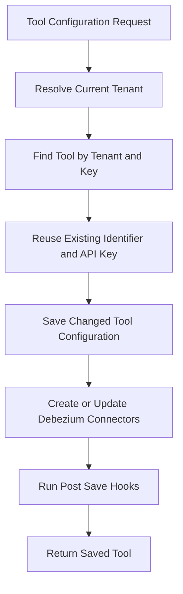

# Operational Controllers

Operational Controllers expose management-only REST actions. They delegate to shared data and integration services rather than embedding persistence logic.

## Endpoints

| Controller | Endpoint | Behavior |
| --- | --- | --- |
| [DevicePinotResyncController](https://github.com/flamingo-stack/openframe-oss-lib/blob/16e7c1cbd9664e7d10ec5ebca7d53c9bd314decf/openframe-management-service-core/src/main/java/com/openframe/management/controller/DevicePinotResyncController.java) | `POST /v1/devices/pinot-resync` | Loads all machine documents, asks `MachineTagEventService` to process them, and returns the count. |
| [IntegratedToolController](https://github.com/flamingo-stack/openframe-oss-lib/blob/16e7c1cbd9664e7d10ec5ebca7d53c9bd314decf/openframe-management-service-core/src/main/java/com/openframe/management/controller/IntegratedToolController.java) | `GET /v1/tools`, `GET /v1/tools/{id}`, `POST /v1/tools/{key}` | Reads and updates tenant-scoped integrated-tool configuration. |
| [ReleaseVersionController](https://github.com/flamingo-stack/openframe-oss-lib/blob/16e7c1cbd9664e7d10ec5ebca7d53c9bd314decf/openframe-management-service-core/src/main/java/com/openframe/management/controller/ReleaseVersionController.java) | `POST /v1/cluster-registrations` | Deprecated compatibility endpoint; returns successfully but intentionally performs no update. |

## Integrated Tool Save Semantics

A tool key is the external address, while the Mongo document identifier is internal and globally unique. When updating an existing tool, the controller reuses the tenant's identifier instead of trusting an identifier sent in the request. If an update omits the API key, it preserves the stored key. Failures in individual post-save hooks are logged and do not roll back the completed save.
