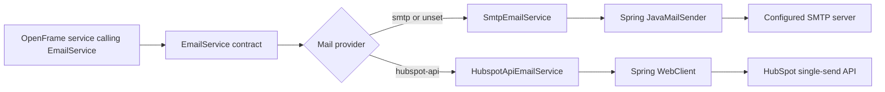
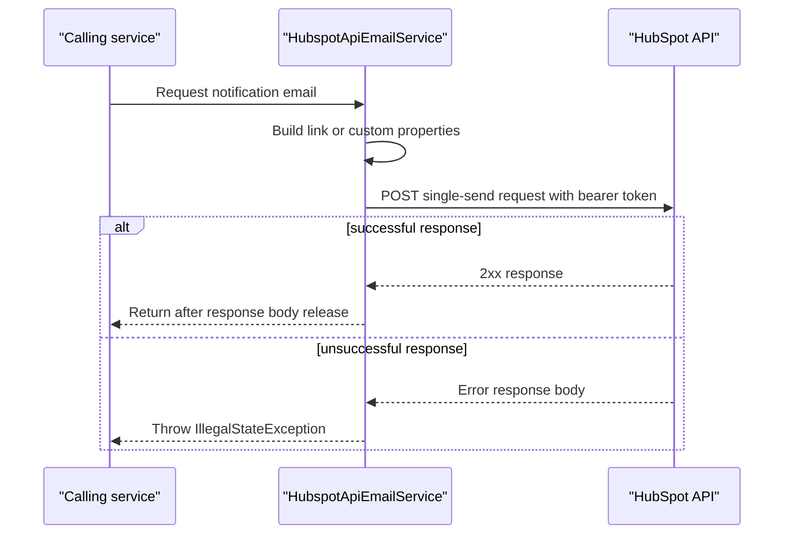
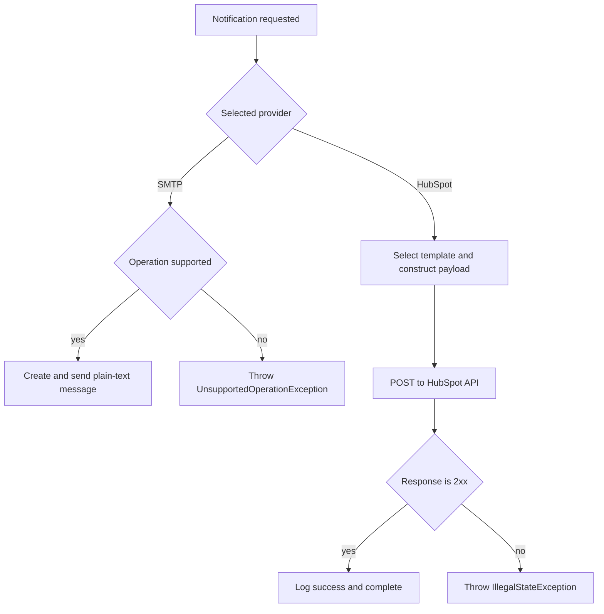

# Openframe Notification Mail

Openframe Notification Mail is the platform library that delivers account-lifecycle email. It supplies two Spring `EmailService` implementations from the OpenFrame OSS Library artifact `com.openframe.oss:openframe-notification-mail` at version `7.0.11`: a default SMTP sender and an optional HubSpot single-send API sender. The tenant repository assembles this library into its services; it does not contain the implementation source.

## Responsibilities

- Send invitation and password-reset messages using links formed from configured templates.
- Deliver ownership-transfer and account-deletion notifications.
- Activate a provider implementation through `openframe.mail.provider`.
- When HubSpot is selected, support email verification, download-link messages, and caller-selected template identifiers with custom properties.
- Log successful sends and surface provider failures to the calling flow.

## Architecture

Both implementations are Spring services, activated conditionally by the same `openframe.mail.provider` setting. `SmtpEmailService` is active for `smtp` and also when the setting is absent. `HubspotApiEmailService` is active only for `hubspot-api`. Values other than these do not activate either implementation based on the provided source.

## Provider Implementations

### SMTP Provider

[`SmtpEmailService`](https://github.com/flamingo-stack/openframe-oss-lib/blob/16e7c1cbd9664e7d10ec5ebca7d53c9bd314decf/openframe-notification-mail/src/main/java/com/openframe/notification/mail/service/SmtpEmailService.java) uses Spring's `JavaMailSender` and `SimpleMailMessage` to issue plain-text mail. It builds invitation links by replacing `{id}` in `openframe.invitations.link-template`, and password-reset links by replacing `{token}` in `openframe.password-reset.link-template`.

Supported SMTP notifications are:

- Invitation
- Password reset
- Ownership transfer
- Account deletion

Email verification and download-link delivery deliberately throw `UnsupportedOperationException` in this provider. Selecting SMTP therefore requires callers not to invoke those two notification paths, or requires switching to HubSpot for them.

### HubSpot API Provider

[`HubspotApiEmailService`](https://github.com/flamingo-stack/openframe-oss-lib/blob/16e7c1cbd9664e7d10ec5ebca7d53c9bd314decf/openframe-notification-mail/src/main/java/com/openframe/notification/mail/service/HubspotApiEmailService.java) initializes a `WebClient` with `openframe.mail.hubspot.base-url` and posts JSON to `/marketing/v4/email/single-send`. Each request carries a bearer access token and a message containing the recipient, configured sender, subject, selected template identifier, and custom properties.

The provider maps each mail use case to its configured HubSpot template identifier. Invitation, password-reset, and verification messages supply a `link` property. Download-link messages supply `download_id`; ownership-transfer and account-deletion messages have no custom properties. The public generic `send` operation allows a caller to select another template identifier and property map.

The request is completed synchronously through `block()`. A non-successful HubSpot response is converted to `IllegalStateException` containing its HTTP status and response body; successful sends are logged at information level. When debug logging is enabled, the HubSpot payload is logged before dispatch, so operational logging policy should account for recipient and message metadata.

## Configuration

### Provider Selection

| Property | Values in source | Behavior |
| --- | --- | --- |
| `openframe.mail.provider` | `smtp` | Activates the SMTP implementation. |
| `openframe.mail.provider` | omitted | Activates the SMTP implementation by default. |
| `openframe.mail.provider` | `hubspot-api` | Activates the HubSpot API implementation. |

### Shared Link Templates

| Property | Placeholder replaced by the provider | Used by |
| --- | --- | --- |
| `openframe.invitations.link-template` | `{id}` | SMTP and HubSpot invitation mail |
| `openframe.password-reset.link-template` | `{token}` | SMTP and HubSpot password-reset mail |
| `openframe.email-verify.link-template` | `{token}` | HubSpot verification mail |

The source provides empty-string defaults for the link-template properties. Configure each template for the flows enabled by the chosen provider; otherwise replacement produces a link from an empty template.

### HubSpot-Specific Properties

| Property | Purpose |
| --- | --- |
| `openframe.mail.from` | Sender address included in the HubSpot message. |
| `openframe.mail.hubspot.access-token` | Bearer token for the HubSpot API request. |
| `openframe.mail.hubspot.base-url` | Base URL used to create the HubSpot `WebClient`. |
| `openframe.mail.hubspot.invitation-email-id` | Template identifier for invitations. |
| `openframe.mail.hubspot.reset-email-id` | Template identifier for password resets. |
| `openframe.mail.hubspot.verify-email-id` | Template identifier for email verification. |
| `openframe.mail.hubspot.owner-transfer-email-id` | Template identifier for ownership transfers. |
| `openframe.mail.hubspot.delete-account-email-id` | Template identifier for account deletion. |
| `openframe.mail.hubspot.download-link-email-id` | Template identifier for download links. |

The HubSpot template identifier properties have empty-string defaults in the code, while the access token and base URL are required property placeholders. Validate the template identifiers before enabling a corresponding flow.

## Delivery Behavior and Operational Considerations

- The SMTP implementation delegates transport configuration and delivery failures to `JavaMailSender`; it does not set a sender address in its `SimpleMailMessage` construction.
- The HubSpot service logs the full payload only at debug level, but that payload includes the recipient, sender, subject, template identifier, and custom properties. Do not enable debug logging broadly without considering that exposure.
- HubSpot calls block until the remote response is available. Callers should treat email dispatch failures as synchronous errors and apply the failure policy appropriate to their initiating workflow.
- Neither implementation supplies a retry or queue in the provided module code. Reliability, retry, and alerting policies belong to the surrounding application integration.

## Module Boundaries

Openframe Notification Mail is an outbound delivery adapter. It does not define HTTP endpoints, persist mail records, or own invitation, password-reset, verification, account, or download-token lifecycle state. Those workflows invoke the `EmailService` contract and provide the recipient plus identifiers or tokens; this module transforms them into provider-specific mail requests.
