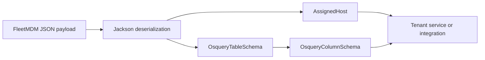
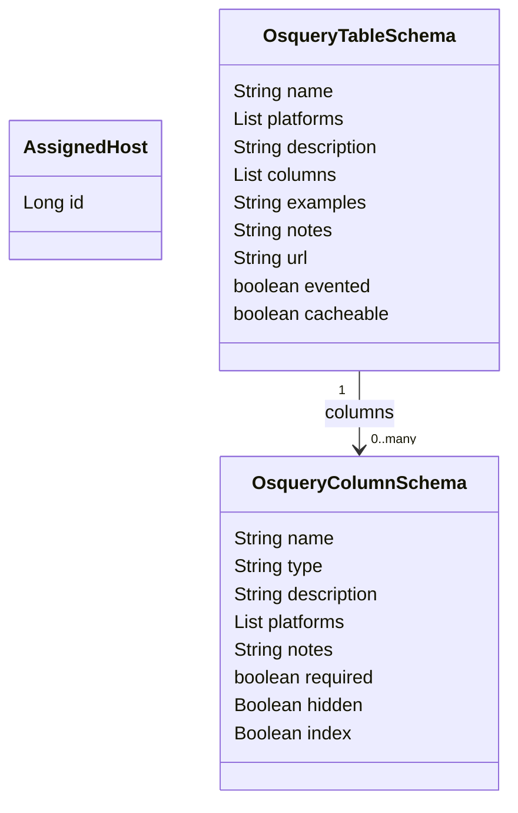
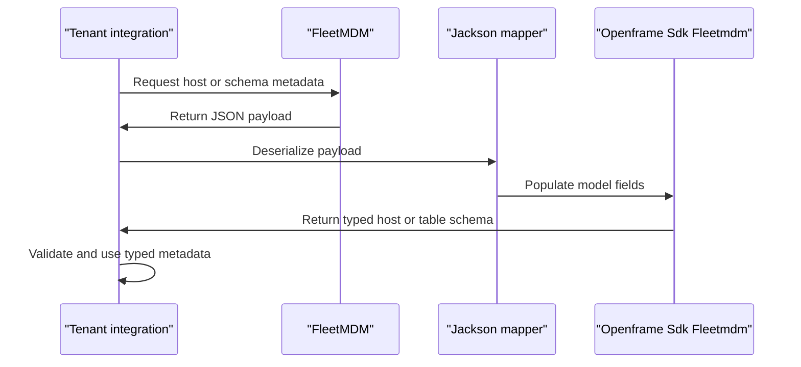

# Openframe Sdk Fleetmdm

Openframe Sdk Fleetmdm is a small Java model package supplied by the `com.openframe.oss:fleetmdm` library. The tenant repository consumes version `7.0.11` of that library. Its responsibility is to deserialize selected FleetMDM JSON responses into stable Java objects: an assigned-host identifier and osquery table and column metadata.

The module deliberately contains transport-neutral data models. It does not define HTTP clients, endpoints, persistence, or FleetMDM request orchestration. Callers supply those concerns, deserialize payloads with Jackson, and use these models as the typed result structure.

## Scope and Responsibilities

| Area | Components | Responsibility |
| --- | --- | --- |
| Host assignment | `AssignedHost` | Represents an assigned host by its numeric FleetMDM identifier. |
| osquery table metadata | `OsqueryTableSchema` | Describes an osquery table, including documentation metadata, supported platforms, flags, and its columns. |
| osquery column metadata | `OsqueryColumnSchema` | Describes a single column's name, type, platform coverage, documentation, and query-relevant flags. |

## Architecture Overview

The model layer is intentionally one-directional. `OsqueryTableSchema` owns a list of `OsqueryColumnSchema` objects, while `AssignedHost` is independent because it represents only the `id` property returned for a host assignment.

## Data Model Relationships

## Component Reference

### Assigned Host

[`AssignedHost`](https://github.com/flamingo-stack/openframe-oss-lib/blob/16e7c1cbd9664e7d10ec5ebca7d53c9bd314decf/sdk/fleetmdm/src/main/java/com/openframe/sdk/fleetmdm/model/AssignedHost.java) is a minimal mutable DTO with an `id` field of type `Long`. Jackson maps the FleetMDM `id` JSON property explicitly with `@JsonProperty("id")`. Lombok generates the accessor and mutator methods.

Use this model where a response only needs to identify the assigned FleetMDM host. Since the identifier is nullable at the Java level, consumers should validate it before performing operations that require a host reference.

### Osquery Table Schema

[`OsqueryTableSchema`](https://github.com/flamingo-stack/openframe-oss-lib/blob/16e7c1cbd9664e7d10ec5ebca7d53c9bd314decf/sdk/fleetmdm/src/main/java/com/openframe/sdk/fleetmdm/model/OsqueryTableSchema.java) maps metadata for an osquery table:

- `name` identifies the table.
- `platforms` lists supported operating-system platforms.
- `description`, `examples`, `notes`, and `url` carry documentation metadata.
- `columns` provides the nested column definitions.
- `evented` and `cacheable` expose boolean table capabilities.

This type is the aggregation boundary for a schema response. Consumers can use platform information and column flags to present valid query options or perform validation before dispatching a query, while retaining the source documentation fields for user-facing help.

### Osquery Column Schema

[`OsqueryColumnSchema`](https://github.com/flamingo-stack/openframe-oss-lib/blob/16e7c1cbd9664e7d10ec5ebca7d53c9bd314decf/sdk/fleetmdm/src/main/java/com/openframe/sdk/fleetmdm/model/OsqueryColumnSchema.java) represents an entry within `OsqueryTableSchema.columns`.

| Property group | Fields | Meaning |
| --- | --- | --- |
| Identity and representation | `name`, `type` | The column name and its declared value type. |
| Documentation | `description`, `notes` | Human-readable usage context supplied with schema metadata. |
| Compatibility | `platforms` | Platforms on which the column applies. |
| Query flags | `required`, `hidden`, `index` | Required is a primitive boolean. Hidden and index are boxed booleans, allowing an absent JSON value to remain distinguishable from `false`. |

## Deserialization Contract

All three DTOs use Jackson `@JsonIgnoreProperties(ignoreUnknown = true)`. This makes the integration forward-compatible with payloads that add fields: known properties are populated and unknown properties are ignored. It also means this module is not a strict payload validator. Callers that require validation must validate required domain conditions after deserialization.

The implementation uses Lombok:

- `AssignedHost` uses `@Getter` and `@Setter`.
- The osquery schema types use `@Data`, which provides accessors, mutators, and standard value-style methods.

## Typical Data Flow

## Integration Boundaries

Openframe Sdk Fleetmdm is provided by the OpenFrame OSS Library rather than implemented in this tenant repository. The tenant assembles the wider platform services and consumes the artifact; this model package provides a typed contract at the FleetMDM boundary. Platform services that need FleetMDM setup or Fleet-facing routing should keep request execution and operational policy outside these DTOs.

## Maintenance Notes

- Preserve `@JsonIgnoreProperties(ignoreUnknown = true)` when evolving these models unless a deliberate strict-deserialization policy is introduced across the integration.
- Prefer additive fields to renaming existing JSON-mapped fields, since downstream deserialization relies on the field names.
- Retain boxed `Boolean` types for `hidden` and `index` when absence has different semantics from an explicit `false`.
- Keep schema documentation fields intact even when a current consumer does not display them; they are part of the metadata contract.
