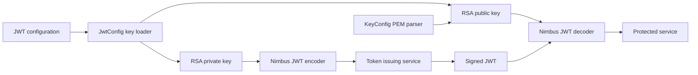
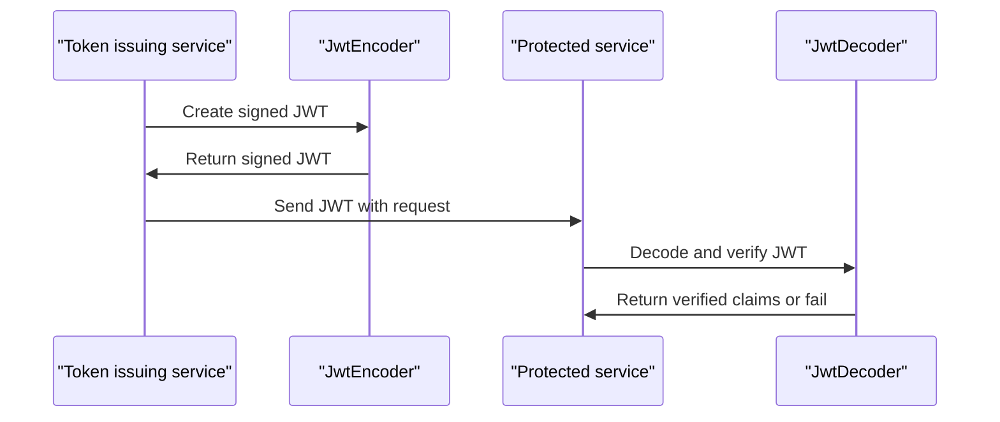
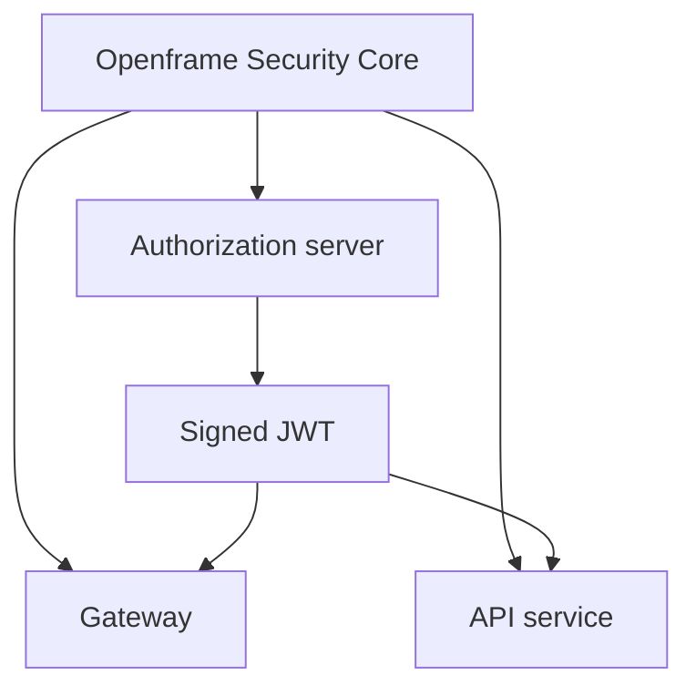

# Openframe Security Core

Openframe Security Core is the shared JWT cryptography foundation used by OpenFrame services. It comes from the `com.openframe.oss:openframe-security-core` library at version `7.0.11`, which this repository consumes. The module contributes Spring beans that encode JWTs with an RSA key pair and decode JWTs using the corresponding public key. It also provides `KeyConfig`, a small configuration value type for converting a PEM-encoded RSA public key into Java's `RSAPublicKey` representation.

The module deliberately does not define HTTP authorization rules, OAuth endpoints, token claims, or tenant policy. Those responsibilities belong to the services that compose this library, including the authorization server, gateway, and application-specific security configuration.

## Architecture Overview

`JwtSecurityConfig` is the Spring configuration entry point. It constructs one in-memory JSON Web Key set containing both RSA key material for the encoder, while the decoder is constructed from the public key only. Consequently, services validating tokens do not need access to private-key material through the decoder path.

## Core Components

### JWT Security Configuration

[`JwtSecurityConfig`](https://github.com/flamingo-stack/openframe-oss-lib/blob/16e7c1cbd9664e7d10ec5ebca7d53c9bd314decf/openframe-security-core/src/main/java/com/openframe/security/config/JwtSecurityConfig.java) is a Spring `@Configuration` class that exposes two beans:

- `JwtEncoder`: asks `JwtConfig` to load an `RSAPublicKey` and `RSAPrivateKey`, builds a Nimbus `RSAKey`, wraps it in an immutable JWK set, and returns a `NimbusJwtEncoder`. This bean is the signing boundary for code that issues JWTs.
- `JwtDecoder`: asks `JwtConfig` for the RSA public key and returns a `NimbusJwtDecoder` bound to that key. This bean verifies JWT signatures without loading the private key for the decoder itself.

Both bean factory methods propagate key-loading failures. A service therefore fails its application-context initialization when the configured key material cannot be read or parsed, rather than starting with an unusable encoder or decoder.

### PEM Public-Key Configuration

[`KeyConfig`](https://github.com/flamingo-stack/openframe-oss-lib/blob/16e7c1cbd9664e7d10ec5ebca7d53c9bd314decf/openframe-security-core/src/main/java/com/openframe/security/jwt/KeyConfig.java) holds a configurable string value and converts it into an `RSAPublicKey`.

Its `toRSAPublicKey` operation:

1. Removes the standard PEM public-key header and footer.
2. Removes whitespace, allowing formatted multi-line PEM input.
3. Base64-decodes the remaining payload.
4. Creates an RSA `KeyFactory` and an `X509EncodedKeySpec`.
5. Generates and returns the Java RSA public key.

The operation accepts the X.509-encoded public-key form represented by the PEM markers it removes. Invalid Base64 content, non-RSA material, or malformed X.509 key data results in an exception for the caller to handle.

## Token Processing Flow

At application startup, the configuration first materializes the signing encoder from public and private keys, and independently creates the verification decoder from the public key. At runtime, an issuer uses the encoder to sign tokens. A protected service passes an incoming token to the decoder, which uses the configured public key to verify its signature before the service uses the decoded result.

## Integration in OpenFrame

Openframe Security Core is an infrastructure library rather than a standalone service. This repository publishes the `openframe-authorization-server`, `openframe-gateway`, and `openframe-api` Maven artifacts, each of which can compose shared security infrastructure alongside its own application-level configuration.

The module sits beneath the authorization and gateway layers:

Openframe Security Core supplies only the encoder and decoder construction. The surrounding service selects when tokens are issued, how authentication is established, which claims are present, and how verified identities are authorized.

## Operational Considerations

- Keep the private key available only to deployments that must issue tokens. Although the decoder uses only the public key, the encoder bean requires both keys.
- Ensure every token issuer and validator that must interoperate uses the matching RSA key pair.
- Treat PEM configuration as sensitive operational input. `KeyConfig` makes parsing tolerant of whitespace, but it does not validate the key until conversion is requested.
- Plan key rotation at the service-configuration level. This module creates a fixed, immutable JWK set during application startup and does not expose key-discovery or rotation orchestration.

## Documentation Layout

Openframe Security Core has two focused implementation files and no separately generated child documentation pages. This page documents both configuration and public-key parsing together.

## Source and Scope

The implementation is supplied by the OpenFrame OSS Library artifact, not defined directly in this repository. The documented source files are [`JwtSecurityConfig.java`](https://github.com/flamingo-stack/openframe-oss-lib/blob/16e7c1cbd9664e7d10ec5ebca7d53c9bd314decf/openframe-security-core/src/main/java/com/openframe/security/config/JwtSecurityConfig.java) and [`KeyConfig.java`](https://github.com/flamingo-stack/openframe-oss-lib/blob/16e7c1cbd9664e7d10ec5ebca7d53c9bd314decf/openframe-security-core/src/main/java/com/openframe/security/jwt/KeyConfig.java).