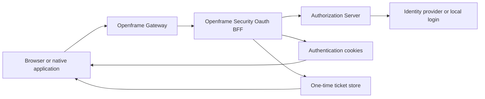
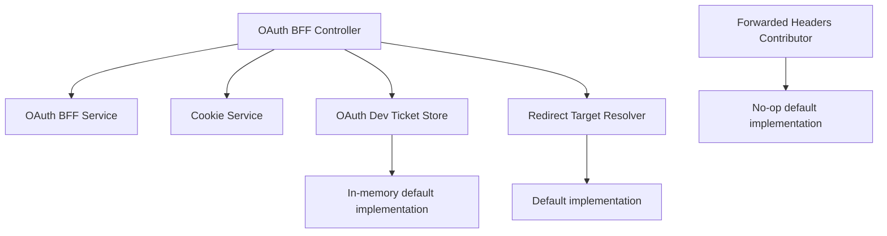
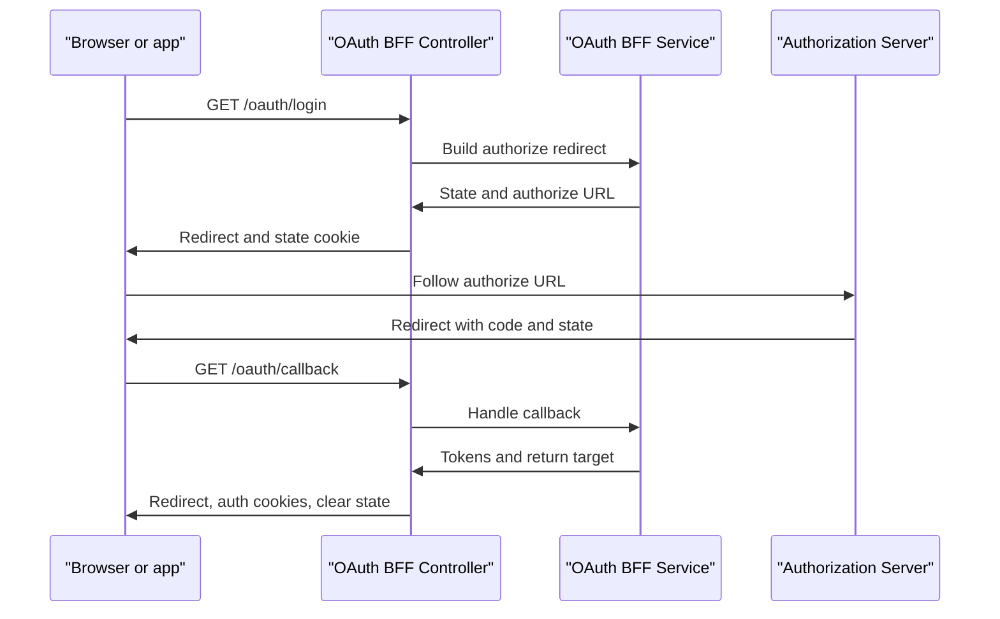

# Openframe Security Oauth

Openframe Security Oauth is the gateway-facing OAuth backend-for-frontend layer supplied by the `com.openframe.oss:openframe-security-oauth` library, version `7.0.11`. In this repository it runs with the Openframe gateway service. It turns browser and mobile authentication interactions into redirects, cookies, or tightly scoped token handoffs while delegating authorization-server communication to `OAuthBffService`.

The module is deliberately small: its controller owns HTTP behavior and cookie lifecycle, a redirect resolver supplies a default return target, a ticket store supports one-time token handoff, and a default forwarded-header contributor allows deployments to add proxy-aware behavior without changing the module.

## Responsibilities

- Start and resume OAuth authorization-code flows with state and PKCE data prepared by the BFF service.
- Process authorization callbacks, establish access and refresh token cookies, and redirect the user back to the application.
- Refresh or revoke sessions without accidentally clearing a newer session during a concurrent refresh-token rotation.
- Support mobile-oriented sign-in, Apple native exchange and registration, signup continuation, and join-cancel return flows when mobile authentication is enabled.
- Enforce allow-list checks for the two controller-owned native redirect hops.
- Exchange opaque, single-use development or mobile tickets for token headers.

## Runtime Placement

The Openframe gateway routes `/sas/**` to the authorization server and exposes the OAuth BFF endpoints at `/oauth/**`. The authorization server implements the identity-provider, SSO, registration, and token-minting concerns; Openframe Security Oauth is the gateway adapter that presents those results safely to browsers and native shells.

The gateway itself is assembled by this repository, while the BFF implementation in this document comes from the OpenFrame OSS Library. Its source files are linked in the component sections below.

## Component Architecture

`OAuthBffService`, `CookieService`, `OAuthDevTicketStore`, `RedirectTargetResolver`, and `ForwardedHeadersContributor` are collaboration contracts. Only the default ticket store, redirect resolver, and forwarded-header contributor are implemented in the supplied component set. Spring conditional registration permits a deployment to provide a different bean for each contract.

## Request Flows

### Browser authorization and callback

1. A client calls `GET /oauth/login` with a tenant identifier and optional return target, provider, and mobile-authentication flag.
2. The controller clears existing authorization-server cookies and stale OAuth state cookies. It asks `OAuthBffService` to build an authorization redirect, serializes returned state data into a state JWT, and writes a short-lived state cookie. The default state-cookie lifetime is 180 seconds.
3. The client follows the redirect to the authorization server and completes authentication.
4. The authorization server redirects to `GET /oauth/callback` with an authorization code and state value.
5. The BFF service handles the callback. On success, the controller sets access and refresh cookies, clears the matching state cookie, optionally attaches a one-time development ticket to the return target, and issues a redirect.
6. On failure, the controller clears the supplied state cookie and redirects to the configured authentication-error URL with an `AuthErrorCode` reference. Unclassified failures use `SSO_LOGIN_FAILED`.

`GET /oauth/continue` follows the same redirect initialization process but does not clear existing authorization-server or authentication cookies. It is intended for a continuation after SSO finalization when an authenticated principal may already exist.

### Session refresh and logout

`POST /oauth/refresh` reads the refresh token from the refresh-token cookie when available; otherwise it reads the module's refresh-token header. If a `tenantId` is supplied, refresh is performed for that tenant. Otherwise the BFF service resolves the tenant from the token.

A missing token produces `401` and clears authentication cookies. In contrast, an invalid or unknown supplied token produces `401` **without clearing cookies**. This distinction protects a valid, newly rotated browser refresh token from a late concurrent refresh request using an older token. Upstream refresh failures preserve the session and return the upstream HTTP status; unexpected failures return `502`.

`GET /oauth/logout` clears authentication cookies and requests refresh-token revocation through the BFF service. As with refresh, tenant selection can be explicit or derived by lookup.

### Native Apple and mobile handoffs

When `openframe.gateway.oauth.mobile-auth-enabled` is true, the controller exposes native Apple exchange and registration endpoints:

- `POST /oauth/apple/native-exchange` validates the presence of identity and authorization-code inputs. It can discover a tenant from the verified identity token when no tenant identifier is supplied, then exchanges credentials for OpenFrame tokens. A registration-required result is represented as `409` with `registration_required`.
- `POST /oauth/apple/native-register` creates a tenant from a verified Apple identity and organization details, then performs the normal exchange using the same authorization code.
- `POST /oauth/login/sso/complete` completes a mobile signup ticket and returns a one-time development ticket instead of placing tokens in a WebView response.
- `GET /oauth/signup-continue` and `GET /oauth/join-return` are redirect-policy enforcement points. They append the handoff ticket or optional error only if the requested native URI passes the redirect allow-list; otherwise they use the configured web fallback pages.

The controller also supports `GET /oauth/dev-exchange`. It consumes a one-time ticket and returns tokens in the access-token and refresh-token response headers. This endpoint is enabled if either development-ticket support or mobile authentication is enabled.

## Core Components

### OAuth BFF Controller

[OAuth BFF Controller source](https://github.com/flamingo-stack/openframe-oss-lib/blob/16e7c1cbd9664e7d10ec5ebca7d53c9bd314decf/openframe-security-oauth/src/main/java/com/openframe/security/oauth/controller/OAuthBffController.java)

`OAuthBffController` is a reactive Spring controller, conditionally activated only when `openframe.gateway.oauth.enable=true`. It owns the `/oauth` HTTP surface:

| Endpoint | Purpose | Successful response |
|---|---|---|
| `GET /oauth/login` | Starts a new browser or mobile authorization flow. | `302` to the authorization URL with state cookie. |
| `GET /oauth/continue` | Starts an authorization continuation without clearing the existing session. | `302` to the authorization URL with state cookie. |
| `GET /oauth/callback` | Completes code and state processing. | `302` to the return target with auth cookies. |
| `POST /oauth/refresh` | Exchanges a refresh token for refreshed tokens. | `204` with refreshed cookies and, when enabled, token headers. |
| `GET /oauth/logout` | Clears local authentication and attempts refresh-token revocation. | `204` with cleared cookies. |
| `POST /oauth/apple/native-exchange` | Exchanges native Apple credentials for OpenFrame tokens. | `204` with cookies and token headers. |
| `POST /oauth/apple/native-register` | Registers and exchanges a native Apple identity. | `204` with cookies and token headers. |
| `GET /oauth/signup-continue` | Allows or rejects a native signup redirect target. | `302` to native target or configured web continuation page. |
| `GET /oauth/join-return` | Allows or rejects the mobile consent-page return target. | `302` to native target or configured login page. |
| `POST /oauth/login/sso/complete` | Completes a mobile signup ticket. | `200` with a one-time development ticket. |
| `GET /oauth/dev-exchange` | Exchanges a one-time ticket for token headers. | `204` with token headers. |

The controller defaults an absent callback return target to `/`; that fallback is not an allow-list decision. Redirect allow-list validation in the provided code is specifically applied to the signup-continuation and join-return hops through `RedirectTargetResolver.isAllowedRedirectUri`.

### In-memory OAuth Development Ticket Store

[In-memory OAuth Development Ticket Store source](https://github.com/flamingo-stack/openframe-oss-lib/blob/16e7c1cbd9664e7d10ec5ebca7d53c9bd314decf/openframe-security-oauth/src/main/java/com/openframe/security/oauth/service/InMemoryOAuthDevTicketStore.java)

`InMemoryOAuthDevTicketStore` is the default `OAuthDevTicketStore` bean when no replacement is registered. It generates a random UUID for each ticket, stores its `TokenResponse` in a concurrent map, and removes the entry during `consumeTicket`. Removal makes a successfully consumed ticket single-use.

The store is process-local and has no expiry or persistence in this implementation. In a replicated gateway deployment, a ticket issued by one instance cannot be consumed by another. Operators that need multi-instance handoff durability, expiration, or centralized revocation should supply a replacement `OAuthDevTicketStore` implementation.

### Default Redirect Target Resolver

[Default Redirect Target Resolver source](https://github.com/flamingo-stack/openframe-oss-lib/blob/16e7c1cbd9664e7d10ec5ebca7d53c9bd314decf/openframe-security-oauth/src/main/java/com/openframe/security/oauth/service/redirect/DefaultRedirectTargetResolver.java)

`DefaultRedirectTargetResolver` supplies a return target in this precedence order:

1. The explicitly requested return target.
2. The request `Referer` header.
3. The root path `/`.

It does not interpret the tenant or user identifiers passed to its `resolve` method and it does not validate the chosen target. Deployments that need tenant-aware routing or validation at resolution time can provide another `RedirectTargetResolver`. The controller's native handoff routes use the contract's allow-list operation to protect their redirects.

### No-op Forwarded Headers Contributor

[No-op Forwarded Headers Contributor source](https://github.com/flamingo-stack/openframe-oss-lib/blob/16e7c1cbd9664e7d10ec5ebca7d53c9bd314decf/openframe-security-oauth/src/main/java/com/openframe/security/oauth/headers/NoopForwardedHeadersContributor.java)

`NoopForwardedHeadersContributor` is the primary fallback implementation of `ForwardedHeadersContributor`. Its `contribute` operation intentionally makes no changes to outbound headers. It is active only if no other contributor bean is supplied, allowing environments behind a reverse proxy to install a contributor that forwards the required request metadata.

## Configuration and Operational Notes

| Property | Default in supplied code | Effect |
|---|---:|---|
| `openframe.gateway.oauth.enable` | No default in controller annotation | Enables the controller only when set to `true`. |
| `openframe.gateway.oauth.state-cookie-ttl-seconds` | `180` | Lifetime for the OAuth state cookie. |
| `openframe.gateway.oauth.dev-ticket-enabled` | `true` | Enables development-ticket creation in callback and refresh scenarios. |
| `openframe.gateway.oauth.mobile-auth-enabled` | `true` | Enables mobile and native Apple routes and mobile behavior. |
| `openframe.auth.error-url` | Required | Redirect destination for callback errors. |
| `openframe.gateway.oauth.signup-continue-page` | `/auth/sso-continue` | Fallback when a signup continuation target is not allow-listed. |
| `openframe.gateway.oauth.join-cancel-page` | `/auth/login` | Fallback when a join-return target is not allow-listed. |

Maintain the redirect allow-list used by the `RedirectTargetResolver` carefully: it determines whether native handoff endpoints can append sensitive, opaque tickets or errors to a requested URI. Also ensure the gateway runs a shared ticket-store implementation when traffic can be load-balanced across instances.

## System Integration

Openframe Security Oauth is consumed by the gateway service in this repository. It complements the authorization-server library, which supplies authorization-server configuration, tenant filtering, login and SSO controllers, key generation, registered-client persistence, and token grant support. The gateway's route configuration forwards authorization-server traffic under `/sas/**`, while this module provides the browser and mobile BFF surface under `/oauth/**`.

The gateway security module provides JWT authentication and gateway filters. Openframe Security Oauth adds OAuth session orchestration rather than replacing gateway authorization policy. Token issuance, validation, and upstream identity interactions remain delegated to the authorization-server and BFF service contracts.
