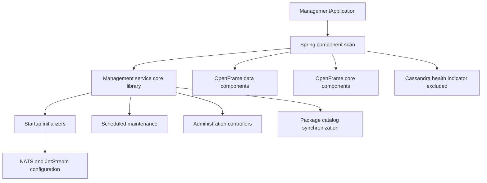
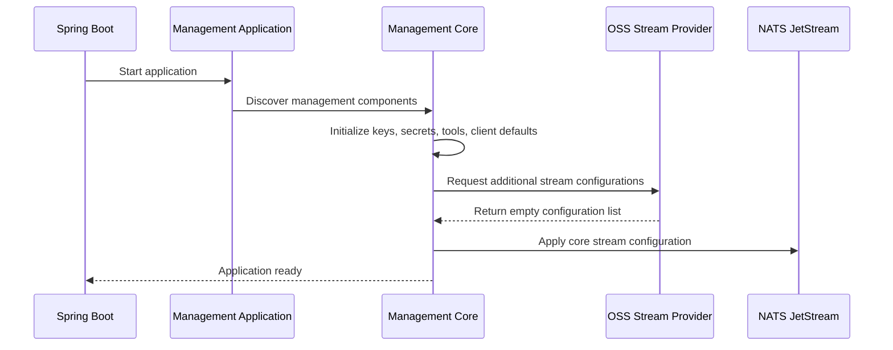
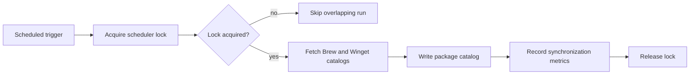
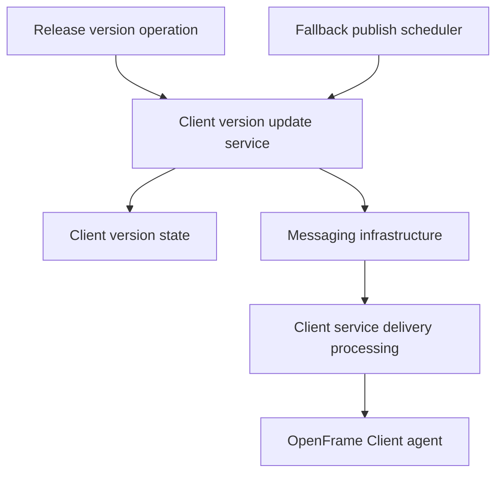
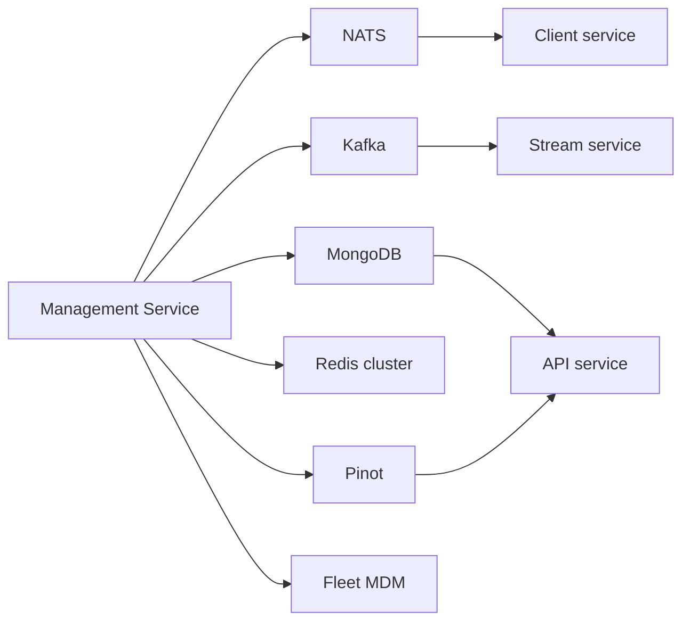

# Management Service

Management Service is the operational control-plane service packaged as `com.openframe:openframe-management`. It is the OpenFrame tenant deployment's background-management process: it initializes baseline platform state, maintains messaging infrastructure, performs scheduled reconciliation and housekeeping, manages package-catalog synchronization, and exposes a small set of administration endpoints.

The tenant repository contributes the Spring Boot launcher and an OSS-specific extension. Most runtime behavior is supplied by the `com.openframe.oss:openframe-management-service-core` library at version `7.0.11`. The deployed image is `ghcr.io/flamingo-stack/openframe-oss-tenant/openframe-management`.

For the sibling application inventory, see [OpenFrame Services](openframe-services.md).

## Responsibilities

Management Service owns the following operational responsibilities:

- **Application assembly.** `ManagementApplication` bootstraps Spring Boot and scans the management, data, and core packages.
- **Baseline initialization.** Core initializers provision agent log keys, registration secrets, integrated tool agents, client configuration, feature flags, client-version state, and NATS stream configuration.
- **Platform maintenance.** Schedulers detect devices that have missed heartbeats, set up Fleet MDM integration, synchronize API-key statistics, and provide a fallback for client-version update publication.
- **Package catalog maintenance.** Scheduled catalog synchronization fetches Winget and Brew data, writes it through the catalog writer, publishes synchronization metrics, and uses a lock configuration to prevent competing runs.
- **Administrative operations.** Library controllers cover integrated-tool administration, release-version operations, and device Pinot resynchronization.
- **OSS stream policy.** The tenant-specific `NoAdditionalStreamConfigurationProvider` returns no streams. Consequently, only the streams created by the core `NatsStreamConfigurationInitializer` are requested; AI-chat-specific streams are intentionally absent in this distribution.

## Runtime Composition

`ManagementApplication` is intentionally small. It starts the Spring context and declares the package boundaries for component discovery. It scans `com.openframe.management`, `com.openframe.data`, and `com.openframe.core`, while explicitly excluding `CassandraHealthIndicator`. The exclusion means Management Service does not register that Cassandra health contributor through component scanning.

The service consumes the OpenFrame OSS Library management-core artifact as its implementation layer. Its deployment configuration connects Management Service to Kafka and NATS, while shared configuration supplies MongoDB, Redis, Cassandra, and Pinot connection settings. The service's specific configuration declares Kafka at `kafka.datasources.svc.cluster.local` and NATS at `nats.datasources.svc.cluster.local`.

## Startup and Initialization

The management-core initializers establish required state at startup:

| Initializer or provider | Responsibility |
|---|---|
| `AgentLogKeyInitializer` | Initializes agent log-key material. |
| `AgentRegistrationSecretInitializer` | Initializes agent-registration secret state. |
| `IntegratedToolAgentInitializer` | Initializes integrated tool-agent definitions. |
| `OpenFrameClientConfigurationInitializer` | Initializes OpenFrame Client configuration. |
| `OpenFrameClientFeatureFlagsInitializer` | Initializes client feature flags. |
| `OpenFrameClientVersionInitializer` | Initializes client-version state. |
| `NatsStreamConfigurationInitializer` | Configures the core NATS or JetStream streams. |
| `AdditionalStreamConfigurationProvider` | Extension point for distribution-specific stream definitions. |
| `NoAdditionalStreamConfigurationProvider` | OSS implementation that supplies an empty stream list. |

The empty provider is a deliberate product boundary, not an initialization failure. If a future tenant distribution needs additional streams, it should introduce them through the `AdditionalStreamConfigurationProvider` contract rather than changing the core initializer.

## Scheduled Operations

Management Service performs asynchronous maintenance rather than serving the main interactive application traffic. `ShedLockConfig` and `PackageCatalogSyncLockConfig` support serialized scheduled execution where concurrent replicas could otherwise duplicate work.

| Component | Operational role |
|---|---|
| `DeviceHeartbeatOfflineDetectionScheduler` | Detects devices that have stopped reporting heartbeats. |
| `FleetMdmSetupScheduler` | Performs Fleet MDM setup work. |
| `ApiKeyStatsSyncScheduler` | Synchronizes API-key statistics. |
| `AgentVersionUpdatePublishFallbackScheduler` | Provides fallback publication of agent-version updates. |
| `PackageCatalogSyncScheduler` | Orchestrates periodic package catalog synchronization under a lock. |
| `BrewCatalogFetcher` and `WingetCatalogFetcher` | Fetch catalog data from their package ecosystems. |
| `PackageCatalogWriter` | Persists synchronized catalog records. |
| `PackageCatalogSyncMetrics` | Captures catalog synchronization measurements. |

Package synchronization behavior is controlled by `PackageCatalogSyncProperties`. Maintain that configuration together with the scheduler, fetchers, writer, metrics, and lock configuration because those components form one execution path.

## Administration Surface

The management-core library supplies three controller classes:

| Controller | Purpose |
|---|---|
| `IntegratedToolController` | Administrative operations for integrated tools. |
| `ReleaseVersionController` | Release-version operations. |
| `DevicePinotResyncController` | Requests device data resynchronization to Pinot. |

This module does not define the endpoint mappings locally; route, authorization, and request-shape details must be verified in the management-core library and deployed configuration before clients rely on them.

## Client Version Update Flow

Client version initialization, fallback publication, and the `OpenFrameClientVersionUpdateService` connect release metadata to downstream client-update delivery. The Management Service establishes and publishes version state; client-facing services and agents process the resulting updates.

## System Position

Management Service is one of the deployable services in the tenant chart. It is not routed as one of the gateway paths listed for interactive traffic. Instead, it operates alongside the API, client, stream, configuration, gateway, authorization, and external API services as the platform maintenance and initialization process.

The diagram identifies configured or functional relationships, not direct ownership of every datastore. Shared platform configuration supplies the datastore connection definitions; the management-core library determines which components use each facility at runtime.

## Extension and Maintenance Guidance

- Add tenant-specific startup behavior as Spring components within the scanned management package.
- Use the additional stream configuration provider only for streams required by this distribution. The current provider must remain empty while the OSS product intentionally excludes AI chat.
- Preserve the `CassandraHealthIndicator` exclusion unless health behavior is intentionally redesigned and validated for this service.
- Treat scheduled jobs as multi-replica operations. Any new periodic task should have an explicit overlap and locking strategy.
- Keep package catalog changes aligned across fetchers, writer, metrics, lock configuration, and scheduler properties.
- Validate controller routes and authorization from the deployed management-core version rather than inferring them from controller class names.

## Source Ownership

| Source | Contribution |
|---|---|
| This repository | `ManagementApplication` launcher and `NoAdditionalStreamConfigurationProvider` OSS specialization. |
| OpenFrame OSS Library | Management configuration, controllers, initialization, package catalog synchronization, schedulers, and management services through `com.openframe.oss:openframe-management-service-core` version `7.0.11`. |
| Tenant deployment configuration | Service image delivery plus Kafka, NATS, and shared datastore settings. |
