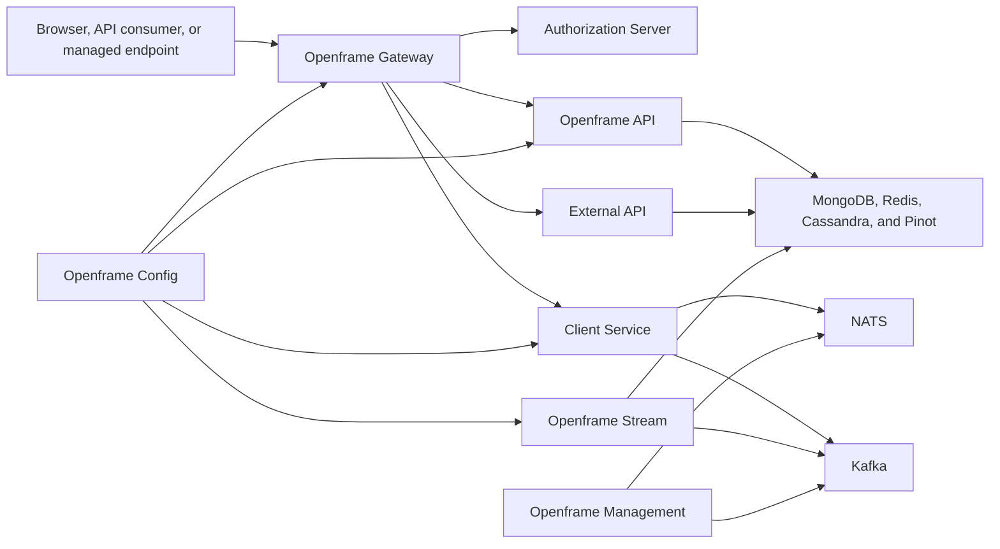
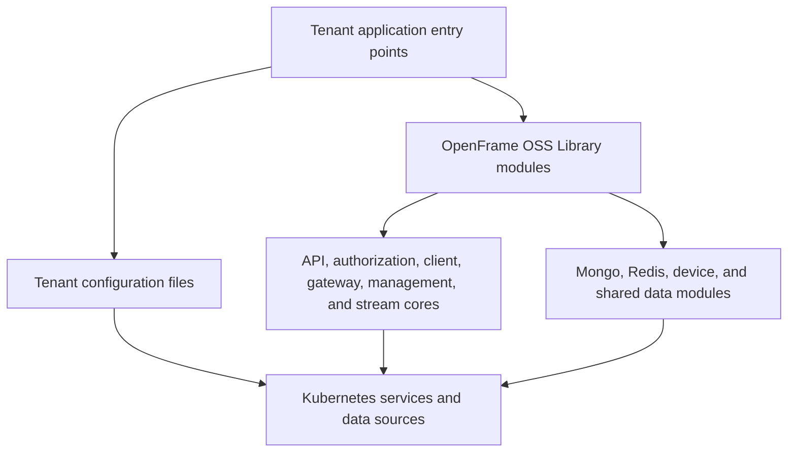
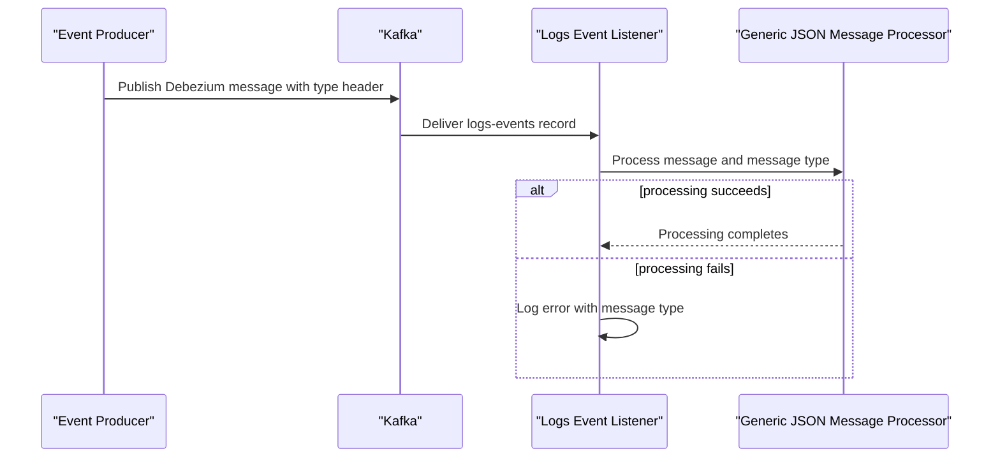

# Openframe Services

Openframe Services is the deployable Spring Boot layer of the OpenFrame OSS Tenant distribution. It assembles service implementations supplied by the OpenFrame OSS Library with tenant-specific application entry points, component scanning, messaging activation, and distribution defaults.

The repository publishes the service artifacts at version `1.0.0-SNAPSHOT`. The applications consume OpenFrame OSS Library Maven modules pinned to `7.0.11`; the Rust endpoint client library is consumed separately by the platform and is not launched by these Spring Boot applications.

## Runtime Architecture

The gateway configuration routes `/sas/**` to the authorization server, `/api-docs/**` to the external API, `/api/**` to the API service, `/clients/**` to the client service, and all remaining paths to the frontend. The tenant deployment also includes MongoDB, Redis, Cassandra, Pinot, Kafka, NATS, Fleet MDM, and MeshCentral.

## Service Inventory

| Service | Tenant entry point | Runtime role |
| --- | --- | --- |
| Openframe API | `ApiApplication` | Main API application. Scans API, data, core, notification, and Kafka components. |
| Authorization Server | `OpenFrameAuthorizationServerApplication` | OAuth and tenant-aware authentication application with discovery enabled. |
| Client Service | `ClientApplication` | Receives and coordinates managed-client registration, telemetry, command delivery, remote management, and client update flows. |
| Config Server | `ConfigServerApplication` | Starts the configuration service used by the deployment. |
| External API | `ExternalApiApplication` | Provides integration-oriented REST APIs and scans external, data, core, API, and Kafka components. |
| Gateway | `GatewayApplication` | Edge routing and security boundary for browser, API, and WebSocket traffic. |
| Management | `ManagementApplication` | Initializes and maintains platform state, releases, integrated tools, stream configuration, and scheduled operations. |
| Stream | `StreamApplication` | Kafka-enabled event processing service for logs, RMM outcomes, software projection, enrichment, and storage workflows. |

## Assembly Boundaries

The entry points in this repository are intentionally thin. Their primary responsibility is to establish each deployable application's Spring Boot context and select the packages contributed by the OpenFrame OSS Library. Business endpoints, authentication flows, persistence repositories, Kafka stream processors, and client-delivery behavior reside in the corresponding library modules.

## Startup and Configuration

Each application is launched through `SpringApplication.run`. Package scans differ deliberately:

- The API and External API applications include API-domain and Kafka packages, together with shared data and core components.
- The authorization server includes authorization, shared data, core, and notification components and enables service discovery.
- The Client and Management applications exclude the Cassandra health indicator while scanning their operational packages.
- The Stream application enables Kafka and scans the stream, data, and Kafka-producer packages.
- The gateway scans gateway, core, data, and security packages.

Service configuration is distributed through the configuration service and deployment manifests. Shared configuration declares MongoDB, Redis, Cassandra, and Pinot targets. API, Client, External API, Management, and Stream additionally use Kafka or NATS according to their service-specific settings.

## Event Processing

The Stream service contains the tenant-specific `LogsEventListener`. It is enabled only when the inbound logs-events topic name is configured. The listener consumes `CommonDebeziumMessage` records from that topic under the `openframe-oss-logs-events-group` consumer group, reads the message type from the Kafka header, and delegates processing to `GenericJsonMessageProcessor`. Processing errors are logged rather than escaping the listener method.

## Distribution-Specific Behavior

Management contributes `NoAdditionalStreamConfigurationProvider`, an implementation of the library's additional-stream configuration extension. It returns an empty list, so this distribution does not add JetStream streams beyond those initialized by the standard NATS stream initializer. The source comment attributes this to the absence of AI chat functionality in this distribution.

## Detailed Service Documentation

- [Management Service](management_service.md) documents the management bootstrap application and its distribution-specific JetStream extension.
- [Stream Service](stream_service.md) documents Kafka activation and the conditional logs-events consumer.

## Source Entry Points

- [Openframe API application](https://github.com/flamingo-stack/openframe-oss-tenant/blob/main/openframe/services/openframe-api/src/main/java/com/openframe/api/ApiApplication.java)
- [Authorization server application](https://github.com/flamingo-stack/openframe-oss-tenant/blob/main/openframe/services/openframe-authorization-server/src/main/java/com/openframe/authz/OpenFrameAuthorizationServerApplication.java)
- [Client application](https://github.com/flamingo-stack/openframe-oss-tenant/blob/main/openframe/services/openframe-client/src/main/java/com/openframe/client/ClientApplication.java)
- [Config server application](https://github.com/flamingo-stack/openframe-oss-tenant/blob/main/openframe/services/openframe-config/src/main/java/com/openframe/config/ConfigServerApplication.java)
- [External API application](https://github.com/flamingo-stack/openframe-oss-tenant/blob/main/openframe/services/openframe-external-api/src/main/java/com/openframe/external/ExternalApiApplication.java)
- [Gateway application](https://github.com/flamingo-stack/openframe-oss-tenant/blob/main/openframe/services/openframe-gateway/src/main/java/com/openframe/gateway/GatewayApplication.java)
- [Management application](https://github.com/flamingo-stack/openframe-oss-tenant/blob/main/openframe/services/openframe-management/src/main/java/com/openframe/management/ManagementApplication.java)
- [No Additional Stream Configuration Provider](https://github.com/flamingo-stack/openframe-oss-tenant/blob/main/openframe/services/openframe-management/src/main/java/com/openframe/management/initializer/NoAdditionalStreamConfigurationProvider.java)
- [Stream application](https://github.com/flamingo-stack/openframe-oss-tenant/blob/main/openframe/services/openframe-stream/src/main/java/com/openframe/stream/StreamApplication.java)
- [Logs Event Listener](https://github.com/flamingo-stack/openframe-oss-tenant/blob/main/openframe/services/openframe-stream/src/main/java/com/openframe/stream/listener/LogsEventListener.java)
