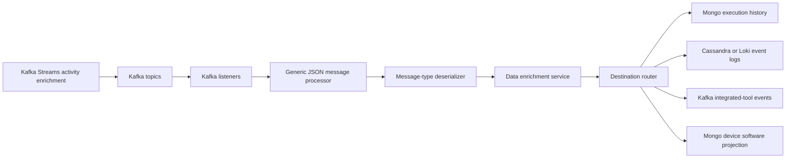
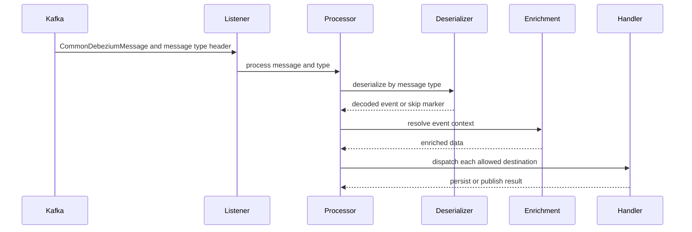
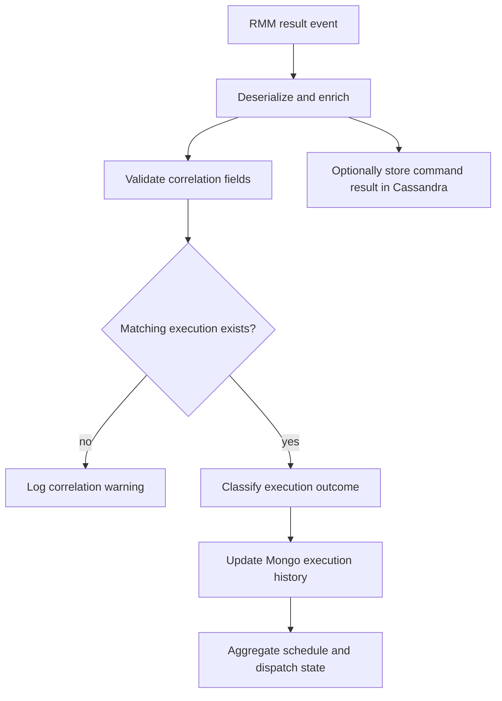

# Stream Service

Stream Service is the event-processing workload of OpenFrame OSS Tenant. It starts a Spring Boot application with Kafka support, consumes Debezium-shaped records from configured Kafka topics, deserializes and enriches those records, and routes them to storage, projection, and remote-management handlers. The deployable service is assembled in this repository from `openframe-stream-service-core` version `7.0.11` from OpenFrame OSS Library.

The service itself provides a small bootstrap layer and a dedicated listener for the `logs-events` topic. Most event-routing, deserialization, enrichment, Kafka Streams, and persistence behavior comes from the library artifact.

## Responsibilities

- Start the Stream Service application and scan stream, data, and Kafka-producer components.
- Consume integrated-tool and log events delivered as `CommonDebeziumMessage` records with a `message-type` Kafka header.
- Convert the header into an OpenFrame `MessageType`; unknown header values are logged and resolve to no type.
- Select a type-specific deserializer, enrich the decoded event, and dispatch it only to the destinations declared by that message type.
- Preserve tenant boundaries by dropping Debezium records for which a tenant cannot be resolved before event-log or Kafka/Pinot publication.
- Update remote-management execution history and software projections from result and Fleet CDC events.
- Optionally run a Kafka Streams topology that enriches Fleet activities with host information.

## Runtime Architecture

`StreamApplication` is the service entry point. Its `@EnableKafka` annotation enables Kafka listener support, while the component scan includes `com.openframe.stream`, `com.openframe.data`, and `com.openframe.kafka.producer`. Consequently, the service discovers both the tenant-owned listener and handlers contributed by the shared library.

### Kafka Ingress

The library supplies `JsonKafkaListener`, enabled in tenant mode by default. It consumes the configured MeshCentral, Fleet MDM, Fleet query-result, and Fleet policy-membership inbound topics. The local `LogsEventListener` adds a separate consumer for the configured `logs-events` topic. It uses the fixed consumer group `openframe-oss-logs-events-group` and the `ossTenantKafkaListenerContainerFactory`.

Both listener paths receive a `CommonDebeziumMessage` plus the `message-type` header and pass them to `GenericJsonMessageProcessor`. The local log listener catches and logs processing failures so that a failed record is visible with its declared message type.

### Dispatch Pipeline

`GenericJsonMessageProcessor` builds three registries at startup:

| Registry | Selection key | Role |
|---|---|---|
| Deserializers | `MessageType` | Decode a common Debezium envelope into a typed event representation. |
| Enrichment services | Data-enrichment service type declared by the message type | Resolve contextual machine, organization, tenant, and execution information. |
| Handlers | Event-handler type and destination | Persist, project, or republish the decoded event. |

The processor ignores a null deserialization result and any event marked to skip processing. Otherwise, it records the declared message type on the decoded event, obtains enrichment data, then iterates over the destinations declared by that type. A destination is skipped when the event explicitly excludes it or no matching handler is registered. This design keeps message classification, enrichment, and delivery independent while allowing one incoming record to serve several outputs.

## Event Decoding and Enrichment

The shared library includes deserializers for integrated-tool, RMM, script-result, command-result, Fleet, MeshCentral, remote-session, Google Workspace, and Microsoft 365 audit events. For example, `FleetEventDeserializer` reads a Fleet activity record, derives its tenant from the stamped Fleet team identifier, uses the activity type as the source event type, and falls back to event details where a human-readable activity mapping is unavailable.

`RmmEnrichmentService` enriches remote-management results in three stages:

1. It resolves the agent machine through the machine cache and adds machine identity, hostname, nickname, and organization context.
2. It correlates the record with script or command execution records, providing the initiator, execution source, and script-creation source where available.
3. It resolves the tenant from the cluster tenant resolver when present, or uses the current tenant provider otherwise.

Test-run results are deliberately excluded from Cassandra logs, Loki logs, and Kafka/Pinot publication. They can still be processed by applicable execution-history handlers.

## Tenant Safety and Event Storage

`TenantIdRequiredDebeziumEventValidator` is the primary Debezium validation policy. It rejects an event with no resolved tenant identifier, preventing ambiguous data from crossing tenant boundaries. The validator is used by the Kafka/Pinot and event-log handlers.

`TenantDebeziumKafkaMessageHandler` transforms valid visible Debezium events into `IntegratedToolEvent` records and publishes creates, reads, and updates to the configured outbound integrated-tool-events topic. The publish key is based on device and tool type when a device exists, user and tool type when only a user exists, or tool type alone.

The tool-event log destination is configured through `openframe.tool-events.store`:

| Setting | Active handler behavior |
|---|---|
| `cassandra` | Store valid events in Cassandra. |
| `loki` | Store valid events in Loki. |
| `both` | Write to both stores, allowing Cassandra failure to be logged while Loki processing continues. |

The Loki handler retries transient push and query failures up to six times, with exponential backoff from one second to a maximum of 30 seconds. A rejected Loki push is checked for an already-stored event so duplicate delivery is treated as successful rather than data loss.

## Remote Management Result Processing

Command and script result handlers update pre-existing Mongo execution records. They require correlation fields from the event payload and do not create new execution history when a matching record cannot be found.

- `CommandExecutionHandler` matches a command by machine and execution identifiers, classifies outcome from exit code, timeout, error, and agent failure reason, and refuses to overwrite a final status.
- `ScriptExecutionHandler` additionally requires the script identifier because one scheduled execution can include multiple scripts. It updates the matching script execution, aggregates scheduled-run results when appropriate, and marks a matching device-online dispatch as processed.
- Both handlers preserve bounded output by truncating standard output and standard error to the model-defined maximum byte size and recording whether truncation occurred.
- `CommandResultCassandraMessageHandler`, when Cassandra is enabled, stores the agent result fields as JSON in the Cassandra command-results table. The table default time-to-live manages expiration.

## Fleet Activity and Software Streams

When `kafka.stream.enabled` is true, or unset, `KafkaStreamsConfig` enables Kafka Streams. It creates application configuration with at-least-once processing, one stream thread, an earliest offset reset policy, and local state under `/tmp/kafka-streams`. The application identifier is the Spring application name, optionally suffixed with `openframe.cluster-id`. Bootstrap servers are selected from the explicit stream override first, then tenant Kafka configuration, then SaaS Kafka configuration.

`ActivityEnrichmentService` joins Fleet activity records to host-activity records within a five-second window. It keys both streams by activity identifier, adds host and agent identifiers when host data is available, then writes the enriched activity to the Fleet events topic. The stream adds the `message-type` and type-identifier headers needed by downstream consumers. Policy-related activity types use the Fleet policy activity message type; other activities use the general Fleet event type.

`DeviceSoftwareHandler` is enabled only when `openframe.fleet.software-cdc.enabled` is true. It resolves a Fleet host to an OpenFrame tenant and machine, fetches the authoritative host-software view, reconciles Mongo device-software rows, removes no-longer-present titles, and signals software-title and CVE projections. Snapshot reconciliation is cached per Fleet host to avoid repeatedly processing the same host during a CDC snapshot.

## Configuration and Operations

The service requires Kafka bootstrap connectivity through the tenant configuration. The repository deployment configuration identifies `kafka.datasources.svc.cluster.local` as the Kafka endpoint consumed by the `openframe-stream` service.

Important conditional capabilities are summarized below.

| Configuration | Default or condition | Effect |
|---|---|---|
| `openframe.oss-tenant.kafka.topics.inbound.logs-events.name` | Must be set | Enables the local Logs Event Listener. |
| `openframe.cluster.mode` | Tenant by default | Enables the library JSON Kafka listener for tenant topics. |
| `kafka.stream.enabled` | Enabled when absent | Enables the activity enrichment topology. |
| `openframe.stream.kafka-streams.bootstrap-servers` | Optional override | Chooses the Kafka cluster for the streams topology. |
| `openframe.tool-events.store` | Store-dependent | Selects Cassandra, Loki, or both for tool event logs. |
| `spring.data.cassandra.enabled` | Must be true | Enables Cassandra command-result storage. |
| `openframe.fleet.software-cdc.enabled` | Must be true | Enables Fleet software reconciliation. |

Operationally, investigate Kafka consumer lag, deserialization failures, warnings about missing execution correlations, and tenant-validation drops. A tenant-validation drop indicates that an event cannot safely be attributed to a tenant and therefore will not be forwarded to tenant-sensitive outputs.

## Module Boundaries

The tenant repository owns the `StreamApplication` bootstrap and `LogsEventListener`. The `openframe-stream-service-core` library provides the reusable Kafka configuration, stream topology, deserializers, routing processor, enrichment services, and most handlers. Stream Service relies on the shared data modules for Mongo and Cassandra repositories and on Kafka producer components for outbound event publication. It does not expose an HTTP API; its primary interface is the configured Kafka topics and its persisted projections.
