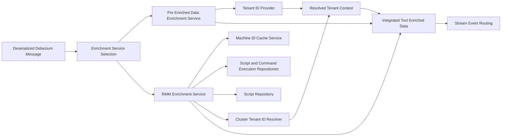
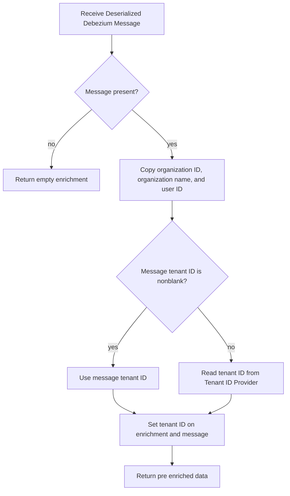
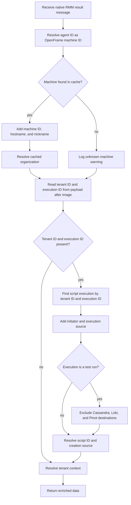
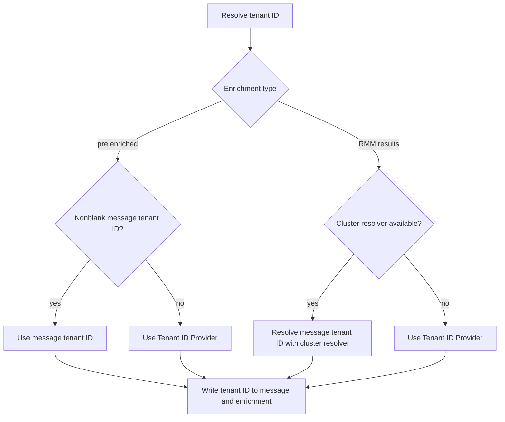

# Enrichment Services

Enrichment Services adds operational context to Debezium messages handled by the OpenFrame stream service. It contains two Spring services from the `com.openframe.oss:openframe-stream-service-core` library, version `7.0.11`, which is executed by this repository's `openframe-stream` service:

- `PreEnrichedDataEnrichmentService` preserves identity information already supplied by an event producer and ensures the message has a tenant identifier.
- `RmmEnrichmentService` resolves the device, organization, execution origin, script creation source, and tenant for native OpenFrame remote-management result events.

The module deliberately produces `IntegratedToolEnrichedData` for both paths, giving downstream event handling a consistent enrichment shape even though the events originate from different sources.

## Responsibilities and boundaries

| Service | Selected enrichment type | Input assumption | Data added or normalized |
|---|---|---|---|
| `PreEnrichedDataEnrichmentService` | `PRE_ENRICHED` | The producer already attached organization and user context; no agent is available for lookup. | Organization ID and name, user ID, and tenant ID. |
| `RmmEnrichmentService` | `RMM_RESULTS` | A native remote-management event carries the OpenFrame machine ID in `agentId`. | Machine ID, hostname, nickname, organization ID and name, execution initiator and source, script creation source, tenant ID, and optional destination exclusions. |

Neither service owns message consumption, event deserialization, persistence, or the final delivery to storage destinations. Those responsibilities remain in the surrounding stream-service modules:

- [Kafka Configuration and Activity Streams](kafka_configuration_and_activity_streams.md) configures Kafka processing and includes the activity enrichment service.
- [Event Deserialization](event_deserialization.md) converts incoming records into typed event messages.
- [Routing and Log Storage](routing_and_log_storage.md) validates and routes processed events to log destinations.
- [RMM Execution Processing](rmm_execution_processing.md) handles command and script execution result flows.
- [Fleet Software Projection](fleet_software_projection.md) is the separate software-inventory projection path.

## Architecture

The services are Spring `@Service` implementations of `DataEnrichmentService<DeserializedDebeziumMessage>`. A caller selects the implementation by the `DataEnrichmentServiceType` it reports, then receives a populated `IntegratedToolEnrichedData` object. Both implementations also write the resolved tenant ID back to the mutable message so later processing observes the same tenant context.

### Dependency roles

- **`TenantIdProvider`** supplies the local tenant identity. It is the fallback for pre-enriched messages with no tenant and the direct source when the RMM service has no cluster-aware resolver.
- **`ClusterTenantIdResolver`** is optional in the RMM service. When present, it resolves the tenant from the message tenant value; when absent, local tenant configuration is used.
- **`MachineIdCacheService`** maps a native event's `agentId` directly to cached machine information, then obtains cached organization information using the machine's organization ID.
- **`ScriptExecutionRepository`** looks up an execution by tenant ID and execution ID to identify the initiating user, the execution source, and whether it was a test run.
- **`CommandExecutionRepository`** provides the test-run fallback when no matching script execution is found.
- **`ScriptRepository`** resolves the script creation source after the service obtains a script ID from the event payload or the execution record.

## Pre-enriched event flow

`PreEnrichedDataEnrichmentService` is a pass-through service for records whose source has already stamped organization and user fields. Its documentation explicitly calls out directory-audit events polled per organization as an example. It does not attempt agent, machine, or organization-cache lookups because those events do not have an agent identity.

### Behavior and null handling

- A `null` message returns an empty `IntegratedToolEnrichedData` instance.
- Otherwise, organization ID, organization name, and user ID are copied exactly from the message.
- A nonblank message tenant ID takes precedence. If it is blank, the service uses `TenantIdProvider.getTenantId()`.
- The chosen tenant ID is written to both the returned enrichment object and the input message.

This behavior makes producer-stamped context authoritative while still enforcing tenant continuity for downstream processing.

## Native remote-management result flow

`RmmEnrichmentService` applies to native OpenFrame RMM result events, documented in the source as script-executed events and extensible to command-executed events. It differs from external-tool enrichment at the machine lookup boundary: native events already carry the OpenFrame machine ID as `agentId`, so it does not translate an external tool-agent ID through a tool-connection mapping.

### Machine and organization enrichment

1. The service reads `agentId` as the native machine ID.
2. If it is absent, machine enrichment is skipped.
3. It queries `MachineIdCacheService.getMachineByMachineId`.
4. When the machine exists, it sets the machine ID, hostname, and nickname on the enrichment result.
5. It resolves the machine's organization from the same cache and, when available, adds organization ID and organization name.
6. An unknown machine is non-fatal: the service logs a warning and continues with execution and tenant enrichment.

### Execution and script provenance

The service reads `tenantId` and `executionId` from the Debezium payload's `after` image. Both values are required before it attempts repository lookups.

- A matching `ScriptExecution` supplies `initiatedBy` as the user ID and supplies the execution source. A missing execution source is represented as `MANUAL`.
- Test-run detection prefers the resolved script-execution record. If there is no record, it falls back to a matching command-execution record.
- The script ID comes from the payload when present, otherwise from the resolved script execution.
- A matching `Script` supplies its creation source. A missing creation source is represented as `MANUAL`.
- Repository failures are caught and logged as warnings, so unavailable provenance does not prevent event handling.

### Test-run destination policy

When the resolved execution is marked as a test run, the service sets excluded destinations on the input message. The excluded destinations are `CASSANDRA_EVENT_LOG`, `LOKI_EVENT_LOG`, and `KAFKA_PINOT`. This is a routing instruction on the event rather than a failure: enrichment still returns all context it was able to resolve.

## Tenant resolution rules

Tenant handling differs slightly by service but always ends by stamping the resolved tenant on the message and its enrichment data.

For RMM events, the cluster resolver is injected as optional. Deployments without it use the local `TenantIdProvider`, while cluster-aware deployments delegate message-tenant resolution to the resolver.

## Failure tolerance and operational characteristics

The module favors partial enrichment over event loss:

| Condition | Result |
|---|---|
| Message is `null` | Return an empty enrichment object. |
| Native event has no machine ID | Skip machine and organization fields. |
| Machine cache misses | Log a warning and continue. |
| Payload lacks tenant ID or execution ID | Skip execution and script provenance lookup. |
| Script execution or script is absent | Preserve available fields; leave unavailable provenance unset. |
| Repository query raises an exception | Log a warning, then continue tenant resolution. |
| No cluster tenant resolver is configured | Use `TenantIdProvider`. |

Maintain this non-blocking behavior when extending either service. Enrichment runs in the stream path, and a missing cache record or an incomplete historical record must not turn an otherwise valid event into a processing failure.

## Implementation notes

- Keep `getType()` aligned with the source event category. The return values, `PRE_ENRICHED` and `RMM_RESULTS`, are the dispatch contract for the enrichment service selector.
- Preserve the distinction between native RMM IDs and external-tool agent IDs. Native RMM `agentId` values are machine IDs; applying external-tool indirection would resolve the wrong entity or create avoidable cache misses.
- Treat event payload fields as optional. The RMM service deliberately checks the Debezium `after` image and blank values before repository access.
- Apply destination exclusions on the message, not merely the result object, because routing consumes the message-level exclusion set.
- Do not overwrite producer-supplied pre-enriched organization or user fields through cache lookup. That service treats the event producer as the source of truth.

## Source files

The implementation is provided by the OpenFrame OSS Library artifact used by this repository:

- [PreEnrichedDataEnrichmentService.java](https://github.com/flamingo-stack/openframe-oss-lib/blob/16e7c1cbd9664e7d10ec5ebca7d53c9bd314decf/openframe-stream-service-core/src/main/java/com/openframe/stream/service/PreEnrichedDataEnrichmentService.java)
- [RmmEnrichmentService.java](https://github.com/flamingo-stack/openframe-oss-lib/blob/16e7c1cbd9664e7d10ec5ebca7d53c9bd314decf/openframe-stream-service-core/src/main/java/com/openframe/stream/service/rmm/RmmEnrichmentService.java)
