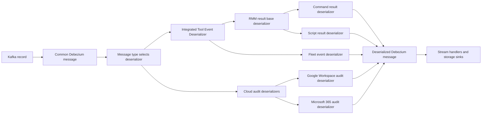
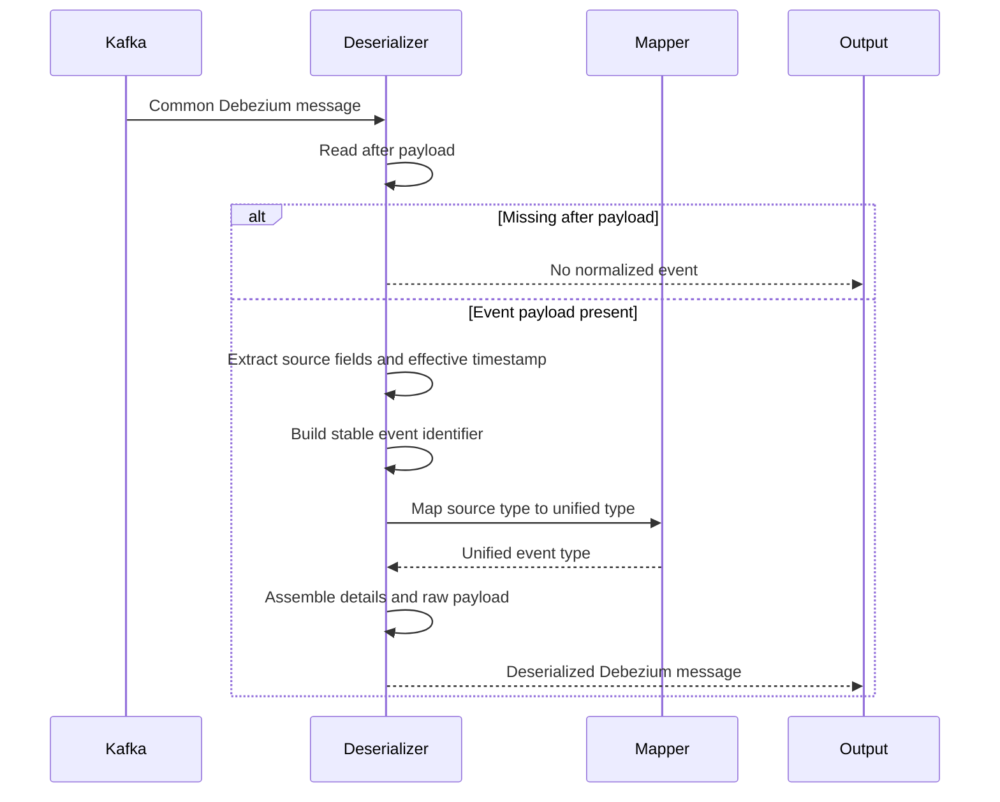
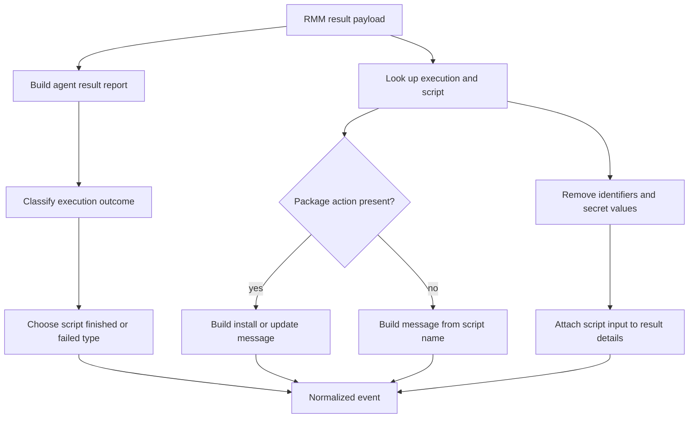

# Event Deserialization

Event Deserialization is the normalization boundary in the OpenFrame Stream service. It turns incoming Kafka records—usually Debezium change-data-capture records, plus pre-enriched audit records—into `DeserializedDebeziumMessage` records used by downstream event-log, analytics, and remote-management processing.

The implementation is supplied by OpenFrame OSS Library artifact `com.openframe.oss:openframe-stream-service-core` version `7.0.11` and runs in this repository's OpenFrame Stream service. Its source is maintained in the [OpenFrame OSS Library](https://github.com/flamingo-stack/openframe-oss-lib/tree/16e7c1cbd9664e7d10ec5ebca7d53c9bd314decf/openframe-stream-service-core/src/main/java/com/openframe/stream/deserializer).

## Responsibilities

The module provides a common event envelope while preserving source-specific fields:

- Reject tombstone-style records with no `after` payload by returning no normalized event.
- Select an event timestamp from the source event when valid, otherwise use Debezium's processing timestamp.
- Calculate a UTC ingestion day for partitioning and querying.
- Build stable event identifiers so replayed Kafka records are idempotent.
- Map a source event type, message identifier, and integrated-tool type to a `UnifiedEventType`.
- Preserve the source payload as JSON and extract safe, structured details for consumers.
- Carry tenant and, for pre-enriched cloud audits, organization and actor context.
- Classify visibility and skip-processing behavior for tool event types.

## Architecture

`IntegratedToolEventDeserializer` is the reusable base for CDC-backed tool events. It owns common envelope construction, type mapping, timestamp fallback, id generation, raw-payload retention, and details assembly. `RmmResultDeserializer` specializes that base for the shared shape of native command and saved-script execution results. Fleet extends the common base directly. Google Workspace and Microsoft 365 audit records implement their own deserializers because their pollers produce already enriched, flat `after` objects rather than conventional tool CDC rows.

## Normalized Event Contract

Every successful deserialization constructs a `DeserializedDebeziumMessage` containing the original Debezium payload plus normalized metadata.

| Field group | Meaning | Derivation |
| --- | --- | --- |
| Identity | `toolEventId`, integrated-tool type, source event type, unified event type | Source fields plus `EventTypeMapper`; identifiers are stable across replay. |
| Time | Event timestamp and UTC ingestion day | Source timestamp when parseable, otherwise Debezium processing time. |
| Scope | Tenant, organization, organization name, user, and agent identifiers | Source-specific extraction; cloud audit pollers provide organization and actor data. |
| Presentation | Message, structured details, visibility, skip-processing state | Deserializer-specific message and details builders. |
| Traceability | Raw Debezium message | Serialized `after` object. |

### Shared CDC Processing Flow

## Common CDC Behavior

### Identity and Idempotency

The common base derives a composite key from the lower-case tool name, Debezium source table or collection, and a tool-specific event identifier. It converts that key to a name-based UUID, so a replay of the same source row produces the same `toolEventId`.

If a source event lacks a primary identifier, the base logs a warning and hashes the tool name, table or collection name, and serialized event content. This permits a deterministic fallback but makes the whole payload the identity basis. The source metadata lookup accepts relational `table`, MongoDB `collection`, and finally the default name `events`.

### Details and Fault Tolerance

The base composes the `details` JSON document from three independently parsed portions:

1. `error` from an overridable extractor.
2. `result` from an overridable extractor.
3. Additional source-specific details under `additional_info` when that JSON is an object.

Invalid error or result JSON is retained as a string instead of discarding the value. Invalid additional-detail JSON is logged and omitted. A top-level construction failure produces `{}` so one malformed detail block does not prevent the event envelope from being emitted.

### Tenant Scope and Fleet

Most generic tool implementations supply scope through their own extraction logic. Fleet implementations can read `team_id` via the shared Fleet helper. This discriminator is used for shared-database Fleet CDC rows; deployment-specific tenant enrichment can supply the canonical tenant where source data is absent.

## RMM Execution Results

[Source: RMM result base](https://github.com/flamingo-stack/openframe-oss-lib/blob/16e7c1cbd9664e7d10ec5ebca7d53c9bd314decf/openframe-stream-service-core/src/main/java/com/openframe/stream/deserializer/RmmResultDeserializer.java)

The RMM base handles the common result payload fields: `tenantId`, `machineId`, `executionId`, standard output, standard error, exit code, duration, timeout state, failure reason, error, and event timestamp. Its event identity is based on execution and machine identifiers; saved-script events extend it with the script identifier.

| Details section | Content |
| --- | --- |
| `result` | Standard output, exit code, duration, and optional dispatched input. |
| `error` | Standard error, explicit error, failure reason, exit code, and timeout indicator when execution did not complete cleanly. |
| `additional_info` | Exit code, execution duration, and timeout state. |

Numeric fields are emitted as numbers when parseable and preserved as strings when not. The classifier-facing `AgentResultReport` captures exit code, timeout, explicit error, and failure reason, allowing saved-script status to be determined consistently.

### Command Results

[Source: Command result deserializer](https://github.com/flamingo-stack/openframe-oss-lib/blob/16e7c1cbd9664e7d10ec5ebca7d53c9bd314decf/openframe-stream-service-core/src/main/java/com/openframe/stream/deserializer/CommandResultDeserializer.java)

`CommandResultDeserializer` is bound to `COMMAND_EXECUTED` and always classifies the source event as command completion. Its message is `Command timed out` for timed-out work, otherwise it includes the exit code when available. When tenant, execution, and machine identifiers resolve a `CommandExecution` record, it adds the dispatched command, shell, privilege level, and timeout to `result.input`.

The normalized command event continues through both generic event-log and analytics routing and command-specific result handling. Correlation for command-specific sinks is performed downstream using machine and execution identifiers.

### Saved-Script Results

[Source: Script result deserializer](https://github.com/flamingo-stack/openframe-oss-lib/blob/16e7c1cbd9664e7d10ec5ebca7d53c9bd314decf/openframe-stream-service-core/src/main/java/com/openframe/stream/deserializer/ScriptResultDeserializer.java)

`ScriptResultDeserializer` is bound to `SCRIPT_EXECUTED`. It asks the execution-outcome classifier whether a result succeeded and emits either the script-finished or script-failed source event type. Message resolution follows this order:

1. A package-install or package-update message from the matching script execution.
2. A message containing the saved script name from the script repository.
3. A generic success or failure fallback.

When the script document is found, the deserializer adds a sanitized input document to `result.input`. It removes the document identifier, tenant identifier, and content hash; excludes null properties; and removes the value of every environment variable marked secret. This prevents secret values from being copied into logs.

## Fleet Events

[Source: Fleet event deserializer](https://github.com/flamingo-stack/openframe-oss-lib/blob/16e7c1cbd9664e7d10ec5ebca7d53c9bd314decf/openframe-stream-service-core/src/main/java/com/openframe/stream/deserializer/FleetEventDeserializer.java)

`FleetEventDeserializer` handles `FLEET_MDM_EVENT` activity rows. It extracts the agent identifier, activity type, activity-row identifier, Fleet `team_id`, details, and ISO-8601 creation time. Activity type is translated into a human-readable message through Fleet activity mapping; the source `details` field is used when no mapping exists. The activity row identifier provides the preferred idempotency key.

## Cloud Directory Audit Events

Cloud audit events are generated by pollers and are already enriched with tenant and organization context. They are not processed through the generic CDC base, but they produce the same normalized output contract.

| Deserializer | Message type | Source type | Failure classification | Stable identity | Details |
| --- | --- | --- | --- | --- | --- |
| [Google Workspace](https://github.com/flamingo-stack/openframe-oss-lib/blob/16e7c1cbd9664e7d10ec5ebca7d53c9bd314decf/openframe-stream-service-core/src/main/java/com/openframe/stream/deserializer/GoogleWorkspaceAuditEventDeserializer.java) | `GOOGLE_WORKSPACE_AUDIT_EVENT` | `eventType` | Event names containing `_FAILURE` become Google Workspace audit failures. | Unique qualifier, event key or index, and organization identifier. | Raw nested event, IP address, connection identifier, connection name. |
| [Microsoft 365](https://github.com/flamingo-stack/openframe-oss-lib/blob/16e7c1cbd9664e7d10ec5ebca7d53c9bd314decf/openframe-stream-service-core/src/main/java/com/openframe/stream/deserializer/Microsoft365AuditEventDeserializer.java) | `MICROSOFT_365_AUDIT_EVENT` | `category` | `failure` and `timeout` results become Microsoft 365 audit failures. | Graph audit identifier plus organization identifier. | Initiator, target resources, additional details, connection identifier, connection name. |

For both audit sources, recognized source types are mapped through `EventTypeMapper`; an unmapped non-failure type is retained as the source type but receives a source-specific `OTHER` unified type. They use activity timestamps when parseable and Debezium processing timestamps otherwise. Both carry no agent identifier and populate user context from the audit actor: `actorEmail` for Google Workspace and `initiatedBy.user.userPrincipalName` for Microsoft 365.

The organization suffix in each cloud `toolEventId` is essential: the same upstream audit can be fanned out to multiple linked organizations, while organization is not part of the event-store primary key. The suffix prevents those copies from overwriting each other and preserves idempotency on cursor-overlap replays.

## Operational Considerations

- Treat `toolEventId` generation as a compatibility boundary. Altering composite-key fields changes idempotency and can create duplicate historical events.
- Preserve the timestamp fallback behavior so malformed source time values do not stop ingestion.
- Keep cloud-audit organization suffixes whenever a record can fan out across organizations.
- Do not add raw script environment-variable values to script-result details without retaining the secret-value removal rule.
- Treat `details` as structured JSON with optional sections. Consumers must tolerate missing `error`, `result`, and `additional_info` sections.
- Google Workspace event parameters are source passthrough data. A parameter can use `value`, `boolValue`, `intValue`, `multiValue`, or nested `multiMessageValue`; consumers must not assume `value` is always populated.

## Module Boundaries

Event Deserialization sits below Kafka listener and stream configuration and above routing, log storage, and RMM execution processing. It should normalize payloads and enforce safe event representation, not write business projections itself. Downstream handlers own persistence, execution correlation, analytics projection, and end-user presentation.
