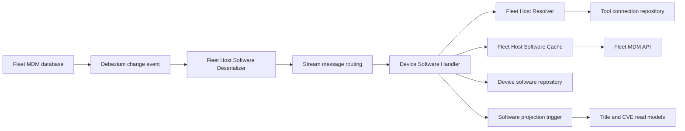
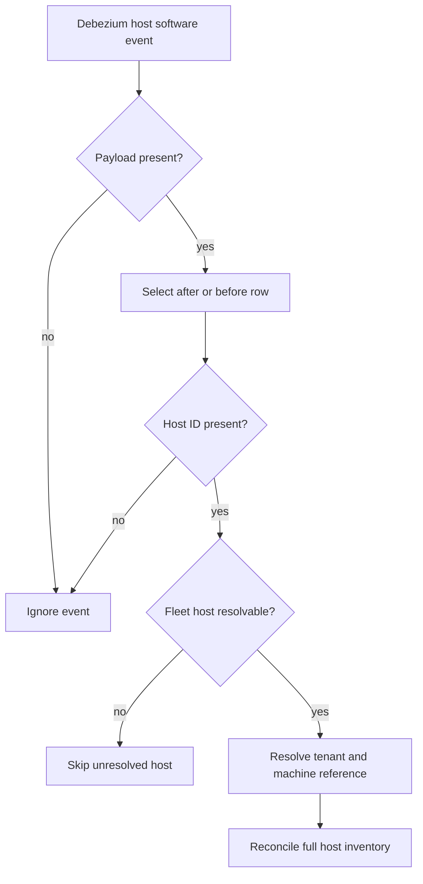
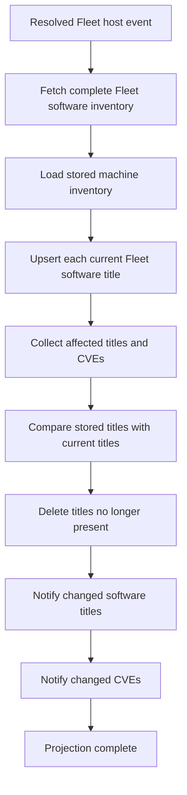
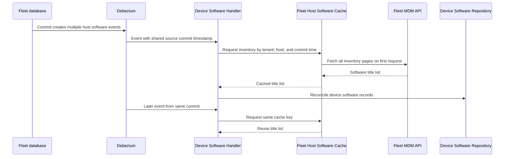
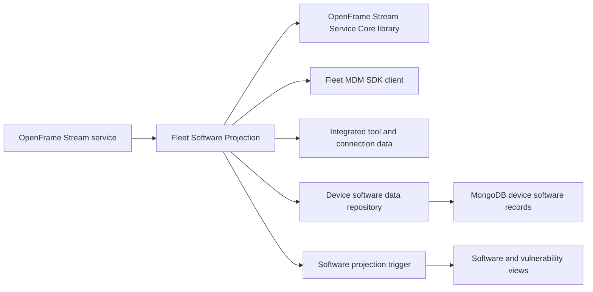

# Fleet Software Projection

Fleet Software Projection maintains OpenFrame's per-device software inventory from Fleet MDM change-data-capture events. It is implemented by the `openframe-stream-service-core` library from [OpenFrame OSS Library](https://github.com/flamingo-stack/openframe-oss-lib) and runs inside this repository's OpenFrame Stream service. Rather than treating each Fleet `host_software` row as the final inventory record, the module uses the event as a signal to retrieve the complete current software list for the affected host and reconcile the OpenFrame read model.

This design makes the projected inventory authoritative for a Fleet host after a successful reconciliation: current titles are upserted, no-longer-present titles are removed, and downstream title and CVE projections are notified.

## Responsibilities

- Recognize Fleet host-software Debezium events and retain the source payload and event time.
- Resolve the Fleet host identifier to an OpenFrame tenant and machine through its latest Fleet tool connection.
- Fetch a paginated, tenant-scoped inventory from Fleet MDM.
- Reconcile `DeviceSoftware` records for the resolved machine in MongoDB.
- Preserve version, package identity, installer, vendor, system-component, and vulnerability information supplied by Fleet.
- Reduce duplicate upstream reads during a multi-row Fleet commit and reduce redundant snapshot reconciliation.
- Trigger derived software-title and CVE projection updates after inventory changes.

## Runtime Position

The module participates in the stream service's Kafka/Debezium handling path. The handler is active only when `openframe.fleet.software-cdc.enabled` is `true`. Its event type is `FLEET_MDM_HOST_SOFTWARE_EVENT`; its handler destination is `MONGO_DEVICE_SOFTWARE`.

The event contains no tenant identifier for `host_software` and `host_software_windows_details`. Tenant ownership is therefore derived from the Fleet host's connection to an OpenFrame machine, not from the CDC row itself.

## Component Design

| Component | Role | Important behavior |
| --- | --- | --- |
| [Fleet Host Software Deserializer](https://github.com/flamingo-stack/openframe-oss-lib/blob/16e7c1cbd9664e7d10ec5ebca7d53c9bd314decf/openframe-stream-service-core/src/main/java/com/openframe/stream/deserializer/FleetHostSoftwareDeserializer.java) | Converts a common Debezium envelope into a Fleet-enriched stream message. | Selects `after` when present and falls back to `before`, allowing deletes to remain processable. It labels the message as the Fleet integrated-tool type and copies the payload timestamp. |
| [Fleet Host Resolver](https://github.com/flamingo-stack/openframe-oss-lib/blob/16e7c1cbd9664e7d10ec5ebca7d53c9bd314decf/openframe-stream-service-core/src/main/java/com/openframe/stream/handler/software/FleetHostResolver.java) | Maps Fleet host ID to tenant and machine. | Looks up the most recently connected `FLEET_MDM` tool connection and requires both tenant and machine IDs. Positive resolvability and resolution are cached; misses are not cached so newly connected hosts can be recognized promptly. |
| [Fleet Host Software Cache](https://github.com/flamingo-stack/openframe-oss-lib/blob/16e7c1cbd9664e7d10ec5ebca7d53c9bd314decf/openframe-stream-service-core/src/main/java/com/openframe/stream/handler/software/FleetHostSoftwareCache.java) | Retrieves and briefly caches the complete Fleet inventory for a host. | Requests Fleet pages of 100 titles until Fleet reports no next page. The two-minute cache key includes tenant, host, and source commit time. |
| [Device Software Handler](https://github.com/flamingo-stack/openframe-oss-lib/blob/16e7c1cbd9664e7d10ec5ebca7d53c9bd314decf/openframe-stream-service-core/src/main/java/com/openframe/stream/handler/software/DeviceSoftwareHandler.java) | Coordinates resolution, full inventory retrieval, persistence, deletion, and invalidation. | Reconciles all software for one resolved machine rather than applying only the changed CDC row. |

## Event Interpretation and Host Resolution

The deserializer accepts Fleet host-software events. It inspects the payload defensively: a missing message, payload, or selected row yields no deserialized result. For ordinary changes, it observes the `after` row; for a delete, the relevant row is expected in `before`.

The handler repeats that row selection based on the Debezium operation and extracts `host_id`. Events without a payload, row, or numeric host ID are ignored. It then converts the host ID to text and asks the resolver whether it corresponds to a connected OpenFrame machine.

An unresolved host is deliberately skipped instead of being assigned to an inferred tenant. This protects tenant isolation and avoids creating inventory entries that cannot be associated with a known OpenFrame machine. The resolver chooses the latest matching tool connection ordered by connection time, then discards incomplete mappings.

## Full-Inventory Reconciliation

A CDC operation can affect several Fleet rows while the desired outcome is one coherent software inventory. The handler obtains Fleet's complete software-title list for the resolved host and applies the following reconciliation.

1. Load existing `DeviceSoftware` rows for the resolved tenant and machine.
2. Record CVEs from the existing rows so removal also invalidates vulnerability projections.
3. For every Fleet software title with an ID, find or create the matching device-software row.
4. Set ownership, machine, title ID, name, source, versions, upgrade code, vendor, package identifiers, installer types, system-component value, Winget ID, vulnerabilities, and update time.
5. Mark a newly created row as machine-connected, then save it.
6. Delete each previously stored title absent from the retrieved Fleet inventory.
7. Notify the projection trigger of changed title IDs and CVE identifiers.

### Field derivation

A Fleet title can contain multiple installed versions. The projection derives fields across that collection as follows:

- **Versions:** all non-null version strings, deduplicated.
- **Vendor and Winget ID:** the first non-blank value among installed versions.
- **ARP keys, package-family names, and installer types:** all non-blank values, deduplicated.
- **System component:** `null` when no version reports the flag; otherwise `true` only when every reporting version marks it as a system component.
- **Vulnerabilities:** all non-blank CVE strings across installed versions, deduplicated.

This preserves multiple package instances while producing one software-title record per tenant, machine, and Fleet software-title ID.

## Caching and Snapshot Handling

The module has two distinct cache layers with different purposes.

| Cache | Key and lifetime | Purpose |
| --- | --- | --- |
| Fleet inventory cache | Tenant ID, Fleet host ID, and source commit timestamp; two minutes | Several CDC rows from one Fleet commit share a source timestamp. They reuse one full Fleet API read, while a later commit receives a different cache key and cannot reuse an earlier snapshot. |
| Reconciled snapshot-host cache | Fleet host ID; 24 hours | Limits a CDC snapshot read to one reconciliation per host during its snapshot window. |
| Unresolved snapshot-host cache | Fleet host ID; five minutes | Limits repeated debug logs and resolution attempts for unresolved hosts during a snapshot without permanently suppressing later connection discovery. |
| Resolver caches | Fleet host ID; Spring cache policy | Reuses positive resolution results. A failed resolvability lookup is explicitly not cached. |

## Fleet API and Tenant Configuration

To call Fleet, `FleetHostSoftwareCache` looks up the tenant's configured Fleet integrated tool using the Fleet server key. Its API token is supplied to a `FleetMdmClient` together with the tenant context.

The Fleet base URL is selected in this order:

1. A `FleetBaseUrlResolver`, when available, resolves a non-blank tenant-specific URL.
2. If no tenant-specific URL is resolved, the handler logs a warning and falls back to `fleet.mdm.base-url`.

A missing Fleet integrated-tool configuration causes the reconciliation to fail rather than silently querying Fleet without the correct tenant credentials. Keep the configured Fleet connection, its API token, and the host-to-machine tool connection consistent for every tenant that enables software CDC.

## Operational Behavior and Failure Boundaries

- **Feature gate:** no handler bean is enabled unless `openframe.fleet.software-cdc.enabled=true`.
- **Malformed or incomplete events:** the handler returns without persistence when payload, selected row, or `host_id` is absent.
- **Unmapped hosts:** the handler logs a debug message and skips inventory projection. Snapshot events receive short-lived suppression only.
- **Fleet API paging:** the cache loader continues while Fleet marks a next page available. A null response terminates the load safely.
- **Repository scope:** all lookup, save, and delete actions are tenant and machine scoped after resolution.
- **Projection invalidation:** removed rows contribute their prior CVEs; changed or created rows contribute current CVEs. This ensures downstream vulnerability views can be refreshed for both additions and removals.

## Data and Dependency Boundaries

Fleet Software Projection is part of the OpenFrame Stream service but relies on library-provided models and persistence contracts. The following relationships are especially important for maintainers:

The module's direct source is supplied by `com.openframe.oss:openframe-stream-service-core` version `7.0.11`, an upstream dependency of this repository. Its runtime service is `openframe-stream`, which is configured with Kafka and NATS endpoints by the tenant deployment. The handler itself processes Fleet Debezium content and uses Mongo-backed repositories; it does not expose an HTTP endpoint.

## Maintenance Checklist

When changing this module, verify the following behaviors:

1. Delete events still select `before` and normal events select `after`.
2. A host with no valid tenant and machine mapping cannot write a device-software record.
3. A multi-page Fleet response produces a complete inventory before reconciliation begins.
4. Multiple events from the same source commit use the same inventory-cache key.
5. A later source commit gets a distinct cache key and fetches a fresh inventory.
6. Reconciliation removes stale records as well as upserting current ones.
7. Changes and removals notify both title and CVE projections with the correct tenant.
8. Snapshot suppression does not cache a normal unresolved-host miss indefinitely.

For the wider stream pipeline, see platform documentation for Kafka/Debezium routing and message enrichment. For query and presentation behavior, see platform documentation for software inventory and vulnerability read models.
