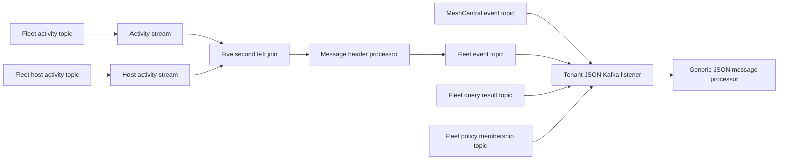
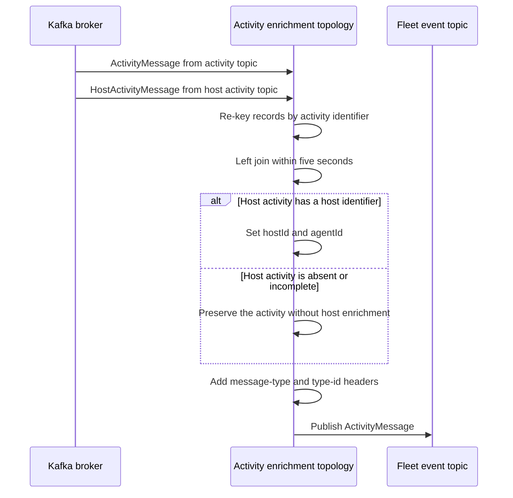
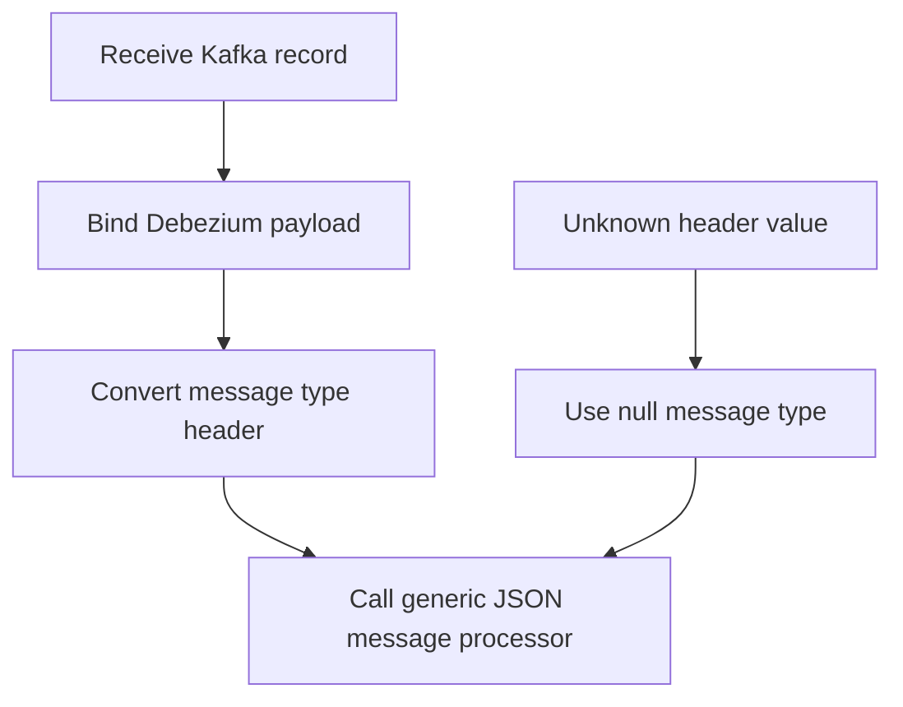

# Kafka Configuration And Activity Streams

Kafka Configuration And Activity Streams is the Kafka-facing portion of the OpenFrame stream service. It creates the Kafka Streams topology that enriches Fleet activity records with host data, standardizes the outbound event headers expected by downstream processing, and provides the tenant-cluster listener that sends integrated-tool Debezium events to the generic JSON processor.

The implementation is supplied by the OpenFrame OSS Library artifact `com.openframe.oss:openframe-stream-service-core` version `7.0.11` and runs in this repository's `openframe-stream` service. The tenant deployment configures that service to use Kafka at `kafka.datasources.svc.cluster.local` through `spring.oss-tenant.kafka.bootstrap-servers`.

## Responsibilities

- Configure JSON serdes and Kafka Streams runtime behavior for the activity-enrichment topology.
- Read Fleet activity and host-activity streams, then join matching records by activity identifier.
- Add `hostId` and the corresponding string `agentId` when matching host activity data is present.
- Publish enriched activity records to the configured Fleet event topic with an explicit message-type header.
- Convert inbound Kafka message-type header bytes to the `MessageType` enum for Spring listener binding.
- Consume selected tenant-cluster integrated-tool topics and delegate their decoded Debezium payloads to `GenericJsonMessageProcessor`.

## Position In The Stream Service

The module has two complementary paths:

1. **Kafka Streams enrichment** reads Fleet activity topics and produces enriched Fleet events.
2. **Listener fan-in** consumes integrated-tool events that are already routed to inbound topics and invokes the generic processor.

The listener consumes the Fleet event topic that is also the enrichment topology's output. This provides a direct path from the enriched records to the generic event-processing flow when the service runs in tenant mode.

## Component Design

| Component | Role | Source |
| --- | --- | --- |
| `KafkaConfig` | Registers the byte-array-to-`MessageType` header converter. Unknown header values are logged and converted to `null`. | [KafkaConfig](https://github.com/flamingo-stack/openframe-oss-lib/blob/16e7c1cbd9664e7d10ec5ebca7d53c9bd314decf/openframe-stream-service-core/src/main/java/com/openframe/stream/config/KafkaConfig.java) |
| `KafkaStreamsConfig` | Enables Kafka Streams when stream processing is enabled, declares activity JSON serdes, and supplies the default Streams configuration. | [KafkaStreamsConfig](https://github.com/flamingo-stack/openframe-oss-lib/blob/16e7c1cbd9664e7d10ec5ebca7d53c9bd314decf/openframe-stream-service-core/src/main/java/com/openframe/stream/config/KafkaStreamsConfig.java) |
| `ActivityEnrichmentService` | Builds the topology, performs the activity-to-host-activity left join, classifies output events, and writes them to the Fleet event topic. | [ActivityEnrichmentService](https://github.com/flamingo-stack/openframe-oss-lib/blob/16e7c1cbd9664e7d10ec5ebca7d53c9bd314decf/openframe-stream-service-core/src/main/java/com/openframe/stream/service/ActivityEnrichmentService.java) |
| `JsonKafkaListener` | Provides tenant-only topic fan-in and delegates decoded messages plus their type to the generic JSON processor. | [JsonKafkaListener](https://github.com/flamingo-stack/openframe-oss-lib/blob/16e7c1cbd9664e7d10ec5ebca7d53c9bd314decf/openframe-stream-service-core/src/main/java/com/openframe/stream/listener/JsonKafkaListener.java) |

## Kafka Streams Configuration

`KafkaStreamsConfig` is active when `kafka.stream.enabled` is `true`; the property defaults to enabled when omitted. It uses the following bootstrap-server precedence:

1. `openframe.stream.kafka-streams.bootstrap-servers`
2. `spring.oss-tenant.kafka.bootstrap-servers`
3. `spring.saas.kafka.bootstrap-servers`

The explicit stream-specific setting is important when tenant and shared Kafka clusters are both available and the topology must bind to one of them.

The Streams application identifier starts with `spring.application.name`. When `openframe.cluster-id` is present and non-blank, the identifier becomes the application name followed by a hyphen and that cluster identifier. This namespaces consumer state and prevents different clusters from sharing a Kafka Streams application identity.

### Runtime Characteristics

| Setting | Configured behavior | Operational effect |
| --- | --- | --- |
| Processing guarantee | At least once | A record can be processed again after failure or recovery; downstream handling should tolerate duplicates. |
| Stream threads | One | The topology executes with one configured stream thread per service instance. |
| State directory | `/tmp/kafka-streams` | Local Kafka Streams state is stored under this path. |
| Offset reset | Earliest | A new consumer group begins from the earliest available records. |
| Maximum poll records | 100 | Limits a consumer poll to 100 records. |
| Maximum task idle time | Five seconds | Allows stream time to advance when partitions are idle, helping left-join windows close if host activity data is absent. |
| Producer batch size | 16,384 bytes | Configures buffering for produced stream records. |
| Producer linger | 10 milliseconds | Allows a short batching delay before sending produced records. |
| Producer buffer memory | 33,554,432 bytes | Sets the producer's memory buffer. |

Three JSON serdes use the application `JsonMapper`:

- `activityMessageSerde` handles inbound `ActivityMessage` values.
- `hostActivityMessageSerde` handles inbound `HostActivityMessage` values.
- `outgoingActivityMessageSerde` writes `ActivityMessage` values without Jackson type metadata, preserving the expected downstream event shape.

## Activity Enrichment Flow

The topology creates two source streams and normalizes both to the Fleet activity identifier before joining:

- The activity source drops records whose Debezium payload or `after` value is absent, then selects the activity's own identifier as its key.
- The host-activity source drops records without a usable `after` value or `activityId`, then maps its key to `activityId`.
- A five-second left join retains every valid activity record. A host record enriches the activity only when its `hostId` is available.

The join does not reject an activity because its matching host activity is missing. Instead, the original activity is forwarded, and diagnostic logging records why enrichment was skipped. This preserves the activity stream while allowing later diagnostics of absent or incomplete host information.

### Header Classification

After joining, the topology adds two headers using the Kafka Processor API:

- The `MESSAGE_TYPE_HEADER` header is `FLEET_MDM_POLICY_ACTIVITY_EVENT` for `created_policy`, `edited_policy`, `deleted_policy`, and `applied_spec_policy` activity types.
- All other activities receive `FLEET_MDM_EVENT`.
- The `__TypeId__` header is set to `com.openframe.kafka.model.debezium.CommonDebeziumMessage`.

`KafkaConfig` supplies the complementary converter used by Spring message handling: it decodes message-type header bytes as UTF-8, uses a case-insensitive enum lookup, logs unknown values, and returns `null` rather than throwing for an unrecognized header.

## Tenant Listener Fan-In

`JsonKafkaListener` is enabled only when `openframe.cluster.mode` is `tenant`; tenant mode is also the default when the property is absent. It listens with the group configured at `spring.oss-tenant.kafka.consumer.group-id` and consumes these configured topics:

- MeshCentral events
- Fleet MDM events
- Fleet MDM query-result events
- Fleet MDM policy-membership events

For each record, Spring binds a `CommonDebeziumMessage` payload and the converted `MessageType` header. The listener passes both values to `GenericJsonMessageProcessor`. The listener does not implement event-specific persistence or routing itself; it is the ingress adapter between tenant Kafka topics and that processor.

## Configuration Reference

| Property | Used by | Purpose |
| --- | --- | --- |
| `kafka.stream.enabled` | Kafka Streams configuration and activity enrichment | Enables or disables the Kafka Streams configuration and topology. Defaults to enabled. |
| `openframe.stream.kafka-streams.bootstrap-servers` | Kafka Streams configuration | Optional bootstrap-server override for the topology. |
| `spring.oss-tenant.kafka.bootstrap-servers` | Kafka Streams configuration | Tenant Kafka bootstrap-server fallback. |
| `spring.saas.kafka.bootstrap-servers` | Kafka Streams configuration | Shared Kafka bootstrap-server fallback. |
| `spring.application.name` | Kafka Streams configuration | Base value for the Streams application identifier. |
| `openframe.cluster-id` | Kafka Streams configuration | Optional suffix that isolates a cluster's Streams application identifier. |
| `openframe.oss-tenant.kafka.topics.inbound.fleet-mdm-activities.name` | Activity enrichment | Source topic for activity records. |
| `openframe.oss-tenant.kafka.topics.inbound.fleet-mdm-host-activities.name` | Activity enrichment | Source topic for host activity records. |
| `openframe.oss-tenant.kafka.topics.inbound.fleet-mdm-events.name` | Activity enrichment and tenant listener | Output topic for enriched activity records and a tenant listener input. |
| `openframe.cluster.mode` | Tenant listener | Activates the listener only for tenant mode. Defaults to tenant mode. |
| `spring.oss-tenant.kafka.consumer.group-id` | Tenant listener | Consumer group for integrated-tool event fan-in. |

## Failure And Data-Quality Behavior

- Invalid activity or host-activity envelopes are filtered before the join when their required Debezium `after` data is missing.
- A missing host-activity match is valid for the left join and results in an unchanged activity message.
- A host-activity record with no `hostId` also leaves the activity unchanged.
- An unknown message-type header produces a warning and a `null` message type rather than a converter exception.
- At-least-once processing means processor implementations receiving these events should be safe under replay or duplicate delivery.

## Maintenance Notes

When changing topic configuration, retain the shared meaning of the Fleet MDM event topic: it is the activity-enrichment output and one of the listener's inputs. When changing classification, update the policy activity type set and validate the message-type values expected by downstream processors. Changes to the cluster identifier or application name alter the Kafka Streams application identity and therefore its consumer-group and state behavior.

For broader stream-service responsibilities, consult the platform documentation for event deserialization, routing and log storage, remote-management execution processing, fleet software projection, and enrichment services.