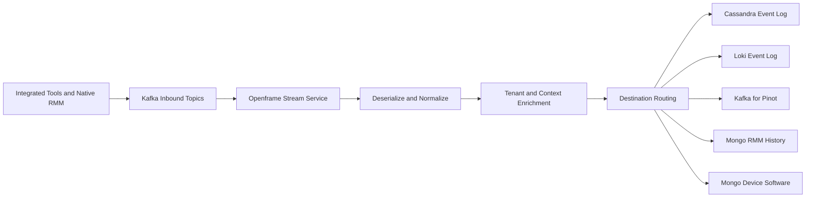
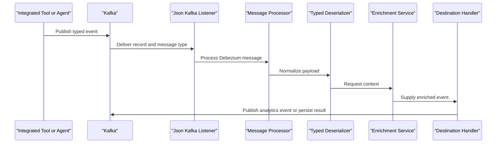
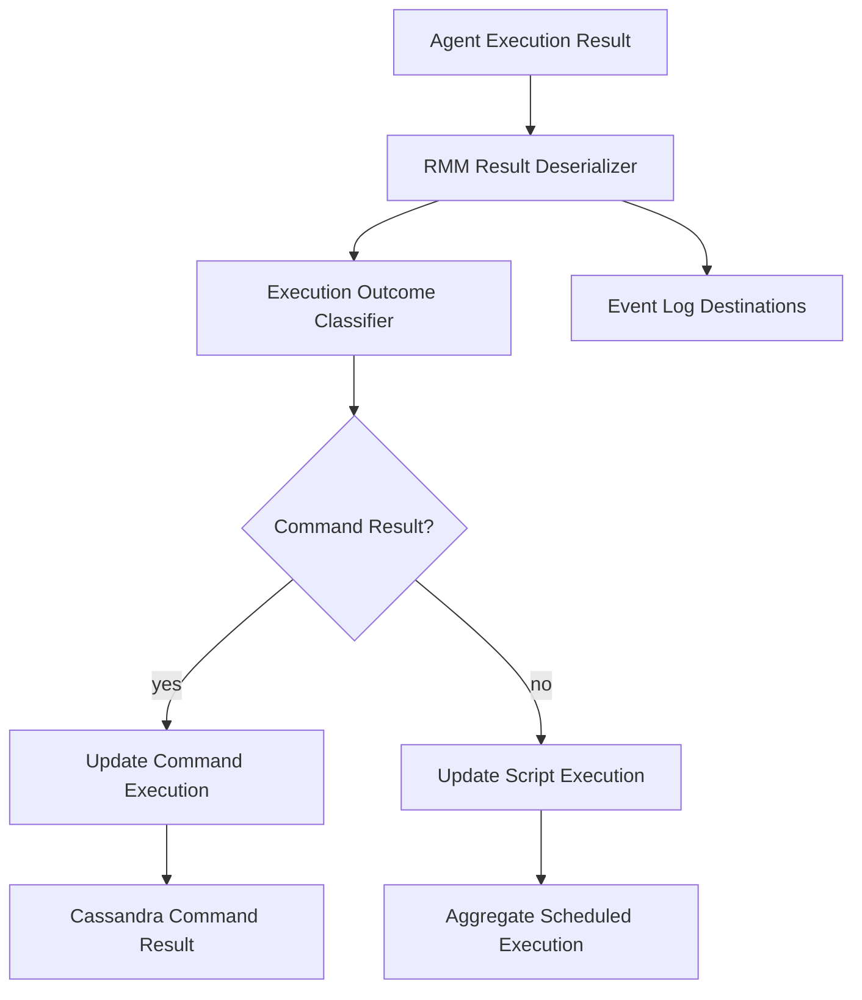

# Openframe Stream Service Core

Openframe Stream Service Core is the event-processing foundation used by the Openframe Stream service. The tenant repository runs it through the `openframe-stream` application, while the implementation is supplied by the OpenFrame OSS Library artifact `com.openframe.oss:openframe-stream-service-core` version `7.0.11`.

It consumes change-data-capture and application event records from Kafka, normalizes source-specific payloads into integrated-tool events, enriches them with tenant, machine, organization, and execution context, and routes the results to the configured log, analytics, and RMM-history destinations. It also runs Kafka Streams enrichment for Fleet activity records and projects Fleet software inventory into device software records.

## Runtime Position

The Stream service is deployed with access to the tenant Kafka cluster. Its configuration names Kafka as the bootstrap service, and the surrounding platform provides MongoDB, Cassandra, Redis, Pinot, and optional Loki-backed log storage. The module does not expose an HTTP API; it operates as a Kafka consumer and stream processor.

## Processing Model

1. `JsonKafkaListener` receives tenant-cluster integrated-tool records and reads the message-type header.
2. A matching deserializer transforms the Debezium-style payload into `DeserializedDebeziumMessage`, retaining the source payload while deriving event identity, time, visibility, tool type, and structured details.
3. The appropriate enrichment service supplies tenant and contextual metadata. Native RMM results use direct machine identifiers, while pre-enriched audit events preserve producer-stamped organization and user context.
4. Handlers apply destination-specific validation and persistence or publication. Create, snapshot-read, and update operations share write behavior; delete operations are intentionally ignored by the supplied event-log handlers.

## Major Areas

The detailed pages generated for this module organize the implementation into these areas:

- [Kafka Configuration and Activity Streams](kafka_configuration_and_activity_streams.md) — Kafka message conversion, Kafka Streams configuration, JSON serdes, and the Fleet activity to host-activity join.
- [Event Deserialization](event_deserialization.md) — common normalization plus adapters for Fleet, MeshCentral, Google Workspace, Microsoft 365, remote-session audits, and native command or script outcomes.
- [Routing and Log Storage](routing_and_log_storage.md) — operation dispatch, visibility and tenant validation, Kafka analytics publication, and Cassandra or Loki writes.
- [RMM Execution Processing](rmm_execution_processing.md) — command and script result classification, execution-history updates, result retention, metrics, and schedule aggregation.
- [Fleet Software Projection](fleet_software_projection.md) — host resolution, cached Fleet API inventory retrieval, device software reconciliation, and projection triggers.
- [Enrichment Services](enrichment_services.md) — passthrough pre-enrichment and native RMM machine, execution, organization, tenant, and test-run enrichment.

## Kafka and Streams Configuration

`KafkaConfig` provides conversion of the message-type header bytes into the `MessageType` enum and rejects unknown values with a warning. `KafkaStreamsConfig` is enabled by `kafka.stream.enabled`, which defaults to enabled. It configures JSON serdes for Fleet activity records, at-least-once processing, a single stream thread, earliest offset reset, bounded polling, and a local state directory at `/tmp/kafka-streams`.

The streams application identifier starts with `spring.application.name`. When `openframe.cluster-id` is nonblank, the identifier adds that value as a suffix to isolate state and consumer identity by cluster. The stream bootstrap server can be explicitly overridden by `openframe.stream.kafka-streams.bootstrap-servers`; otherwise it falls back from tenant Kafka settings to SaaS Kafka settings.

`ActivityEnrichmentService` joins Fleet activity and host-activity records in a five-second left-join window. When a matching host activity is present, it adds the Fleet host identifier as the activity's host and agent identifier. It then assigns either a regular Fleet event type or a policy-activity type in the output message header and republishes to the enriched Fleet event topic.

## Normalized Event Contract

`IntegratedToolEventDeserializer` provides the shared contract for Debezium-derived tool events. It derives a UTC ingest date, source event type, unified event type, source timestamp, visibility, and a deterministic UUID. The UUID is based on tool type, Debezium table or collection, and source event identifier. When a source identifier is absent, it uses a content hash fallback.

The base class also builds structured details with distinct `error`, `result`, and `additional_info` sections. Concrete deserializers provide source-specific extraction and mapping. Important specializations include:

- `RmmResultDeserializer` captures standard output, standard error, exit code, duration, timeout, agent error, and failure reason for both native command and script outcomes.
- `CommandResultDeserializer` adds the persisted command input to the result details and emits the command-finished event type.
- `ScriptResultDeserializer` resolves saved-script metadata, removes identifiers and secret environment-variable values before embedding script input, and chooses success or failure based on `ExecutionOutcomeClassifier`.
- `FleetEventDeserializer`, policy activity, policy membership, and query-result deserializers map Fleet records and use cached Fleet metadata for human-readable policy or query context.
- Google Workspace and Microsoft 365 audit deserializers accept producer-pre-enriched records and suffix source identifiers with organization identity so copies distributed to multiple organizations remain idempotent.
- `AccessChangeEventDeserializer` transforms identity lifecycle actions into unified identity events, retaining selected evidence fields.
- `MeshCentralEventDeserializer` handles both object and JSON-string payload shapes and extracts agent-log parameters.
- `RemoteSessionAuditEventDeserializer` records remote-session deletion context, including technician and machine references.

Source implementation references: [Integrated Tool Event Deserializer](https://github.com/flamingo-stack/openframe-oss-lib/blob/16e7c1cbd9664e7d10ec5ebca7d314decf/openframe-stream-service-core/src/main/java/com/openframe/stream/deserializer/IntegratedToolEventDeserializer.java), [RMM Result Deserializer](https://github.com/flamingo-stack/openframe-oss-lib/blob/16e7c1cbd9664e7d10ec5ebca7d53c9bd314decf/openframe-stream-service-core/src/main/java/com/openframe/stream/deserializer/RmmResultDeserializer.java), and [Activity Enrichment Service](https://github.com/flamingo-stack/openframe-oss-lib/blob/16e7c1cbd9664e7d10ec5ebca7d53c9bd314decf/openframe-stream-service-core/src/main/java/com/openframe/stream/service/ActivityEnrichmentService.java).

## Enrichment and Tenant Safety

`PreEnrichedDataEnrichmentService` is for audit producers that already supply tenant, organization, and user fields. It copies those fields directly and only falls back to the deployment tenant provider when a tenant is absent.

`RmmEnrichmentService` treats the message agent identifier as an Openframe machine identifier, looks up cached machine and organization data, then resolves the execution and script origin. It hides test-run results from Cassandra event-log, Loki event-log, and Kafka-to-Pinot destinations while allowing execution-history processing.

`TenantIdRequiredDebeziumEventValidator` is the primary safety check used by event handlers. It drops events without a resolved tenant identifier. This prevents unresolved shared-cluster CDC records from being persisted or published without tenant isolation.

## Destinations and Reliability

The generic handler hierarchy validates a message, maps it to the destination model, and dispatches according to Debezium operation: create, read, update, or delete. Event-log handlers write create, read, and update events; deletes are no-ops.

- `TenantDebeziumKafkaMessageHandler` maps events to `IntegratedToolEvent` and publishes them to the configured tenant outbound topic. It only publishes visible, tenant-valid events and uses device, user, or tool type as the broker key.
- `CassandraLogEventHandler` writes mapped log events when Cassandra storage is selected. With the `both` store mode, a Cassandra write failure is logged but does not prevent the Loki path from proceeding.
- `LokiLogEventHandler` writes mapped events when Loki storage is selected. It retries transient push and query failures with exponential backoff, treats an already-stored rejected event as idempotent, and logs data loss for a rejected unsaved event.
- `CommandResultCassandraMessageHandler` saves a compact JSON result keyed by execution and machine identifiers. Cassandra table-level retention governs its expiry.

## Native RMM Result Lifecycle

Command and script result handlers correlate an agent result with a persisted execution row, classify the outcome, persist terminal fields, record metrics, and refuse to overwrite final state on duplicates. Both handlers preserve output within their model byte limits and mark truncation when necessary.

`ExecutionOutcomeConfig` selects the classifier behavior through `openframe.rmm.execution.script-error-status.enabled`. A true value enables script-error-status handling; false or an omitted setting selects legacy behavior. `CommandExecutionHandler` correlates by machine and execution identifiers. `ScriptExecutionHandler` additionally requires script identifier because a scheduled execution can include multiple scripts sharing an execution identifier.

## Fleet Software Projection

When `openframe.fleet.software-cdc.enabled` is true, `DeviceSoftwareHandler` reacts to Fleet host software CDC records. It resolves the Fleet host to an Openframe tenant and machine through the latest Fleet tool connection. It then fetches the host's complete software inventory through `FleetHostSoftwareCache`, reconciles device-software records, removes absent entries, and triggers title and CVE projections.

The cache is keyed by tenant, Fleet host, and source commit timestamp. This coalesces the multiple row events from one Fleet commit while ensuring a later commit receives a fresh inventory read. Snapshot reads are guarded so a host is reconciled once per day; temporarily unresolved snapshot hosts are retried after a short cooldown.

## Operational Notes

- Configure at least one event-log store through `openframe.tool-events.store`: Cassandra, Loki, or both.
- Keep tenant-resolution data current. Records lacking a tenant are deliberately dropped by the primary validator.
- Enable Fleet software CDC only where the Fleet API, tool configuration, and host-to-machine connection data are available.
- Kafka Streams state is local to the service instance. Cluster-specific application identifiers avoid state and consumer-group collisions across clusters.
- The module processes duplicate CDC and replayed records defensively through deterministic event identity, persistence checks, and terminal-state guards.
