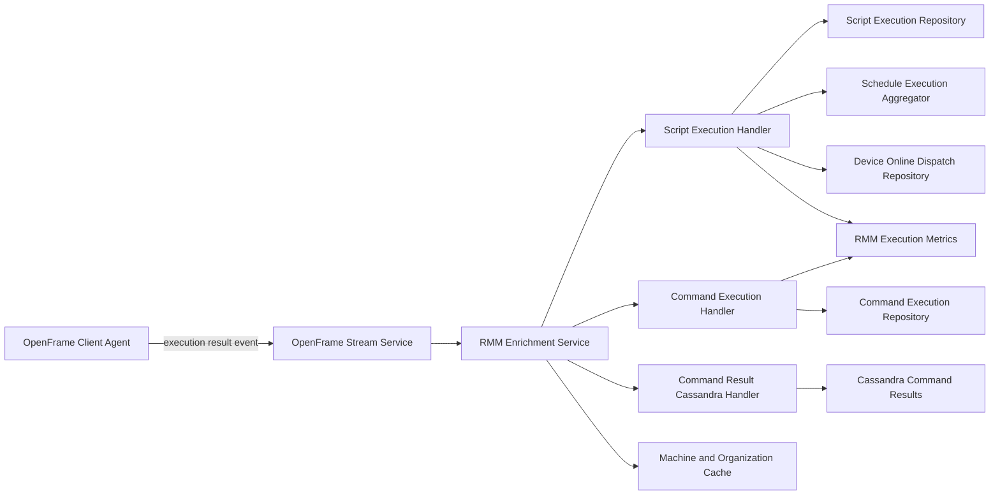
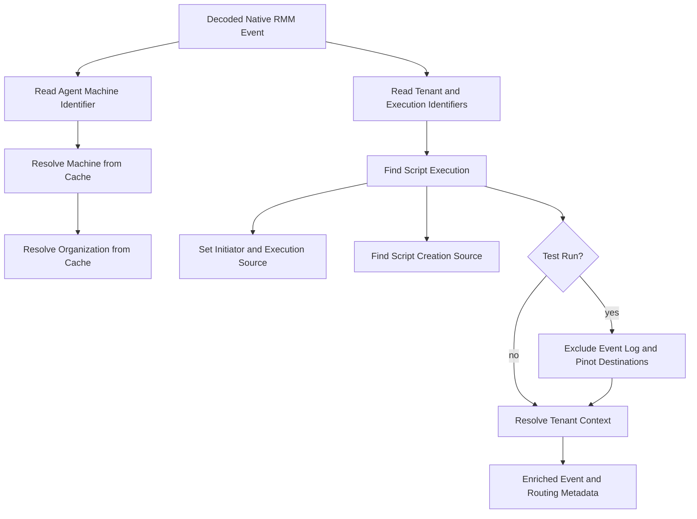
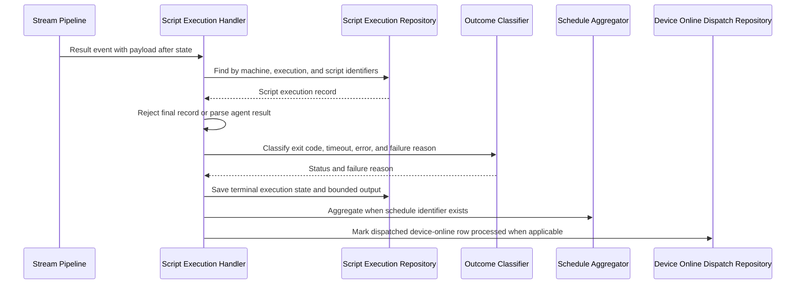
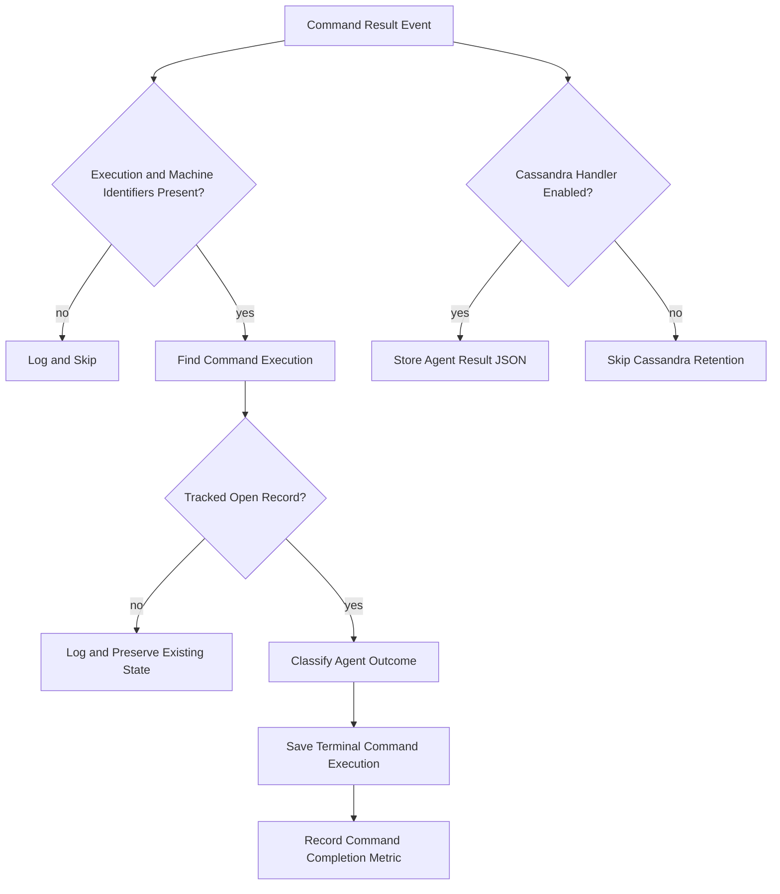

# Rmm Execution Processing

Rmm Execution Processing is the OpenFrame Stream service capability that consumes native RMM execution-result events and turns them into durable execution state, command-result history, metrics, and enriched downstream events. Its implementation is supplied by the `com.openframe.oss:openframe-stream-service-core` library version `7.0.11` and runs in this repository's OpenFrame Stream service.

The module handles two correlated result paths:

- **Script results** update a persisted script execution, optionally aggregate a scheduled run, and can complete a device-online dispatch record.
- **Command results** update a tracked batch-command execution and, when Cassandra is enabled, are also retained in a short-lived command-results table.

The handlers deliberately preserve terminal state, validate correlation fields before writing, and retain the agent's stdout and stderr only up to each execution model's configured byte limit.

## Scope and Responsibilities

| Area | Responsibility |
|---|---|
| Event enrichment | Resolves native RMM machine, organization, tenant, execution initiator, execution source, and script creation source metadata. |
| Script lifecycle | Correlates a result with one script execution using machine, execution, and script identifiers, then writes its terminal outcome and agent report. |
| Command lifecycle | Correlates a batch command result using machine and execution identifiers, then writes its terminal outcome and agent report. |
| Schedule integration | Aggregates scheduled script execution state and marks an applicable device-online dispatch as processed. |
| Command retention | Writes the original agent result fields to Cassandra when Cassandra support and configuration are enabled. |
| Observability | Records script and command completion metrics after a successful MongoDB state update. |

## Runtime Architecture

The OpenFrame Stream service receives decoded native RMM events through the wider streaming pipeline. Rmm Execution Processing enriches each event before destination-specific handlers update execution history and optional command retention.

### Component Roles

- [Execution Outcome Configuration](https://github.com/flamingo-stack/openframe-oss-lib/blob/16e7c1cbd9664e7d10ec5ebca7d53c9bd314decf/openframe-stream-service-core/src/main/java/com/openframe/stream/config/ExecutionOutcomeConfig.java) selects one `ExecutionOutcomeClassifier` bean. The `openframe.rmm.execution.script-error-status.enabled` property is disabled by default when absent, preserving legacy classification; setting it to `true` enables script-error status behavior.
- [RMM Enrichment Service](https://github.com/flamingo-stack/openframe-oss-lib/blob/16e7c1cbd9664e7d10ec5ebca7d53c9bd314decf/openframe-stream-service-core/src/main/java/com/openframe/stream/service/rmm/RmmEnrichmentService.java) enriches native results. Unlike external-tool enrichment, it uses the event's agent identifier directly as an OpenFrame machine identifier rather than resolving a tool-agent mapping.
- [Script Execution Handler](https://github.com/flamingo-stack/openframe-oss-lib/blob/16e7c1cbd9664e7d10ec5ebca7d53c9bd314decf/openframe-stream-service-core/src/main/java/com/openframe/stream/handler/rmm/ScriptExecutionHandler.java) owns the `MONGO_HISTORY` destination and updates script-execution records.
- [Command Execution Handler](https://github.com/flamingo-stack/openframe-oss-lib/blob/16e7c1cbd9664e7d10ec5ebca7d53c9bd314decf/openframe-stream-service-core/src/main/java/com/openframe/stream/handler/rmm/CommandExecutionHandler.java) owns the `MONGO_COMMAND_HISTORY` destination and updates batch command-execution records.
- [Command Result Cassandra Message Handler](https://github.com/flamingo-stack/openframe-oss-lib/blob/16e7c1cbd9664e7d10ec5ebca7d53c9bd314decf/openframe-stream-service-core/src/main/java/com/openframe/stream/handler/rmm/CommandResultCassandraMessageHandler.java) owns the `CASSANDRA_COMMAND_RESULT` destination and persists command-result JSON only when Cassandra support is available and `spring.data.cassandra.enabled` is `true`.

## Enrichment and Routing

The enrichment service implements the RMM-results enrichment type. It produces the same enriched-data shape used by the general integrated-tool pipeline while using a native-machine lookup path.

### Enriched Fields and Special Cases

1. The service reads the native event's agent identifier and resolves the machine from `MachineIdCacheService`. When found, it adds machine identifier, hostname, nickname, organization identifier, and organization name.
2. It reads `tenantId` and `executionId` from the post-change event payload. For a matching script execution, it adds the initiating user and execution source. It then resolves the script's creation source using `scriptId` from the event or, if absent, the execution record.
3. A matching script or command execution flagged as a test run excludes Cassandra event logs, Loki event logs, and Pinot routing destinations. The execution handlers remain available for their own history destinations.
4. Tenant context comes from `ClusterTenantIdResolver` when present. In a non-cluster setup, the current `TenantIdProvider` value is used. The resolved value is written back to the message as well as the enrichment result.
5. Cache misses and enrichment lookup failures are logged but do not stop the message from continuing through the pipeline with the metadata that is available.

## Script Result Processing

A script result must contain `executionId`, `machineId`, and `scriptId`. The three-field correlation is important: a schedule execution may use the same execution identifier for multiple scripts, so machine and execution identifiers alone are not sufficiently specific.

On a successful correlation, the handler:

- refuses to overwrite an execution that is already final;
- classifies the agent report from exit code, timeout, error, and agent failure reason;
- treats a system-owned execution source, or an execution associated with a software action, as system-owned during classification;
- records status, failure reason, status-change time, finish time, exit code, duration, timeout flag, and error;
- bounds stdout and stderr to `ScriptExecution.MAX_OUTPUT_BYTES`, and records a truncation flag for each field;
- saves the row, then records script completion metrics with execution source, package manager, dispatch time, and completion time;
- invokes schedule aggregation when the row has a schedule identifier; and
- changes an associated device-online dispatch from `DISPATCHED` to `PROCESSED` only. Missing rows or other existing statuses are left unchanged.

A missing execution row is treated as an out-of-order result or an untracked run and is logged rather than created implicitly.

## Command Result Processing

Command handling is the batch-command counterpart of script handling. It requires `executionId` and `machineId`, finds a `CommandExecution` record by those fields, and is intentionally pre-tenant-enrichment for correlation consistency with the command-result deserialization path.

The handler allows an open record when its status is `RUNNING`, or when it is terminal but not yet final for its current failure reason. It rejects a final record to prevent a duplicate frame or watchdog race from overwriting history. After outcome classification, it writes the same core report fields and bounded output handling used for scripts, then emits a command-completed metric.

## Cassandra Command-Result Retention

The Cassandra handler performs a separate, optional write for a command result. This is a deliberate double-write alongside the MongoDB command-execution update. It uses a composite key of execution and machine identifiers and serializes only the agent-facing result fields:

- execution identifier and machine identifier;
- stdout and stderr;
- exit code and execution duration;
- timeout indicator; and
- error text.

Numeric fields accept either JSON numbers or parseable string values. If parsing fails, the original string is retained in the JSON result. The Cassandra table's default time-to-live controls expiry, so the handler does not assign a per-write TTL.

## Data and State Transitions

| Record | Lookup key | Entry condition | Result effect |
|---|---|---|---|
| Script execution | Machine identifier, execution identifier, script identifier | Result carries all three identifiers and the record is not final | Writes terminal outcome, timing, agent result fields, output truncation flags, and metrics. |
| Scheduled script execution | Tenant identifier and execution identifier through the schedule aggregator | Updated script execution has a schedule identifier | Recomputes aggregate schedule-run state. |
| Device-online dispatch | Tenant identifier, machine identifier, schedule identifier | Matching dispatch is currently `DISPATCHED` | Changes status to `PROCESSED`. |
| Command execution | Machine identifier and execution identifier | Tracked record is open | Writes terminal outcome, timing, agent result fields, output truncation flags, and metrics. |
| Cassandra command result | Execution identifier and machine identifier | Cassandra handler is enabled and identifiers are present | Stores compact agent-result JSON that expires according to table policy. |

## Reliability and Operational Behavior

### Idempotency and Ordering

- Both main handlers validate mandatory correlation data before any repository mutation.
- Script processing never overwrites a final execution. Command processing similarly protects records that are already terminal and final.
- Duplicate, delayed, or watchdog-raced result frames therefore preserve the first final state.
- A result that arrives before its dispatch record is persisted is logged as unmatched; this module does not synthesize historical records from an event alone.
- Device-online dispatch processing is constrained to the one-way `DISPATCHED` to `PROCESSED` transition.

### Output Safety

Script and command stdout and stderr are UTF-8 encoded and limited by their respective domain-model output byte caps. The stored truncation flags let readers distinguish absent output from output that was shortened for persistence. The byte-slicing decode can replace a partial multibyte sequence at the boundary, which keeps stored output within the size constraint.

### Configuration Matrix

| Configuration | Default | Effect |
|---|---|---|
| `openframe.rmm.execution.script-error-status.enabled` | `false` when omitted | Selects legacy outcome classification. Set to `true` to select script-error status classification. |
| `spring.data.cassandra.enabled` | No default established by this module | Enables the Cassandra command-result handler only when set to `true`. |
| Cassandra repository classpath | Required | The Cassandra command-result handler is absent when Spring Data Cassandra repository support is unavailable. |

## Integration Boundaries

Rmm Execution Processing sits between the agent-facing result protocol and persistent RMM history in the Stream service. It relies on the broader streaming module for message deserialization, routing, tenancy, repository wiring, schedule aggregation, and metrics collection. The OpenFrame Client Core Java module is the upstream service area responsible for RMM scheduling and delivery, while the OpenFrame Client agent supplies execution-result events. Platform documentation covers the corresponding API query and UI presentation layers.

When modifying this module, preserve the correlation keys, terminal-state checks, output-size limits, and optional Cassandra guard. Those behaviors protect execution history against duplicate delivery, races, unbounded output, and deployments without Cassandra.
