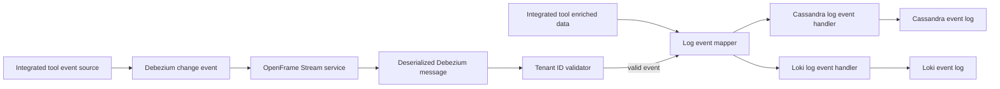
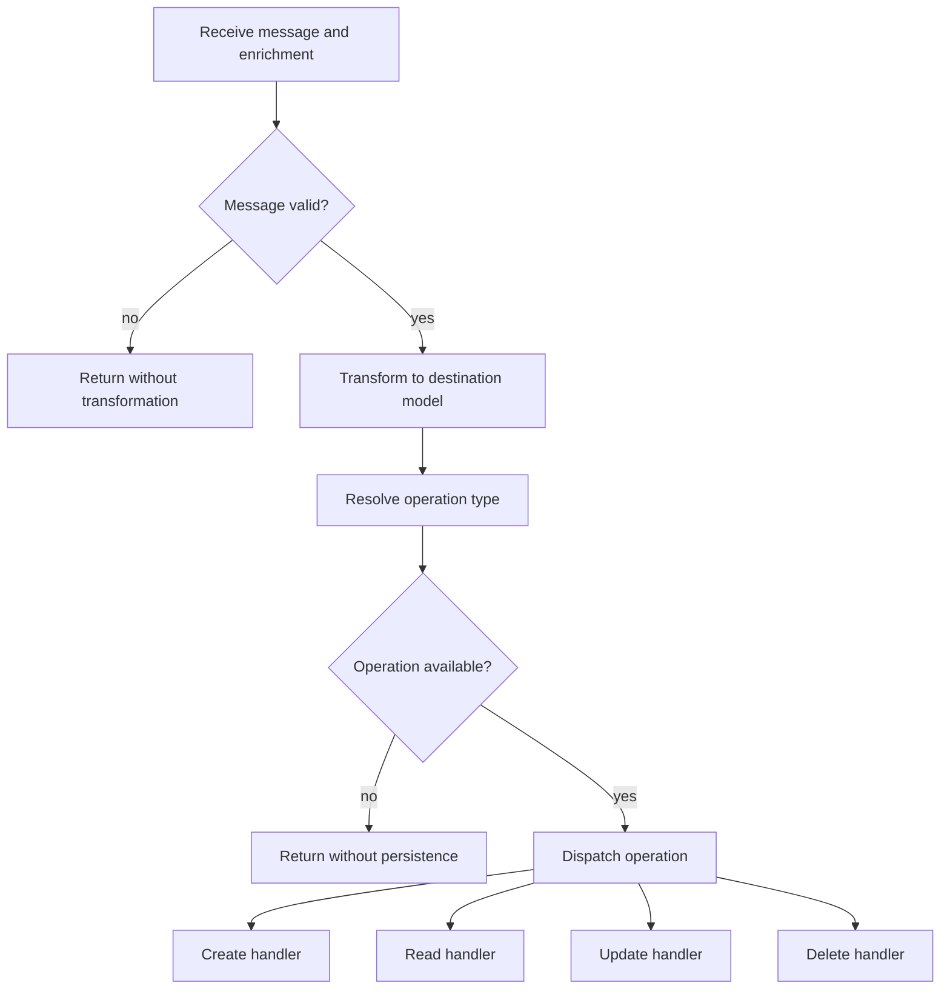
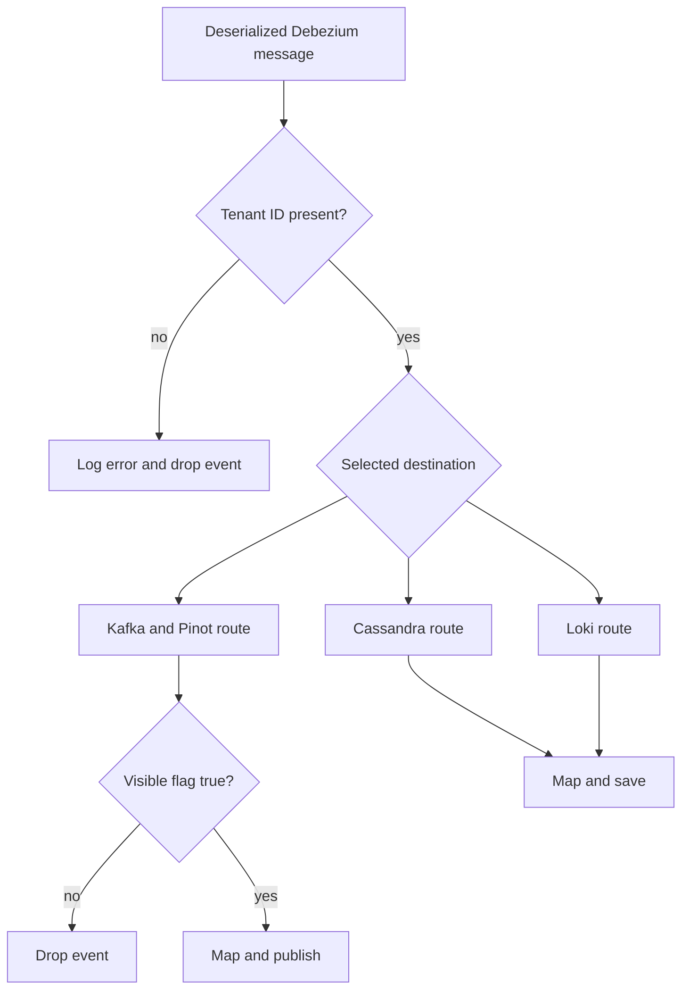
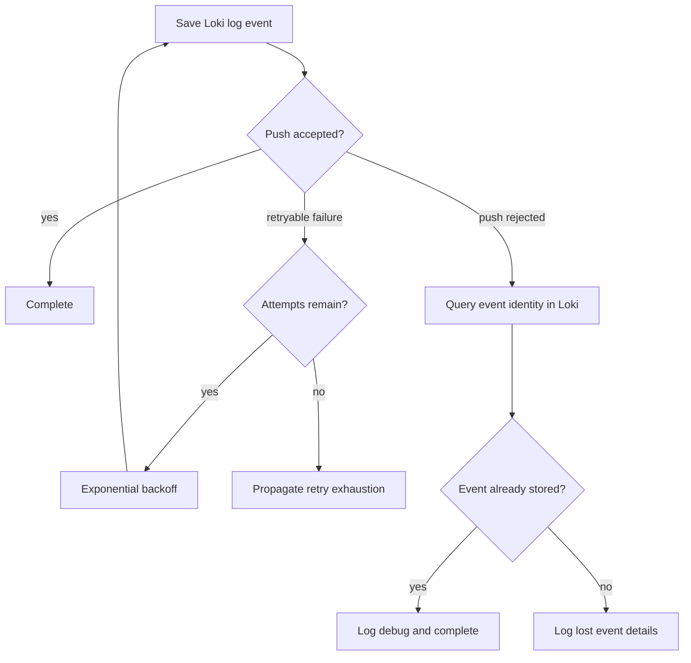
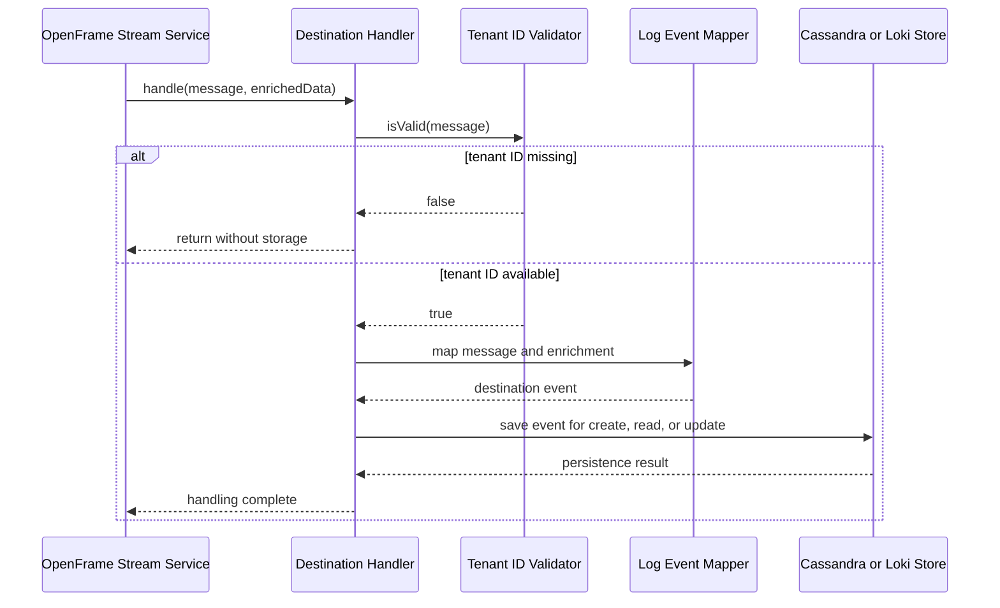

# Routing And Log Storage

Routing And Log Storage is the OpenFrame Stream service path that turns validated Debezium tool-event changes into durable, tenant-scoped log records. It is supplied by the OpenFrame OSS Library artifact `com.openframe.oss:openframe-stream-service-core` at version `7.0.11` and runs in this repository's OpenFrame Stream service.

The module has two responsibilities:

- apply a uniform change-operation lifecycle to a deserialized Debezium message;
- write supported create, read, and update events to Cassandra, Loki, or both, according to `openframe.tool-events.store`.

Delete operations are deliberately no-ops in every storage handler shown here. Events that lack a resolved tenant ID are rejected before transformation or storage, preventing a shared-cluster event from crossing tenant boundaries.

## Position In The Stream Pipeline

The surrounding Stream service consumes Kafka-based event streams and deserializes source changes. Routing And Log Storage operates after a `DeserializedDebeziumMessage` and its `IntegratedToolEnrichedData` are available. It maps the pair into storage-specific representations and persists them using enabled handlers.

The event source, deserialization, enrichment, and handler dispatch are outside this module. This module defines the shared handling contract, the tenant guard, and the Cassandra and Loki destination implementations.

## Component Responsibilities

| Component | Responsibility | Important behavior |
| --- | --- | --- |
| [GenericMessageHandler](https://github.com/flamingo-stack/openframe-oss-lib/blob/16e7c1cbd9664e7d10ec5ebca7d53c9bd314decf/openframe-stream-service-core/src/main/java/com/openframe/stream/handler/GenericMessageHandler.java) | Base operation dispatcher for a message plus enrichment data. | Rebuilds its Jackson mapper to accept empty strings as null objects; validates, transforms, derives the operation, then dispatches it. |
| [DebeziumKafkaMessageHandler](https://github.com/flamingo-stack/openframe-oss-lib/blob/16e7c1cbd9664e7d10ec5ebca7d53c9bd314decf/openframe-stream-service-core/src/main/java/com/openframe/stream/handler/DebeziumKafkaMessageHandler.java) | Abstract route for valid, visible tool events destined for Kafka and Pinot. | Maps to `IntegratedToolEvent`, publishes create, read, and update operations to a subclass-selected topic, and ignores deletes. |
| [TenantIdRequiredDebeziumEventValidator](https://github.com/flamingo-stack/openframe-oss-lib/blob/16e7c1cbd9664e7d10ec5ebca7d53c9bd314decf/openframe-stream-service-core/src/main/java/com/openframe/stream/handler/TenantIdRequiredDebeziumEventValidator.java) | Primary Debezium validation policy. | Rejects blank or absent tenant IDs and logs the dropped event's tool-event ID. |
| [CassandraLogEventHandler](https://github.com/flamingo-stack/openframe-oss-lib/blob/16e7c1cbd9664e7d10ec5ebca7d53c9bd314decf/openframe-stream-service-core/src/main/java/com/openframe/stream/handler/CassandraLogEventHandler.java) | Cassandra destination implementation. | Persists mapped events when Cassandra is available and the selected store is Cassandra or both. |
| [LokiLogEventHandler](https://github.com/flamingo-stack/openframe-oss-lib/blob/16e7c1cbd9664e7d10ec5ebca7d53c9bd314decf/openframe-stream-service-core/src/main/java/com/openframe/stream/handler/LokiLogEventHandler.java) | Loki destination implementation. | Persists mapped events when the selected store is Loki or both, with bounded retry and duplicate-aware rejected-push handling. |

## Shared Routing Contract

`GenericMessageHandler` owns the invariant processing sequence. Concrete handlers supply the three extension points: message validity, transformation, and operation-specific persistence.

All destinations follow the same operation policy:

| Debezium operation | Cassandra behavior | Loki behavior | Kafka and Pinot route behavior |
| --- | --- | --- | --- |
| Create | Save the mapped event. | Save the mapped event. | Publish the mapped event. |
| Read | Treated as create. | Treated as create. | Treated as create. |
| Update | Treated as create. | Treated as create. | Treated as create. |
| Delete | No action. | No action. | No action. |

The read and update behavior makes the destinations consume the latest mapped representation through their normal write path. The module itself does not implement record deletion.

## Tenant Isolation And Visibility

The primary validator requires a nonblank `tenantId`. When the tenant cannot be resolved, it emits an error containing the tool-event ID and returns `false`; the base lifecycle consequently does not transform or persist the event. Cassandra and Loki both use this validator.

The Kafka and Pinot route applies the same validator and adds an explicit visibility check: `isVisible` must be `true`. This route declares the common handler type and the Kafka/Pinot destination. Its broker key is deterministic:

1. `deviceId-toolType` when a device ID is present;
2. `userId-toolType` when no device ID is present but a user ID is present;
3. `toolType` otherwise.

## Storage Selection And Failure Semantics

The `openframe.tool-events.store` setting controls which concrete storage handlers are registered:

| Value | Cassandra handler | Loki handler |
| --- | --- | --- |
| `cassandra` | Enabled if Spring Data Cassandra is on the classpath. | Disabled. |
| `loki` | Disabled. | Enabled. |
| `both` | Enabled if Spring Data Cassandra is on the classpath. | Enabled. |

When Cassandra is the sole selected store, a runtime persistence error is propagated. In `both` mode, the Cassandra handler logs the failed event identity and allows processing to continue so Loki can still receive the event.

Loki uses at most six attempts for retryable `LokiPushException` and `LokiQueryException` failures. Retry delays begin at one second, double each time, and are capped at 30 seconds. A `LokiPushRejectedException` is not retried. After such a rejection, the handler queries Loki by tenant ID, tool type, event timestamp, and tool-event ID:

- if the event is already present, it logs a debug message and treats the rejection as harmless;
- otherwise, it logs that the event details were lost.

## Data Models And Mapping Boundary

Each destination handler receives `DeserializedDebeziumMessage` and `IntegratedToolEnrichedData`, then delegates model construction to `LogEventMapper`:

- Cassandra uses `toCassandraLogEvent` to produce `CassandraLogEvent`.
- Loki uses `toLokiLogEvent` to produce `LokiLogEvent`.
- The Kafka and Pinot path uses `toIntegratedToolEvent` to produce `IntegratedToolEvent`.

Keeping transformation in the mapper separates destination schemas from operation dispatch. Handler implementations should preserve that separation: validate input before mapping, use mapper output as the persistence payload, and keep destination-specific retry or failure policy at the storage edge.

## Component Interaction

## Operational Guidance

- Treat tenant resolution failures as data-routing defects, not as storage failures. A dropped event is identified in logs by its tool-event ID.
- In `both` mode, monitor Cassandra error logs separately from Loki ingestion. Cassandra failure is intentionally nonfatal in that mode, so successful overall processing does not prove Cassandra storage succeeded.
- Loki rejections need review even though an already-stored event is safely accepted. A rejected event that cannot be found by its identity is explicitly reported as lost.
- Do not assume deletes remove historical log entries. The implemented delete callbacks are empty.
- When adding a destination, preserve the common lifecycle and make its store-selection and failure policy explicit. Destination model mapping belongs in `LogEventMapper`, while persistence belongs in the handler.

## System Integration

Routing And Log Storage is part of the OpenFrame Stream service, one of the service images delivered by this repository. The tenant deployment includes Cassandra as a datasource; the Stream service's broader Kafka configuration and event deserialization are provided by the same OpenFrame OSS Library artifact. Log-query API layers can expose stored event data through their own configured backends, but this module is responsible only for validating, mapping, and routing incoming tool events to storage.
