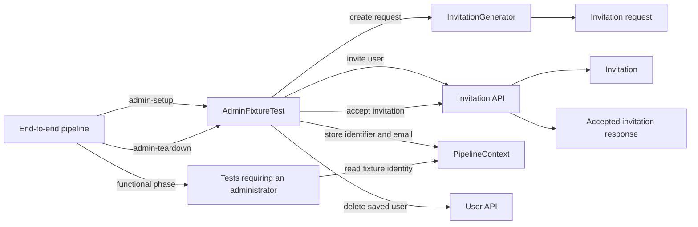
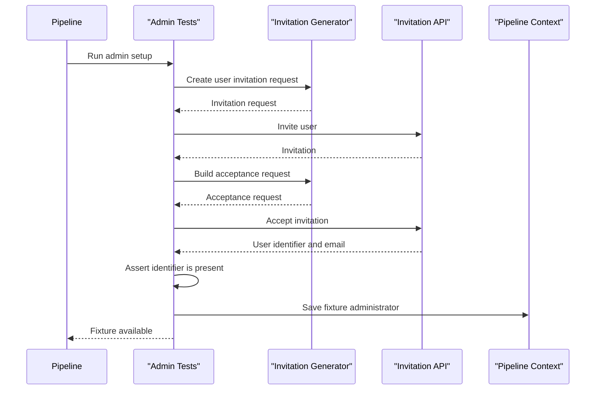
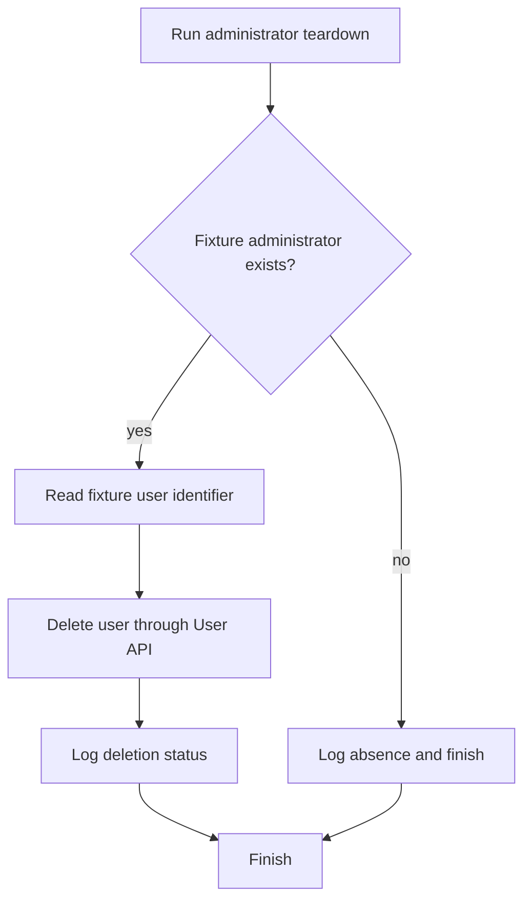
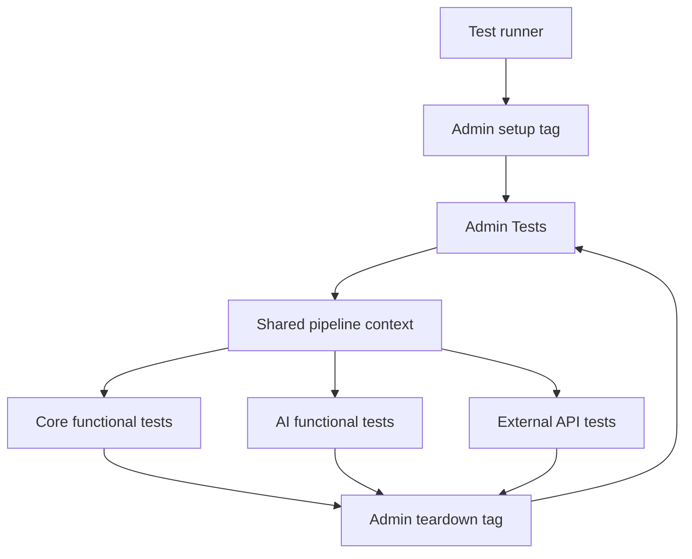

# Admin Tests

Admin Tests provides the pipeline-scoped administrator fixture used by the OpenFrame end-to-end test suite. It creates one invited-and-accepted administrator before functional tests run, records that identity in shared pipeline state, and removes it during final teardown. This solves the distinction between a newly registered tenant's OWNER and an ADMIN user: tests that need to select, assign, or query an administrator can rely on a single known fixture rather than creating competing users in individual test classes.

The implementation is supplied by the `com.openframe.oss:openframe-test-service-core` library at version `7.0.11`, which this repository consumes. The source is [AdminFixtureTest.java](https://github.com/flamingo-stack/openframe-oss-lib/blob/16e7c1cbd9664e7d10ec5ebca7d53c9bd314decf/openframe-test-service-core/src/main/java/com/openframe/test/tests/AdminFixtureTest.java). It is run by this repository's OpenFrame test service.

## Responsibilities

| Concern | Admin Tests behavior |
|---|---|
| Fixture provisioning | Generates an invitation request, invites a user, and accepts that invitation. |
| Shared identity | Stores the accepted user's identifier and email address in `PipelineContext`. |
| Execution ordering | Exposes separate `admin-setup` and `admin-teardown` JUnit tags so the pipeline can schedule lifecycle work around the functional phase. |
| Cleanup | Deletes the saved fixture user only when pipeline state says one was created. |
| Diagnostics | Emits lifecycle logs containing the fixture user identity and deletion status. |

## Architecture

`AdminFixtureTest` extends the common test base and coordinates existing API helpers rather than interacting directly with persistence. Its boundary is the administrator fixture lifecycle: invitation creation and acceptance on setup, followed by a user deletion request on teardown.

### Component roles

- **AdminFixtureTest** is the JUnit class carrying the `oss` suite tag and the two lifecycle-specific tags. It owns the creation and deletion workflow.
- **InvitationGenerator** creates the invitation payload and derives an acceptance payload from the returned invitation. This keeps setup aligned with the test suite's normal invitation model.
- **InvitationApi** performs the invite and acceptance operations. Acceptance yields the user identifier and email saved for later consumers.
- **PipelineContext** is the cross-test handoff. It makes the fixture independent of test-class ordering during the functional phase.
- **UserApi** performs the teardown deletion request using the stored identifier.

## Setup Process

The setup test, `setupAdminUser`, is tagged `admin-setup`. It is intended to run once before the functional phase, not once for every test class. The accepted invitation response is asserted to contain a non-null identifier before state is published, preventing downstream tests from receiving an incomplete fixture.

### Fixture invariant

After successful setup, exactly one administrator fixture is expected to exist for the pipeline run. The fixture is deliberately shared because a new tenant's initial OWNER role is not interchangeable with ADMIN. Functional tests can therefore use the saved administrator where application behavior requires an ADMIN member, such as administrator-oriented user selection or assignment workflows.

## Teardown Process

The teardown test, `teardownAdminUser`, is tagged `admin-teardown` and is intended to run at the end of the pipeline. It first checks `PipelineContext.hasFixtureAdmin()`.

- When no fixture was published, teardown logs that there is nothing to delete and exits without calling the user endpoint.
- When a fixture exists, teardown calls `UserApi.deleteUser` with the saved identifier and logs the returned HTTP status code.

This guard supports failed or skipped setup phases while avoiding an attempt to delete an unknown user.

## Pipeline Integration

Admin Tests sits in the test-service layer, alongside test runner, authentication flows, DTOs, UI page objects, and other functional suites. Its purpose is not to validate a standalone feature; it establishes prerequisite state for tests that assume an administrator already exists.

The diagram shows the intended lifecycle dependency, not a guarantee that every suite consumes the fixture. The only direct fixture contract in this module is publishing and later deleting the stored administrator identity.

## Maintenance Notes

- Preserve the separation between the OWNER created during tenant registration and the ADMIN created here. Collapsing those roles can hide authorization defects in tests that require an administrator.
- Keep setup and teardown tags paired with the pipeline's lifecycle scheduling. Running teardown before dependent tests invalidates their shared context.
- Keep the identifier assertion before the `PipelineContext` write. A missing identifier would cause downstream failures and make cleanup ambiguous.
- Teardown currently logs the deletion status rather than asserting a successful status. When changing this behavior, consider cleanup reliability after partial test failures.
- Avoid creating per-test administrator fixtures unless isolation is explicitly needed; this module exists to prevent cross-class ordering and duplicate-fixture issues.

## Boundaries

Admin Tests does not define invitation transport, user deletion behavior, pipeline-state storage, or role authorization rules. It composes those facilities from the test-service library to establish a predictable ADMIN fixture for the surrounding end-to-end suite.
