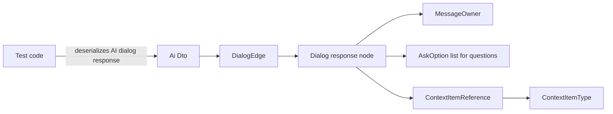
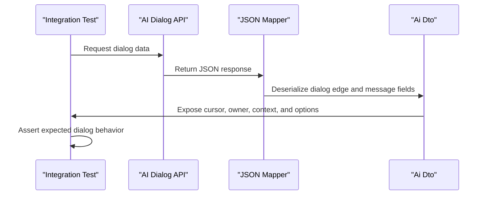

# Ai Dto

Ai Dto is a small set of JSON data-transfer objects used by the OpenFrame test service when it reads AI-dialog responses. The types provide a stable, tolerant representation of an AI conversation's pagination, ownership metadata, user-selectable questions, and referenced context.

The implementation is supplied by the `com.openframe.oss:openframe-test-service-core` library, version `7.0.11`, from the OpenFrame OSS Library. This repository assembles that library in the OpenFrame test service; the DTO source is maintained in the library rather than in this repository.

## Purpose and Boundaries

Ai Dto is a test-side response model. It does not call an AI provider, select a model, resolve a ticket, or execute an action. Instead, it deserializes the fields a test needs in order to inspect an AI dialog:

- a dialog connection item and its pagination cursor;
- an assistant reply's resolved model and provider metadata;
- a contextual entity reference that enriches prompt text; and
- the alternatives included with an AI question.

The module deliberately uses tolerant Jackson annotations on response-shaped objects. `AskOption`, `DialogEdge`, and `MessageOwner` ignore unrecognized JSON fields, so tests can continue reading known fields while the upstream response gains fields. `ContextItemReference` omits null fields during serialization.

## Architecture Overview

`DialogResponse` is represented as the node carried by `DialogEdge`, and the documented question payload is represented by an options collection of `AskOption` values. Those adjacent response types are referenced by the provided component documentation but are not core components of Ai Dto, so this page documents only the contract visible from the supplied code.

## Core Contracts

| Contract | Responsibility | Serialization behavior |
|---|---|---|
| [AskOption](https://github.com/flamingo-stack/openframe-oss-lib/blob/16e7c1cbd9664e7d10ec5ebca7d53c9bd314decf/openframe-test-service-core/src/main/java/com/openframe/test/data/dto/ai/AskOption.java) | Represents one candidate offered with an AI question, using `label` and `description`. | Ignores unknown input fields. |
| [ContextItemReference](https://github.com/flamingo-stack/openframe-oss-lib/blob/16e7c1cbd9664e7d10ec5ebca7d53c9bd314decf/openframe-test-service-core/src/main/java/com/openframe/test/data/dto/ai/ContextItemReference.java) | Identifies prompt-enriching context with a `type` and an `id`. | Excludes null properties from output. |
| [ContextItemType](https://github.com/flamingo-stack/openframe-oss-lib/blob/16e7c1cbd9664e7d10ec5ebca7d53c9bd314decf/openframe-test-service-core/src/main/java/com/openframe/test/data/dto/ai/ContextItemType.java) | Limits context references to supported domain categories. | Java enum. |
| [DialogEdge](https://github.com/flamingo-stack/openframe-oss-lib/blob/16e7c1cbd9664e7d10ec5ebca7d53c9bd314decf/openframe-test-service-core/src/main/java/com/openframe/test/data/dto/ai/DialogEdge.java) | Wraps a dialog response node with its pagination `cursor`. | Ignores unknown input fields. |
| [MessageOwner](https://github.com/flamingo-stack/openframe-oss-lib/blob/16e7c1cbd9664e7d10ec5ebca7d53c9bd314decf/openframe-test-service-core/src/main/java/com/openframe/test/data/dto/ai/MessageOwner.java) | Records owner type and, for assistant messages, resolved model, display name, and provider. | Ignores unknown input fields. |

## Context References

`ContextItemReference` pairs an identifier with `ContextItemType`. The supported categories are `DEVICE`, `SCRIPT`, `TICKET`, `ORGANIZATION`, `USER`, `KB_ARTICLE`, `POLICY`, `QUERY`, and `SCHEDULED_SCRIPT`.

A context item enriches the prompt text only. In particular, a device reference does **not** select the machine on which an action executes: the source documentation states that execution target resolution comes from the dialog's ticket. Tests should therefore assert prompt context separately from target-selection behavior.

## Dialog Inspection Flow

### Pagination

`DialogEdge` provides the connection-style boundary: `cursor` identifies the edge position and `node` holds the dialog response. Test code can use the cursor to distinguish individual responses when inspecting a paginated dialog result, while assertions are made against fields on the node.

### Questions and Ambiguity

When an AI response asks for clarification, each `AskOption` supplies a concise `label` and a supporting `description`. These options are useful diagnostics for a failed test: they reveal which alternatives the router considered plausible and help maintainers adjust an ambiguous test prompt so that the intended path proceeds without a follow-up question.

### Message Attribution

`MessageOwner` always carries its owner `type`. Assistant-originated messages may also contain:

- `model`: the resolved model identifier;
- `modelName`: the model display name; and
- `providerName`: the provider display name.

The optional assistant fields are populated from assistant settings when the message is saved. Tests that validate model routing can use these persisted values rather than inferring the selected model from response text.

## Implementation Notes

All five DTOs use Lombok to provide data accessors and builders. `AskOption`, `ContextItemReference`, `DialogEdge`, and `MessageOwner` also expose no-argument and all-argument constructors. This supports Jackson binding and concise fixture construction in test code.

Maintain the established compatibility posture when extending a response contract:

1. Keep fields narrowly focused on observable test behavior.
2. Preserve tolerant deserialization for API response DTOs where forward compatibility is required.
3. Treat context references as prompt metadata, not execution routing instructions.
4. Assert structured fields such as cursors, options, and owner metadata instead of matching generated prose alone.

## System Role

Ai Dto belongs to the test data layer of the OpenFrame test service. It supports the AI-focused test suite by converting API responses into typed values that can be checked by tests for Fae and Mingo conversation scenarios. It is a consumer-facing test contract, separate from the runtime AI orchestration services and from the application API implementations that produce dialog responses.