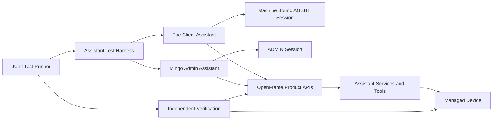
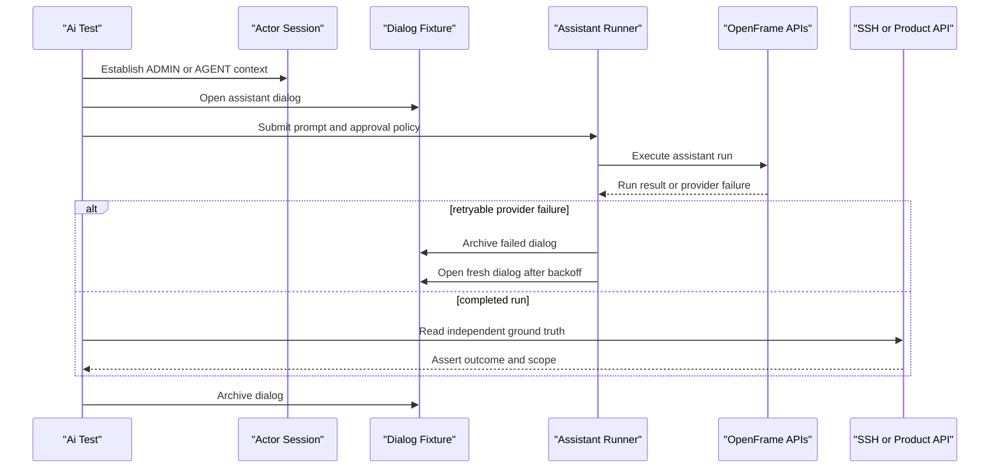

# Ai Tests

## Purpose

Ai Tests is the end-to-end acceptance suite for the OpenFrame AI assistants. It exercises two distinct assistant surfaces supplied by the `com.openframe.oss:openframe-test-service-core` library at version `7.0.11`:

- **Fae** is the client assistant. Tests act as the enrolled device's AGENT identity and validate that operations are limited to that identity's machine.
- **Mingo** is the administrative assistant. Tests run with the administrator surface and validate tenant-wide operations, including multi-device actions and managed entities.

The suite sends prompts through product APIs, waits for real assistant runs, and verifies observable results through independent channels such as SSH or product APIs. It therefore detects false success claims as well as failed side effects.

## Architecture Overview

## Test Design Principles

- **Actor-aware coverage:** Fae opens an `AgentSession` backed by credentials read from the SSH-verified target; Mingo uses the administrative test context.
- **Independent assertions:** Mutating device cases verify remote state over SSH. Entity cases query the relevant product API. Assertions do not rely solely on generated prose.
- **Isolation and cleanup:** Tests use run-specific identifiers, archive dialogs, remove temporary files, and close or resolve seeded entities. Tenant-wide model switching is isolated and restores its prior configuration.
- **Reliable provider handling:** Shared base classes retry retryable upstream model-provider failures with exponential backoff and jitter. Each retry opens a fresh dialog so prior failures do not affect the succeeding conversation.
- **Meaningful negatives:** Safety tests prove a request reached the relevant decision point before treating the absence of a side effect as a pass, avoiding vacuous green results caused by unrelated tenant policy.

## Execution Flow

## Component Areas

Detailed documentation is organized into the following generated submodules:

- [Fae Client Assistant Tests](fae_client_assistant_tests.md) cover device operations, machine scope, capability boundaries, approval and injection safety, lifecycle behavior, and client-owned ticket reopening.
- [Mingo Administrator Assistant Tests](mingo_administrator_assistant_tests.md) cover device and fleet operations, directory and entity workflows, Fleet MDM management, safety, conversation lifecycle behavior, and ticketing.

## System Context

Ai Tests is library code from the OpenFrame OSS Library, executed by this repository's `openframe/services/openframe-test` service. It validates behavior that spans the tenant deployment: assistant APIs, agent identity, managed devices, ticketing, knowledge base, scripts, Fleet MDM, and tenant AI settings. The test service is part of the repository's published `com.openframe:openframe-test` artifact.

Source files are maintained in the OpenFrame OSS Library under its AI test package. The detailed submodule documentation identifies the corresponding classes and test responsibilities.
