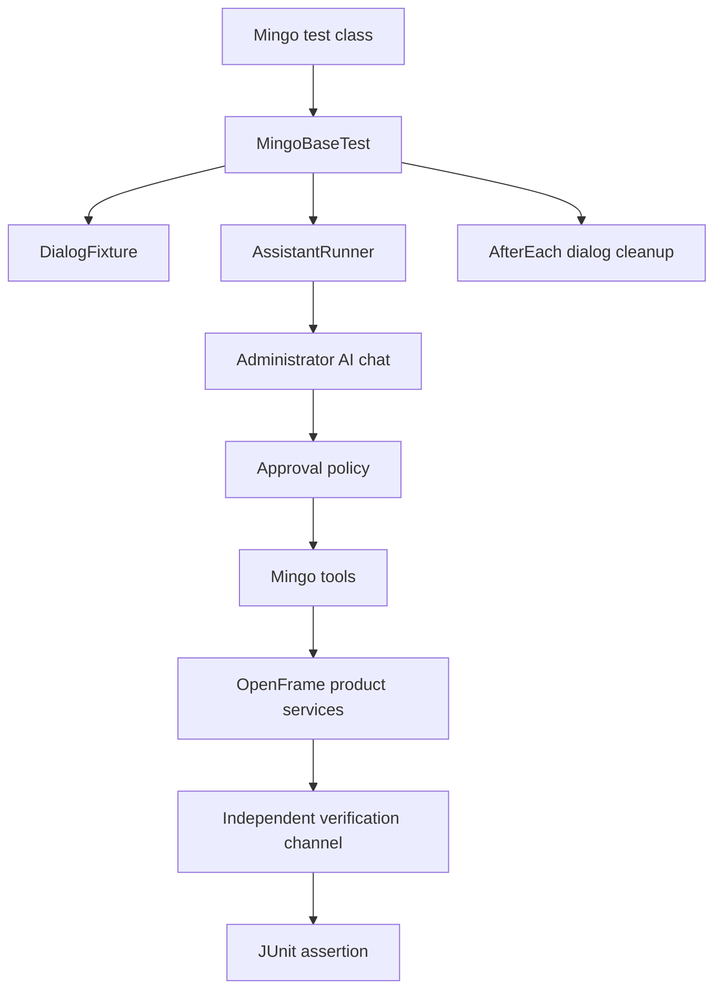
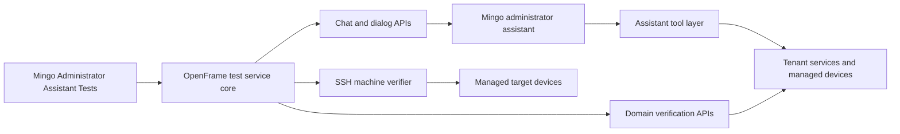
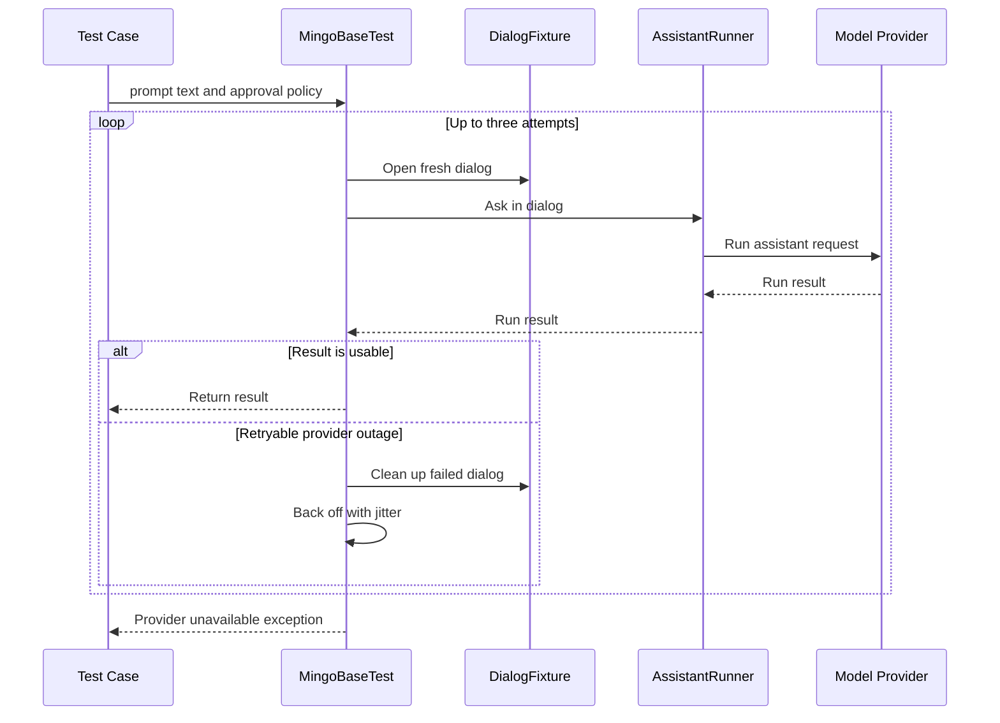
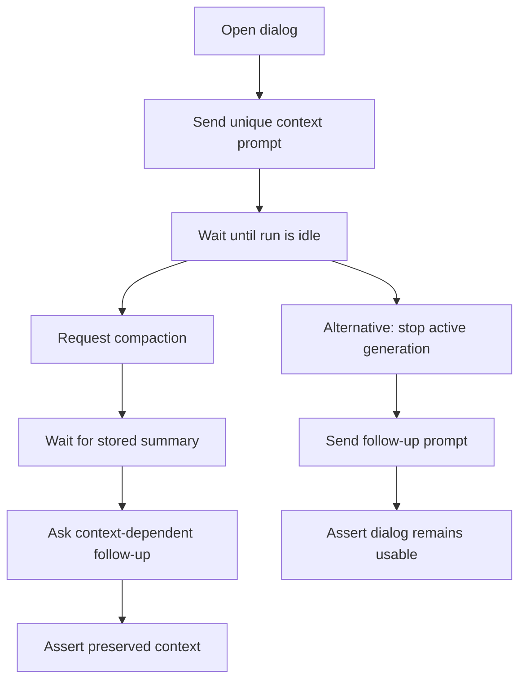
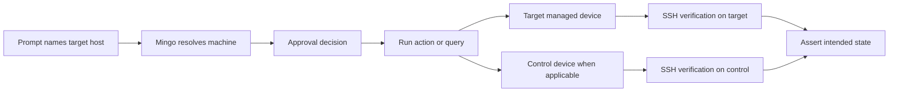
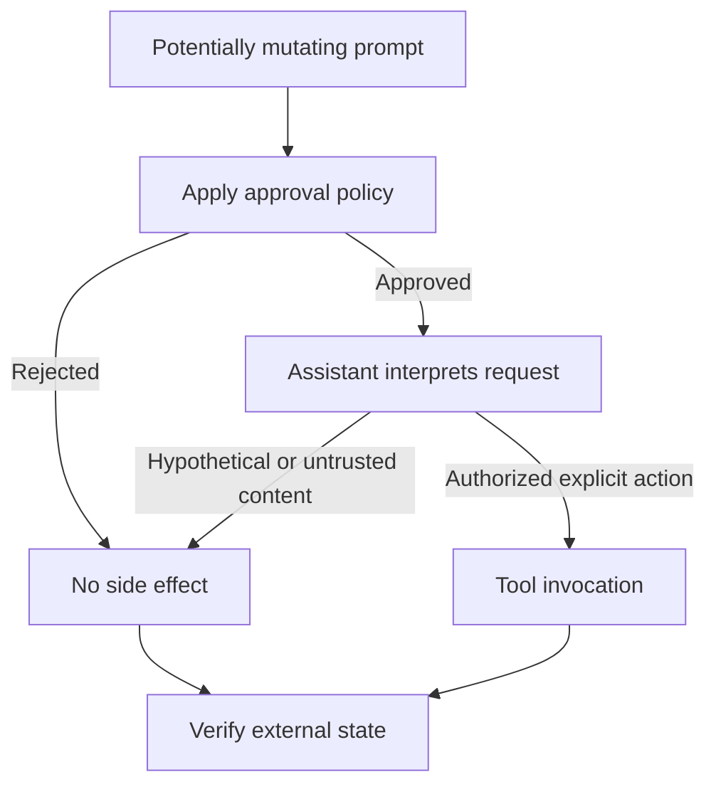

# Mingo Administrator Assistant Tests

Mingo Administrator Assistant Tests is the end-to-end validation suite for Mingo, the administrator-facing AI assistant. It is supplied by the OpenFrame OSS Library artifact `com.openframe.oss:openframe-test-service-core` version `7.0.11` and is run by this repository's OpenFrame test service. The suite sends prompts through the product's administrator AI chat, applies an approval policy, and verifies outcomes through independent product APIs or SSH rather than trusting generated prose.

The tests cover dialog lifecycle behavior, context preservation, model changes, cancellation, directory and web queries, tickets, scripts, knowledge base content, Fleet MDM resources, machine operations, multi-host scoping, and safety boundaries.

## Scope and Test Principles

The module is organized around `MingoBaseTest` and ten focused JUnit test classes. All classes carry the `ai` and `mingo` tags; focused tags such as `fleet`, `negative`, `compaction`, and `stop` allow selective execution.

| Area | Test class | Primary verification channel |
| --- | --- | --- |
| Shared dialog and provider handling | `MingoBaseTest` | Dialog fixture and run result |
| Context compaction | `MingoCompactionTest` | Dialog and message APIs |
| Single-device operations | `MingoDeviceTest` | Independent SSH verifier |
| Scripts and knowledge base mutations | `MingoEntityMutationTest` | Script and Knowledge Base APIs |
| Directory and web queries | `MingoEntityQueryTest` | Product APIs and executed-tool record |
| Multi-host scoping | `MingoFleetTest` | Independent SSH on target and control hosts |
| Fleet MDM policies and queries | `MingoMdmTest` | Fleet monitoring API |
| Model switching | `MingoModelSwitchTest` | AI settings API and run metadata |
| Safety controls | `MingoSafetyTest` | SSH, ticket API, and Knowledge Base API |
| Generation cancellation | `MingoStopGenerationTest` | Dialog API and follow-up run |
| Workspace ticketing | `MingoTicketingTest` | Ticket API |

## Architecture

The tests exercise a deployed tenant through its public product interfaces. Test setup may create fixtures directly, but the action under test always originates as a Mingo prompt. A separate channel then checks durable state or host state.

### Runtime Dependencies

The module depends on the following test infrastructure and product capabilities:

- `DialogFixture`, `AssistantRunner`, `RunResult`, approval policies, waiters, and provider-error classification drive and observe a chat run.
- Dialog and message APIs create conversations, submit direct messages where timing matters, compact history, and stop active generation.
- Domain APIs read or seed scripts, knowledge base items, organizations, users, devices, Fleet policies, scheduled queries, and tickets.
- `SshMachineVerifier` independently reads machine state, writes setup fixtures, and removes test artifacts on managed hosts.
- The configured administrator AI model and tool layer perform the actual Mingo operation.

## Shared Execution Lifecycle

[`MingoBaseTest`](https://github.com/flamingo-stack/openframe-oss-lib/blob/16e7c1cbd9664e7d10ec5ebca7d53c9bd314decf/openframe-test-service-core/src/main/java/com/openframe/test/tests/ai/MingoBaseTest.java) centralizes the behavior that must be consistent across Mingo cases.

- `prompt(text)` uses automatic approval; the overload accepts an explicit `ApprovalPolicy` for tests that must reject a proposed action.
- Every prompt attempt opens a new dialog. A fresh dialog prevents duplicate user input and previous conversation-wide errors from affecting a retry.
- Retryable model-provider failures are detected by `ProviderErrorClassifier`. The base class makes at most three attempts, with exponential backoff beginning at five seconds plus random jitter.
- Exhausted retryable failures become `ProviderUnavailableException`; interruption during backoff becomes `InfraFailureException` while preserving the thread interruption status.
- The most recently opened dialog is archived in `@AfterEach` cleanup.
- `onlineWindowsDevice()` obtains an online Windows machine with a Fleet connection for tests that require an unambiguous real device.

## Behavioral Coverage

### Conversation Continuity and Lifecycle

[`MingoCompactionTest`](https://github.com/flamingo-stack/openframe-oss-lib/blob/16e7c1cbd9664e7d10ec5ebca7d53c9bd314decf/openframe-test-service-core/src/main/java/com/openframe/test/tests/ai/MingoCompactionTest.java) validates manual context compaction. It places a unique reference code in a dialog, requests compaction once the chat is idle, confirms the generated summary preserves that code, and confirms a later prompt can retrieve it. It also checks that Mingo can answer a current UTC-time request after compaction.

The same class pins protocol boundaries: an empty chat returns `422`, a second compaction without new history returns `422`, and compaction while a reply is active returns `409`. Threshold-triggered compaction is intentionally excluded because reaching the threshold requires a very long conversation.

[`MingoStopGenerationTest`](https://github.com/flamingo-stack/openframe-oss-lib/blob/16e7c1cbd9664e7d10ec5ebca7d53c9bd314decf/openframe-test-service-core/src/main/java/com/openframe/test/tests/ai/MingoStopGenerationTest.java) starts a long answer, invokes the dialog stop operation, requires a `200` response, and verifies that the partial text remains available and the dialog accepts a later prompt. It also confirms stopping an idle dialog is refused with `409`.

[`MingoModelSwitchTest`](https://github.com/flamingo-stack/openframe-oss-lib/blob/16e7c1cbd9664e7d10ec5ebca7d53c9bd314decf/openframe-test-service-core/src/main/java/com/openframe/test/tests/ai/MingoModelSwitchTest.java) is isolated because it changes tenant-wide administrator AI configuration. It records the original model, sends a memory-bearing prompt, applies an alternate model, then sends a follow-up in the same dialog. Assertions require the configured model to change while the reference code remains in conversation context. `@AfterAll` restores the original selection after a switch.

### Machine and Fleet Operations

[`MingoDeviceTest`](https://github.com/flamingo-stack/openframe-oss-lib/blob/16e7c1cbd9664e7d10ec5ebca7d53c9bd314decf/openframe-test-service-core/src/main/java/com/openframe/test/tests/ai/MingoDeviceTest.java) tests operations against an enrolled, online, SSH-reachable target. It covers file create, read, delete, append, nested directory creation, protected-path behavior, hostname and service-state queries, Windows build lookup, free-space reporting, dependent file operations, saved-script execution, and assistant-created script execution. Machine state is read independently over SSH; generated commands are not accepted as proof of success. Files, directories, and directly seeded scripts are tracked and removed after each test.

[`MingoFleetTest`](https://github.com/flamingo-stack/openframe-oss-lib/blob/16e7c1cbd9664e7d10ec5ebca7d53c9bd314decf/openframe-test-service-core/src/main/java/com/openframe/test/tests/ai/MingoFleetTest.java) extends this to a configured control machine. It verifies both positive scope and negative scope: a target-only write must not appear on the control host, while a two-host write must reach both. A live osquery request must invoke `runLiveQuery` and identify both hosts. The class is skipped if the control-host configuration is absent.

[`MingoMdmTest`](https://github.com/flamingo-stack/openframe-oss-lib/blob/16e7c1cbd9664e7d10ec5ebca7d53c9bd314decf/openframe-test-service-core/src/main/java/com/openframe/test/tests/ai/MingoMdmTest.java) tests Fleet MDM policy and scheduled-query workflows. It requires a named online Windows device when Mingo needs to validate SQL before saving. It verifies policy creation, in-place update, assignment to exactly one Fleet host, target-only deletion, scheduled-query creation, and target-only scheduled-query deletion. Policy and query state is checked with the Fleet monitoring API, and seeded resources are deleted best-effort during teardown.

### Product Entity, Directory, and Ticket Workflows

[`MingoEntityMutationTest`](https://github.com/flamingo-stack/openframe-oss-lib/blob/16e7c1cbd9664e7d10ec5ebca7d53c9bd314decf/openframe-test-service-core/src/main/java/com/openframe/test/tests/ai/MingoEntityMutationTest.java) verifies script creation, in-place update, scoped deletion, and knowledge base article creation through product APIs. Mutating tools require administrator approval, which the runner automatically approves for these cases. The script-create case is currently disabled; the remaining enabled cases verify persisted state and clean up their fixtures.

[`MingoEntityQueryTest`](https://github.com/flamingo-stack/openframe-oss-lib/blob/16e7c1cbd9664e7d10ec5ebca7d53c9bd314decf/openframe-test-service-core/src/main/java/com/openframe/test/tests/ai/MingoEntityQueryTest.java) checks read-only delegation. Organization, user, and online Windows-machine responses are compared to product API ground truth and must record use of `searchOrganizations`, `searchUsers`, or `searchMachines`. Its current-release web lookup must invoke `webSearch`. The OpenSSH CVE research case is disabled.

[`MingoTicketingTest`](https://github.com/flamingo-stack/openframe-oss-lib/blob/16e7c1cbd9664e7d10ec5ebca7d53c9bd314decf/openframe-test-service-core/src/main/java/com/openframe/test/tests/ai/MingoTicketingTest.java) validates workspace ticket creation and a valid transition to the tenant's resolved status. The ticket-create prompt explicitly identifies workspace ticketing tools to avoid routing the request as an OpenFrame support request. Assertions read the persisted ticket through `TicketApi`, and teardown resolves created fixtures.

### Safety Boundaries

[`MingoSafetyTest`](https://github.com/flamingo-stack/openframe-oss-lib/blob/16e7c1cbd9664e7d10ec5ebca7d53c9bd314decf/openframe-test-service-core/src/main/java/com/openframe/test/tests/ai/MingoSafetyTest.java) is the negative-behavior suite. It verifies that rejected approval prevents a file write, hypothetical wording does not delete a seeded file even with automatic approval, and a missing file is reported as absent instead of being fabricated. It also seeds prompt-injection text in a ticket and confirms that asking for a summary does not execute the embedded instruction. The analogous knowledge base injection test is currently disabled.

## Verification Model

The suite deliberately distinguishes the channel that performs an action from the channel that judges it:

1. Setup creates controlled fixtures directly only when the setup itself is not under test.
2. Mingo receives a prompt through a newly opened administrator AI dialog.
3. The configured approval policy permits or rejects the proposed tool action.
4. The test reads authoritative state through SSH or a product API.
5. Teardown removes files, scripts, policies, queries, articles, and tickets on a best-effort basis.

This design detects false-success responses, unintended blast radius, lost conversation state, and approvals that do not enforce their decision. It also separates infrastructure failures, such as an offline or unreachable test machine, from retryable model-provider outages.

## Operational Notes

- Device and Fleet cases require enrolled, online machines; device cases also require SSH reachability and a scratch directory.
- Multi-host cases additionally require control-host configuration. Without it, JUnit assumptions skip that class.
- Mingo may require a named online machine before it tests and saves a script, Fleet policy, or scheduled query. The relevant tests provide that hostname explicitly to avoid ambiguous historical device records.
- Mutating tests use unique `RunId` values for fixture names and content, preventing collisions and making cleanup safe.
- Disabled tests remain documented as coverage intent but do not execute until reviewed and repaired.
- The suite uses tenant-wide settings only in the isolated model-switch class and restores the previous configuration after it runs.

## Source Files

All implementation classes documented here are provided by the OpenFrame OSS Library artifact used by this repository:

- [Mingo Base Test](https://github.com/flamingo-stack/openframe-oss-lib/blob/16e7c1cbd9664e7d10ec5ebca7d53c9bd314decf/openframe-test-service-core/src/main/java/com/openframe/test/tests/ai/MingoBaseTest.java)
- [Mingo Compaction Test](https://github.com/flamingo-stack/openframe-oss-lib/blob/16e7c1cbd9664e7d10ec5ebca7d53c9bd314decf/openframe-test-service-core/src/main/java/com/openframe/test/tests/ai/MingoCompactionTest.java)
- [Mingo Device Test](https://github.com/flamingo-stack/openframe-oss-lib/blob/16e7c1cbd9664e7d10ec5ebca7d53c9bd314decf/openframe-test-service-core/src/main/java/com/openframe/test/tests/ai/MingoDeviceTest.java)
- [Mingo Entity Mutation Test](https://github.com/flamingo-stack/openframe-oss-lib/blob/16e7c1cbd9664e7d10ec5ebca7d53c9bd314decf/openframe-test-service-core/src/main/java/com/openframe/test/tests/ai/MingoEntityMutationTest.java)
- [Mingo Entity Query Test](https://github.com/flamingo-stack/openframe-oss-lib/blob/16e7c1cbd9664e7d10ec5ebca7d53c9bd314decf/openframe-test-service-core/src/main/java/com/openframe/test/tests/ai/MingoEntityQueryTest.java)
- [Mingo Fleet Test](https://github.com/flamingo-stack/openframe-oss-lib/blob/16e7c1cbd9664e7d10ec5ebca7d53c9bd314decf/openframe-test-service-core/src/main/java/com/openframe/test/tests/ai/MingoFleetTest.java)
- [Mingo MDM Test](https://github.com/flamingo-stack/openframe-oss-lib/blob/16e7c1cbd9664e7d10ec5ebca7d53c9bd314decf/openframe-test-service-core/src/main/java/com/openframe/test/tests/ai/MingoMdmTest.java)
- [Mingo Model Switch Test](https://github.com/flamingo-stack/openframe-oss-lib/blob/16e7c1cbd9664e7d10ec5ebca7d53c9bd314decf/openframe-test-service-core/src/main/java/com/openframe/test/tests/ai/MingoModelSwitchTest.java)
- [Mingo Safety Test](https://github.com/flamingo-stack/openframe-oss-lib/blob/16e7c1cbd9664e7d10ec5ebca7d53c9bd314decf/openframe-test-service-core/src/main/java/com/openframe/test/tests/ai/MingoSafetyTest.java)
- [Mingo Stop Generation Test](https://github.com/flamingo-stack/openframe-oss-lib/blob/16e7c1cbd9664e7d10ec5ebca7d53c9bd314decf/openframe-test-service-core/src/main/java/com/openframe/test/tests/ai/MingoStopGenerationTest.java)
- [Mingo Ticketing Test](https://github.com/flamingo-stack/openframe-oss-lib/blob/16e7c1cbd9664e7d10ec5ebca7d53c9bd314decf/openframe-test-service-core/src/main/java/com/openframe/test/tests/ai/MingoTicketingTest.java)
