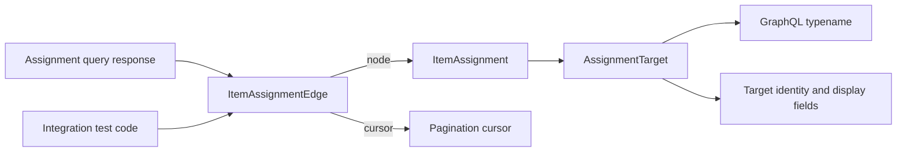
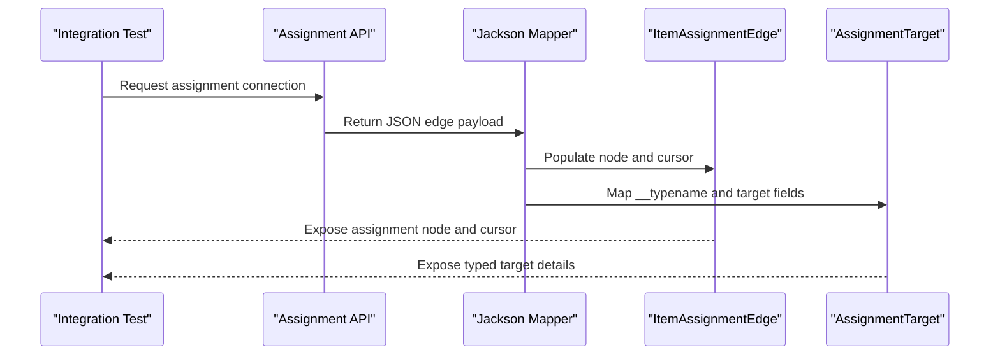

# Assignment Dto

Assignment Dto is a small test-support contract module supplied by the OpenFrame OSS Library's `openframe-test-service-core` artifact. It provides Jackson-deserializable Java DTOs that let integration tests model assignment query results: an assignable target and the cursor-wrapped edge that carries an assignment record.

The code runs with this repository's OpenFrame test service through the `com.openframe.oss:openframe-test-service-core` dependency. Its source lives in the OpenFrame OSS Library rather than this repository:

- [Assignment Target](https://github.com/flamingo-stack/openframe-oss-lib/blob/16e7c1cbd9664e7d10ec5ebca7d53c9bd314decf/openframe-test-service-core/src/main/java/com/openframe/test/data/dto/assignment/AssignmentTarget.java)
- [Item Assignment Edge](https://github.com/flamingo-stack/openframe-oss-lib/blob/16e7c1cbd9664e7d10ec5ebca7d53c9bd314decf/openframe-test-service-core/src/main/java/com/openframe/test/data/dto/assignment/ItemAssignmentEdge.java)

## Purpose

Tests that query assignments need a stable in-memory representation of a polymorphic assignment target and a cursor-based result edge. Assignment Dto deliberately ignores fields that are not represented in the DTOs, allowing test payloads to evolve without breaking deserialization when unrelated API fields are added.

## Architecture

`ItemAssignmentEdge` follows the common connection-edge shape: `node` contains an `ItemAssignment` object and `cursor` preserves the opaque pagination position returned by the API. `ItemAssignment` is referenced by the edge but is not one of this module's supplied core components, so this module does not define or reinterpret its assignment-specific fields.

`AssignmentTarget` represents the object to which an assignment points. The `__typename` GraphQL discriminator is mapped to `typename`, so tests can distinguish target variants without custom JSON parsing.

## Components

### Assignment Target

`AssignmentTarget` is a Lombok-generated data carrier with builder, no-argument constructor, all-argument constructor, getters, setters, equality, and string representation.

| Field | Purpose |
| --- | --- |
| `typename` | Value of the GraphQL `__typename` discriminator. The source comments note that a ticket target uses the trimmed type from the assignment schema. |
| `id` | Target identifier. |
| `ticketNumber` | Ticket number when the target is a ticket. |
| `title` | Target title. |
| `statusKind` | Target status classification. |
| `name` | Target display name. |
| `machineId` | Machine identifier when the target is device-related. |
| `hostname` | Machine hostname when available. |

The class is annotated with `@JsonIgnoreProperties(ignoreUnknown = true)`. This makes decoding forward-compatible for additive response changes. `@JsonProperty("__typename")` is required because the JSON field name cannot map directly to the Java `typename` property using normal bean conventions.

### Item Assignment Edge

`ItemAssignmentEdge` is the pagination wrapper around one assignment result.

| Field | Purpose |
| --- | --- |
| `node` | The `ItemAssignment` payload for this result. |
| `cursor` | Cursor associated with this edge for connection pagination. |

It has the same Lombok and Jackson tolerance pattern as `AssignmentTarget`: tests can construct expected results using the builder or deserialize API responses using the no-argument constructor and setters.

## Data Flow

## Design Considerations

- **Polymorphic targets:** Consumers should inspect `typename` before asserting fields that only make sense for a particular target kind, such as `ticketNumber` or `hostname`.
- **Nullable variant fields:** The structure combines ticket-oriented and machine-oriented fields. A test should treat fields outside the active target variant as optional.
- **Pagination:** Preserve and use the edge cursor when a test validates multi-page assignment queries.
- **Forward-compatible decoding:** Unknown response properties are intentionally ignored. Assertions should target the fields that the scenario requires rather than require a complete response shape.
- **Test-only boundary:** These classes are fixtures/contracts for the test service. They do not implement assignment persistence, authorization, or query resolution.

## Relationship to the Platform

Assignment Dto is part of the OpenFrame test service's DTO layer. Assignment behavior itself is exposed by the API layer and backed by platform data services; this module only provides Java objects for interpreting assignment responses during automated tests. The repository consumes the OpenFrame OSS Library at version `7.0.11`, where this artifact is supplied as `com.openframe.oss:openframe-test-service-core`.
