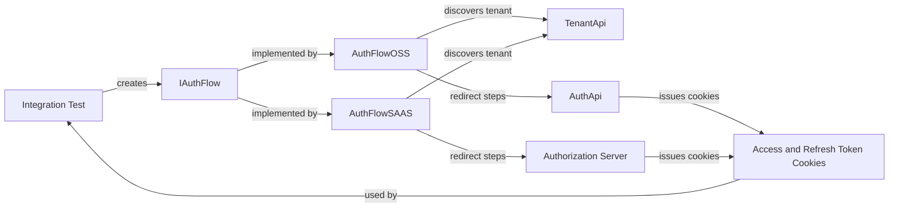
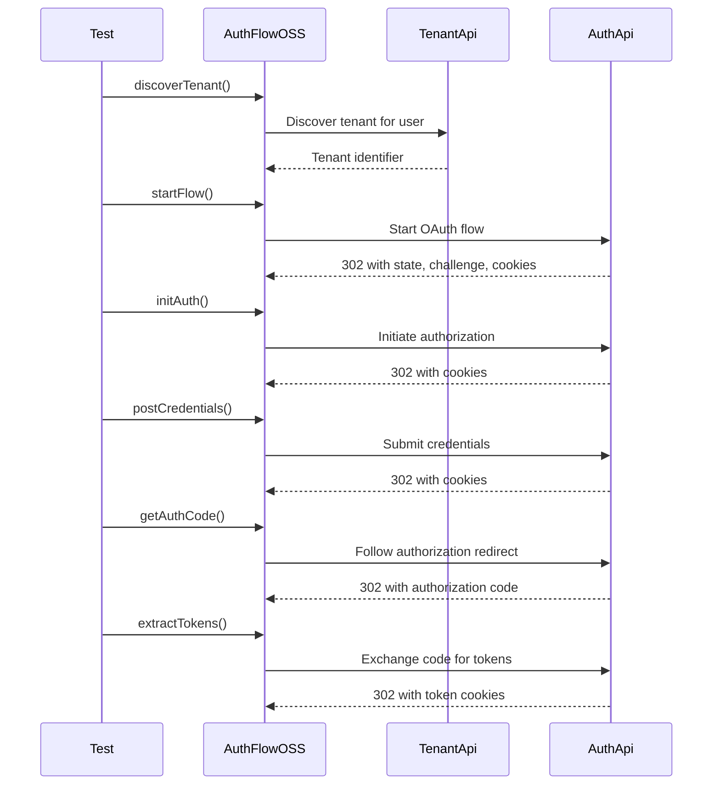
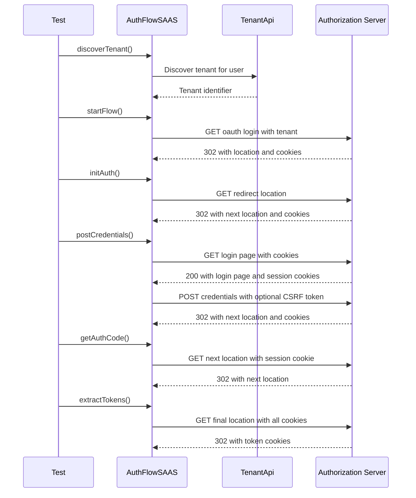

# Auth Flow

Auth Flow is a test-support module in the `openframe-test-service-core` library. It gives integration tests a common, fluent contract for completing a browser-style login and returning the resulting `access_token` and `refresh_token` cookies. The module has separate implementations for OSS and SaaS deployments because their redirect entry points differ, while retaining one six-stage workflow.

The implementation is supplied by the OpenFrame OSS Library artifact `com.openframe.oss:openframe-test-service-core`, version `7.0.11`, and is run by this repository's OpenFrame test service. Its source is maintained in the OpenFrame OSS Library: [IAuthFlow](https://github.com/flamingo-stack/openframe-oss-lib/blob/16e7c1cbd9664e7d10ec5ebca7d53c9bd314decf/openframe-test-service-core/src/main/java/com/openframe/test/api/auth/IAuthFlow.java), [AuthFlowOSS](https://github.com/flamingo-stack/openframe-oss-lib/blob/16e7c1cbd9664e7d10ec5ebca7d53c9bd314decf/openframe-test-service-core/src/main/java/com/openframe/test/api/auth/AuthFlowOSS.java), and [AuthFlowSAAS](https://github.com/flamingo-stack/openframe-oss-lib/blob/16e7c1cbd9664e7d10ec5ebca7d53c9bd314decf/openframe-test-service-core/src/main/java/com/openframe/test/api/auth/AuthFlowSAAS.java).

## Purpose and Boundaries

Auth Flow is a client-side test driver, not an authorization-server implementation. It deliberately:

- resolves the tenant for a supplied test user before beginning authentication;
- follows the required redirect chain one response at a time, with automatic redirects disabled;
- retains session and authorization cookies across stages;
- supplies the user's credentials at the login stage;
- extracts the final access and refresh token cookies for authenticated test requests; and
- asserts the expected HTTP status at every redirect or login-page boundary.

It does not validate token contents, determine authorization policy, or persist users. Those responsibilities remain in the authorization server and test fixtures.

## Architecture

The shared interface makes the deployment choice transparent to a caller. `AuthFlowOSS` delegates the protocol operations to test API helpers, whereas `AuthFlowSAAS` issues its own RestAssured requests against the configured authentication URL. In either case, the output is intentionally limited to the two token cookies when they are present.

## Shared Contract

`IAuthFlow` defines the ordered operations below. Each mutating method returns `IAuthFlow`, allowing tests to chain the entire flow. `extractTokens()` is terminal and returns a string-to-string cookie map.

| Stage | Contract method | Expected result |
|---|---|---|
| Tenant discovery | `discoverTenant()` | Resolves a tenant identifier for the test user. |
| Flow start | `startFlow()` | Starts the deployment-specific OAuth login path and captures redirect state. |
| Authorization initialization | `initAuth()` | Advances to the authorization-server login sequence. |
| Credential submission | `postCredentials()` | Submits the test user's email and password while preserving the current session. |
| Authorization code | `getAuthCode()` | Advances the callback redirect that makes an authorization code available. |
| Token extraction | `extractTokens()` | Completes the final redirect and returns `access_token` and `refresh_token` cookies when set. |

The implementations use a `302` assertion for every redirect transition. The SaaS credential-page fetch is the exception: it is asserted as `200` because the page body is needed to read its CSRF input.

## OSS Flow

`AuthFlowOSS` uses `TenantApi.discoverTenant(user)` and generates an `AuthParts` value after discovery. That value carries the user and tenant context through the helper calls in `AuthApi`.

1. `startFlow()` starts the OAuth flow, requires a `302`, and reads `state` and `code_challenge` from the `Location` header. It saves all response cookies.
2. `initAuth()` invokes the authorization-initiation helper and merges newly returned cookies.
3. `postCredentials()` submits the credentials through the helper and merges the next cookie set.
4. `getAuthCode()` follows the next redirect, extracts the `code` query parameter from its `Location` header, and saves it in `AuthParts`.
5. `extractTokens()` exchanges that code through the helper. It returns only `access_token` and `refresh_token` if the response sets them.

The implementation therefore preserves OAuth correlation values and redirect-derived authorization data inside `AuthParts`, while exposing only token cookies to tests.

## SaaS Flow and CSRF Handling

`AuthFlowSAAS` maintains a tenant identifier, the current redirect target, and a cumulative cookie map. It begins with a non-followed request to `oauth/login` at the configured authentication URL and sends the tenant identifier as a query parameter. Each redirect location becomes the next request target.

The implementation uses relaxed HTTPS validation for its test requests. It disables URL encoding while following redirect URLs so an existing query string is preserved. Credential submission restores URL encoding because the CSRF value can contain characters that require form encoding.

Before posting credentials, `postCredentials()` fetches the login page with the accumulated cookies and requires `200`. It extracts a hidden `_csrf` input regardless of whether `name` or `value` appears first in the input element. If a token is found, it is added to the form with the user's email and password. If no token exists, the request proceeds without it to retain compatibility with deployments where the login page does not yet enforce CSRF.

The credential POST sends the current `JSESSIONID`, does not follow redirects, expects `302`, and merges subsequent cookies. Later calls use the next redirect target and session cookie to reach the authorization-code stage, then request the final target with all accumulated cookies to obtain the token cookies.

## Component Responsibilities

| Component | Responsibility |
|---|---|
| `IAuthFlow` | Defines a deployment-neutral, ordered API for tenant discovery, redirect progression, credential submission, authorization-code retrieval, and token extraction. |
| `AuthFlowOSS` | Drives the OSS flow through `TenantApi` and `AuthApi`, stores redirect state, code challenge, cookies, and authorization code in `AuthParts`. |
| `AuthFlowSAAS` | Drives the SaaS redirect sequence directly with RestAssured, retains a cumulative cookie jar, and conditionally submits a page-derived CSRF token. |

## Operational and Test Considerations

- Call the methods in contract order. Each later stage depends on tenant data, redirect location, cookies, or authorization data produced by an earlier stage.
- Treat a missing token cookie as an authentication-flow outcome for the caller to assess. Both implementations return only cookies actually present in the final response.
- The SaaS helper intentionally supports both CSRF-enabled and older login pages. A missing hidden `_csrf` field is logged and does not itself fail the flow.
- Do not convert the explicit redirect requests into automatic redirect following. The helpers must inspect `Location` headers and capture cookies at intermediate boundaries.
- The authorization service configuration, including the CSRF protection applied to the login POST path, belongs to the OpenFrame OSS Library's [authorization security configuration](https://github.com/flamingo-stack/openframe-oss-lib/blob/16e7c1cbd9664e7d10ec5ebca7d53c9bd314decf/openframe-authorization-service-core/src/main/java/com/openframe/authz/config/SecurityConfig.java).
