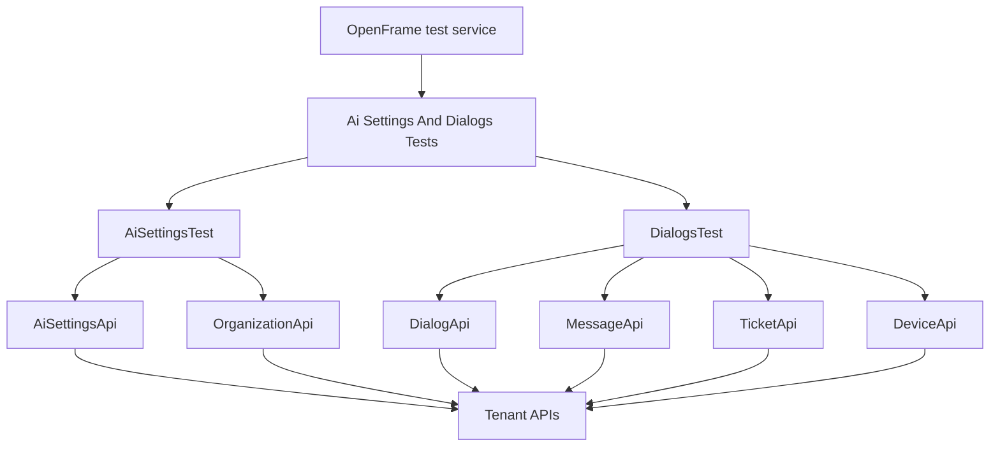
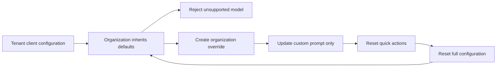
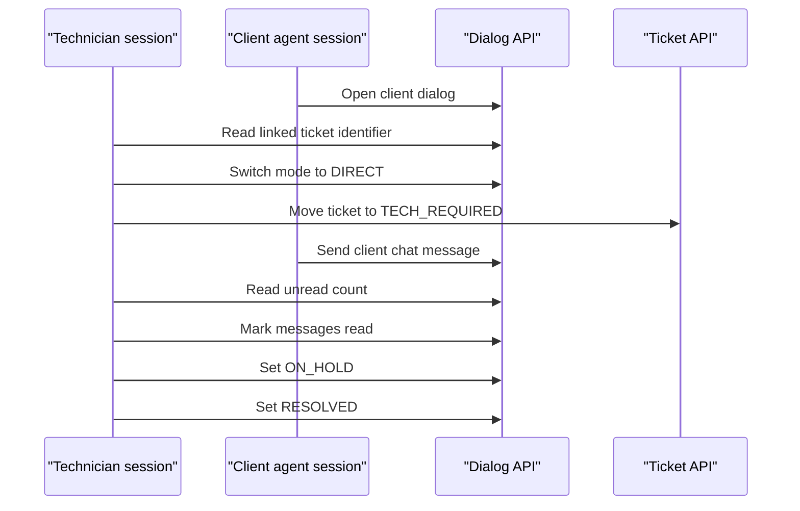
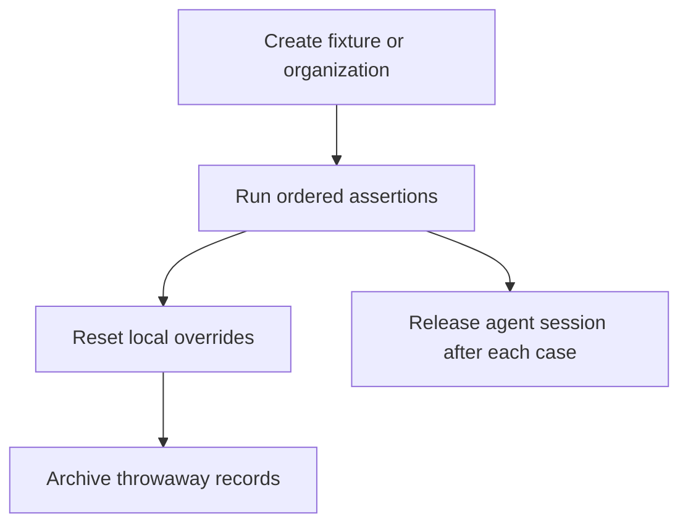

# Ai Settings And Dialogs Tests

Ai Settings And Dialogs Tests is an ordered, SaaS-tagged end-to-end test module for two assistant-facing capabilities: tenant and organization AI settings, and technician-managed dialogs. It is supplied by the `com.openframe.oss:openframe-test-service-core` library and run by this repository's OpenFrame test service. The module verifies externally observable API behavior rather than implementation details, including persistence, inheritance, validation errors, safe retries, read-back behavior, and cleanup of test data.

The module contains two JUnit test classes:

- [AiSettingsTest source](https://github.com/flamingo-stack/openframe-oss-lib/blob/16e7c1cbd9664e7d10ec5ebca7d53c9bd314decf/openframe-test-service-core/src/main/java/com/openframe/test/tests/AiSettingsTest.java) covers assistant configuration, organization overrides, guardrails, supported models, and connection testing.
- [DialogsTest source](https://github.com/flamingo-stack/openframe-oss-lib/blob/16e7c1cbd9664e7d10ec5ebca7d53c9bd314decf/openframe-test-service-core/src/main/java/com/openframe/test/tests/DialogsTest.java) covers dialog lifecycle, discovery, statistics, client-to-technician handoff, unread counters, and status transitions.

## Architecture Overview

Both test classes inherit the shared test base and drive OpenFrame through typed API clients and fixtures. The test module keeps its state in static fields because each class has an explicit JUnit order: later cases validate the data established by earlier cases.

### Runtime Boundaries

- The AI settings suite is tagged `saas` and `ai-settings`. It performs behavior-neutral tenant-level write-back operations, then creates a throwaway organization for stateful override checks.
- The dialog suite is tagged `saas`. Its device-dependent cases additionally require a configured and enrolled target machine; JUnit assumptions skip those cases when the prerequisite is absent.
- Neither suite invokes an AI model to generate a response. The AI settings suite uses a deliberately invalid key to assert a failed connection test, while the Fae dialog flow tests operational handoff and messaging behavior.

## Test Class Responsibilities

| Component | Responsibility | Main dependencies |
|---|---|---|
| `AiSettingsTest` | Verifies tenant defaults, organization-specific assistant settings and guardrails, supported-model validation, and AI configuration connection behavior. | `AiSettingsApi`, `OrganizationApi`, `PipelineContext`, organization generator, run identifier |
| `DialogsTest` | Verifies administrative dialog operations and a client dialog's technician workflow. | `DialogApi`, `MessageApi`, `TicketApi`, `DeviceApi`, machine configuration, agent session, dialog fixture |

## Ai Settings Coverage

`AiSettingsTest` executes fifteen ordered cases. The early read and write-back cases establish that both administrator and client assistant configurations are valid and can be round-tripped without semantic change.

### Tenant Assistant Configuration

The suite reads both assistant configurations and checks that each has an agent type, a supported provider, and a non-empty model. Accepted provider values are `ANTHROPIC`, `OPENAI`, and `GOOGLE_GEMINI`; supported answer styles are `SHORT`, `STANDARD`, `DETAILED`, and `CUSTOM`.

A missing configuration identifier is treated as a synthetic, non-persisted default, so it must not have a creation timestamp. The administrator and client configurations must identify different assistant types. The suite then writes each configuration back using an echo input and verifies all preserved fields:

- provider, model, answer style, and custom prompt;
- quick-action content and identifiers;
- the quick-action default flag when present; and
- persistence after a subsequent read.

This makes the write cases safe in shared environments: they exercise mutation behavior without intentionally changing tenant configuration.

### Organization View and Client Configuration Inheritance

The test creates one throwaway organization and uses it across the remaining organization-scoped cases. It first confirms that the organization has no client-view override, creates one with an assistant name, dark theme, and accent color, performs a partial theme-only update, then resets it. The second reset confirms idempotence.

The organization client AI configuration is then checked in its inherited state. It must expose tenant provider, model, answer style, prompt, and applicable quick actions while reporting `inheritDefault` and `quickActionsIsDefault`. The suite rejects an unsupported model before creating a valid override from the platform's supported-model list.

The valid override checks server-assigned quick-action identifiers, a timestamp, and all requested fields. A subsequent partial update must retain the prior answer style and quick-action identifier. Resetting quick actions restores only their inheritance while preserving the remaining override; resetting the full configuration restores all tenant values. Both reset operations are tested for safe repetition.

### Guardrail Inheritance and Overrides

The suite reads guardrails for the same organization before customization. An inherited policy has no local source template or overrides, is inactive locally, and exposes tenant rules. Every rule requires a natural key and one of these approval levels: `ALLOW`, `ASK_USER`, `ASK_TECHNICIAN`, or `DENY`.

It then validates two key paths:

1. An unknown template identifier must return a user error and must not persist a policy.
2. A real template must materialize an active organization policy. If the chosen template is the tenant's active template, the materialized rule levels must match the inherited rules.

After local policy creation, the suite changes exactly one rule's approval level. It asserts that the override is stored by natural key, that the selected rule changes, and that all other template-derived levels remain unchanged. Resetting guardrails must restore tenant inheritance and the original effective levels.

### Active AI Configuration and Connection Test

The suite reads the active REST-oriented AI configuration and its supported models. It verifies that the active provider and model are represented in the available model catalog. When the client assistant config is synthetic, the test also confirms that it is derived from the active configuration.

A connection test submits a syntactically plausible but intentionally fake API key. Expected behavior is a failed result with an explanatory `Connection failed` message, the requested provider and model in the response, and no generated model output. A raw request with no model must return HTTP status `400`. Reading the configuration again demonstrates that connection testing does not save the submitted key or otherwise alter the active configuration.

The final save case is guarded by `needs-registered-tenant` and runtime assumptions. It runs only for a pipeline-registered tenant using a platform key, because a stored tenant key cannot be read back and therefore cannot be safely echoed. When enabled, it saves the current provider and model without a key and verifies that the resulting active configuration still uses the platform key.

## Dialog Coverage

`DialogsTest` begins with an administrative dialog and then, when an enrolled target machine is available, exercises a Fae client dialog. The suite recognizes the statuses `ACTIVE`, `ACTION_REQUIRED`, `ON_HOLD`, `RESOLVED`, and `ARCHIVED`.

### Administrative Dialog Lifecycle

The first case opens a fixture dialog, renames it using a run-specific title, and verifies that its identifier remains stable and its initial status is `ACTIVE`. It validates two list behaviors:

- an active, "my dialogs" filter contains the dialog and only returns active entries; and
- searching by the run identifier finds the renamed dialog.

The statistics case validates that there is at least one dialog, that status counts use allowed values and are non-negative, and that their sum does not exceed the total count. It also requires a non-null formatted average resolution time.

The archive case confirms that archiving moves the dialog from the active filter to the archived filter. Unarchiving must retain the same identifier, restore the `ACTIVE` status, and return the dialog to the active result set.

### Fae Dialog Handoff and Read State

The Fae workflow requires `MachineConfig` to identify an enrolled target host. The suite finds that host through `DeviceApi`, opens an agent session verified over SSH, and creates a client dialog as that agent. The agent bearer is explicitly released before technician actions begin.

Changing the client dialog to `DIRECT` transfers it to the technician workflow without changing its active status. Repeating the same mode request is required to be a no-op, and a subsequent read must report direct mode with no technician-unread messages.

The test transitions the linked ticket to `TECH_REQUIRED` before sending a client message. This is significant because client messages while the ticket is in AI assistance belong to Fae rather than being technician unread work. The agent sees its own message as read; after the agent session is closed, the technician sees exactly one unread message. Marking messages read must set the counter to zero and remain idempotent.

Finally, the technician sets the dialog to `ON_HOLD` and then `RESOLVED`. The mode must stay `DIRECT`; `resolvedAt` is absent while on hold and populated when resolved. A final read confirms the resolved state.

## Ordering, Isolation, and Cleanup

The classes use `MethodOrderer.OrderAnnotation`; their order is part of test correctness, not presentation. `AiSettingsTest` stores the created organization, inherited snapshots, overrides, selected template, and active configuration for dependent tests. `DialogsTest` stores fixtures, the machine identity, ticket identifier, and workflow flags for later cases.

Ai Settings And Dialogs Tests uses cleanup defensively:

- AI settings cleanup resets the client view, resets organization AI configuration and guardrails only when each override was created, then archives the throwaway organization.
- Dialog cleanup releases any agent bearer after every test case. At class completion it cleans up both the administrative dialog and the client dialog; client dialog cleanup resolves and archives its linked ticket before archiving the dialog.

The use of raw reset and archive calls in cleanup avoids masking the primary assertion failure while still limiting persistent test data. Assumption-based guards prevent dependent cases from creating misleading failures when an earlier setup step, a target machine, or a registered tenant is unavailable.

## Maintenance Guidance

When changing the underlying APIs or schemas, preserve these behavioral contracts or update the test deliberately:

- partial updates must retain unspecified configuration fields;
- invalid model and guardrail-template inputs must produce user-visible errors without persisting partial state;
- reset and mark-read operations must be idempotent;
- a connection test must not persist submitted credentials;
- a direct-mode dialog retains its mode through status changes; and
- session cleanup must restore the administrator context before the next ordered case.

The test's run identifier is intentionally included in created titles, prompts, actions, and messages. It isolates list searches and makes leftover data identifiable during troubleshooting.
