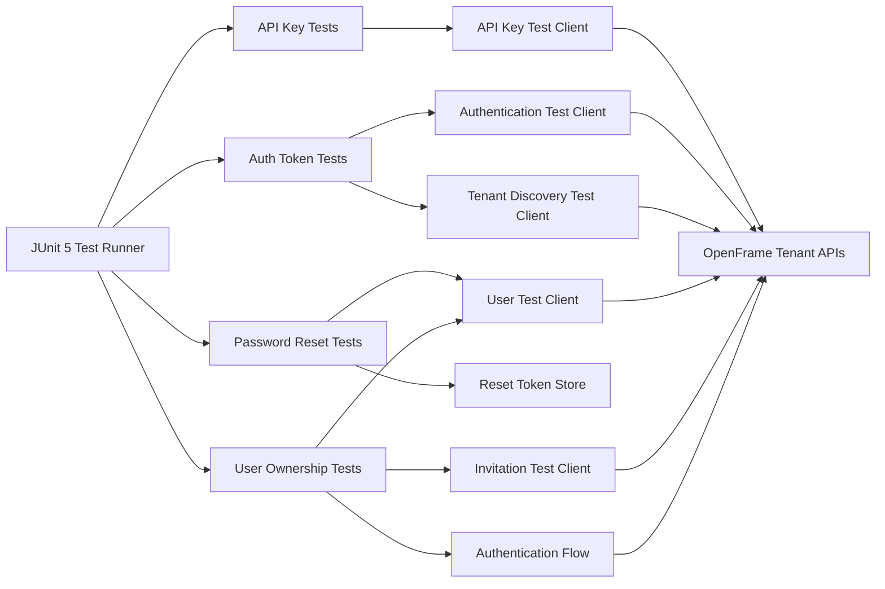
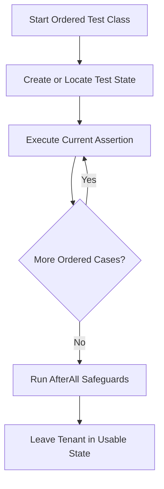
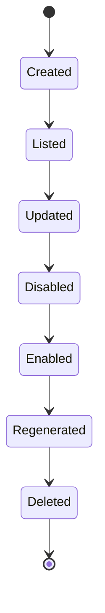
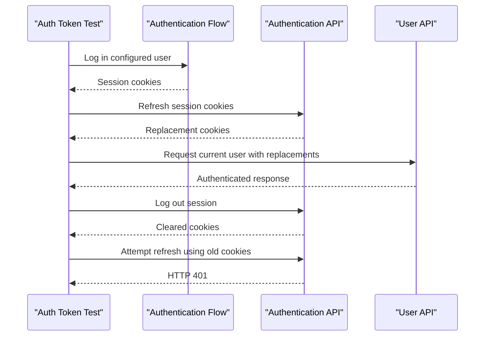
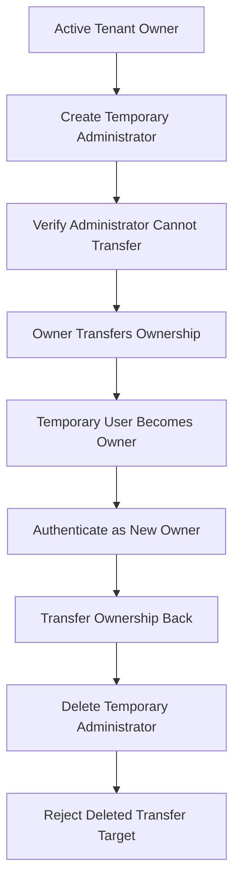

# Api And Auth Management Tests

## Purpose

Api And Auth Management Tests is an end-to-end test slice supplied by the OpenFrame OSS Library through the `com.openframe.oss:openframe-test-service-core` artifact. It is run by this repository's OpenFrame test service and verifies security-sensitive user-facing workflows against a live tenant: API-key lifecycle management, access-token refresh and logout, password-reset confirmation, and tenant ownership transfer.

The module contains four JUnit 5 test classes. It drives HTTP-facing test APIs, authenticates using real cookie sessions, and validates observable responses, status codes, and persisted state. The tests deliberately create isolated resources and clean them up so that repeated executions leave the tenant usable.

## Scope and Boundaries

| Area | Test class | Primary assertions |
|---|---|---|
| API-key lifecycle | [ApiKeysTest](https://github.com/flamingo-stack/openframe-oss-lib/blob/16e7c1cbd9664e7d10ec5ebca7d53c9bd314decf/openframe-test-service-core/src/main/java/com/openframe/test/tests/ApiKeysTest.java) | Creation, read operations, partial update, enablement, regeneration, deletion, and cleanup |
| Session tokens | [AuthTokensTest](https://github.com/flamingo-stack/openframe-oss-lib/blob/16e7c1cbd9664e7d10ec5ebca7d53c9bd314decf/openframe-test-service-core/src/main/java/com/openframe/test/tests/AuthTokensTest.java) | Refresh behavior and logout invalidation, with and without an explicit tenant identifier |
| Password reset | [ResetPasswordTest](https://github.com/flamingo-stack/openframe-oss-lib/blob/16e7c1cbd9664e7d10ec5ebca7d53c9bd314decf/openframe-test-service-core/src/main/java/com/openframe/test/tests/ResetPasswordTest.java) | Reset-token retrieval, confirmation, authenticated result, and invalid-token rejection |
| User ownership | [UserTest](https://github.com/flamingo-stack/openframe-oss-lib/blob/16e7c1cbd9664e7d10ec5ebca7d53c9bd314decf/openframe-test-service-core/src/main/java/com/openframe/test/tests/UserTest.java) | User reads, ownership authorization, ownership handoff and rollback, and deleted-target rejection |

The module tests contracts exposed by the platform rather than reimplementing authentication or authorization logic. Its collaborators include `ApiKeyApi`, `AuthApi`, `UserApi`, `InvitationApi`, `TenantApi`, the configured test user, authentication flows, Redis test access, and test data generators.

## Architecture Overview

The execution surface is the tenant API layer. The suite relies on response DTOs and raw-response methods where it must assert error status codes, while normal paths use typed helpers. Redis is accessed only by the password-reset scenario to obtain the reset token created for the test user.

## Test Execution Model

### Ordered stateful workflows

Api And Auth Management Tests uses ordered JUnit methods when later cases must observe state made by an earlier case:

- `ApiKeysTest` carries one generated API key from creation through mutation, regeneration, and deletion.
- `UserTest` records the initial owner, provisions an isolated administrator, optionally transfers ownership away and back, then deletes the temporary account.

Precondition helpers use JUnit assumptions to skip dependent cases when their setup state is unavailable, avoiding misleading follow-on failures. Tests that can run independently, including token refresh, logout, and password-reset cases, are not ordered.

### Cleanup and tenant safety

Each stateful class provides an `AfterAll` safeguard:

- API-key cleanup makes a raw delete request if the normal deletion case did not clear the tracked key identifier.
- User cleanup restores ownership if needed, revokes an unrevoked invitation, and deletes the temporary user.

Ownership transfer is additionally guarded by `PipelineContext.hasRegisteredTenant()`. The actual handoff and restoration run only for a pipeline-registered tenant because the operation temporarily demotes the suite's owner session.

## API Key Lifecycle Coverage

`ApiKeysTest` creates an API key with a run-specific name, description, and no initial traffic. It asserts that the returned identifier begins with `ak_` and that the one-time disclosed full credential begins with the generated identifier followed by `.sk_`.

The class then validates the entire lifecycle for that key only:

1. List API keys and find the created key.
2. Fetch the key by identifier.
3. Update name, description, and expiry, then read it back.
4. Disable and re-enable it while ensuring omitted fields remain unchanged.
5. Regenerate it and verify that the new identifier and secret differ, while name, description, and expiry persist.
6. Verify that the replaced identifier returns HTTP 404 and cannot be regenerated.
7. Delete the regenerated key, then verify it is absent from both direct lookup and listing.

This sequence protects important key-management invariants: credentials are disclosed only at issuance or regeneration, regeneration invalidates the former identifier, and disabled keys remain manageable and visible to their owner.

## Authentication Token Coverage

`AuthTokensTest` logs in the configured user through `AuthFlow`, then exercises refresh and logout through both tenant-aware and tenant-less helper overloads.

For refresh, it asserts that the returned cookie map differs from the original session, installs those cookies using `AuthHelper`, and confirms that the `me` response remains authenticated. For logout, it asserts the cookie map equals the known cleared-cookie representation and confirms that attempting refresh with the prior cookies receives HTTP 401.

## Password Reset Coverage

`ResetPasswordTest` starts a password reset for the configured user, retrieves the generated token from the test Redis helper, and submits a generated confirmation request. The test updates the in-memory user's password to the confirmed value and requires the subsequent current-user response to be authenticated.

A negative test submits a confirmation request containing the literal invalid token value and compares the typed error response with the canonical invalid-token response generated by `AuthGenerator`.

The Redis lookup is an intentional test-only observation point. Production password-reset behavior is still exercised through the user-facing reset and confirmation APIs.

## User and Ownership Coverage

`UserTest` verifies that listed users have essential populated properties, then checks that fetching a listed user returns the same record. The historical owner-deletion assertion is retained but disabled until the associated deletion behavior is implemented.

The active ownership sequence validates both authorization and lifecycle rules:

- the suite account must be an active `OWNER`;
- a self-transfer is a successful no-op;
- an unknown target and a pending invitation are not users and result in `USER_NOT_FOUND` behavior;
- a newly invited and accepted administrator can authenticate but receives HTTP 403 when attempting a transfer;
- the owner can transfer ownership to that active administrator and the roles swap to `OWNER` and `ADMIN` respectively;
- a fresh login is used by the new owner before transferring ownership back, because the older token was issued while that user was an administrator;
- after the temporary administrator is deleted, a transfer to that deleted target is refused with the expected operation-not-allowed response.

## Tags and Selective Execution

The classes use JUnit tags to support targeted runs:

| Tag | Meaning in this module |
|---|---|
| `oss` | Open-source tenant coverage for API-key, token, and user tests |
| `api-keys` | API-key management scenario |
| `users` | User and ownership scenario |
| `feature` | Primary feature behavior |
| `read` | Listing and retrieval behavior |
| `negative` | Error and refusal behavior |
| `token` | Refresh-token behavior |
| `logout` | Logout and revoked-session behavior |
| `reset` | Password-reset behavior |
| `needs-registered-tenant` | Ownership mutation that only runs in a pipeline-registered tenant |

## Relationship to the Tenant Runtime

This module is library code from OpenFrame OSS Library, pinned by this repository at version `7.0.11`. The repository assembles and deploys the API, authorization server, gateway, and related services against which the test artifact is run. In the deployment configuration, the gateway forwards `/sas/**` requests to the authorization server and `/api/**` requests to the API service; the tests validate behavior across those boundaries through their test API clients.

The module does not expose a production endpoint. It provides acceptance coverage for the platform's API-key management, authenticated-session, password-reset, invitation, and user-management capabilities.

## Maintenance Notes

- Preserve the ordered execution contract in `ApiKeysTest` and `UserTest`; changing method order without changing state handling can invalidate later assertions.
- Keep cleanup tolerant of partial failure. Raw helper calls are used where cleanup must not throw and hide the original failure.
- Treat token and API-key values as secrets. Assertions check prefixes, rotation, and invalidation rather than logging complete credentials.
- When changing ownership rules, update both the role-transition assertions and the rollback path. The suite must always restore its initial owner before it deletes temporary data.
- When changing reset-token storage, preserve an appropriate test-only observation mechanism or update the reset test to obtain the confirmation material through the intended test interface.
