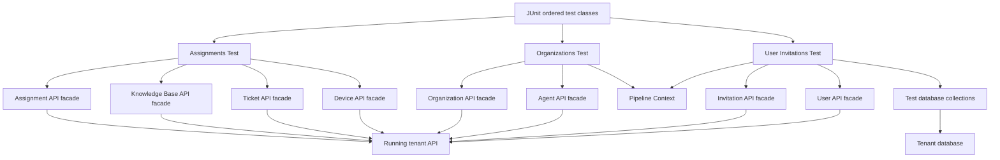
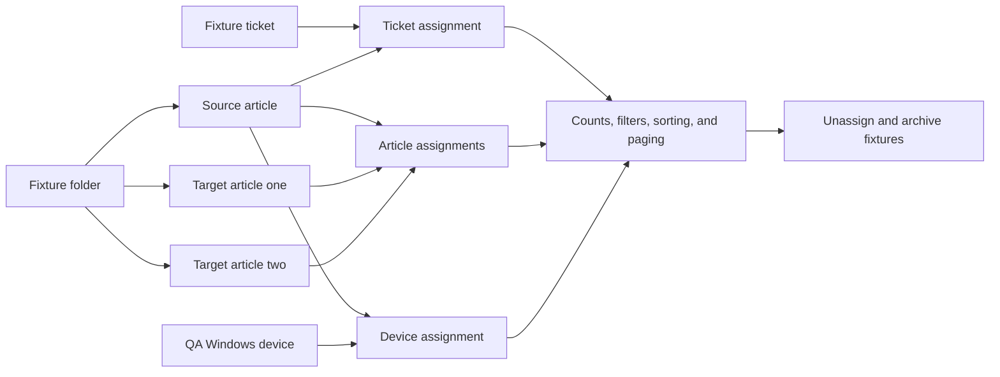
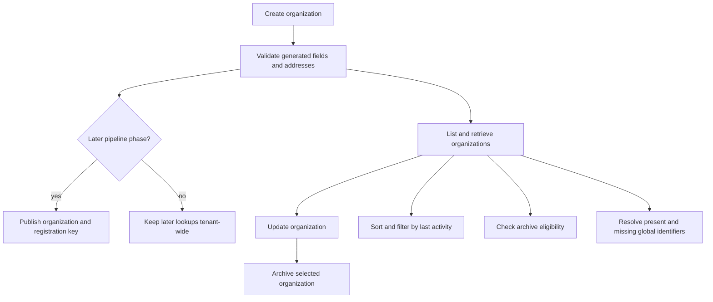
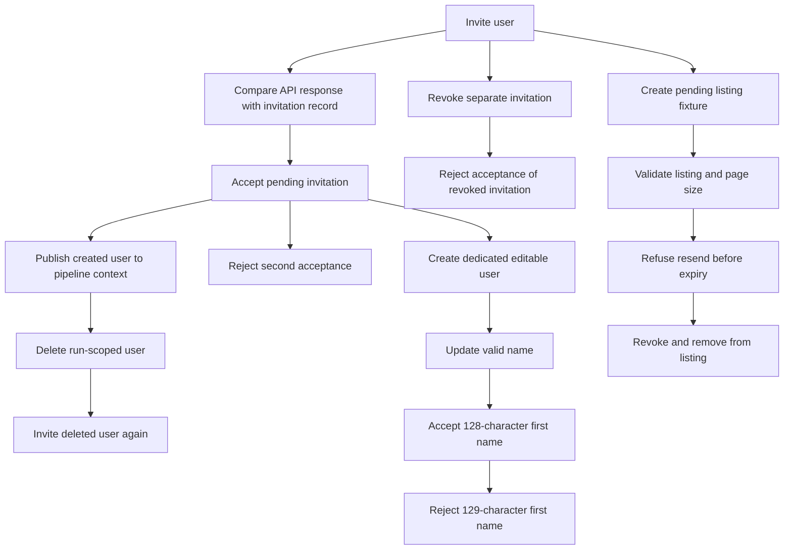

# Assignment And Organization Tests

Assignment And Organization Tests is an ordered end-to-end test module supplied by the `com.openframe.oss:openframe-test-service-core` library and run by this repository's OpenFrame test service. It validates three related management workflows against a running tenant:

- assigning knowledge-base articles to tickets, other articles, and devices;
- creating, reading, updating, sorting, filtering, and archiving organizations; and
- inviting, accepting, revoking, listing, resending, editing, and deleting users.

The module is integration-oriented rather than unit-oriented. Each test class drives the public test API facade, asserts the returned domain representation, and, where appropriate, confirms persistence through test database collections. Ordered methods deliberately carry fixtures from one lifecycle stage to the next; cleanup paths protect the shared test tenant when a preceding assertion fails.

## Source And Runtime Context

The implementation belongs to the OpenFrame OSS Library artifact `com.openframe.oss:openframe-test-service-core` at version `7.0.11`, which this repository consumes. It is executed by the OpenFrame test service assembled in this tenant repository.

| Test class | Focus | Source |
| --- | --- | --- |
| `AssignmentsTest` | Knowledge article assignment lifecycle | [Assignments Test](https://github.com/flamingo-stack/openframe-oss-lib/blob/16e7c1cbd9664e7d10ec5ebca7d53c9bd314decf/openframe-test-service-core/src/main/java/com/openframe/test/tests/AssignmentsTest.java) |
| `OrganizationsTest` | Organization lifecycle and organization query semantics | [Organizations Test](https://github.com/flamingo-stack/openframe-oss-lib/blob/16e7c1cbd9664e7d10ec5ebca7d53c9bd314decf/openframe-test-service-core/src/main/java/com/openframe/test/tests/OrganizationsTest.java) |
| `UserInvitationsTest` | Invitation and invited-user lifecycle | [User Invitations Test](https://github.com/flamingo-stack/openframe-oss-lib/blob/16e7c1cbd9664e7d10ec5ebca7d53c9bd314decf/openframe-test-service-core/src/main/java/com/openframe/test/tests/UserInvitationsTest.java) |

## Architecture Overview

The test classes use API facades as their primary interface. `UserInvitationsTest` additionally reads invitation and user records through test-only collections to compare API behavior with persisted state. `PipelineContext` is a coordination boundary for pipeline runs: organization creation can publish an organization identifier and agent registration key for later device-install stages, while invitation acceptance publishes the user created by that run for targeted deletion.

## Test Design Principles

### Ordered Stateful Scenarios

Each class uses JUnit method ordering. Later checks either consume state produced by earlier checks or protect themselves with assumptions. For example, assignment list and pagination checks require the ticket and two article assignments to exist; device-specific checks are skipped when the expected QA Windows device cannot be found.

### Contract-Level Assertions

The suite verifies observable contracts, not merely successful responses:

- Relay global identifiers decode to the expected domain type.
- Returned targets expose the expected GraphQL typename and identifying fields.
- Filtered counts remain consistent with filtered lists.
- Paging cursors, sort direction, and search results have deterministic behavior.
- Invalid or repeated operations preserve documented idempotent or validation behavior.
- API representations match database records where the test requires persistence verification.

### Isolation And Cleanup

Fixtures are namespaced with a generated run identifier when assignment tests create knowledge-base items and tickets. Assignment cleanup removes any remaining links, archives the fixture folder and its child articles, and moves the fixture ticket through resolved and archived statuses. Invitation cleanup deletes the dedicated edit user or revokes its outstanding invitation, then revokes any pending listing fixture. Organization cases archive their own temporary organization when testing archiving eligibility.

## Assignment Coverage

`AssignmentsTest` validates assignments from a knowledge-base article to three target categories: tickets, knowledge-base articles, and devices. It creates a folder with three draft articles, creates a ticket, and optionally discovers a specifically named QA Windows device.

### Lifecycle Validated

1. A newly created article returns no assignment counts and no ticket assignments.
2. Assigning a ticket verifies assignment identity, item and target types, ticket display formatting, timestamps, and ticket target fields.
3. Assigning two articles verifies article display names, resolved target types, distinct assignment identifiers, and preservation of target identifiers.
4. Assigning the QA device, when available, verifies hostname display behavior and machine identity fields.
5. Per-target-type queries return the expected ticket and article sets and no organization assignments.
6. Article assignment queries support name search, ascending and descending display-name sorting, cursor pagination, and total filtered counts.
7. Aggregate counts agree with every per-type list.
8. Removing a ticket removes its list entry and count; a repeated removal remains successful without changing counts.
9. Bulk removal by target type removes both article links while leaving the target article itself intact.
10. Device removal restores an empty assignment-count response when no assignments remain.

The class tracks every assignment it creates in an in-memory target-to-type map. That map supports both precise assertions and best-effort cleanup after an interrupted scenario.

## Organization Coverage

`OrganizationsTest` exercises organization management across OSS and SaaS-tagged environments. It uses generated create and update requests, then checks both organization fields and query behavior.

### Lifecycle And Query Contracts

- Creation verifies non-null identity and timestamps, confirms the created organization is non-default, and checks generated request fields recursively. The mailing address is expected to match the physical address.
- When the pipeline has a later consumer phase, the test stores the created organization identifier in `PipelineContext`; it also attempts to fetch and publish the active agent registration secret. Standalone runs deliberately do not publish this state, avoiding unintended narrowing of later device lookups.
- Listing and retrieval require non-empty organization data and non-null identity, name, and timestamps. A retrieved record must match the listed record apart from the default marker behavior.
- Update uses a non-default organization and verifies that mutable request data is reflected while system-managed fields remain excluded from request comparison.
- Archive targets the pipeline-created organization when one was published; otherwise it uses the first eligible result. The archived organization must disappear from the active list.
- Last-activity sorting returns timestamps in ascending order. An inclusive range filter returns only values between the selected endpoints.
- A newly created empty organization is eligible for archival, and its persisted status becomes `ARCHIVED` afterward.
- Global-ID retrieval resolves an existing record and returns `null` for a syntactically valid, non-existent organization identifier.

## Invitation And User Coverage

`UserInvitationsTest` tests the coupled invitation and user lifecycle. It uses invitation and user API facades for actions, test collections for persistence comparison, and `PipelineContext` to ensure the delete stage removes the user created in the same run rather than a shared administrator.

### Invitation State Transitions

The module covers pending, accepted, revoked, and deleted-user cases:

- A newly invited user is found in persistence, and its API representation matches the stored invitation except for timestamps, which are compared within one second.
- Accepting a pending invitation creates a user whose email matches the invitation. The resulting user identifier and email are published to `PipelineContext` for safe cleanup.
- Re-accepting an accepted invitation returns the expected conflict response.
- A revoked invitation has `REVOKED` status in persistence, and an attempt to accept it returns the expected revoked conflict response.
- Inviting the authenticated user again validates the current-tenant conflict path. This avoids incorrectly selecting a cross-tenant user from a global collection.
- Deletion is limited to the user created in the current test run; if no such user is available, the test creates and accepts a throwaway user. The user then remains retrievable with `DELETED` status.
- A deleted user's email can receive a new pending invitation.

### User Editing And Invitation Listing

A dedicated invitation and accepted user isolate update behavior from shared users:

- A normal name update preserves email, roles, and active status, and is visible through a subsequent read.
- A first name of 128 characters is accepted. Omitting the last name retains its previous value.
- A 129-character first name yields a `VALIDATION_ERROR` referring to `firstName` and does not alter persisted user names.

A separate pending invitation verifies list semantics:

- The requested page index and size are echoed, the new invitation is discoverable across all pages, and its pending status, email, roles, and expiry are preserved.
- A page size of one returns one item and has pagination metadata consistent with the total element count.
- A pending, unexpired invitation cannot be resent and returns conflict status `409`.
- After revocation, the invitation is omitted from the listing rather than returned with a revoked state.

## Dependencies And Boundaries

| Dependency | Role in Assignment And Organization Tests |
| --- | --- |
| OpenFrame test service core library | Provides the three JUnit test classes, API facades, DTOs, generators, helpers, and test database collections. |
| Tenant API | Executes assignment, knowledge-base, ticket, device, organization, invitation, agent, and user operations through the test facades. |
| Tenant database | Supplies direct persistence verification for invitations and users through test-only collections. |
| Pipeline Context | Shares a created organization, registration secret, and invited user only when later pipeline phases need them. |
| QA Windows device | Optional fixture for device-assignment coverage; unavailable infrastructure skips only the device-specific checks. |

## Maintenance Notes

- Preserve method ordering whenever a test consumes a fixture created earlier in the class.
- Keep cleanup tolerant of partial failures. It is the safeguard for a shared test environment, not merely a final assertion.
- Use generated or run-namespaced fixtures rather than fixed names for mutable resources.
- Do not broaden deletion or archival selection to arbitrary shared users or organizations. The pipeline context exists to target resources created by the current run.
- When changing assignment query behavior, update list, count, search, sort, cursor, and idempotent-unassign expectations together: these tests intentionally cross-check the same state through several read paths.
