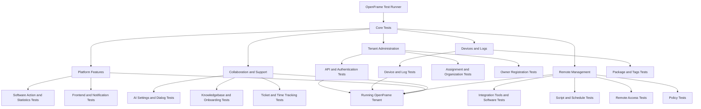
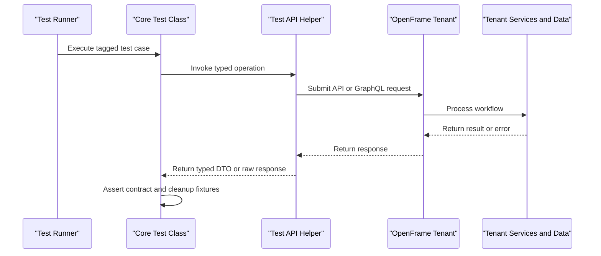

# Core Tests

Core Tests is the primary end-to-end test collection provided by the `com.openframe.oss:openframe-test-service-core` dependency. It validates OpenFrame tenant workflows through the deployed API, authentication, GraphQL, device-management, and integration surfaces.

The module groups functional tests for tenant administration, devices, tickets, remote management, software, knowledge base content, notifications, onboarding, and AI-related configuration. Individual test classes use shared fixtures, API helpers, ordered execution where state must persist between cases, and cleanup routines for resources created during a run.

## Architecture

## Core Responsibilities

| Area | Representative test classes | Validated behavior |
|---|---|---|
| API and authentication | `ApiKeysTest`, `AuthTokensTest`, `ResetPasswordTest`, `UserTest` | API-key lifecycle, session refresh and logout, password reset, user and owner-management behavior. |
| Organizations and assignments | `AssignmentsTest`, `OrganizationsTest`, `UserInvitationsTest` | Organization lifecycle, invitations, users, and assignments between knowledge-base content, tickets, devices, and articles. |
| Device and log operations | `DevicesTest`, `DeviceLogsTest`, `LogsTest`, `StaleDeviceCleanupTest` | Device inventory, integration data, device-log queries, event logs, and duplicate-enrolment cleanup. |
| Remote management | `CreatePolicyTest`, `TriggerPolicyTest`, `DeletePolicyTest`, `RemoteAccessPolicyTest`, `RemoteAccessSessionTest` | Fleet policy lifecycle, compliance aggregation, remote-access policy resolution, approval, session lifecycle, and audit history. |
| Scripts and software | `ScriptsTest`, `ScriptScheduleTest`, `ScriptScheduleDevicesTest`, `ScriptExecutionHistoryTest`, `SoftwareBundleTest`, `SoftwareInventoryTest` | Script execution, scheduling, device targeting, software deployment, inventory, vulnerabilities, and execution history. |
| Tickets and knowledge base | `TicketsTest`, `TimeTrackingTest`, `KnowledgeBaseTest`, `OnboardingTest` | Ticket lifecycle, attachments, time entries, knowledge-base content, attachments, tags, and user onboarding. |
| AI and frontend features | `AiSettingsTest`, `DialogsTest`, `FrontendSupportTest`, `NotificationsTest` | AI configuration, dialog workflows, feature flags, dashboard events, notifications, and notification preferences. |
| Supporting platform coverage | `IntegratedToolsTest`, `PackageSearchTest`, `TagsTest`, `StatsTest` | Integrated-tool discovery, package catalog behavior, tag lifecycle, software-action history, and optional tenant statistics collection. |

## Execution Model

Core Tests primarily verify externally visible contracts. This includes successful workflows, validation failures, pagination and filtering semantics, idempotent mutations, authorization boundaries, and state restoration after mutating scenarios.

## Test Isolation

Tests commonly use generated run-specific names and identifiers to avoid collisions in shared tenant environments. Stateful workflows may use ordered methods when a later test must inspect data created by an earlier test.

Cleanup is intentionally defensive:

- Created organizations, tags, tickets, invitations, scripts, schedules, and software bundles are removed, archived, or reset where supported.
- Device-dependent scenarios use assumptions when an enrolled machine or required integration is unavailable.
- Tests that alter tenant-wide configuration preserve and restore the previous state where possible.
- Best-effort cleanup avoids hiding the original assertion failure.

## Core Component Documentation

The following component documentation describes the main Core Tests areas:

- **AI Settings and Dialogs Tests** — `AiSettingsTest` and `DialogsTest`
- **API and Auth Management Tests** — `ApiKeysTest`, `AuthTokensTest`, `ResetPasswordTest`, and `UserTest`
- **Assignment and Organization Tests** — `AssignmentsTest`, `OrganizationsTest`, and `UserInvitationsTest`
- **Policy Tests** — `CreatePolicyTest`, `DeletePolicyTest`, and `TriggerPolicyTest`
- **Device and Log Tests** — `DeviceLogsTest`, `DevicesTest`, `LogsTest`, and `StaleDeviceCleanupTest`
- **Frontend and Notification Tests** — `FrontendSupportTest` and `NotificationsTest`
- **Integration Tools and Software Tests** — `IntegratedToolsTest`, `SoftwareActionHistoryTest`, `SoftwareBundleTest`, and `SoftwareInventoryTest`
- **Knowledgebase and Onboarding Tests** — `KnowledgeBaseTest` and `OnboardingTest`
- **Owner Registration Tests** — `OwnerRegistrationNegativeTest` and `OwnerRegistrationTest`
- **Package and Tags Tests** — `PackageSearchTest` and `TagsTest`
- **Remote Access Tests** — `RemoteAccessPolicyTest` and `RemoteAccessSessionTest`
- **Script and Schedule Tests** — `ScriptsTest`, `ScriptScheduleTest`, `ScriptScheduleDevicesTest`, and `ScriptExecutionHistoryTest`
- **Software Action and Statistics Tests** — `SoftwareActionHistoryTest` and `StatsTest`
- **Ticket and Time Tracking Tests** — `TicketsTest` and `TimeTrackingTest`

## Module Boundary

Core Tests belongs to the test-service core library consumed by this repository. The tenant repository provides the deployable OpenFrame services and infrastructure that the tests exercise, including the API, authorization server, gateway, client services, management services, stream processing, and configured data services.