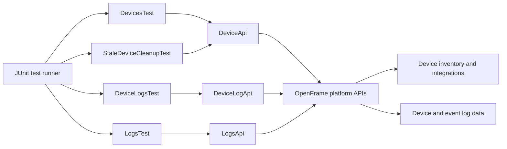
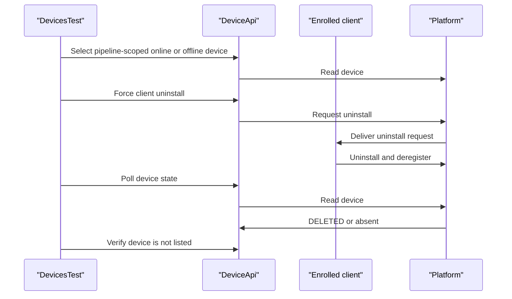
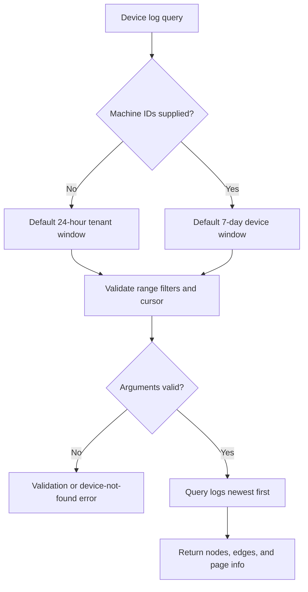
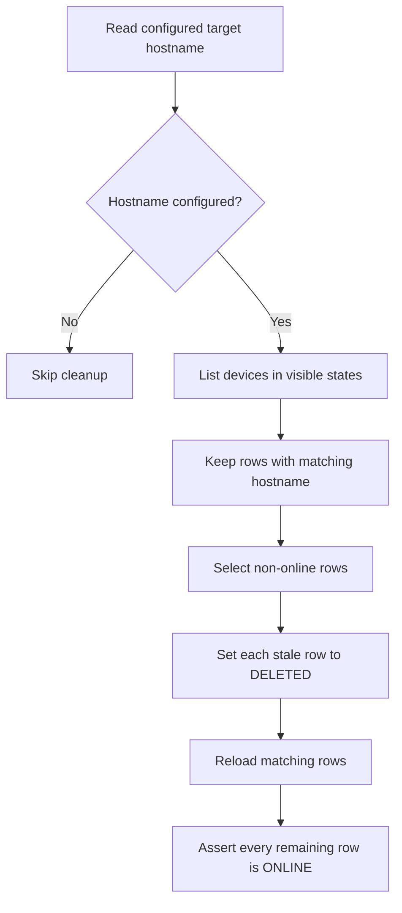

# Device And Log Tests

Device And Log Tests is the end-to-end coverage slice for device inventory, device-scoped agent logs, tenant event logs, and duplicate-enrolment cleanup. Its four JUnit 5 classes are supplied by the `com.openframe.oss:openframe-test-service-core` library and executed by this repository's OpenFrame test service. The tests exercise the platform through test API facades rather than accessing storage directly, so they validate the observable device and logging contracts.

The implementation is maintained in [OpenFrame OSS Library](https://github.com/flamingo-stack/openframe-oss-lib) at the pinned library revision used by this repository.

## Scope

| Test class | Primary contract | Test characteristics |
| --- | --- | --- |
| [`DevicesTest`](https://github.com/flamingo-stack/openframe-oss-lib/blob/16e7c1cbd9664e7d10ec5ebca7d53c9bd314decf/openframe-test-service-core/src/main/java/com/openframe/test/tests/DevicesTest.java) | Device discovery, detail, tool connections, Fleet and MeshCentral facts, filtering, nickname updates, and dashboard-driven deletion | Mostly read-only SaaS feature tests, plus explicitly tagged destructive deletion coverage |
| [`DeviceLogsTest`](https://github.com/flamingo-stack/openframe-oss-lib/blob/16e7c1cbd9664e7d10ec5ebca7d53c9bd314decf/openframe-test-service-core/src/main/java/com/openframe/test/tests/DeviceLogsTest.java) | Device Logs query defaults, filters, validation, cursor paging, and single-device scoping | Ordered SaaS tests under `device-logs`; the device-specific case additionally needs an enrolled Windows device |
| [`LogsTest`](https://github.com/flamingo-stack/openframe-oss-lib/blob/16e7c1cbd9664e7d10ec5ebca7d53c9bd314decf/openframe-test-service-core/src/main/java/com/openframe/test/tests/LogsTest.java) | Tenant event-log filters, list/detail consistency, search, severity filtering, ordering, and inclusive time ranges | Read-only SaaS feature tests |
| [`StaleDeviceCleanupTest`](https://github.com/flamingo-stack/openframe-oss-lib/blob/16e7c1cbd9664e7d10ec5ebca7d53c9bd314decf/openframe-test-service-core/src/main/java/com/openframe/test/tests/StaleDeviceCleanupTest.java) | Retirement of non-online duplicate enrolments for the machine configured for the current run | OSS cleanup test, intentionally narrow and state-changing |

## Architecture Overview

The module is an acceptance-level boundary: test classes invoke `DeviceApi`, `DeviceLogApi`, and `LogsApi`; those facades issue platform requests and deserialize responses into test DTOs. Assertions then verify filtering, projection, lifecycle, and error semantics visible to a consumer.

## Device Inventory Coverage

`DevicesTest` establishes the baseline device-management contract.

- **Filter metadata:** verifies that status, operating-system, and organization filter options have values, labels, nonzero counts, and an overall filtered count.
- **Device projection:** selects an online or offline device, reloads it by machine ID, and requires core identity, lifecycle, operating-system, organization, timestamps, agent version, tool connections, and installed-agent fields.
- **Integrated-source views:** resolves Fleet MDM and MeshCentral identifiers from a device's tool connections. Fleet assertions cover hardware, processor, memory, uptime, disk capacity, users, installed software, and—when present—vulnerability fields. MeshCentral assertions cover the node identity and last-connect metadata.
- **Search and filter behavior:** checks hostname search, Windows filtering, and a seeded `purpose:auto_test` tag. The tag test validates the tag on every returned device, not merely that an expected hostname is included.
- **Nickname lifecycle:** sets a generated nickname, verifies response and persisted state, clears it with a null value, and restores the original nickname in a `finally` block.

### Deletion Lifecycle

The dashboard deletion case deliberately uses an enrolled device selected from the pipeline's organization when that context is available. It forces client uninstall, accepts the immediate transitional `PENDING_DELETION` or terminal `DELETED` state, polls until deletion completes, then confirms the machine ID is absent from normal listed-device results.

This case is tagged `archive` rather than `read`; it must run only where its pipeline-scoped fixture and side effects are intended.

## Device Log Contract Coverage

`DeviceLogsTest` uses ordered cases because the first case pins a nonempty tenant time window and subsequent cases reuse it. It checks a dedicated device-log query, distinct from the general event-log query tested by `LogsTest`.

### Query Semantics

- With no device selection, the default lower bound is the prior 24 hours. When a device is named, the default lower bound is the prior seven days. Both allow a five-minute clock-skew allowance.
- A pinned query always has an explicit inclusive time window. If the default tenant window is empty, the test broadens it to the 30-day maximum rather than skipping all follow-on tests.
- Returned entries must be newest first, have valid severity levels (`DEBUG`, `INFO`, `WARN`, or `ERROR`), non-null messages, and nonblank edge cursors. Page start and end cursors must match the first and last edge.
- Level selection returns only requested levels. `contains` and `excludes` are case-insensitive and literal: the test specifically proves that `.*` is not evaluated as a regular expression.
- Cursor pagination moves strictly toward older ingestion timestamps without overlap or a timestamp split across adjacent pages.

### Validation Boundaries

The module treats invalid input as an observable API contract. It expects a `VALIDATION_ERROR` for a range longer than 30 days, inverted time bounds, an empty device list, more than 50 device IDs, too many search terms, an oversized exclusion term, and an invalid cursor. An unknown device must instead produce `DEVICE_NOT_FOUND`.

The single-device case finds a named enrolled Windows fixture, verifies device-only results and hostname attribution, expands to an explicit 30-day window, and confirms compatibility of the deprecated single-machine argument.

## General Event Log Coverage

`LogsTest` validates the tenant-wide event-log surface through `LogsApi`.

1. It requires filter metadata for tool type, event type, and severity.
2. It requires list rows to expose a tool-event identifier, event type, tool type, timestamp, ingestion day, and summary.
3. It retrieves details for a listed row and compares the identifier, event type, and tool type against the originating list item.
4. It derives a search term from an existing summary and verifies the search returns a matching summary.
5. It selects an available severity and requires all matching rows to have that severity.
6. It requests ascending timestamp order and verifies chronological ordering.
7. It takes the first and last timestamps from an ordered result set, queries that inclusive range, and verifies every returned timestamp lies within it.

## Stale Enrolment Cleanup

`StaleDeviceCleanupTest` removes ambiguity caused when repeated pipeline enrolments create multiple device rows with the same hostname. It is intentionally conservative:

- It runs only if the current run has a configured, nonblank target hostname.
- It considers only rows with that exact hostname, case-insensitively.
- It retires only rows whose status is not `ONLINE`; every live enrolment remains untouched.
- It uses the API's soft-deletion state transition rather than a hard deletion, preserving the data required by downstream filter counts.
- After cleanup, it reloads the host-matched device set and requires every remaining row to be online.

## System Placement

The tests run against the tenant deployment rather than mocking the services that own device and log behavior. Device interactions traverse the client-facing API surface and depend on enrolled client data, including Fleet MDM and MeshCentral integrations. Log interactions validate the API-visible records produced by device logging and platform event ingestion.

In this repository, the relevant deployment exposes OpenFrame API traffic through the gateway's `/api/**` route. The library source above supplies the test implementation; this repository packages and operates the service environment in which it executes.

## Maintenance Notes

- Preserve the ordered execution and shared pinned window in `DeviceLogsTest`; later cases are intentionally conditional on data found by the first case.
- Keep fixture-specific checks scoped to their tags. The Windows log case relies on an enrolled device, and deletion is an intentional destructive test.
- When changing a device or log API contract, update both positive assertions and refusal-code assertions so validation failures do not regress into silent broad reads or paging restarts.
- Keep cleanup scoped to the configured hostname and non-online rows. Broad stale-device deletion risks retiring devices owned by users in a shared tenant.
