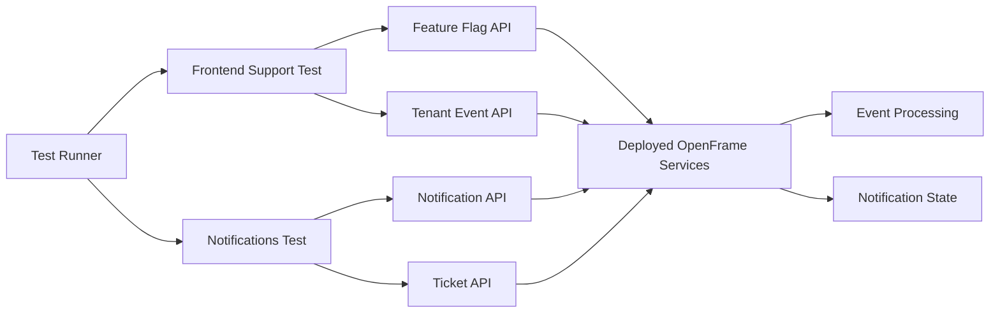
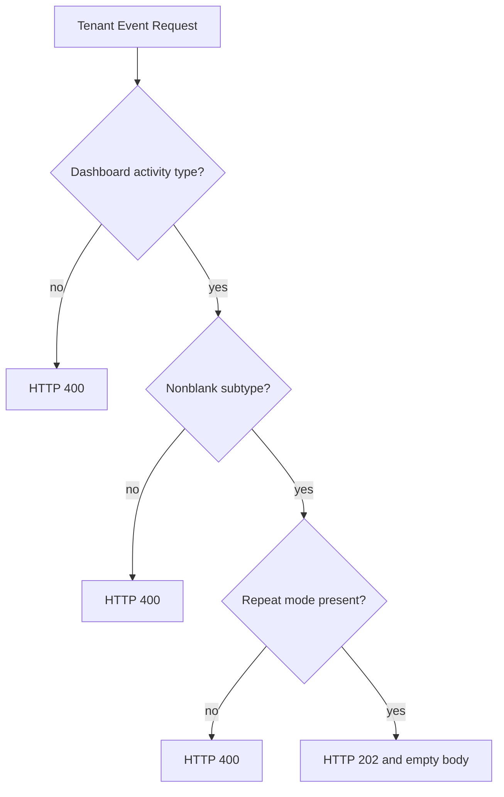
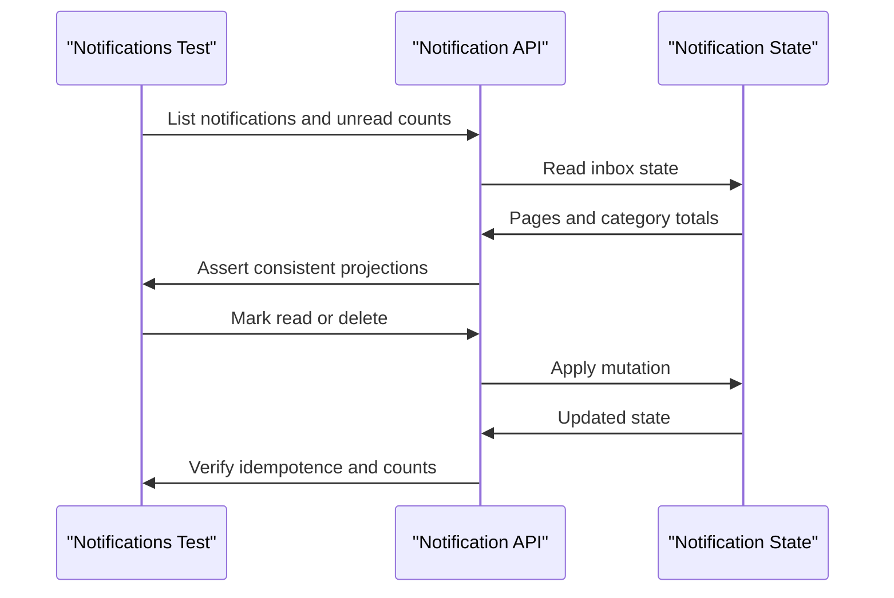

# Frontend And Notification Tests

Frontend And Notification Tests is an ordered SaaS integration-test slice supplied by the OpenFrame OSS Library `com.openframe.oss:openframe-test-service-core` dependency. It verifies two user-facing contracts through the test APIs: the frontend shell's feature-flag and dashboard-activity behavior, and the signed-in user's notification inbox and preferences.

The module is run by this repository's OpenFrame test service. Its test code resides in the OpenFrame OSS Library rather than this repository:

- [Frontend Support Test source](https://github.com/flamingo-stack/openframe-oss-lib/blob/16e7c1cbd9664e7d10ec5ebca7d53c9bd314decf/openframe-test-service-core/src/main/java/com/openframe/test/tests/FrontendSupportTest.java)
- [Notifications Test source](https://github.com/flamingo-stack/openframe-oss-lib/blob/16e7c1cbd9664e7d10ec5ebca7d53c9bd314decf/openframe-test-service-core/src/main/java/com/openframe/test/tests/NotificationsTest.java)

## Scope

Both test classes extend the suite base class and use API helpers to exercise the deployed system rather than isolated implementations. They are deliberately method-ordered: later cases reuse state read by earlier cases, and notification settings are restored after mutation.

| Test area | Main verification |
| --- | --- |
| Frontend support | Frontend flags resolve consistently, named queries preserve requested order, unknown flags resolve disabled, and only valid dashboard-activity events are accepted. |
| Notifications | Inbox pages, unread summaries, read and deletion mutations, ticket-scoped reads, notification settings, and bulk operations remain internally consistent. |

## Architecture

The Frontend Support Test treats a dashboard event as asynchronous acceptance: a valid request must return HTTP 202 with no response body, indicating handoff rather than synchronous completion. Notification assertions query state through the API and compare related projections, such as unread category totals and the boolean unread indicator.

## Frontend Support Test

`FrontendSupportTest` is tagged `saas` and `frontend-support`. It validates the two interactions identified in the source as frontend-shell session behavior.

### Feature-flag contract

The ordered first three cases establish and reuse a map of the tenant's resolved flags:

1. An unfiltered query must return a non-empty, duplicate-free set of named flags with non-null values, including the configured `billings` flag.
2. An empty name list must be equivalent to no filter.
3. A query containing a known and a generated unknown name must return exactly those names in request order. The known value must match the unfiltered value; the unknown value must be `false` and must not appear in the tenant-wide set.

The shared flag map is a test dependency, not persisted platform state. Cases that require it use an assumption and are skipped if the initial read did not run.

### Dashboard-activity contract

The remaining cases submit tenant events and distinguish input validation from accepted asynchronous work:

A valid event uses the dashboard activity type, the frontend's skip-onboarding main-dashboard subtype, and singular repeat mode. The singular mode is intentional: repeated UI-style submissions collapse to one event per user.

## Notifications Test

`NotificationsTest` is tagged `saas`, `post-mingo`, and `notifications`. Its `post-mingo` placement matters because the test suite cannot create a notification for the same actor whose inbox it reads. The test can therefore use notifications produced by a preceding Mingo phase; the single-notification case skips itself when the inbox is empty.

### Inbox and mutation coverage

The first four ordered cases verify these behaviors:

- Notification connections supply page information; every returned item has an identifier, title, severity, category, read state, and creation timestamp.
- Per-category unread counts are non-negative and agree with the overall unread indicator and unread page.
- Marking one notification read is idempotent, adjusts its category count only when it was unread, and deletion removes it. A second delete returns `false`.
- Ticket-scoped read marking never increases unread totals and is idempotent on a second invocation.
- Bulk marking read empties unread views, then bulk deletion removes read entries and leaves the inbox empty. These operations are intentionally destructive for the test user.

### Settings lifecycle

The settings cases protect shared user configuration by treating it as a read-modify-restore transaction:

1. Read the resolved master switch and every defined notification group, retaining the original settings.
2. Invert only `TICKET_CREATED`; confirm all other group values and all server-supplied labels are unchanged.
3. Update only the master switch and confirm stored group overrides remain unchanged.
4. Restore the original master switch and all group values.

An `AfterAll` safeguard attempts restoration whenever the original settings were captured but the explicit restore case did not complete. This prevents a test failure in a later ordered case from leaking modified settings into another run.

## Maintenance Notes

- Keep the feature-flag assertions aligned with the frontend's declared flag names and environment defaults.
- When notification categories or setting groups change in the GraphQL schema, update the corresponding expected sets in `NotificationsTest`; the test intentionally requires exact schema coverage.
- Preserve test ordering or replace the static handoffs with an explicit fixture mechanism before reordering cases.
- Treat the bulk notification case as stateful cleanup: it empties the authenticated test user's inbox, so it belongs only in an environment where that effect is acceptable.
