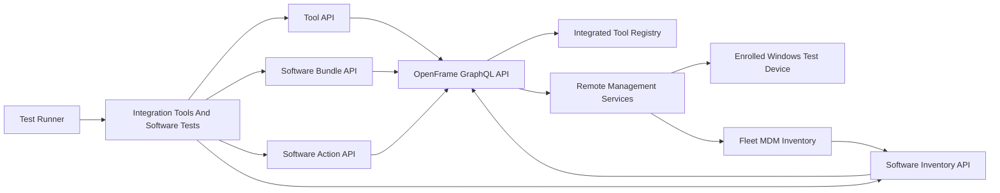
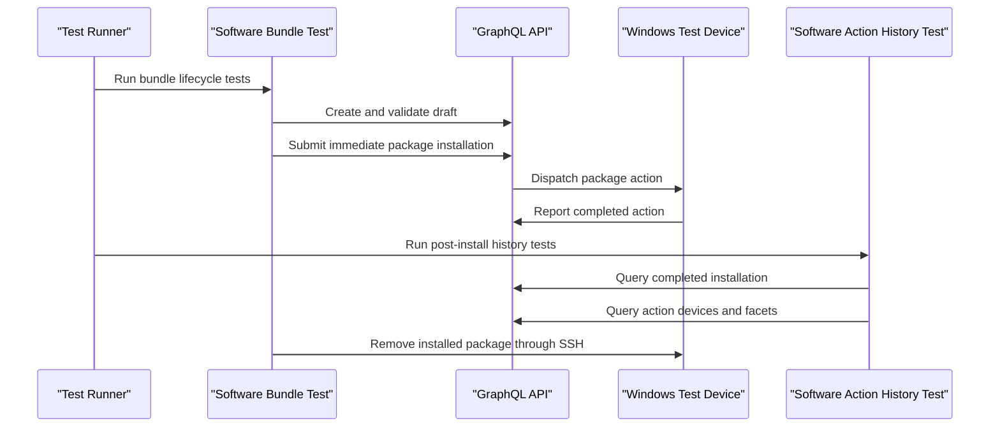
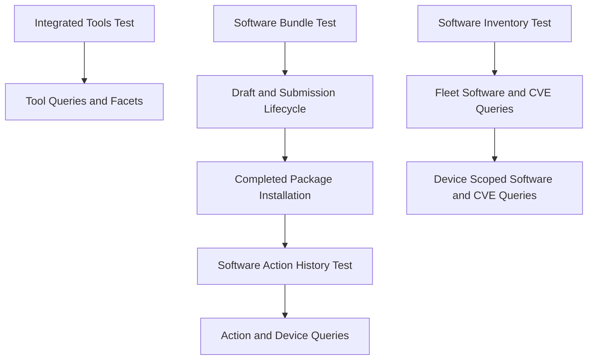

# Integration Tools And Software Tests

Integration Tools And Software Tests is the end-to-end regression suite for OpenFrame's integrated-tool registry and remote-management software workflows. It is supplied by the `com.openframe.oss:openframe-test-service-core` library at version `7.0.11` and runs through this repository's OpenFrame test service. The suite exercises live GraphQL reads and mutations against a configured tenant, Fleet MDM-backed inventory, and—where required—an enrolled Windows test device.

The module is deliberately state-aware. Read-only checks validate lists, searches, facets, pagination, detail views, and GraphQL error behavior. The software bundle scenario creates a disposable draft, installs a harmless package on the designated test device, observes its action history, then removes the package through SSH during the test or cleanup.

## Scope

The following generated sub-module pages provide the detailed test contracts for this module.

| Area | Contract validated | Primary test |
|---|---|---|
| Integrated tools | Tenant registry list, facet derivation, filters, search, and empty-result behavior | [Integrated Tools](integration_tools_and_software_tests/integrated_tools/integrated_tools.md) |
| Software bundles | Draft lifecycle, device assignment, validation failures, immediate package dispatch, action completion, and cleanup | [Software Bundles](integration_tools_and_software_tests/software_bundles/software_bundles.md) |
| Software action history | Action and device drill-downs, status and customer filters, facets, ordering, pagination, and absent records | [Software Action History](integration_tools_and_software_tests/software_action_history/software_action_history.md) |
| Software inventory | Fleet and device-scoped software and CVE queries, facets, sorting, pagination, and invalid-device handling | [Software Inventory](integration_tools_and_software_tests/software_inventory/software_inventory.md) |

## Architecture Overview

The test classes call typed test APIs, which issue GraphQL requests to the running OpenFrame platform. Results reflect tenant data and the state of integrated tools, remote-management deliveries, Fleet MDM inventory, and vulnerability projections. `SoftwareBundleTest` is the mutating path; its completed installation becomes an observable input for `SoftwareActionHistoryTest` in pipeline execution.

## Test Execution Model

All four classes extend the shared test base supplied by the test library and use JUnit tags to select suitable environments. The `saas` tag identifies the suite's target environment. Tests that need a real enrolled machine carry `needs-device`; action-history verification is also tagged `post-mingo` so it can run after the bundle installation path in the pipeline.

## Behavioral Boundaries

- The integrated-tool and inventory tests are read-only; they require existing tenant, tool, Fleet MDM, and vulnerability data rather than creating fixtures.
- Device-dependent cases preferentially select the online `vm115982` Windows device. They use JUnit assumptions to skip dependent steps when that device, its package manager, or SSH configuration is unavailable.
- The software bundle flow uses a harmless Winget package, verifies completion through the software-action API, and protects the test machine with `AfterAll` cleanup.
- Several tests intentionally submit unknown IDs, unknown filter values, unmatched searches, and unknown sort fields. Expected outcomes distinguish empty results, `null` details, `NOT_FOUND`, `BAD_REQUEST`, and validation errors.
- Assertions verify semantic consistency across views: connection `filteredCount` values, pagination flags, filter facets, sorted output, parent counts, and detail records must agree.

## Component Relationships

## Source Components

The implementation is maintained in the OpenFrame OSS Library. The source files below define the tests executed by this repository:

- [IntegratedToolsTest source](https://github.com/flamingo-stack/openframe-oss-lib/blob/16e7c1cbd9664e7d10ec5ebca7d53c9bd314decf/openframe-test-service-core/src/main/java/com/openframe/test/tests/IntegratedToolsTest.java)
- [SoftwareActionHistoryTest source](https://github.com/flamingo-stack/openframe-oss-lib/blob/16e7c1cbd9664e7d10ec5ebca7d53c9bd314decf/openframe-test-service-core/src/main/java/com/openframe/test/tests/SoftwareActionHistoryTest.java)
- [SoftwareBundleTest source](https://github.com/flamingo-stack/openframe-oss-lib/blob/16e7c1cbd9664e7d10ec5ebca7d53c9bd314decf/openframe-test-service-core/src/main/java/com/openframe/test/tests/SoftwareBundleTest.java)
- [SoftwareInventoryTest source](https://github.com/flamingo-stack/openframe-oss-lib/blob/16e7c1cbd9664e7d10ec5ebca7d53c9bd314decf/openframe-test-service-core/src/main/java/com/openframe/test/tests/SoftwareInventoryTest.java)

## Maintenance Notes

When changing the remote-management schema or test APIs, preserve the cross-view invariants documented here. In particular, bundle submission must remain idempotent after completion, action history must expose a completed bundle run, and inventory list, facet, detail, and device-scoped projections must retain consistent counts and scopes. Environment-dependent assumptions are intentional safeguards against modifying shared tenant state when required infrastructure is absent.
