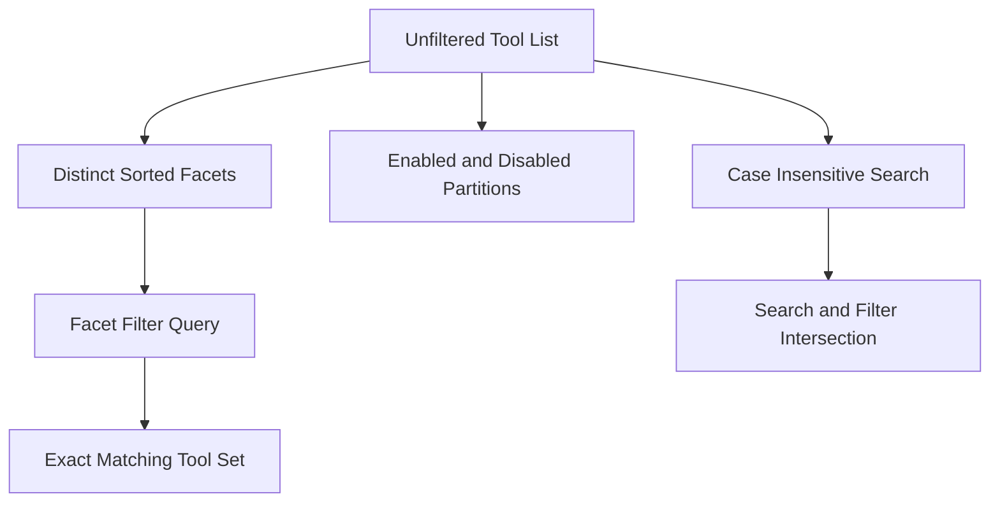

# Integrated Tools

Integrated Tools validates the tenant's read-only integrated-tool registry through `ToolApi`. The source class is [IntegratedToolsTest](https://github.com/flamingo-stack/openframe-oss-lib/blob/16e7c1cbd9664e7d10ec5ebca7d53c9bd314decf/openframe-test-service-core/src/main/java/com/openframe/test/tests/IntegratedToolsTest.java).

## Responsibilities

- Confirm that tenant setup provides at least one tool and that every tool has a unique global identifier, a non-empty name, and a defined enabled state.
- Derive the expected type, category, and platform-category facets from the unfiltered list, excluding null values, deduplicating, and sorting them.
- Verify that each advertised facet value returns exactly the matching tools.
- Verify that enabled and disabled queries partition the unfiltered collection.
- Verify case-insensitive search across name and description, including conjunction with an enabled-state filter.
- Confirm unknown facet values and unmatched literal searches return empty results. The search check includes regex metacharacters to ensure they are treated literally.

## Query Consistency

The test only assumes that a tenant registry exists. It skips the per-facet loop when no tool advertises any of the three optional facet fields, avoiding a false failure for an otherwise valid registry with empty facets.
