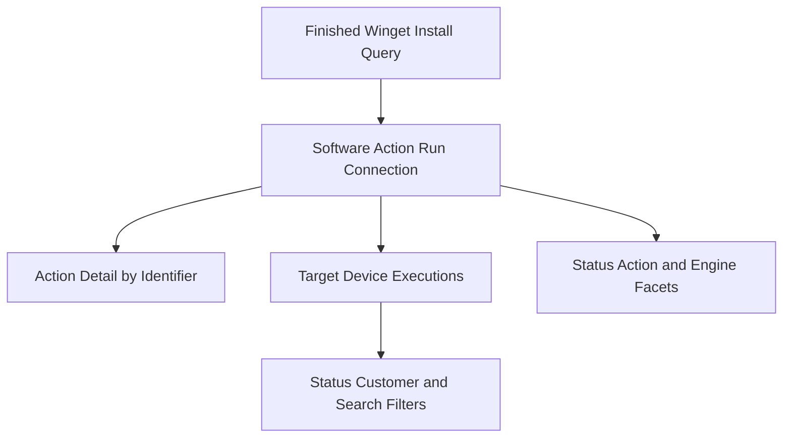

# Software Action History

Software Action History validates action-history read models after remote package operations. [SoftwareActionHistoryTest](https://github.com/flamingo-stack/openframe-oss-lib/blob/16e7c1cbd9664e7d10ec5ebca7d53c9bd314decf/openframe-test-service-core/src/main/java/com/openframe/test/tests/SoftwareActionHistoryTest.java) is ordered because it selects a finished Winget installation, preferably one submitted by the software bundle scenario.

## Covered Read Model

The test filters for completed Winget installs, verifies newest-first ordering and connection pagination, then chooses a bundle-originated run when available. It checks that a `NOW` bundle action has no schedule identifier.

## Key Invariants

- List rows have identifiers, execution identifiers, dispatch timestamps, and counts within the total target-device count.
- The detail query recursively equals its corresponding list row.
- Every action-device row identifies its machine and hostname and uses a recognized lifecycle status.
- Completed devices have exit code zero plus dispatch and completion timestamps; their count equals the parent action's responded-machine count.
- Device status, customer, machine identifier, hostname search, and unmatched-search queries retain their expected scopes.
- Facet counts agree with the matching list's `filteredCount`; constrained facets reduce to completed, install, and Winget values.
- An unmatched history search produces an empty connection and empty facets. Unknown action identifiers return `null` detail and no device rows.

The class is tagged `post-mingo` so a pipeline can schedule it after the software-bundle installation scenario. It can fall back to another completed tenant bundle installation when the current run's row is not the newest available entry.
