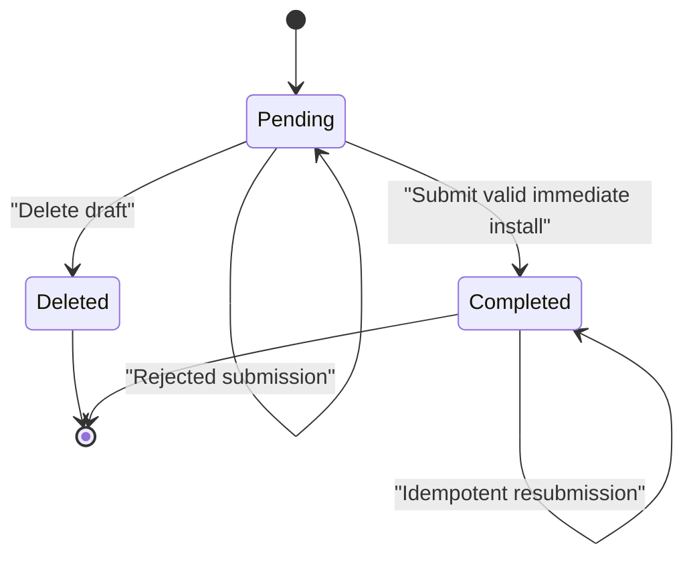

# Software Bundles

Software Bundles is the mutating end-to-end scenario for remote software deployment. [SoftwareBundleTest](https://github.com/flamingo-stack/openframe-oss-lib/blob/16e7c1cbd9664e7d10ec5ebca7d53c9bd314decf/openframe-test-service-core/src/main/java/com/openframe/test/tests/SoftwareBundleTest.java) manages disposable bundle records, dispatches a harmless Winget installation to the selected Windows device, waits for the resulting action, and removes the installed package over SSH.

## Lifecycle Coverage

## Assertions

- A new bundle is a `PENDING` draft with no assigned devices, packages, action, schedule, or execution identifiers.
- Device assignment supports direct and global machine identifiers, avoids duplicates, and keeps available-device edges synchronized with the assigned state.
- Filtered bulk assignment and removal agree with the device-picker query; unmatched removal is a no-op.
- Deleting a draft is idempotent, while a completed bundle remains immutable history and cannot be deleted or reassigned.
- Submission refuses missing devices, an empty package list, incomplete Brew package data, and unknown bundle identifiers with the expected GraphQL error codes.
- A valid immediate Winget installation records the action, package, completion metadata, one execution identifier, and no schedule.
- The test waits for a `COMPLETED` or `FAILED` action row, requires successful completion, confirms the expected package is installed, and then uninstalls it.

## Operational Safeguards

The scenario only runs its device interaction after confirming that the named Windows device is online, Winget is available, SSH test-machine configuration targets that device, and the package is absent. `AfterAll` removes unsubmitted drafts and attempts package cleanup if an interrupted run left it installed.
