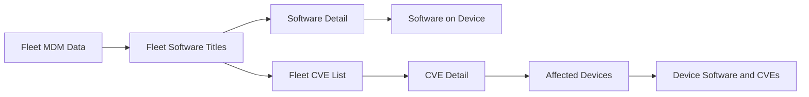

# Software Inventory

Software Inventory validates Fleet MDM-backed software and vulnerability projections exposed through `SoftwareInventoryApi`. [SoftwareInventoryTest](https://github.com/flamingo-stack/openframe-oss-lib/blob/16e7c1cbd9664e7d10ec5ebca7d53c9bd314decf/openframe-test-service-core/src/main/java/com/openframe/test/tests/SoftwareInventoryTest.java) covers fleet-wide titles and CVEs, detail views, device-scoped views, facets, sorting, pagination, and error handling.

## Projection Relationships

## Coverage

### Fleet Software

The suite requires non-empty fleet inventory and at least one vulnerable title. It validates unique title identifiers, known package sources, positive device counts, source, severity, and version-status facets, searches, and supported sorting by name, device count, and CVE count. It also checks cursor pagination and rejects an unsupported sort field as `BAD_REQUEST`.

For a selected vulnerable title, the test compares list and detail fields, verifies per-device installed versions and status facets, and checks that title device counts equal the distinct device holders. It also validates title-specific CVE rows, including CVE identifier format, affected version, and severity ordering.

### Fleet Vulnerabilities

Fleet CVE list rows intentionally leave detail-only data absent. The detail query must then provide affected software, while the affected-device query must match the detail's device count. Severity facets, severity thresholds, ordering, pagination, and unknown-CVE behavior are tested.

### Device-Scoped Views

For the selected Windows machine and for a device discovered from a CVE, the tests validate software and vulnerability projections in the device scope. They confirm that affected software equals the machine's vulnerable installed titles, while fleet-wide counts remain fleet-wide. Unknown machine identifiers must return `NOT_FOUND` from all four device-scoped query and facet operations.

## Data Assumptions

Read-only inventory tests do not create fixtures. They require connected Fleet MDM data, at least one CVE-bearing title, and, for device-specific cases, the configured Windows test device. JUnit assumptions clearly report when the required tenant data is unavailable.
