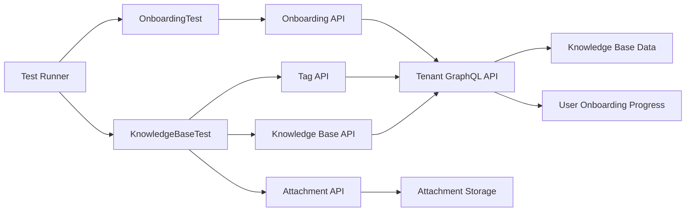
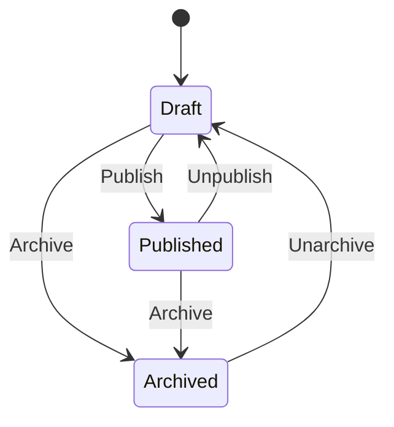
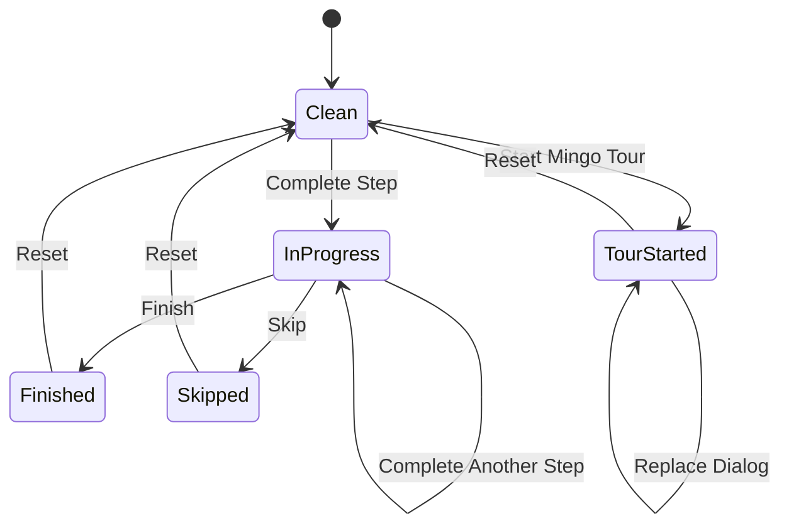

# Knowledgebase And Onboarding Tests

## Purpose

Knowledgebase And Onboarding Tests is an ordered, stateful end-to-end test slice in the `com.openframe:openframe-test-service-core` library. It validates two user-facing GraphQL domains against a running tenant:

- **Knowledge base management**: folders, articles, publication lifecycle, tags, and binary attachments.
- **Personal Get Started onboarding**: a signed-in administrator's progress, completion, skip, reset, and Mingo tour-dialog state.

The test classes are supplied by [OpenFrame OSS Library](https://github.com/flamingo-stack/openframe-oss-lib) version `7.0.11` and are run in this repository by the OpenFrame test service. They deliberately mutate live test data, then use ordered cases and best-effort cleanup to keep later assertions meaningful and reduce persistent test artifacts.

## Architecture Overview

The tests use API helper classes rather than directly constructing GraphQL requests. Assertions validate mutation responses and, for persistent operations, issue a follow-up read to verify that the server stored the expected state. Attachment cases additionally exercise the returned upload and download URLs as HTTP transfers.

## Components

### Knowledge Base Test

[KnowledgeBaseTest source](https://github.com/flamingo-stack/openframe-oss-lib/blob/16e7c1cbd9664e7d10ec5ebca7d53c9bd314decf/openframe-test-service-core/src/main/java/com/openframe/test/tests/KnowledgeBaseTest.java) is an ordered JUnit suite tagged `feature` and `saas`. It creates prerequisite content early, validates reads and in-place mutations, and removes or archives selected test data afterwards.

| Area | Coverage and expected behavior |
| --- | --- |
| Folder and article creation | Creates a root folder, then a draft article in a root folder. The article assertions cover identity, parent placement, content, summary, draft status, absent publication timestamp, and populated author information. |
| Query behavior | Retrieves root folders, folder-only and article-only trees, and items by identifier. It verifies item types, IDs, names, root parenting, and populated timestamps where applicable. |
| Folder mutations | Renames a folder, moves a specifically created child folder beneath a specifically created parent, and deletes a root folder while requesting archival of its children. Creating move fixtures inside the test avoids relying on pre-existing multiple roots. |
| Article lifecycle | Updates fields, publishes a draft, archives an article and observes it in the archive list, unarchives it into a supplied root folder, and unpublishes a newly created article back to draft. |
| Permanent attachments | Requests an attachment upload URL, uploads the generated file, requests a download URL, and compares downloaded bytes with the declared size. It also deletes an article attachment and verifies it is absent after a refetch. |
| Temporary attachments | Uploads a temporary attachment, checks that deleting it prevents linking, then validates the successful temporary-to-article linking path and downloaded content. |
| Tags | Creates an idempotent knowledge-article tag, attaches it, validates item and collection visibility, removes it, and confirms persistence. A negative assertion verifies that attaching an unknown tag returns GraphQL errors. |

The class stores IDs of articles created for tag and unpublish tests. Its `AfterAll` cleanup archives these IDs and intentionally suppresses cleanup failures so a cleanup problem cannot hide the primary failing assertion.

### Knowledge Base Lifecycle

The lifecycle diagram describes the paths explicitly asserted by the suite. Folder deletion is tested separately with an option that archives contained articles.

### Onboarding Test

[OnboardingTest source](https://github.com/flamingo-stack/openframe-oss-lib/blob/16e7c1cbd9664e7d10ec5ebca7d53c9bd314decf/openframe-test-service-core/src/main/java/com/openframe/test/tests/OnboardingTest.java) is an ordered JUnit suite tagged `saas` and `onboarding`. It tests the signed-in user's personal Get Started state, not tenant Initial Setup progress.

The suite recognizes eight user steps: `MEET_MINGO`, `DEVICES`, `TICKETS`, `SCRIPTING`, `MONITORING`, `LOGGING`, `INCIDENTS`, and `KNOWLEDGE_MANAGEMENT`. It explicitly sends `MSP_SETUP`, a tenant-only value, as a negative case and expects a top-level GraphQL error without changing user progress.

| Stage | Validated behavior |
| --- | --- |
| Initial read | Checks that completed steps are distinct and valid, flags are non-null, and completion or skip timestamps exist exactly when their corresponding flags are true. The original state is retained before mutation. |
| Clean | Reset must remove steps, completion and skip flags, timestamps, and the tour-dialog identifier. A subsequent read must remain clean. |
| Steps complete | Completes every allowed step one at a time and expects the completed-step set to grow without setting the overall completion flag. Repeating a step must be idempotent. |
| Finished | Finish sets `completed` and `completedAt`, retains the steps, does not mark skipped, and keeps the first completion timestamp when invoked again. |
| Skipped | Skip preserves steps completed so far, sets `skipped` and `skippedAt`, does not mark completed, and preserves the original skip timestamp when repeated. |
| Tour dialog | Starting a Mingo tour records a dialog identifier without completing or skipping onboarding. A later start replaces that identifier; reset clears it. |
| Restoration | The final case rebuilds the saved original state. An `AfterAll` fallback uses non-throwing API attempts when a prior test prevented normal restoration. |

Timestamp assertions allow two minutes of clock skew and compare persisted timestamps at millisecond precision. This avoids false negatives caused by service and test-host clock differences or storage precision.

### Onboarding State Flow

## Test Design and Isolation

Both components depend on ordered execution because later tests consume entities or state established earlier. `KnowledgeBaseTest` uses `@Order` to establish a folder and article before tree, lifecycle, attachment, and tag cases. `OnboardingTest` uses an internal stage guard and JUnit assumptions to prevent a state-changing case from running when its prerequisite stage was not reached.

The suites use different cleanup models:

- Knowledge base tests leave some mutation effects intentionally visible to validate server behavior, archive created articles recorded for final cleanup, and treat cleanup as best effort.
- Onboarding tests snapshot the current user's progress, restore it in the final test, and use an `AfterAll` recovery path if execution stops early.

Because these tests call real APIs and perform real mutation, they should run only with credentials and data appropriate for end-to-end validation. They are not unit tests and should not be assumed to be safe against a production user account.

## Integration Boundaries

Knowledgebase And Onboarding Tests verifies API contracts implemented outside this module:

- The external API includes knowledge base resources, including create, update, move, archive, unarchive, attachment, and tag request and response types.
- The API service supplies GraphQL knowledge base fetchers, data loaders, image handling, and publish lifecycle integration.
- Mongo persistence includes custom knowledge base and onboarding-progress repositories.
- The test service provides common test infrastructure, API wrappers, generated DTOs, authentication flow support, and the runner that selects tagged suites.

This module is therefore a behavioral consumer of those services. It confirms externally observable semantics rather than duplicating their implementation logic.

## Maintaining the Tests

When extending either suite:

1. Preserve ordering when a test relies on data or state created earlier; create local fixtures when a dependency can be eliminated.
2. Validate both the mutation response and a fresh read whenever persistence is part of the contract.
3. Add an explicit negative assertion when introducing an authorization, enum, or missing-resource boundary.
4. Ensure new state is either restored, archived, deleted, or otherwise intentionally retained for a documented reason.
5. Keep the knowledge base article lifecycle and onboarding-state assumptions synchronized with the API contract before changing expected transitions.
