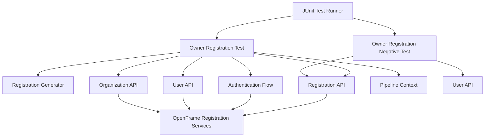
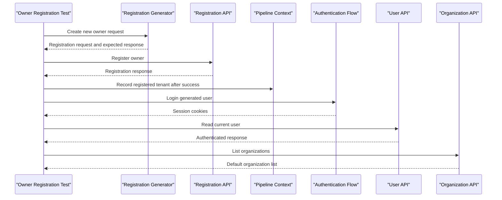
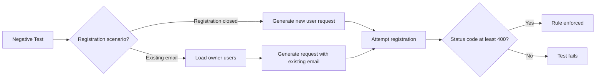

# Owner Registration Tests

Owner Registration Tests is the ordered end-to-end test suite that establishes an initial tenant owner and verifies the baseline conditions created by that registration. It also contains negative coverage for registration attempts that must be rejected. The tests are supplied by the `com.openframe.oss:openframe-test-service-core` library at version `7.0.11` and are run by this repository's OpenFrame test service.

The suite has two JUnit 5 classes:

- [`OwnerRegistrationTest`](https://github.com/flamingo-stack/openframe-oss-lib/blob/16e7c1cbd9664e7d10ec5ebca7d53c9bd314decf/openframe-test-service-core/src/main/java/com/openframe/test/tests/OwnerRegistrationTest.java) provisions an owner, signs in as that user, and confirms that registration created a default organization.
- [`OwnerRegistrationNegativeTest`](https://github.com/flamingo-stack/openframe-oss-lib/blob/16e7c1cbd9664e7d10ec5ebca7d53c9bd314decf/openframe-test-service-core/src/main/java/com/openframe/test/tests/OwnerRegistrationNegativeTest.java) verifies rejection when public registration is closed and when an email already belongs to an owner.

## Purpose and Scope

The positive test class is explicitly ordered and described in its source as running before the remaining tests. Its first test makes a new owner account and records the successful tenant in `PipelineContext`. Later tests use the same generated user to validate authentication and organization provisioning. This creates the tenant context required by the broader end-to-end test pipeline without publishing a tenant if registration fails.

The negative class is separately tagged for OSS and negative-registration execution. It probes two business rules through the registration boundary and asserts only that the response is an HTTP error, which permits either client-side or server-side rejection while preserving the behavior under test.

## Architecture Overview

The tests deliberately use API and authentication helpers rather than database writes. As a result, they verify the observable lifecycle across registration, login, authenticated identity lookup, and default organization retrieval.

## Positive Registration Lifecycle

`OwnerRegistrationTest` uses `@TestMethodOrder(MethodOrderer.OrderAnnotation.class)` to make the account lifecycle deterministic. `@BeforeAll` randomizes environment and user configuration before registration begins.

### Ordered Assertions

| Order | Test | Verified outcome | Key collaborators |
|---:|---|---|---|
| 1 | Register Owner User | The response has an ID, owner ID, and update time. All expected generated fields match after excluding server-generated identifiers, timestamps, HubSpot data, and plan. | `RegistrationGenerator`, `RegistrationApi`, `PipelineContext` |
| 2 | Login Owner User | The generated user can log in and the current-user response is authenticated. | `AuthFlow`, `AuthHelper`, `UserApi` |
| 3 | Check Default Organization Created | An authenticated owner can retrieve at least one organization, demonstrating post-registration default organization provisioning. | `AuthFlow`, `AuthHelper`, `OrganizationApi` |

### Pipeline Context Handoff

After the registration response passes its assertions, the test writes the generated user email and test user domain to `PipelineContext`. The ordering is important: the context is populated only after successful registration. If registration fails, the code leaves it unset, allowing the all-tests pipeline to use its request-tenant fallback rather than incorrectly targeting a partially created tenant.

## Negative Registration Coverage

`OwnerRegistrationNegativeTest` carries the `oss` and `registration-negative` tags. Its methods make an attempted registration and expect a status code greater than or equal to `400`.

The duplicate-email scenario first requires the owner-user list to be nonempty. This prevents the test from constructing a duplicate request from absent fixture state and makes its precondition explicit.

## Component Responsibilities

### Owner Registration Test

The [`OwnerRegistrationTest`](https://github.com/flamingo-stack/openframe-oss-lib/blob/16e7c1cbd9664e7d10ec5ebca7d53c9bd314decf/openframe-test-service-core/src/main/java/com/openframe/test/tests/OwnerRegistrationTest.java) class is the positive lifecycle suite.

- Initializes random environment and user configuration once for the class.
- Registers a generated owner request and performs structural and recursive response assertions.
- Excludes server-owned or integration-owned response fields from the equality comparison.
- Publishes tenant identity to the test pipeline only after successful registration.
- Authenticates the generated owner, installs its session cookies in the shared authentication helper, and confirms `UserApi.me()` reports an authenticated user.
- Confirms that the owner can retrieve a nonempty organization collection.

### Owner Registration Negative Test

The [`OwnerRegistrationNegativeTest`](https://github.com/flamingo-stack/openframe-oss-lib/blob/16e7c1cbd9664e7d10ec5ebca7d53c9bd314decf/openframe-test-service-core/src/main/java/com/openframe/test/tests/OwnerRegistrationNegativeTest.java) class is the policy-rejection suite.

- Attempts a generated registration while registration is closed.
- Retrieves an existing owner and attempts registration using that owner email.
- Treats any HTTP response status of `400` or higher as a successful rejection.
- Verifies that an existing owner is available before executing the duplicate-email scenario.

## Dependencies and System Fit

The module belongs to the `openframe-test-service-core` library, consumed by OpenFrame OSS Tenant as `com.openframe.oss:openframe-test-service-core:7.0.11`. It depends on test-framework collaborators that create requests, invoke registration and resource APIs, establish sessions, and preserve pipeline state. Their implementations are outside this two-class module, so this document describes their observed roles rather than their internal protocol details.

At run time, the tested flows exercise the OpenFrame authentication and registration surface, then verify organization availability through the public test APIs. The broader platform provides tenant registration through the authorization-service core and API-layer capabilities, while this module remains a consumer-focused end-to-end verification layer.

## Execution Characteristics

- **Framework:** JUnit 5 with AssertJ assertions.
- **Positive selection tag:** `registration`.
- **Negative selection tags:** `oss` and `registration-negative`.
- **Ordering:** Only the positive class enforces method order, because login and organization assertions use the owner created by its first method.
- **State:** Randomized environment and user settings are established once per positive test class. Authenticated follow-up calls use cookies stored through `AuthHelper`.
- **Failure boundary:** The positive path validates typed responses. The negative path intentionally uses a status-only registration method so rejected requests can be evaluated without requiring a successful response body.
