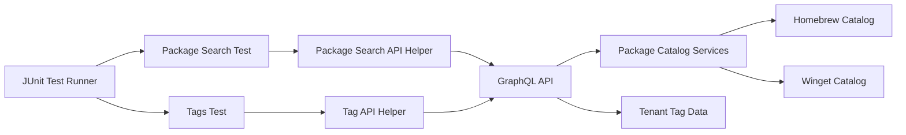
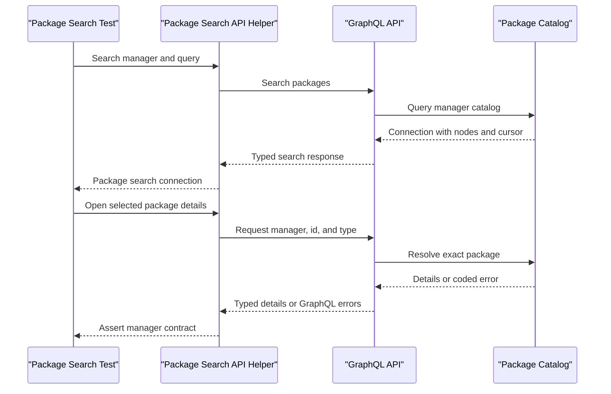
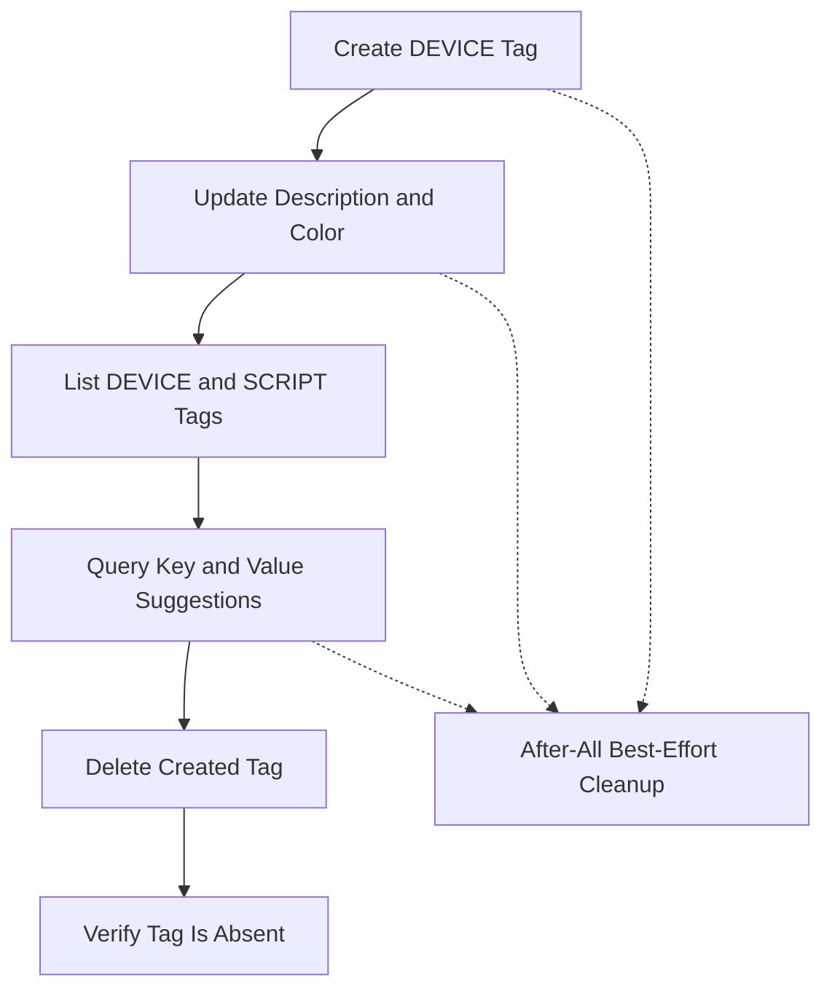

# Package And Tags Tests

Package And Tags Tests is an end-to-end GraphQL verification module supplied by the `com.openframe.oss:openframe-test-service-core` library and run by this repository's OpenFrame test service. It covers two user-facing integration areas:

- **Package search** verifies read-only catalog search, package details, paging, validation, and manager-specific fields for Homebrew and winget.
- **Tags** verifies the lifecycle of a tenant-scoped device tag: create, update, type-scoped listing, key and value suggestions, deletion, and cleanup.

The implementation lives in the OpenFrame OSS Library at [PackageSearchTest.java](https://github.com/flamingo-stack/openframe-oss-lib/blob/16e7c1cbd9664e7d10ec5ebca7d53c9bd314decf/openframe-test-service-core/src/main/java/com/openframe/test/tests/PackageSearchTest.java) and [TagsTest.java](https://github.com/flamingo-stack/openframe-oss-lib/blob/16e7c1cbd9664e7d10ec5ebca7d53c9bd314decf/openframe-test-service-core/src/main/java/com/openframe/test/tests/TagsTest.java). This repository consumes that library at version `7.0.11`.

## Architecture Overview

Both test classes extend the shared test base and invoke API helper classes rather than constructing GraphQL requests in each test. Assertions inspect typed response DTOs and GraphQL error extensions. The tests are tagged `saas`; individual scenarios are also tagged `feature`, and the suggestion-only tag scenario adds the `read` tag.

## Package Search Coverage

`PackageSearchTest` verifies the public catalog used by software installation workflows. Its assertions deliberately distinguish package-manager contracts instead of requiring every manager to expose the same fields.

| Area | Verified behavior |
|---|---|
| Homebrew search | Searches for known formulae, identifies each result as a formula or cask, returns installation commands, and exposes Homebrew popularity without winget publisher or Chocolatey icon fields. |
| Homebrew details | Opens a result using its returned identifier and package type, preserves the search metadata, supplies the current version, and keeps Chocolatey-only release timestamps absent. |
| Type isolation | Confirms that formula and cask results are opened only with their own type. Asking for the alternate type returns `NOT_FOUND`; no similarly named package is substituted. |
| Winget search and details | Finds a stable package by exact identifier, requires a publisher, verifies the exact installation command, and checks unique versions ordered with the search version first. |
| Cursor pagination | Uses the first page's end cursor as the next request's `after` value, checks page information, stable filtered counts, result order, and absence of skips or repeats. |
| Page cap | Requests 100 results and verifies that the server clamps the result set to 39 rows while indicating further data exists. |
| Failure contract | Checks `NOT_FOUND` for unknown identifiers and mismatched Homebrew type, and `VALIDATION_ERROR` for a blank identifier. |
| Chocolatey policy | Verifies that Chocolatey is rejected with `VALIDATION_ERROR` while deployment configuration disables it, including a message naming the disabled manager. |

### Package Search Request Flow

### Test Data Choices

The package scenarios use public, long-lived catalog entries to make their assertions meaningful:

- `wget` exercises a Homebrew formula with no same-name cask.
- `wireshark` provides mixed formula and cask search results for strict package-type checks.
- `7zip.7zip` exercises winget metadata and multi-version ordering.
- `python` is broad enough to test two pages and the service page cap.
- A generated unknown identifier prevents accidental collision with a real catalog entry.

The suite intentionally does not assert fields that are unavailable for a manager. For example, Homebrew has no publisher in these responses, winget has no popularity or package type, and release timestamps are treated as Chocolatey-specific.

## Tag Lifecycle Coverage

`TagsTest` is ordered because later operations depend on the device tag created by the first scenario. It generates a run-specific `E2E_` key, avoiding interference between independent runs.

| Ordered step | Expected contract |
|---|---|
| Create and edit | A newly created tag has an identifier and `DEVICE` entity type. Updating description and color keeps both the identifier and an omitted key unchanged. |
| Entity scoping | The tag appears in `DEVICE` listings but not `SCRIPT` listings or the script tag query. Every item returned from the device list reports the `DEVICE` entity type. |
| Suggestions | Key suggestions find the created key both unfiltered and by prefix. A key with no values yields an empty value suggestion list. If a stored tag with values is available, its suggestions include one or more stored values. |
| Delete | Deletion returns true, removes the tag from device listings, and removes its key from key suggestions. |
| Recovery | An `AfterAll` hook attempts deletion if a preceding assertion interrupted the ordered lifecycle. Cleanup intentionally ignores runtime failures so that cleanup does not replace the original test outcome. |

## Maintainer Notes

- Package data is external and may change. The suite constrains assertions to stable behavior and manager-specific semantics rather than exact catalog counts or incidental fields.
- Winget detail coverage depends on access to the public winget CDN.
- Chocolatey assertions describe the current deployment policy. If Chocolatey is enabled, replace the refusal expectations with catalog assertions appropriate to its response shape.
- The tag suite mutates tenant data only through a generated, run-specific device tag and includes best-effort cleanup to limit residue after failure.
- GraphQL error assertions read extension codes and intentionally discard errors with no code, such as a non-null field error reported by the GraphQL runtime.

## Relationship to the Platform

These tests exercise the test-service library's API-facing contract against the tenant deployment. Package search reaches the package catalog behavior surfaced by the platform's API layer, while tag scenarios validate entity-type filtering and tenant-wide device-tag suggestions. They complement feature suites for software, scripts, devices, and tickets without duplicating those workflows.
