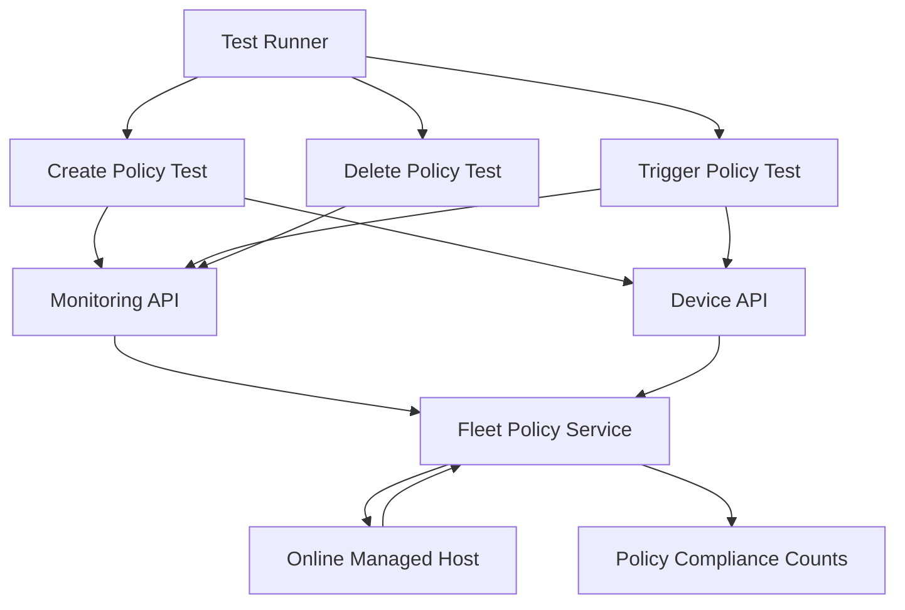
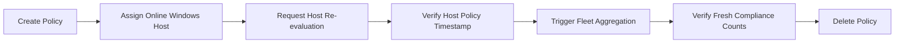
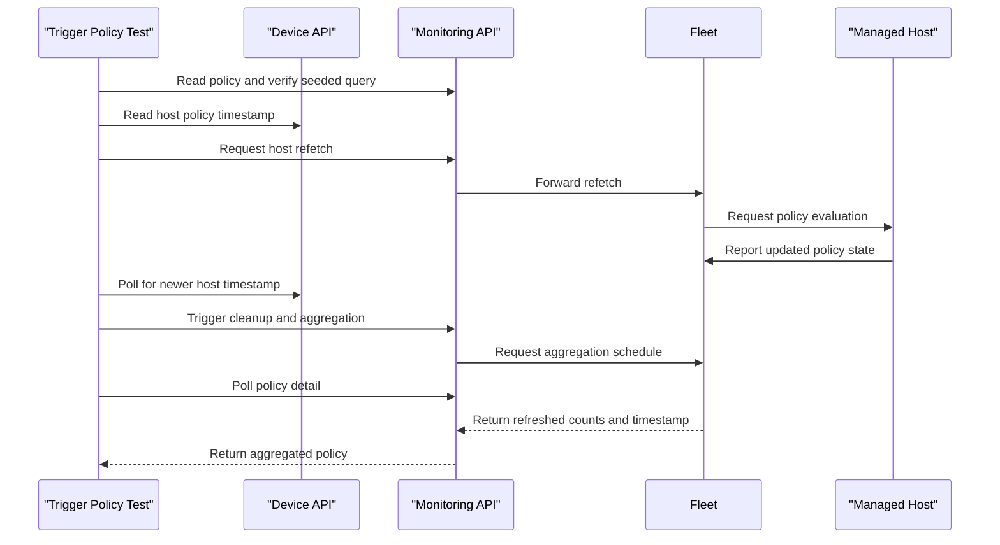

# Policy Tests

## Purpose

Policy Tests are integration tests in the `openframe-test-service-core` library that validate the Fleet policy lifecycle used by OpenFrame monitoring: policy creation, host targeting, compliance re-evaluation, aggregation, and deletion. The tenant repository runs this library through its OpenFrame test service; the implementation lives in the OpenFrame OSS Library artifact `com.openframe.oss:openframe-test-service-core`.

The suite covers two deliberately different fixtures:

- **Empty** — an untargeted policy that must aggregate to zero passing and zero failing hosts.
- **Windows version** — a policy assigned to an online Windows machine with Fleet connectivity, expected to aggregate as compliant.

## Architecture Overview

The tests use `MonitoringApi` for policy operations and Fleet scheduling actions. `DeviceApi` locates eligible devices and reads host policy timestamps. Fleet evaluates policies on managed hosts, then aggregates host outcomes into the policy's passing and failing host counts.

## Lifecycle Coverage

Creation and assignment establish the fixtures that compliance checks expect. Compliance checks do not trust Fleet's periodic aggregation timing: they refetch targeted hosts, explicitly request the cleanup-and-aggregation schedule, and wait for a newer aggregation timestamp. Deletion verifies that both untargeted and host-targeted policies can be removed.

## Test Components

### Policy Creation and Targeting

[CreatePolicyTest](https://github.com/flamingo-stack/openframe-oss-lib/blob/16e7c1cbd9664e7d10ec5ebca7d53c9bd314decf/openframe-test-service-core/src/main/java/com/openframe/test/tests/CreatePolicyTest.java) creates the two fixture shapes.

- **Add policy** creates the Empty policy and verifies that its identifier, name, description, and query match the request.
- **Select policy device** creates the Windows version policy, finds an online Windows device, verifies its tool connections and Fleet identifier, assigns that Fleet host to the policy, then re-reads the policy to verify the host assignment.

Both cases are tagged `feature` and `device`. The targeted case has an environmental prerequisite: at least one online Windows device must be available, must expose a tool connection, and must have a Fleet identifier.

### Policy Compliance Re-evaluation

[TriggerPolicyTest](https://github.com/flamingo-stack/openframe-oss-lib/blob/16e7c1cbd9664e7d10ec5ebca7d53c9bd314decf/openframe-test-service-core/src/main/java/com/openframe/test/tests/TriggerPolicyTest.java) validates compliance after producing a fresh state. Its tests are tagged `mdm` and `scheduled`.

Before asserting compliance, the test resolves each named fixture and verifies its query against the generator's expected definition. This detects fixture drift early: changing a policy query resets Fleet results, so a count-only assertion would otherwise obscure the underlying cause.

For a policy with hosts, the test:

1. Captures each host's policy-update time.
2. Requests a Fleet host refetch.
3. Waits until the host reports a later policy-update time.
4. Triggers the Fleet cleanup-and-aggregation schedule until Fleet accepts the request.
5. Waits for the policy's `host_count_updated_at` to advance.
6. Asserts zero failing hosts and a passing count equal to the number of assigned hosts.

A Fleet conflict response means an aggregation was already running rather than that this test initiated one. The test therefore retries until it receives the accepted status, within its 60-second acceptance window. It then allows up to 180 seconds for an aggregation stamp newer than the captured baseline.

The Empty-policy case normalizes a null host list to an empty list, triggers the same aggregation process without host refetches, and asserts zero passing and zero failing hosts. This reflects Fleet's representation of an untargeted policy: no hosts evaluate it, but aggregation still updates its count timestamp.

### Policy Deletion

[DeletePolicyTest](https://github.com/flamingo-stack/openframe-oss-lib/blob/16e7c1cbd9664e7d10ec5ebca7d53c9bd314decf/openframe-test-service-core/src/main/java/com/openframe/test/tests/DeletePolicyTest.java) is tagged `archive` and covers removal of both fixture variants.

Each case lists policies, resolves a policy by its expected name, deletes it through `MonitoringApi`, and verifies that the deletion response includes the deleted policy identifier. The separate cases prove that deletion works for an unassigned policy and for a policy that has a device assignment.

## Data and State Contracts

| Contract | Verified behavior |
|---|---|
| Policy definition | Creation returns the requested identifier-bearing policy with matching name, description, and query. |
| Target assignment | The Windows version policy contains the selected device in its include-any host collection. |
| Seeded fixture integrity | Trigger tests require the expected policy names and exact generated queries. |
| Fresh host evaluation | A targeted host's policy-update timestamp advances after refetch. |
| Fresh aggregation | `host_count_updated_at` advances after Fleet accepts an aggregation trigger. |
| Targeted compliance | The Windows version policy has no failing hosts and all assigned hosts pass. |
| Untargeted compliance | The Empty policy has no assigned hosts and reports zero passing and failing hosts. |
| Deletion response | The returned deleted-ID collection contains the requested policy ID. |

## Maintenance Notes

- Preserve the **Empty** and **Windows version** fixture names unless all consumers of the test fixtures are updated together.
- Keep the Windows version query aligned with the monitoring generator. Trigger tests intentionally fail before compliance assertions when the persisted definition drifts.
- Avoid replacing explicit refetch and aggregation waits with fixed sleeps. The suite depends on observable timestamps to distinguish stale Fleet state from an actual compliance failure.
- The server-wide aggregation trigger can be temporarily unavailable while another aggregation runs. A sustained inability to obtain an accepted trigger is diagnosed as a Fleet or environment problem, not a policy-compliance result.
- When changing host-selection prerequisites, retain checks for online status, tool connections, and a Fleet identifier; the assignment and re-evaluation flows require all three.
