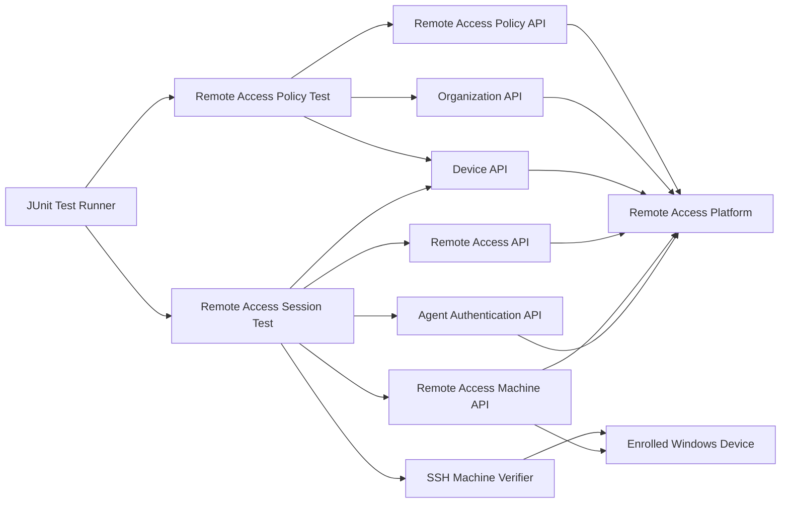
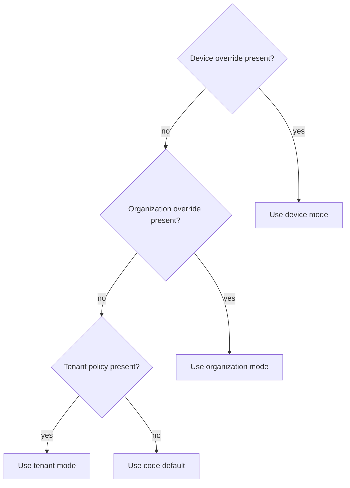
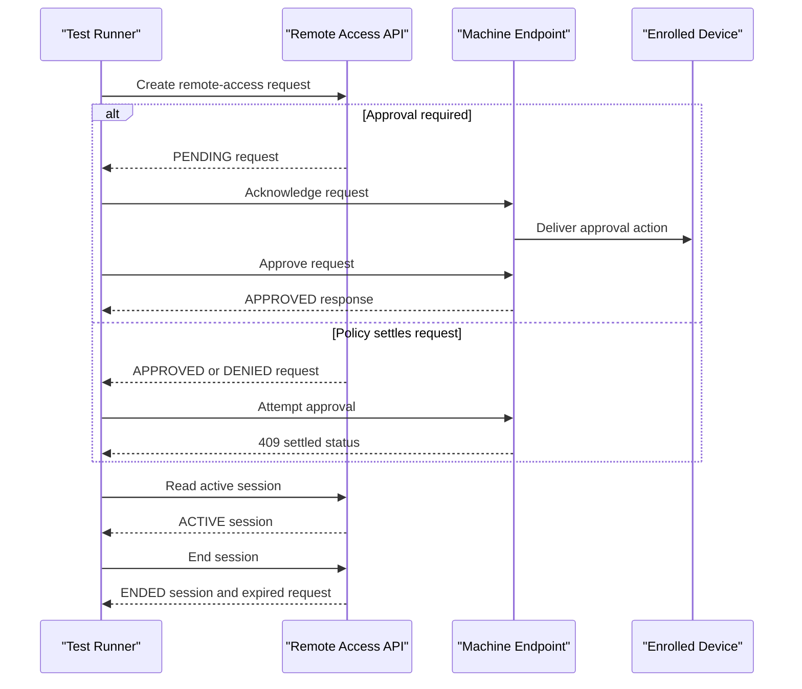

# Remote Access Tests

Remote Access Tests is the end-to-end verification suite for OpenFrame remote-access policy resolution and the remote-session lifecycle. It is supplied by the `com.openframe.oss:openframe-test-service-core` library and run by this repository's OpenFrame test service. The suite exercises a real enrolled Windows device and validates the GraphQL technician-facing APIs together with the device-facing machine endpoint.

The module is intentionally stateful and ordered. It creates isolated test data where possible, skips safely when the shared device cannot support a scenario, and performs best-effort cleanup so a failed run does not leave an organization override, active session, or live request behind.

## Scope

The module contains two JUnit test classes:

| Test class | Responsibility |
| --- | --- |
| [Remote Access Policy Test](https://github.com/flamingo-stack/openframe-oss-lib/blob/16e7c1cbd9664e7d10ec5ebca7d53c9bd314decf/openframe-test-service-core/src/main/java/com/openframe/test/tests/RemoteAccessPolicyTest.java) | Verifies tenant, organization, and device policy precedence, override metadata, validation failures, pipeline setup and teardown, and cleanup of temporary state. |
| [Remote Access Session Test](https://github.com/flamingo-stack/openframe-oss-lib/blob/16e7c1cbd9664e7d10ec5ebca7d53c9bd314decf/openframe-test-service-core/src/main/java/com/openframe/test/tests/RemoteAccessSessionTest.java) | Verifies request creation, device approval, policy-settled outcomes, session reads and termination, request and session history, revocation, concurrency behavior, and invalid-device handling. |

## Architecture Overview

Remote-access validation crosses technician APIs, policy configuration, the selected device, and device-agent authentication. The test service uses the APIs provided by the OpenFrame test library; it does not implement the production remote-access service itself.

## Policy Resolution Coverage

The policy suite establishes the precedence behavior that session tests depend on. A device resolves its mode from the most specific configured scope:

`RemoteAccessPolicyTest` proves the organization and device portions of this resolution chain:

- A newly created organization has no local override and inherits the tenant mode.
- Setting an organization override changes its effective mode, records the actor and timestamp, and does not change the tenant setting.
- Clearing that override restores inheritance and removes override metadata.
- An unknown organization is rejected with `ORGANIZATION_NOT_FOUND`; the raw GraphQL query is expected to return HTTP 200 with an error code in the response extensions and no data.
- For the shared Windows device, the suite only continues when no pre-existing device override exists. It verifies the inherited effective mode against the device's organization policy, sets a device override to the already effective value, and then clears it to restore the original scope.
- An unknown device mutation is rejected with `DEVICE_NOT_FOUND` through the same GraphQL error pattern.

### Pipeline Mode Control

The policy class also provides tagged pipeline phases. The `remote-access-setup` test stores the prior tenant mode in `PipelineContext` and changes the tenant to `SILENT_ACCESS`, allowing session tests to run without waiting for an end user at the test machine. The `remote-access-teardown` test restores the saved mode unless it was already silent or was unavailable.

This separation is important: `RemoteAccessSessionTest` never changes policy. It validates whichever mode was resolved for the selected device, while the pipeline can choose silent access for a deterministic session path.

## Session Lifecycle Coverage

The session suite finds the named Windows device, preferring an online record when duplicate records exist. It first waits for an existing session owned by the same technician to disappear and skips if another technician or a previous run still holds the device.

### Request and Approval Behavior

`RemoteAccessSessionTest` creates a desktop request with a unique run identifier in its reason. It verifies the request identifier format, device and technician identifiers, recording flag, expiry ordering, resolved mode, and its initial status:

| Resolved mode | Initial request status | Decision source |
| --- | --- | --- |
| `APPROVAL_REQUIRED` | `PENDING` | Unset until the device user decides |
| `DENY_ACCESS` | `DENIED` | `POLICY` |
| Any other policy-settled mode, including `SILENT_ACCESS` | `APPROVED` | `POLICY` |

For approval-required requests, the device test authenticates as the machine agent. It reads the local agent identity over SSH, checks that the identity matches the selected machine, exchanges the agent client credentials for a token, then acknowledges and approves the request through the machine endpoint. The suite verifies that approval changes the request to `APPROVED`, records `USER` as the decision source, and sets the resolution time.

For requests already settled by policy, an attempted device approval must return HTTP 409 and preserve the original policy outcome. The suite additionally verifies that a second request for the same occupied device returns the caller's existing request with `created` set to false instead of creating a duplicate.

### Session, Audit, and Error Semantics

When an approved request creates a session, the suite verifies that the session inherits its request's device, technician, mode, session kind, reason, and recording configuration. An active session must report `ACTIVE`, have no end time or end reason, and show `PROCESSING` recording state when recording is enabled, otherwise `NONE`. A silent-access session must not expose a device dialog identifier.

After the technician ends the session, the expected result is an `ENDED` session with `ADMIN` as its end reason, a non-negative duration, no active session on the device, and an `EXPIRED` originating request. Re-ending the same session must return `REMOTE_SESSION_ENDED` and retain the ended-session payload.

The suite then checks two read models:

- Session history contains the ended session, uses non-empty cursors, is newest-first, retains the technician and end reason, and clamps pagination to one through one hundred rows with a default of twenty.
- Connect-attempt audit contains the request with its policy scope, decision source, reason, linked session, technician, and newest-first ordering. Its pagination is likewise clamped from one through one hundred rows.

Negative paths ensure that revoking a settled request returns `REMOTE_ACCESS_REQUEST_SETTLED`, and that both an unknown machine identifier and a Relay global identifier supplied where a machine identifier is expected return `DEVICE_NOT_FOUND`.

## Isolation, Ordering, and Cleanup

The ordered tests share state within each class. This is deliberate: later assertions inspect the request, session, organization, or override created by earlier tests. Guard methods use JUnit assumptions to skip dependent cases when their prerequisite did not run or the shared environment is unsuitable.

| Resource | Isolation strategy | Cleanup behavior |
| --- | --- | --- |
| Organization policy | A run-specific, throwaway organization is created. | The organization is archived. A lingering override is cleared first. |
| Device policy | The existing device is changed only when it has no device override. The override uses the pre-existing effective mode. | A raw mutation clears a potentially lingering override. |
| Tenant policy | Pipeline setup stores the previous value before choosing silent access. | Pipeline teardown restores the prior non-silent value. |
| Remote request and session | Requests carry a unique reason and the test avoids devices held by other runs. | Best-effort helpers revoke live requests and end a session opened by this run. |

The cleanup calls are deliberately best-effort. They are also designed to be safe after partial execution: a settled request does not need revocation, and absent temporary resources are ignored by the raw cleanup calls.

## Test Selection Tags

The suite uses tags to make the execution intent explicit:

| Tag | Meaning |
| --- | --- |
| `remote-access-policy` | Selects policy precedence and pipeline mode tests. |
| `remote-access` | Selects remote session lifecycle tests. |
| `remote-access-setup` | Selects the tenant-mode setup phase. |
| `remote-access-teardown` | Selects the tenant-mode restoration phase. |
| `needs-device` | Marks tests requiring the enrolled Windows device. |
| `feature`, `read`, and `negative` | Classify mutation coverage, read-model coverage, and expected failure behavior. |
| `oss` and `saas` | Identify the environment applicability declared by the test classes and methods. |

## Operational Considerations

- The tests are integration tests, not unit tests. They require platform APIs, a registered Windows machine, and for approval cases, SSH access to that machine and the machine agent's persisted client credentials.
- The target device is shared. The suite waits up to 180 seconds for an active session owned by its technician to clear, then skips rather than disrupting another technician's session.
- Device-specific cases skip when the selected machine has an existing device override, because that configuration belongs to the environment and is outside the suite's ownership.
- The policy setup exists because both `APPROVAL_REQUIRED` and `NOTIFY_ONLY` can wait for a person at the device. Silent access gives pipeline runs a non-interactive path while preserving restoration of the tenant's prior configuration.

## Source Provenance

Both test classes are provided by OpenFrame OSS Library version `7.0.11` as the `com.openframe.oss:openframe-test-service-core` Maven artifact. The tenant repository consumes that artifact and runs it through its OpenFrame test service.
