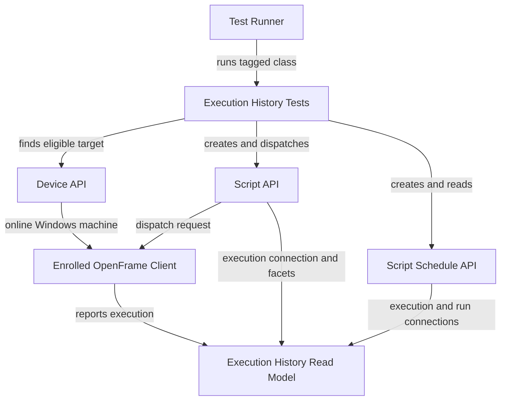
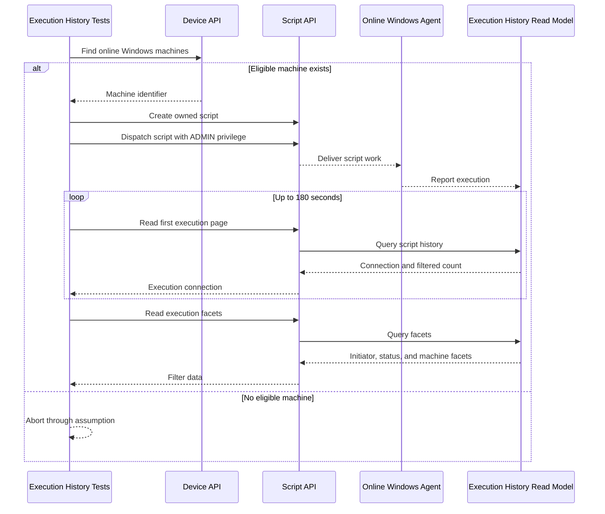
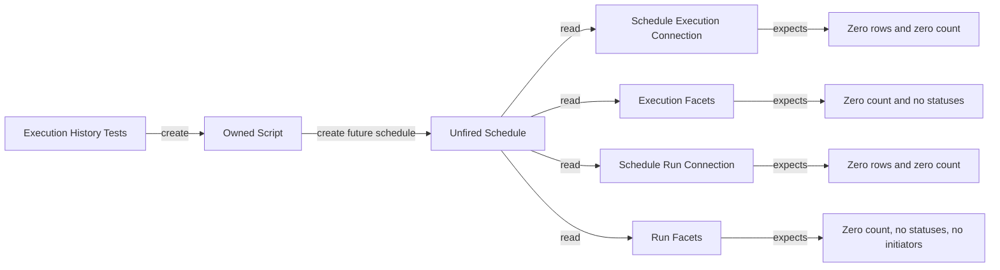

# Execution History Tests

Execution History Tests is an end-to-end read-path suite for script execution history in the OpenFrame test service. It verifies that a freshly dispatched script is discoverable through its execution connection and filter facets, and that a newly created schedule that has never fired reports empty execution and run histories consistently.

The suite is implemented by `ScriptExecutionHistoryTest` in the OpenFrame OSS Library artifact `com.openframe.oss:openframe-test-service-core`, consumed by this repository at version `7.0.11`. The source is available in [ScriptExecutionHistoryTest.java](https://github.com/flamingo-stack/openframe-oss-lib/blob/16e7c1cbd9664e7d10ec5ebca7d53c9bd314decf/openframe-test-service-core/src/main/java/com/openframe/test/tests/ScriptExecutionHistoryTest.java).

## Scope and Contract

The module contains two feature and read-tagged tests:

- **Script execution history:** creates a script, dispatches it to an enrolled online Windows machine with `ADMIN` privilege, waits for the agent-reported execution to appear, and validates the first history page and its facets.
- **Schedule history:** creates an owned script and a one-time schedule for the following day. Because the schedule cannot have fired, it verifies the empty-state contract for schedule executions, schedule runs, and their filter facets.

These cases avoid tenant-owned fixture state. A prior approach searched for an existing dispatched script, but that made the suite skip when preceding tests cleaned up their scripts. Each test now owns the resources it reads and removes them during class teardown.

## Position in the Test Suite

Execution History Tests belongs to the Script and Schedule Tests group. Its device dependency is deliberate: the script-history case requires an enrolled machine that is both Windows and online, so it runs after the device and assistant phases in pipeline execution.

### Tags and Execution Preconditions

| Tag | Purpose |
|---|---|
| `saas` | Includes the class in the SaaS-oriented suite. |
| `post-mingo` | Keeps the class after phases that establish an enrolled online machine. |
| `needs-device` | Marks the requirement for a device; the tenant environment excludes the class where no agent is installed. |
| `feature` and `read` | Classifies each method as a feature-level read-path check. |

If no online Windows machine is available, the dispatch test is aborted through a JUnit assumption rather than reported as a product failure. The schedule empty-state test does not require dispatching work, but remains in the same class and phase to preserve suite ordering.

## Components and Responsibilities

| Component | Responsibility in this module |
|---|---|
| `ScriptExecutionHistoryTest` | Owns test resources, coordinates dispatch and history reads, asserts contracts, and performs best-effort cleanup. |
| `DeviceApi` | Finds machines using a Windows-and-online device filter. |
| `ScriptApi` | Creates, runs, reads, and deletes scripts. |
| `ScriptScheduleApi` | Creates, reads, and deletes schedules; exposes schedule execution and schedule run reads. |
| `FleetWait` | Polls the script execution connection until the asynchronous agent report is observable or the 180-second deadline is reached. |
| `RelayIds` | Decodes a script global identifier so returned execution rows can be associated with their source script. |
| `ScriptExecutionConnection` and `ScheduleRunConnection` | Represent paginated result connections, including nodes, filtered count, and page information. |
| `ScriptExecutionFilters` and `ScheduleRunFilters` | Supply facet totals and filter options, including status and initiator dimensions. |

## Script History Flow

A dispatch request only confirms that work has been submitted; it does not guarantee that the execution read model has already received an agent report. The test therefore polls instead of treating the initial dispatch response as history availability.

### Assertions for a Populated Script History

After the wait observes at least one execution, the test validates both connection and facet invariants:

1. `pageInfo` is present, including when callers only request the first 20 rows.
2. The filtered count is positive and equals the execution-facet filtered count.
3. The returned row count is the smaller of the total count and the requested page size of 20.
4. Each execution has a nonblank identifier and dispatch timestamp.
5. Every execution belongs to the dispatched script, verified by comparing the decoded script identifier with the execution's script identifier.
6. Each status is one of `QUEUED`, `RUNNING`, `SUCCESS`, or `FAILED`.
7. Initiator, status, and machine facet lists are present. For a nonempty history, the status facet is nonempty and the sum of its counts equals the connection total.

This combination checks more than row retrieval: it tests pagination metadata, script ownership, schema-level status values, and aggregation consistency between list and facet read paths.

## Schedule Empty-State Flow

The schedule case creates a date-time schedule for the next available slot at least one day in the future. It consequently asserts a stable, meaningful response before any firing occurs rather than needing to wait for schedule execution.

The connection returned for an unfired schedule must still include `pageInfo`. This ensures client code can use the same pagination structure regardless of whether schedule activity exists.

## Resource Lifecycle and Failure Handling

The class retains references to three resources: the script used for the future schedule, the script dispatched for history verification, and the schedule itself. The `AfterAll` cleanup deletes them in dependency-safe order:

1. Delete the schedule.
2. Delete the dispatched script.
3. Delete the schedule-owned script.

Cleanup is best effort. A runtime exception or assertion failure during deletion is logged as a warning, leaving the resource in the tenant rather than masking the test's primary result. Maintainers should investigate such warnings because leftovers can pollute long-lived test tenants, even though they do not retroactively invalidate the read-path assertions.

## Maintenance Guidance

- Preserve the owned-resource model. Do not replace it with discovery of pre-existing tenant data, because that creates ordering-sensitive skips.
- Keep the device requirement aligned with the pipeline phase that enrolls an online Windows machine. If the supported dispatch target changes, update both the device filter and phase assumptions.
- When introducing a new execution status, update the explicit accepted-status set only after confirming it is intended for this history API contract.
- Keep list totals and facet totals coupled in assertions. A successful row query alone does not prove that filtering UI data is correct.
- Retain the unfired-schedule checks. Empty pages, `pageInfo`, and empty facets are part of the caller-facing contract rather than incidental behavior.

## Related Modules

- [Script and Schedule Tests](script-and-schedule-tests.md) provides the parent test grouping and broader script and schedule coverage.
- [Script Operations Tests](Script%20Operations%20Tests.md) covers the script lifecycle used before execution history can be read.
- [Schedule Lifecycle Tests](Schedule%20Lifecycle%20Tests.md) covers schedule creation and lifecycle behavior.
- [Schedule Device Targeting Tests](Schedule%20Device%20Targeting%20Tests.md) covers the device-assignment behavior that determines where schedules execute.
