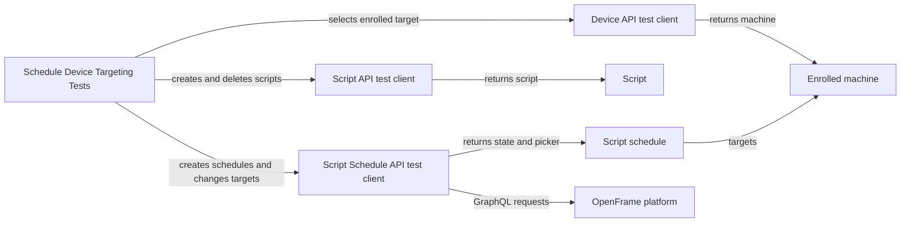
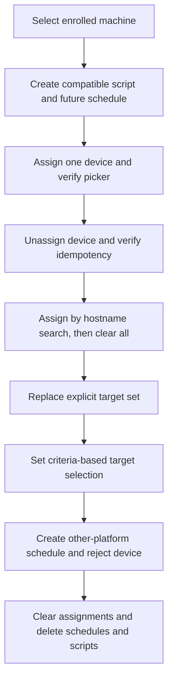
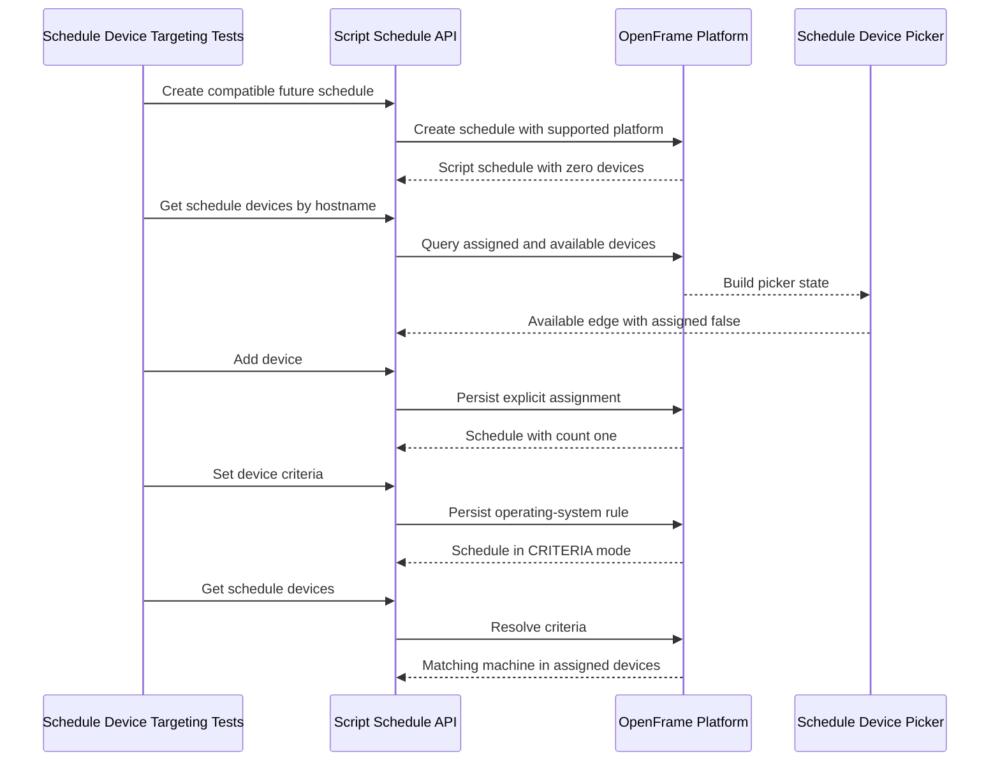

# Schedule Device Targeting Tests

Schedule Device Targeting Tests is an ordered end-to-end JUnit test suite that verifies how a script schedule targets enrolled devices. It creates future-dated schedules, exercises the GraphQL schedule-device operations, checks picker and selection state, and removes all created data when the suite finishes. The implementation belongs to the OpenFrame OSS Library artifact `com.openframe.oss:openframe-test-service-core`, which this repository runs through its OpenFrame test service.

The source implementation is [ScriptScheduleDevicesTest.java](https://github.com/flamingo-stack/openframe-oss-lib/blob/16e7c1cbd9664e7d10ec5ebca7d53c9bd314decf/openframe-test-service-core/src/main/java/com/openframe/test/tests/ScriptScheduleDevicesTest.java).

## Scope and Guarantees

The suite covers the device-targeting portion of script scheduling:

- A newly created schedule starts with no explicit device assignments.
- The device picker separates assigned devices from available devices and exposes an `assigned` flag on each available edge.
- Adding an already assigned device and removing an already absent device are idempotent operations.
- Bulk assignment can use a hostname search, while unfiltered bulk removal clears all explicit assignments.
- Replacing the explicit device set supports both one-device and empty-set requests.
- Criteria selection persists an operating-system rule, changes the schedule selection mode to `CRITERIA`, and resolves matching devices dynamically.
- A device whose operating system is outside a schedule's declared platforms is both rejected by assignment and omitted from that schedule's picker.

The suite deliberately schedules executions one day ahead. A real enrolled device can therefore be targeted without causing the test schedule to dispatch during the test run.

## System Position

The test is an integration boundary consumer rather than a scheduling implementation. It uses test-library APIs to create devices' supporting data and issue schedule operations against the deployed OpenFrame services. Its assertions observe the returned schedule and picker models.

## Test Fixture and Preconditions

`pickDevice()` runs once before the ordered tests. It requests an enrolled Windows device first, then falls back to a device from the listed-status filter. Each test invokes `requireDevice()`, which aborts the test through JUnit assumptions if no usable machine is available. The suite is tagged `saas` and `needs-device`; the latter distinguishes it from test runs that intentionally do not provision an agent.

The fixture uses a unique `RunId` to form an `E2E-<run-id> targeting` schedule name. A page size of 50 is used whenever the suite asks the picker for matching and assigned devices.

Two schedule/script pairs can be created:

| Fixture | Purpose | Platform alignment |
|---|---|---|
| `script` and `schedule` | Exercises valid assignment, bulk, replacement, and criteria workflows. | Script and schedule are created for the selected machine's operating system. |
| `otherScript` and `mismatched` | Exercises platform-mismatch rejection. | Script and schedule are created for an operating system different from the selected machine. |

The initial test constructs a script for the selected device's operating system because the platform compatibility condition applies when the schedule is created as well as when devices are targeted.

## Component Responsibilities

| Component | Responsibility in this suite |
|---|---|
| `ScriptScheduleDevicesTest` | Coordinates fixture setup, six ordered scenarios, assertions, assumptions, and cleanup. |
| `DeviceApi` | Finds a candidate enrolled machine using scoped device filters. |
| `ScriptApi` | Creates scripts for matching and deliberately mismatched platforms, then deletes them. |
| `ScriptScheduleApi` | Creates schedules, obtains picker data, performs explicit and criteria-based targeting, captures GraphQL errors, and removes schedules. |
| `ScriptSchedule` | Returned schedule state, including device count, selection mode, and device criteria. |
| `ScheduleDevices` | Picker snapshot containing assigned devices, available devices, selection mode, and resolved count. |
| `ScheduleDeviceEdge` | Represents a picker entry and reports whether it is currently assigned. |
| `ScheduleDeviceCriteriaInput` | Builds the criteria rule from operating-system and, when present, organization constraints. |
| `GraphqlError` | Captures the expected error response from a rejected incompatible-platform assignment. |

## Ordered Scenarios

The JUnit `OrderAnnotation` method order is intentional: later scenarios reuse the schedule built by the initial valid-assignment case. `requireSchedule()` first checks the device precondition, then aborts subsequent tests if that initial schedule does not exist.

### 1. Assign a Device

The suite creates a compatible script and a future schedule with an empty target set. Before assignment, it verifies that:

- `deviceCount` is zero.
- The selected device is absent from `assignedDevices`.
- The picker offers the selected device in `availableDevices` with `assigned=false`.

It then adds the device and verifies a count of one, persistence in `assignedDevices`, and a picker edge whose `assigned` flag is now true. Repeating the add operation must leave the count at one, proving idempotency.

### 2. Unassign a Device

The suite removes the previously assigned device and expects a zero count and no matching entry in `assignedDevices`. Removing it a second time must remain a no-op with a zero count.

### 3. Bulk Assignment and Removal

`addAllDevices` receives the selected machine hostname as a search term. The test permits other matches in a shared tenant, so it asserts that the count is at least one and that the selected machine is included. It then calls `removeAllDevices` without filters and expects the schedule assignment to be empty.

### 4. Explicit Set Replacement

`setDevices` is validated as replacement rather than additive behavior. Supplying the selected device creates exactly one target; supplying an empty list clears the explicit target set.

### 5. Criteria-Based Selection

The criteria request always contains the selected device's operating system. When the device has an organization identifier, the test adds that identifier as an organization constraint. The suite then verifies that the returned schedule:

- Uses `CRITERIA` selection mode.
- Returns non-null criteria containing exactly the selected operating system.
- Resolves at least one target.

A separate picker read confirms that `CRITERIA` persisted and that the selected device appears in the resolved assigned set.

### 6. Platform Mismatch Rejection

The suite determines another platform, creates a script and schedule for that platform, then attempts to add the original device. It expects a non-empty GraphQL error list with a non-blank message. It also verifies that the schedule retains zero assignments and that the incompatible device never appears in that schedule's available picker results.

## Assignment and Criteria Data Flow

## Safety, Isolation, and Cleanup

The test avoids unintentional execution by using `nextSlot(Duration.ofDays(1))` for both valid and mismatched schedules. It scopes device discovery to the test pipeline's context and prefixes generated schedule names with a unique run identifier.

`cleanup()` performs best-effort teardown after all tests:

1. For each created schedule, it removes all explicit devices and deletes the schedule.
2. For each created script, it deletes the script.
3. Each cleanup action catches runtime and assertion failures, emits a warning, and continues with remaining resources.

This design prevents one failed teardown operation from hiding or blocking cleanup of another resource. A warning that a schedule or script was left in the tenant identifies the residual resource by identifier.

## Maintaining the Suite

When extending Schedule Device Targeting Tests:

- Preserve compatible script, schedule, and target operating-system combinations in positive scenarios.
- Keep test schedules far enough in the future that targeting validation cannot trigger real device work.
- Add state assertions after mutations, not only response assertions, by re-reading the picker or schedule.
- Keep dependent scenarios ordered or make new tests self-contained; do not assume the initial schedule exists without `requireSchedule()`.
- Treat shared tenants as non-exclusive: hostname-search assertions should verify the intended device rather than require an exact global match count.
- Ensure every resource created by a new scenario is included in best-effort cleanup.

The test's observed contracts complement the platform scheduling and persistence components: schedule operations are exercised through the test API, while device resolution and persistence occur in the deployed platform rather than within this test class.
