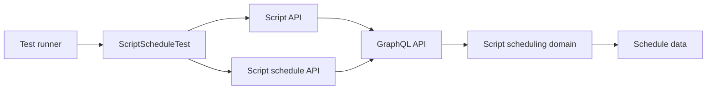
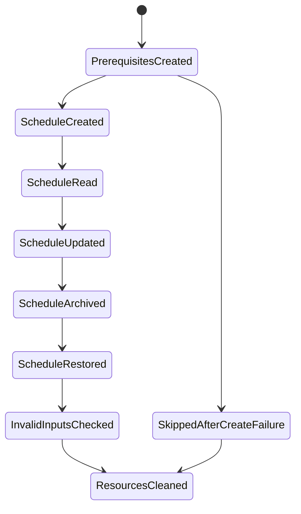
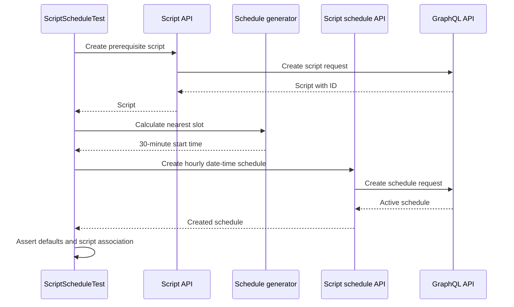
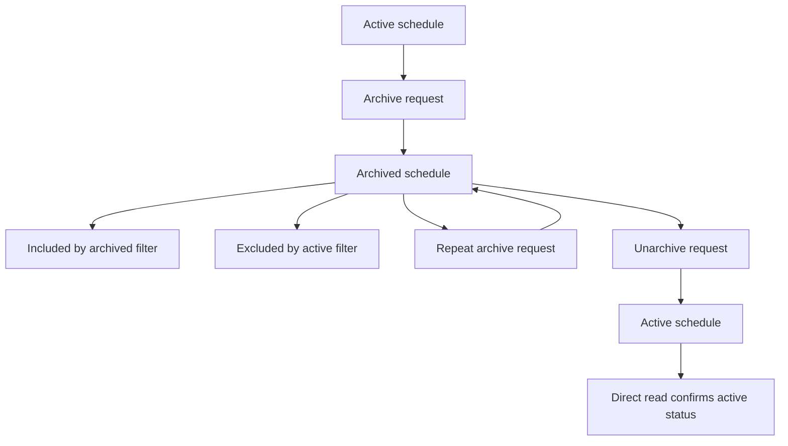
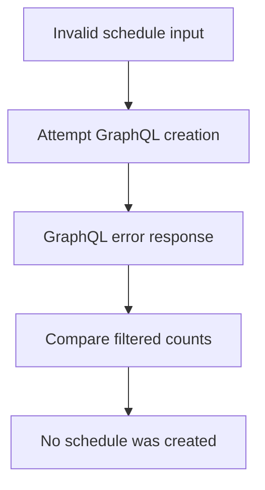

# Schedule Lifecycle Tests

Schedule Lifecycle Tests is an ordered, SaaS-tagged end-to-end test suite for the GraphQL script-scheduling lifecycle. It creates a script and an hourly date-time schedule, verifies the schedule through read and list operations, updates it, archives and restores it, validates timing failures, and then attempts to remove both test resources. The suite is implemented by `ScriptScheduleTest` in the OpenFrame OSS Library's `openframe-test-service-core` artifact, which this repository runs through its OpenFrame test service.

The implementation is available in the [ScriptScheduleTest source](https://github.com/flamingo-stack/openframe-oss-lib/blob/16e7c1cbd9664e7d10ec5ebca7d53c9bd314decf/openframe-test-service-core/src/main/java/com/openframe/test/tests/ScriptScheduleTest.java).

## Purpose and Scope

The suite covers coverage-plan item CP-1: schedule lifecycle management. It deliberately creates a schedule with no assigned devices, so a slot that occurs while the suite runs cannot dispatch work. Device assignment behavior belongs to the neighboring Schedule Device Targeting Tests module, and execution-record inspection belongs to the neighboring Execution History Tests module.

The test establishes these contracts:

- A date-time schedule can be created at the nearest valid 30-minute boundary.
- A newly created schedule is active and returns expected defaults: server time reference, skip-while-offline behavior, and specific-device selection mode.
- The created schedule can be fetched directly, located through a search term, and contributes to the platform filter facet.
- Updating uses full-replacement semantics: explicitly setting recurrence to `null` clears it while retained fields remain intact.
- Archive and unarchive operations persist state and archiving is idempotent.
- Invalid timing, invalid recurrence intervals, and incompatible trigger fields are rejected without leaving schedules behind.

## Runtime Context

The test is part of the `com.openframe.oss:openframe-test-service-core` library at version `7.0.11`. The tenant repository consumes that library and publishes the `com.openframe:openframe-test` service artifact. The test communicates through the library's GraphQL test APIs; it does not invoke scheduler internals directly.

### Principal Collaborators

| Component | Responsibility in this suite |
|---|---|
| `ScriptScheduleTest` | Coordinates ordered lifecycle checks and cleanup. |
| `ScriptApi` | Creates the prerequisite script and removes it during cleanup. |
| `ScriptScheduleApi` | Creates, reads, lists, updates, archives, unarchives, deletes, and attempts invalid schedule creation. |
| `ScriptScheduleGenerator` | Builds date-time schedule inputs, calculates the next valid slot, and supplies the hourly recurrence. |
| `ScriptGenerator` | Produces the script-create request. |
| `RunId` | Provides a unique run marker incorporated into the schedule name for isolated list-search assertions. |
| GraphQL DTOs | Represent schedule inputs, returned schedules, filter connections, facets, scripts, and GraphQL errors. |

## Test State and Ordering

`@TestMethodOrder(OrderAnnotation.class)` makes the lifecycle explicit. The test class holds the prerequisite script, created schedule, requested start time, and run-specific schedule name in static fields. Every operation after creation calls `requireSchedule()`, which converts an absent prerequisite into an assumption failure rather than a misleading secondary failure.

| Order | Test | Primary result |
|---|---|---|
| 1 | Create a script schedule | A script and an active hourly date-time schedule exist on a valid slot. |
| 2 | Get and list script schedules | Direct retrieval, run-ID search, connection metadata, and platform facet behavior are verified. |
| 3 | Edit a script schedule | Renaming persists and a `null` recurrence clears repetition. |
| 4 | Archive and unarchive | Status filtering, archive idempotency, and restored active state are verified. |
| 5 | Reject off-grid timing | Invalid requests return GraphQL errors and do not create resources. |
| After all | Cleanup | The schedule and prerequisite script are deleted on a best-effort basis. |

## Lifecycle Flow

### Create and Verify

The suite first creates a script, then requests `nextSlot()` from `ScriptScheduleGenerator`. Before calling the API, it verifies that the result is evenly divisible by `SLOT_SECONDS`, protecting the test's own precondition. It creates a date-time schedule using that start time and the `HOURLY` repeat interval.

The create response is checked for identity, name, active status, date-time trigger, requested start time, recurrence, next execution time, absent last execution time, no device assignments, and the exact associated script. This validates both input echoing and server-supplied lifecycle defaults.

### Read and Discover

The direct read must return the same identifier, name, and start time. The list query uses the unique run ID as its search text and expects exactly the schedule created by the suite. It also verifies that the GraphQL connection includes page information. A separate filter query must report at least one result and include `WINDOWS` in the platform facet, which the generated schedule contributes.

### Update Semantics

The update request is generated from the existing schedule with a new name and a `null` recurrence. The test expects this to behave as a replacement, not a partial patch: `repeat` is cleared and remains cleared after a fresh read, while the start time, trigger, and script association remain unchanged.

### Archive and Restore

Archiving changes the schedule status to `ARCHIVED`. The test lists schedules by status to confirm the schedule disappears from the active view and appears in the archived view. Repeating the archive request must still return `ARCHIVED`, establishing idempotency. Unarchiving returns the status to `ACTIVE`, and a direct fetch confirms persistence.

## Validation and Non-Creation Guarantees

The negative test records the count of schedules matching the run ID before and after invalid creation attempts. It checks three constraints:

1. A start time seven minutes after a valid slot is rejected because it is not on the 30-minute grid.
2. A recurrence of `1000` seconds is rejected because it is not a whole number of scheduling slots.
3. A `DEVICE_ONLINE` trigger combined with `startAt` is rejected because those fields are incompatible.

Each invalid request must return one or more `GraphqlError` values. The final matching count must equal the original count, ensuring rejected mutations do not leave partial schedule records.

## Cleanup and Failure Handling

`@AfterAll` cleans up in dependency order: schedule first, then script. Each deletion is individually wrapped in a `try` block. A cleanup error produces a warning containing the resource identifier and leaves the test failure signal intact rather than masking it with a cleanup exception.

Maintainers should preserve this order because the schedule references the script. They should also retain the run-specific name pattern when adding queries or negative cases so that assertions remain isolated from other tenant data and concurrent test executions.

## Maintenance Guidance

- Keep the slot assertion paired with `nextSlot()` when changing timing behavior; it distinguishes generator defects from API behavior.
- Treat the status, default-field, and full-replacement assertions as API contracts, not merely object-shape checks.
- When adding a negative mutation case, compare pre- and post-operation filtered counts to verify atomic rejection.
- Keep no-device scheduling in this module. Add device-targeting scenarios to Schedule Device Targeting Tests, and add execution-history scenarios to Execution History Tests.
- Cleanup is best effort by design. Investigate warning messages after a run because undeleted resources remain in the tenant.
