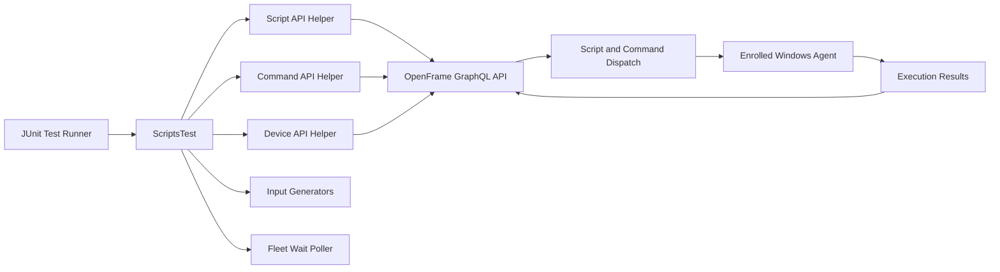
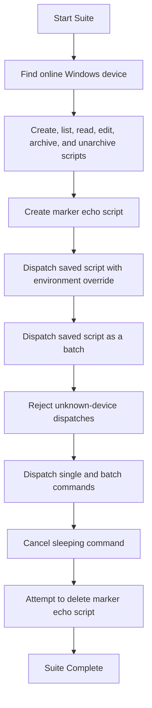
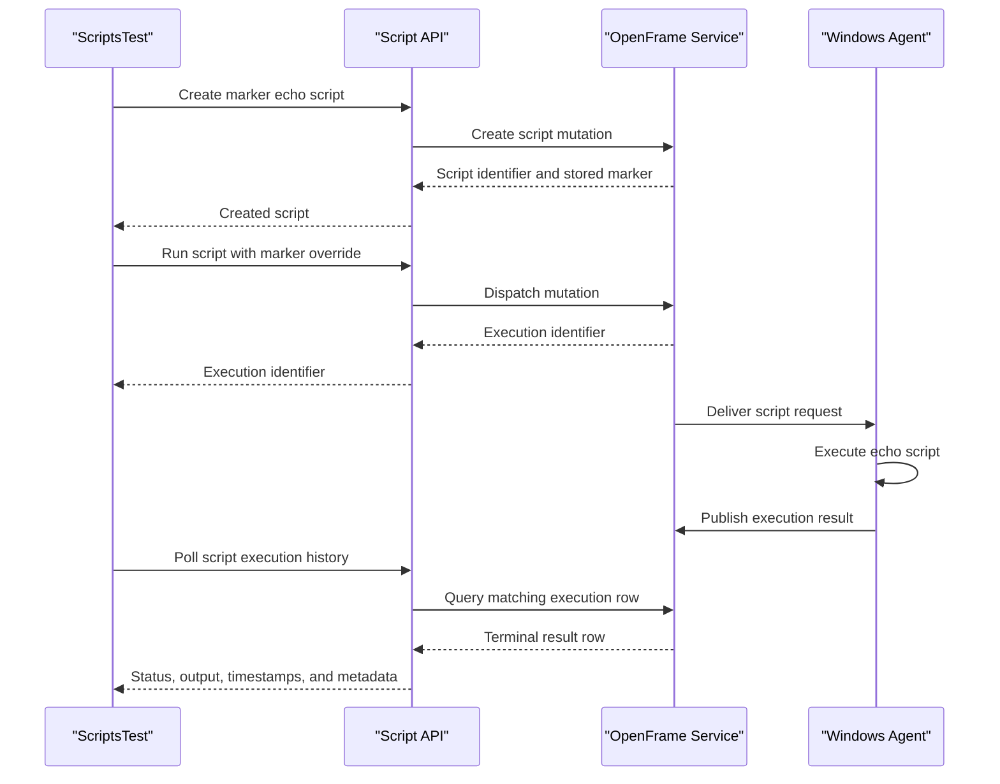
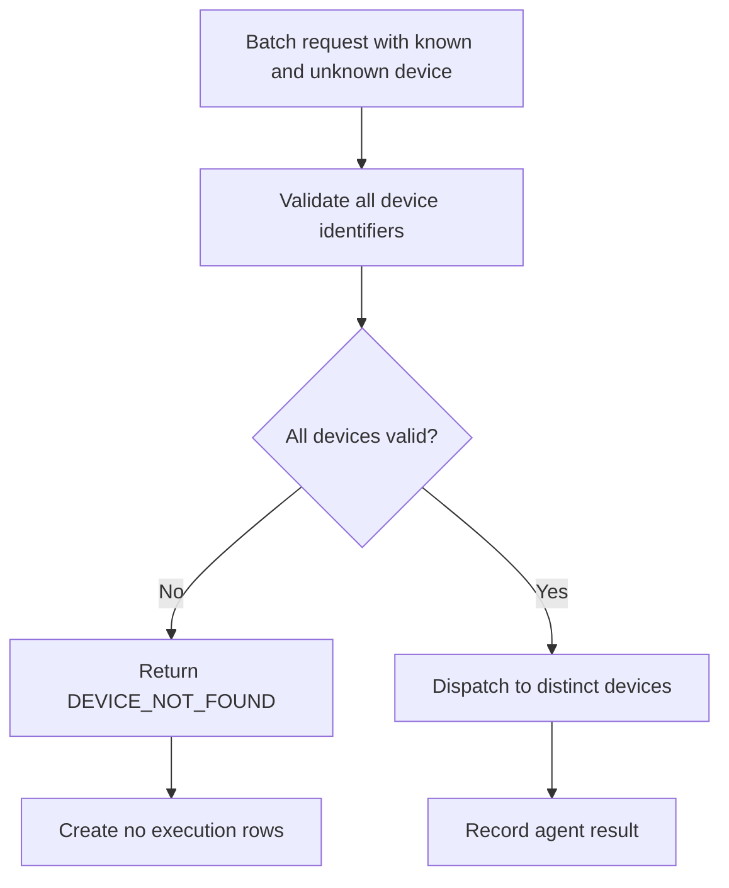

# Script Operations Tests

Script Operations Tests is the end-to-end test suite for interactive script and command operations in the OpenFrame test service. It is implemented by `ScriptsTest` in the OpenFrame OSS Library artifact `com.openframe.oss:openframe-test-service-core`, which this repository runs as part of its test service. The suite verifies the GraphQL-facing lifecycle of scripts and confirms that selected dispatches reach a real enrolled Windows device.

Source: [ScriptsTest.java](https://github.com/flamingo-stack/openframe-oss-lib/blob/16e7c1cbd9664e7d10ec5ebca7d53c9bd314decf/openframe-test-service-core/src/main/java/com/openframe/test/tests/ScriptsTest.java).

## Scope and Guarantees

The suite is tagged `saas`, named `Scripts`, and uses ordered JUnit execution. Its cases cover four areas:

- **Script lifecycle:** create, list, fetch, edit, archive, unarchive, and cleanup.
- **Saved-script execution:** create a marker-echo script, apply environment-variable overrides, dispatch it to one or more devices, and validate the returned execution record.
- **Ad-hoc command execution:** send single-device and batch commands, then request cancellation of an in-flight command.
- **Dispatch validation:** reject single and batch operations that reference an unknown device, without partially dispatching to valid devices.

The device-dependent cases target the enrolled online Windows host named `vm115982`. When that exact host is unavailable, those cases are skipped with JUnit assumptions rather than reported as product failures. Metadata-only lifecycle tests remain runnable without the device.

## Test Architecture

`DeviceApi` selects the test target before the suite starts. `ScriptApi` owns script mutations, queries, execution-history queries, and script dispatch. `CommandApi` exercises transient command dispatch and cancellation. Generators construct unique names, script payloads, marker values, and command payloads; `RunId` contributes a per-suite marker so the assertions can identify their own output.

The `FleetWait` helper addresses the asynchronous boundary between an accepted dispatch and a completed agent execution. It repeatedly queries the saved script's execution history until a row reaches `SUCCESS` or `FAILED`, using a five-minute timeout. The final assertion requires every matching row to be terminal before inspecting the first one.

## Component Responsibilities

| Component | Responsibility in Script Operations Tests |
|---|---|
| `ScriptsTest` | Coordinates ordered end-to-end scenarios and suite cleanup. |
| `ScriptApi` | Creates, reads, updates, archives, unarchives, deletes, dispatches, and queries scripts. |
| `CommandApi` | Dispatches ad-hoc commands and submits execution-cancellation requests. |
| `DeviceApi` | Finds the required online Windows test device. |
| `ScriptGenerator` | Produces regular and marker-echo script inputs plus environment variables. |
| `CommandGenerator` | Produces echo, batch echo, and sleep-then-echo command inputs. |
| `FleetWait` | Polls execution history for terminal execution state. |
| `RelayIds` | Converts the GraphQL script identifier to the raw identifier recorded in an execution row. |

## Ordered Test Flow

The method order is intentional: later tests consume state created by earlier tests. In particular, the saved-script dispatch cases rely on the marker-echo script created in the preceding creation case, and execution identifiers are retained to demonstrate that each dispatch receives a distinct identifier.

### Lifecycle Coverage

The first six cases exercise persisted script state:

1. **Add script** creates a generated script and compares the returned identifier, name, shell, body, and supported platforms to the request.
2. **List scripts** requires a non-empty result and checks the non-null schema fields `id`, `name`, and `shell` for every returned script.
3. **Get script** selects a listed script, fetches it by identifier, and confirms its key fields and non-empty body.
4. **Edit script** changes a description, then re-fetches the script to prove the mutation was persisted.
5. **Archive script** requires the response status to become `ARCHIVED`.
6. **Unarchive script** creates an isolated script, archives it, confirms it is absent from the active list, restores it, confirms `ACTIVE` status and list membership, and verifies that a second restore is idempotent. The isolated script is deleted in a `finally` block.

These cases deliberately use existing scripts for several lifecycle operations. The archive test therefore changes a script selected from the active list; maintainers should preserve this ordering and behavior when changing shared test data assumptions.

## Saved-Script Dispatch and Result Validation

The marker-echo script is created with a stored environment variable. The first dispatch supplies a request-time value for the same variable, which must override the stored value. The second dispatch has no override and must use the stored value.

For a single-device saved-script run, the suite validates all of the following:

- The response is UUID-shaped.
- The result row references the raw identifier of the created script.
- The source is `MANUAL`, no schedule identifier is present, and the requested `ADMIN` privilege is recorded.
- The target machine identifier matches the selected device.
- The terminal status is `SUCCESS`, the exit code is zero, and a completion timestamp exists.
- Standard output contains the override marker and does not contain the stored marker.

The batch case deliberately submits the same machine identifier twice. The resulting history must contain one matching row, demonstrating device de-duplication within a batch. It also verifies a new execution identifier, manual source, correct target, successful output, and use of the stored marker.

## Failure Atomicity and Command Operations

The unknown-device case constructs a mixed batch containing the valid Windows device and a generated nonexistent machine identifier. It checks that the script batch mutation returns a `DEVICE_NOT_FOUND` GraphQL error and that the script execution count is unchanged. It performs the same error-code validation for single and batch ad-hoc commands. Together, these assertions establish the expected all-or-nothing validation boundary: an invalid target prevents dispatch to the known target in the same request.

Ad-hoc command cases assert that each single or batch submission produces a UUID-shaped execution identifier distinct from earlier dispatches. The cancellation case starts a command that sleeps before echoing and calls `cancelExecution` with its device and execution identifier. It verifies the cancellation response only: the suite documents that the QA agent did not reliably honor cancellation for sleeping scripts and that command results are not readable through the API used here.

## Preconditions, Isolation, and Cleanup

| Concern | Test behavior |
|---|---|
| Test environment | The class is marked `saas`; select this tag when running the appropriate environment suite. |
| Device availability | Device-dependent cases require online Windows host `vm115982`; absent or offline host causes skip. |
| Execution capacity | Result polling waits up to 300 seconds because other agents can target the same QA host. |
| Execution status | Only `SUCCESS` and `FAILED` are considered terminal for saved-script result assertions. |
| Marker isolation | A `RunId` makes script names, output markers, and unknown-device identifiers unique for each suite run. |
| Persistent cleanup | The marker-echo script is deleted in `@AfterAll` when it was created successfully. Its execution history is intentionally retained. |

## Maintenance Notes

- Preserve the ordered execution contract when refactoring methods or splitting tests. `testRunScript` and `testBatchRunScript` depend on the marker-echo script created by `testCreateEchoScript`.
- Keep device availability expressed as assumptions. Replacing the skip with a hard failure would conflate test-environment readiness with product behavior.
- Retain output assertions that mention standard error and error fields when a successful run is expected. They make nightly failures diagnosable without separately captured response bodies.
- If agent cancellation becomes reliably observable and command-result retrieval is exposed through the API, extend the cancellation case to assert the terminal result rather than only the acknowledgment.
- Treat the unknown-device assertions as atomicity checks, not merely input-validation checks. The unchanged execution-count assertion is the evidence that valid targets were not partially dispatched.

## System Position

Script Operations Tests verifies the user-visible remote-management path across the test client, API, dispatch machinery, an enrolled endpoint agent, and persisted execution history. It complements schedule and execution-history test modules by focusing on direct script CRUD operations, manual dispatch semantics, environment-variable precedence, and invalid-target behavior.