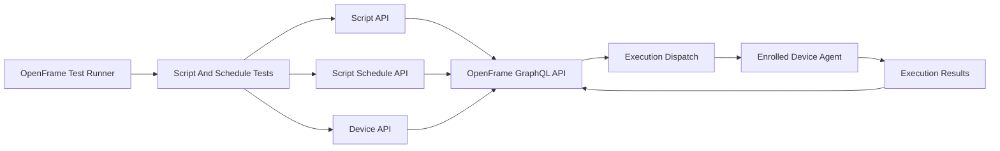
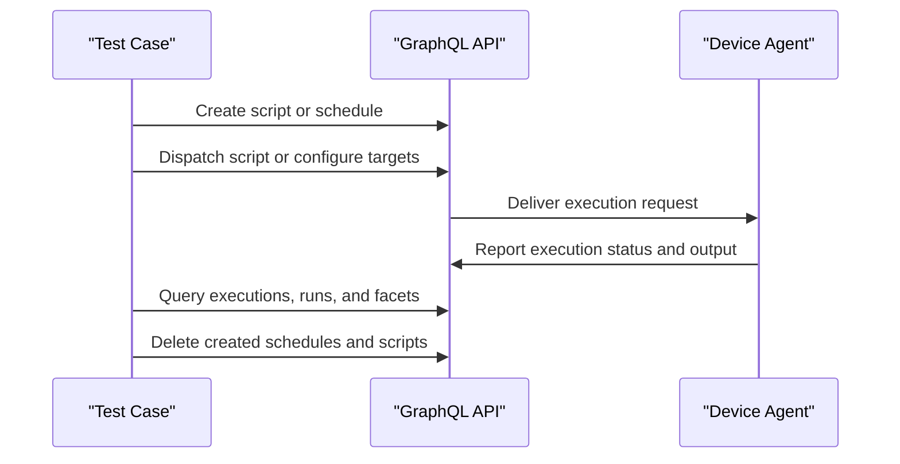

# Script And Schedule Tests

Script And Schedule Tests is the end-to-end test slice for remote-management scripts and script schedules. It is supplied by the `com.openframe.oss:openframe-test-service-core` library and run by this repository's OpenFrame test service. The tests exercise GraphQL read and mutation paths against a tenant, create their own data, and clean it up after execution.

The module verifies four complementary contracts:

- script creation, retrieval, editing, lifecycle transitions, manual execution, command dispatch, and cancellation;
- scheduled-script lifecycle, timing validation, filtering, and archive transitions;
- schedule device selection through explicit assignment and live criteria; and
- execution and schedule-run history, including empty-state behavior and result facets.

## Architecture Overview

The dispatch scenarios require an enrolled online Windows device. Tests use JUnit assumptions when the required device is absent, rather than treating an environment prerequisite as a product failure. They poll for asynchronous agent results through `FleetWait` and use a generated run identifier to scope test data.

## Test Areas

The detailed documents below are generated as part of this module and use the repository documentation hierarchy.

| Area | Purpose | Documentation |
|---|---|---|
| Script Operations | Covers script CRUD-oriented behavior, archive lifecycle, manual and batch dispatch, command dispatch, and cancellation request behavior. | [Script Operations Tests](script_and_schedule_tests/script_operations_tests/script_operations_tests.md) |
| Schedule Lifecycle | Covers date-time schedule creation, server defaults, listing and facets, full-replacement updates, archive transitions, and timing validation. | [Schedule Lifecycle Tests](script_and_schedule_tests/schedule_lifecycle_tests/schedule_lifecycle_tests.md) |
| Schedule Device Targeting | Covers device pickers, idempotent assignment changes, bulk replacement, criteria selection, and platform mismatch rejection. | [Schedule Device Targeting Tests](script_and_schedule_tests/schedule_device_targeting_tests/schedule_device_targeting_tests.md) |
| Execution History | Covers script execution history, schedule execution and run connections, and populated versus empty facets. | [Execution History Tests](script_and_schedule_tests/execution_history_tests/execution_history_tests.md) |

## Execution Model

Manual execution tests create an echo script whose stored environment marker can be overridden at dispatch time. They verify the returned execution identifier, final result metadata, output, target machine, privilege level, and source. Batch inputs deliberately contain duplicate machine identifiers to confirm a device is dispatched only once. Negative coverage verifies that unknown devices reject an entire batch without partially dispatching to known devices.

Schedules are deliberately created on a future slot, generally one day ahead when device assignments are involved. This keeps targeting tests from unintentionally causing a real execution while still validating the scheduling and selection contracts.

## Key Contracts

- A date-time schedule must use the 30-minute timing grid; recurrence must also align with that grid.
- New schedules default to active status, server time reference, skip-while-offline behavior, and specific-device selection.
- Updating a schedule has replacement semantics, including clearing an omitted recurrence.
- Explicit assignment, removal, and archive operations are idempotent where asserted.
- Device targeting is constrained by the scheduled script's supported platform.
- A schedule that has never fired returns empty execution and run connections with non-null page information and empty relevant facets.
- Execution status facets must sum to the connection's filtered count when execution history exists.

## Isolation And Cleanup

Each test class creates data with an `E2E-` name containing a unique run identifier. Cleanup is best effort so an assertion failure does not conceal the primary failure; cleanup failures are logged and may leave data in the tenant. The test suite avoids relying on pre-existing scripts or execution history, except where individual general script lifecycle cases intentionally enumerate tenant scripts.

The component implementations are maintained in the OpenFrame OSS Library:

- [Script Execution History Test](https://github.com/flamingo-stack/openframe-oss-lib/blob/16e7c1cbd9664e7d10ec5ebca7d53c9bd314decf/openframe-test-service-core/src/main/java/com/openframe/test/tests/ScriptExecutionHistoryTest.java)
- [Script Schedule Devices Test](https://github.com/flamingo-stack/openframe-oss-lib/blob/16e7c1cbd9664e7d10ec5ebca7d53c9bd314decf/openframe-test-service-core/src/main/java/com/openframe/test/tests/ScriptScheduleDevicesTest.java)
- [Script Schedule Test](https://github.com/flamingo-stack/openframe-oss-lib/blob/16e7c1cbd9664e7d10ec5ebca7d53c9bd314decf/openframe-test-service-core/src/main/java/com/openframe/test/tests/ScriptScheduleTest.java)
- [Scripts Test](https://github.com/flamingo-stack/openframe-oss-lib/blob/16e7c1cbd9664e7d10ec5ebca7d53c9bd314decf/openframe-test-service-core/src/main/java/com/openframe/test/tests/ScriptsTest.java)
