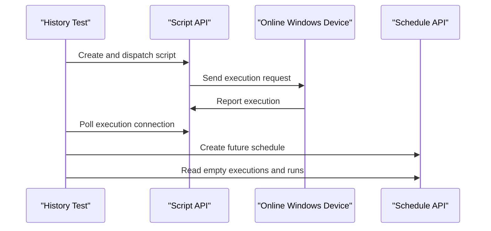

# Execution History Tests

Execution History Tests describe the `ScriptExecutionHistoryTest` suite. It verifies execution-history connections and facets for scripts and schedules.

## Coverage

The script-history case creates and dispatches a script to an online Windows machine, then polls until an execution record is visible. It checks connection page information, count consistency, execution identifiers, script ownership, status values, dispatch timestamps, and status-facet totals.

The schedule-history case creates a schedule one day in the future and verifies the empty-state contract before the schedule has fired. Script execution history, schedule run history, and their relevant facets must all be empty while still returning valid connection objects.

## Read Path

This suite does not search for another test's remaining execution data. It creates its own dispatch because other suites clean up their scripts. An online device is therefore a prerequisite, represented by `saas`, `post-mingo`, and `needs-device` tags.

## Source

[Script Execution History Test source](https://github.com/flamingo-stack/openframe-oss-lib/blob/16e7c1cbd9664e7d10ec5ebca7d53c9bd314decf/openframe-test-service-core/src/main/java/com/openframe/test/tests/ScriptExecutionHistoryTest.java)