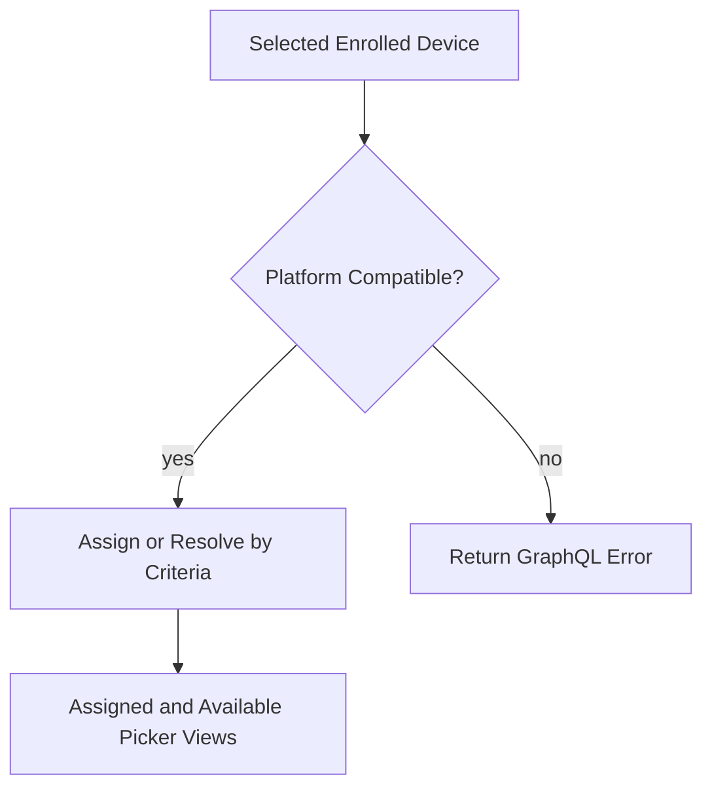

# Schedule Device Targeting Tests

Schedule Device Targeting Tests describe the `ScriptScheduleDevicesTest` suite. It verifies how a schedule selects devices without allowing the future-dated schedule to execute during the test run.

## Coverage

- Discover an enrolled device, preferring Windows and falling back to another listed device.
- Create a script and schedule compatible with the selected device platform.
- Inspect assigned and available-device picker views.
- Add and remove individual devices with idempotent behavior.
- Add devices by hostname search and remove all assigned devices.
- Replace the full device set, including clearing it with an empty set.
- Switch to criteria-based targeting using operating system and, when present, organization identity.
- Reject assignment of a device that does not match the schedule platform.

## Target Resolution

The ordered cases share the initial schedule. Later cases assume that its creation succeeded, making an early failure visible rather than causing unrelated null failures. Cleanup first clears device assignments, then deletes both schedules and both scripts. All cleanup failures are logged to preserve the original test failure.

## Source

[Script Schedule Devices Test source](https://github.com/flamingo-stack/openframe-oss-lib/blob/16e7c1cbd9664e7d10ec5ebca7d53c9bd314decf/openframe-test-service-core/src/main/java/com/openframe/test/tests/ScriptScheduleDevicesTest.java)