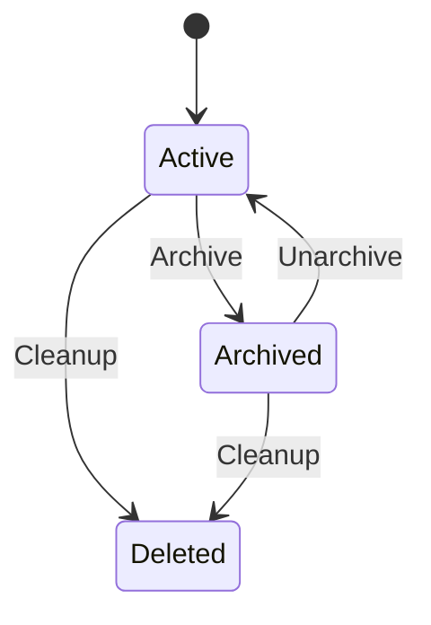

# Schedule Lifecycle Tests

Schedule Lifecycle Tests describe the `ScriptScheduleTest` suite. It validates the GraphQL lifecycle of a date-time script schedule while keeping the schedule unassigned, so it cannot dispatch to a device.

## Coverage

- Create a schedule at the next valid 30-minute slot.
- Verify defaults for active status, server time reference, skip-while-offline behavior, and specific-device targeting.
- Read a schedule and search for the uniquely named result.
- Verify platform filter facets include the created Windows schedule.
- Update the schedule with full-replacement semantics, including clearing recurrence.
- Archive and unarchive the schedule and verify filtered list visibility.
- Reject off-grid start times, invalid recurrence values, and a device-online trigger carrying a start time.

## Lifecycle

The suite uses a run identifier in its name to isolate its list assertion. It expects rejected create requests to leave the search result count unchanged. The deletion cleanup removes the schedule and its script after all ordered cases complete.

## Source

[Script Schedule Test source](https://github.com/flamingo-stack/openframe-oss-lib/blob/16e7c1cbd9664e7d10ec5ebca7d53c9bd314decf/openframe-test-service-core/src/main/java/com/openframe/test/tests/ScriptScheduleTest.java)