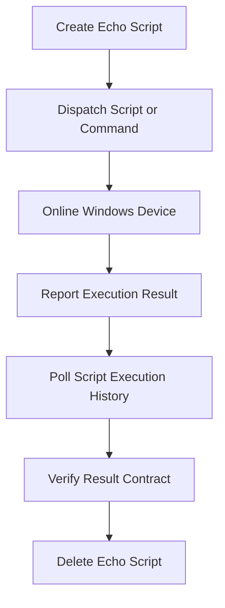

# Script Operations Tests

Script Operations Tests document the `ScriptsTest` end-to-end suite from the OpenFrame OSS Library. The suite validates the script API against a tenant and uses an online Windows device for dispatch-dependent cases.

## Responsibilities

- Create scripts and verify returned identity, name, shell, body, and supported platforms.
- List and retrieve scripts, asserting required GraphQL fields.
- Update a description and verify persistence.
- Archive and unarchive scripts, including idempotent unarchive behavior.
- Create an echo script whose environment marker is stored with the script.
- Dispatch saved scripts and ad-hoc commands, individually and in batches.
- Verify environment overrides, execution provenance, target, privilege level, output, terminal status, and exit code.
- Reject a mixed batch containing an unknown device without dispatching to a known device.
- Request cancellation for an in-flight command.

## Dispatch Flow

The stored marker is expected when no runtime override is supplied. When an override is supplied, the test expects the override in standard output and rejects output containing the stored marker. Batch dispatch receives a duplicated machine identifier and asserts that the resulting history has one row for that device.

The implementation waits up to 300 seconds for a terminal `SUCCESS` or `FAILED` execution state. The suite targets a named quality-assurance Windows host and aborts device-dependent cases when that host is unavailable.

## Source

[Scripts Test source](https://github.com/flamingo-stack/openframe-oss-lib/blob/16e7c1cbd9664e7d10ec5ebca7d53c9bd314decf/openframe-test-service-core/src/main/java/com/openframe/test/tests/ScriptsTest.java)