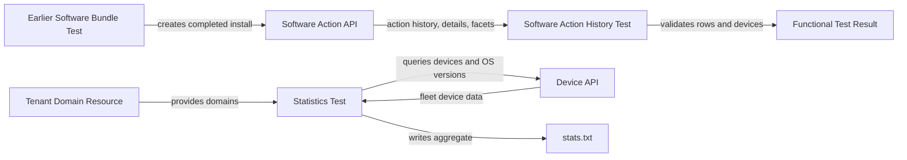
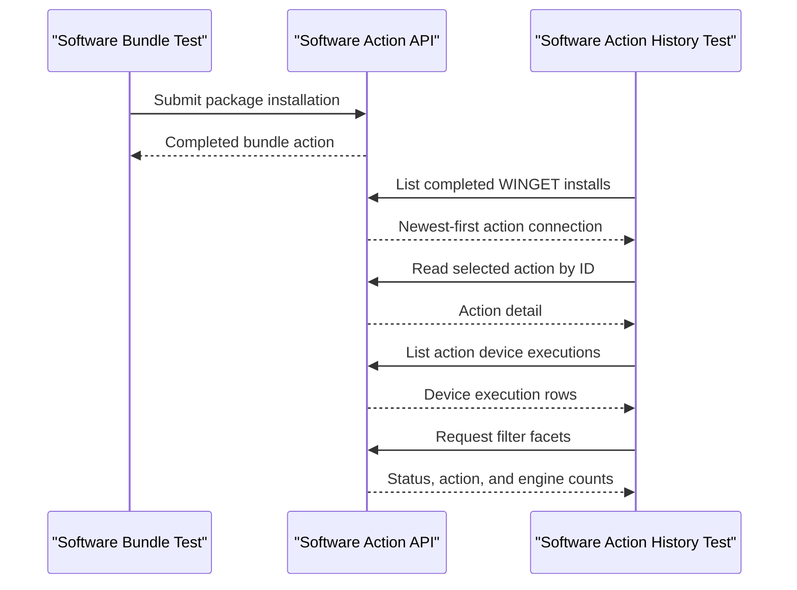

# Software Action And Statistics Tests

Software Action And Statistics Tests is a small, read-oriented portion of the OpenFrame end-to-end test suite. It validates that completed software-bundle operations can be discovered and inspected through the software-action API, and it retains a disabled utility test for aggregating operating-system versions across configured tenant domains.

The implementation is supplied by the `openframe-test-service-core` library from [OpenFrame OSS Library](https://github.com/flamingo-stack/openframe-oss-lib) and is run by this repository's OpenFrame test service. The verified source files are [Software Action History Test](https://github.com/flamingo-stack/openframe-oss-lib/blob/16e7c1cbd9664e7d10ec5ebca7d53c9bd314decf/openframe-test-service-core/src/main/java/com/openframe/test/tests/SoftwareActionHistoryTest.java) and [Statistics Test](https://github.com/flamingo-stack/openframe-oss-lib/blob/16e7c1cbd9664e7d10ec5ebca7d53c9bd314decf/openframe-test-service-core/src/main/java/com/openframe/test/tests/StatsTest.java). The two classes are deliberately different in execution model:

- `SoftwareActionHistoryTest` is a tagged, ordered functional test that depends on a device and an earlier software-bundle installation.
- `StatsTest` is disabled by default and is an operator-run data-collection utility, not a CI acceptance test.

## Architecture Overview

The functional path is intentionally read-only with respect to software actions. Its fixture is a completed WINGET installation previously submitted by the software-bundle workflow. This avoids coupling test classes through Java static state while still exercising the history visible within the same tenant.

## Components

### Software Action History Test

[`SoftwareActionHistoryTest`](https://github.com/flamingo-stack/openframe-oss-lib/blob/16e7c1cbd9664e7d10ec5ebca7d53c9bd314decf/openframe-test-service-core/src/main/java/com/openframe/test/tests/SoftwareActionHistoryTest.java) is a JUnit 5 test class tagged `saas`, `needs-device`, `post-mingo`, and `software-actions`. Ordered methods share one discovered action only after the first method establishes it. If no suitable completed bundle installation is available, assumptions skip dependent checks rather than fabricating a fixture.

Its test sequence verifies the following contract:

1. **List and pagination** — requests completed WINGET installs, both with and without a package search, confirms newest-first dispatch ordering, and checks first-page behavior and `hasNextPage` semantics.
2. **Single-action lookup** — reads the discovered action by ID and compares it recursively with the corresponding list row.
3. **Device drill-down** — validates target-device identity, hostname enrichment, allowable statuses, completion timestamps, successful exit codes, status filtering, hostname and machine-ID searching, and organization filtering.
4. **Facet counts** — confirms that filtered and unfiltered status, action, and engine facets agree with the list count. For an unfiltered result, facet counts must add up to the filtered total.
5. **Empty and unknown results** — confirms empty list metadata and facets for a non-matching search, plus null or empty responses for unknown action IDs.

The selected subject must be a completed `INSTALL` action using WINGET and created from a bundle. A bundle action has no schedule identifier, distinguishing a run-now operation from a scheduled operation. The suite accepts any qualifying latest bundle installation in the tenant, but prefers the package installed by the preceding software-bundle test.

### Statistics Test

[`StatsTest`](https://github.com/flamingo-stack/openframe-oss-lib/blob/16e7c1cbd9664e7d10ec5ebca7d53c9bd314decf/openframe-test-service-core/src/main/java/com/openframe/test/tests/StatsTest.java) is annotated `@Disabled`. When explicitly enabled, it reads tenant domains from the `openframe.all.tenants.json` classpath resource, concurrently visits each tenant, obtains matching Fleet device IDs, and queries each device's OS version.

The collector uses a 15-thread executor and a concurrent counter map. It normalizes Windows versions by removing trailing numeric build segments, sorts aggregates in descending count order, prints the tab-separated result, and writes the same content to `stats.txt` in the current working directory. Per-device query failures are ignored, so the output represents successfully retrieved nonblank values rather than a completeness guarantee.

## Software Action Verification Flow

## Operational Considerations

- Run Software Action And Statistics Tests after the software-bundle workflow when executing the tagged functional suite. The history test expects a reachable tenant with at least one completed qualifying installation and at least one target device.
- The history test uses JUnit assumptions for unavailable fixture data. A skipped dependent assertion indicates missing prerequisite data, not a successful replacement fixture.
- Keep the action API's list, detail, device, and facet queries behaviorally aligned. This suite explicitly tests agreement among those views.
- Do not enable the statistics collector in normal CI without an intentional tenant-domain resource and appropriate authorization. It changes the request base URL per worker and creates the local `stats.txt` artifact.

## System Placement

Software Action And Statistics Tests exercises the RMM software-action experience exposed by the API test layer. The action-history data it validates is associated with software bundle execution and device-level outcomes, while the statistics utility uses device queries and Fleet OS-version data. For runtime behavior, refer to the platform documentation for the API, client delivery, software projection, and persistence services.
