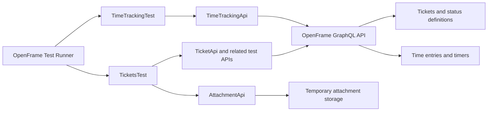
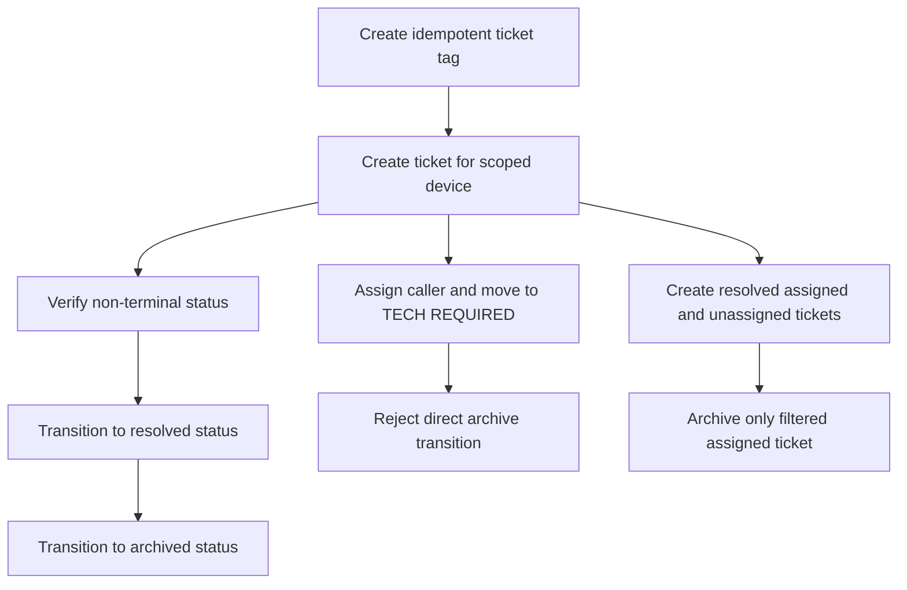
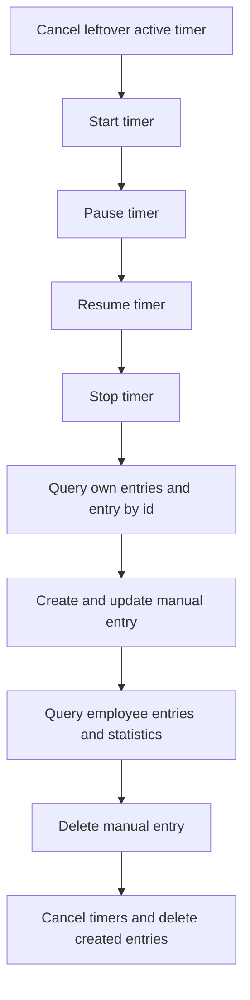

# Ticket And Time Tracking Tests

Ticket And Time Tracking Tests is the end-to-end GraphQL coverage for ticket lifecycle operations and employee time tracking. It is supplied by the `com.openframe.oss:openframe-test-service-core` library at version `7.0.11` and is run by this repository's OpenFrame test service. The module verifies observable contracts rather than implementation details: ticket creation, assignment, lifecycle transitions, status administration, attachments, filtering, and bulk archiving; plus timer and manual-entry workflows, guard conditions, employee queries, and cleanup.

The test implementations live in the OpenFrame OSS Library:

- [TicketsTest source](https://github.com/flamingo-stack/openframe-oss-lib/blob/16e7c1cbd9664e7d10ec5ebca7d53c9bd314decf/openframe-test-service-core/src/main/java/com/openframe/test/tests/TicketsTest.java)
- [TimeTrackingTest source](https://github.com/flamingo-stack/openframe-oss-lib/blob/16e7c1cbd9664e7d10ec5ebca7d53c9bd314decf/openframe-test-service-core/src/main/java/com/openframe/test/tests/TimeTrackingTest.java)

## Purpose And Scope

The module exercises platform behavior through the test library's API clients. `TicketsTest` validates ticket behavior against a shared tenant while creating fixtures in the pipeline-scoped organization. `TimeTrackingTest` verifies the current caller's time records. Both classes use ordered JUnit execution where later cases depend on state deliberately prepared by earlier cases, and both remove test-created state in `AfterAll` cleanup.

The suite is tagged `saas`; individual cases use `feature`, `read`, or `negative` tags to distinguish capability, read-only, and rejected-operation coverage. One non-positive-duration assertion is intentionally disabled because the expected validation response is not yet exposed by the server.

## Architecture Overview

The tests use API-facing DTOs and generators from the library. Ticket cases additionally use device, user, and tag APIs to create internally consistent data: a new ticket is created for a device and the device's owning organization, with an administrator assignee and a ticket tag. Time-entry cases derive the caller identity from the timer entry so manual-entry and employee-statistics queries target the same user.

## Test Areas

### Ticket Lifecycle And Administration

[Ticket Lifecycle And Administration](ticket_lifecycle_and_administration.md) documents ticket listing, search, creation, board ordering, lifecycle transitions, ticket status definitions, transition rules, statistics, and scoped bulk archiving.

### Ticket Collaboration And Attachments

[Ticket Collaboration And Attachments](ticket_collaboration_and_attachments.md) documents notes, staged-file upload and download, attachments, ticket updates, assignment, and device or organization unlinking.

### Time Tracking Workflows

[Time Tracking Workflows](time_tracking_workflows.md) documents timers, manual entries, query and statistics checks, validation coverage, and cleanup behavior.

## Ticket Workflow

Ticket lifecycle assertions treat the status definition as the lifecycle source of truth. They deliberately do not depend on a legacy status enum being synchronized. The suite asserts that new tickets begin in a non-terminal status, validates permitted resolved-to-archived movement, and verifies rejection of invalid active-to-archived movement.

The status administration coverage creates custom statuses, verifies custom properties, edits and reorders them, and deletes them. It separately verifies that system statuses cannot be deleted. The transition-matrix assertions establish that resolved tickets may move to archived while a technician-required ticket cannot move directly there.

## Time Tracking Workflow

The timer case waits between transitions because the server calculates elapsed and break time from its own clock and returns whole-second values. It validates that work duration excludes breaks and that work duration plus break duration approximately equals elapsed time. Guard coverage rejects pausing without a timer, starting a second timer, and editing a running timer.

Manual-entry coverage validates creation, partial update semantics, period filtering, employee totals, and idempotent deletion. A separate negative case requires either notes or a ticket. The disabled zero-duration case preserves the intended positive-duration contract until server-side validation errors are mapped correctly.

## Isolation, Ordering, And Cleanup

`TicketsTest` uses ordered cases to seed a reusable ticket tag, establish ticket fixtures, and prepare records for the bulk-archive case. It records run-owned tickets, custom statuses, and staged attachment identifiers. During final cleanup, it discards remaining staged attachments, transitions created tickets through resolved to archived when necessary, and deletes custom statuses using non-throwing cleanup calls.

`TimeTrackingTest` begins by cancelling a possibly stale timer, records every created entry identifier, and performs best-effort cleanup. The timer guard case uses a `finally` block to cancel the active timer even if an assertion fails. Manual-entry cases remove their identifier from the cleanup list after confirmed deletion.

## System Placement

This repository packages the OpenFrame test service alongside the platform services. Ticket behavior reaches the platform GraphQL API and its ticket data model, including ticket status definitions and ticket-to-time-entry projections. Time tracking reaches the same API surface and persists user-associated timer or manual time-entry records. The module is therefore a contract-level regression suite for business workflows across API, authorization, storage, and GraphQL error handling.
