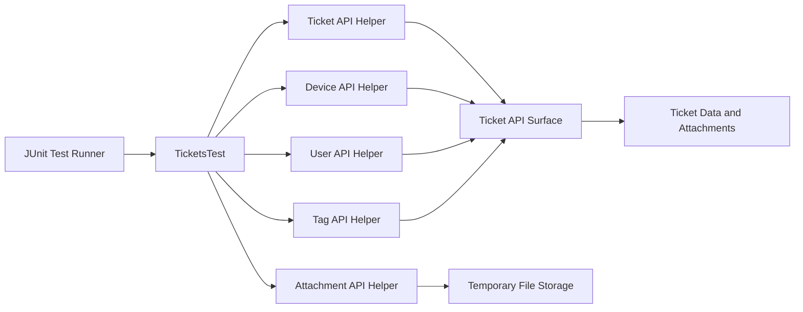
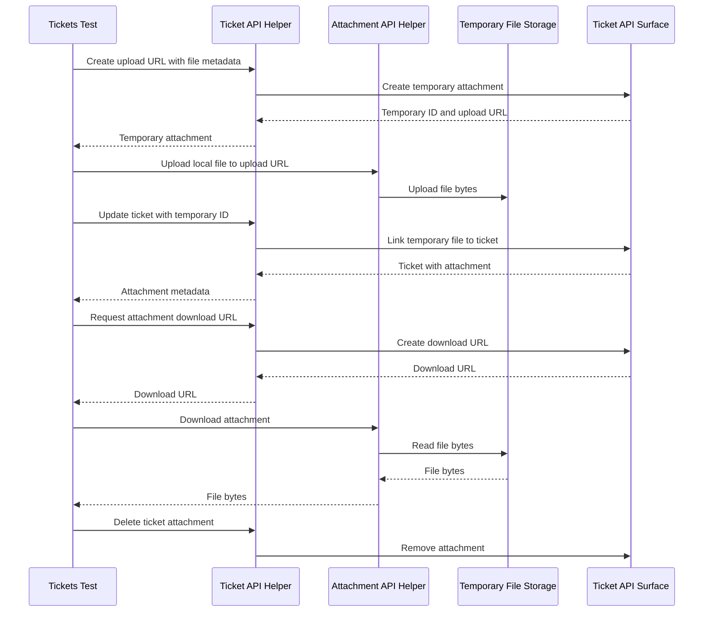
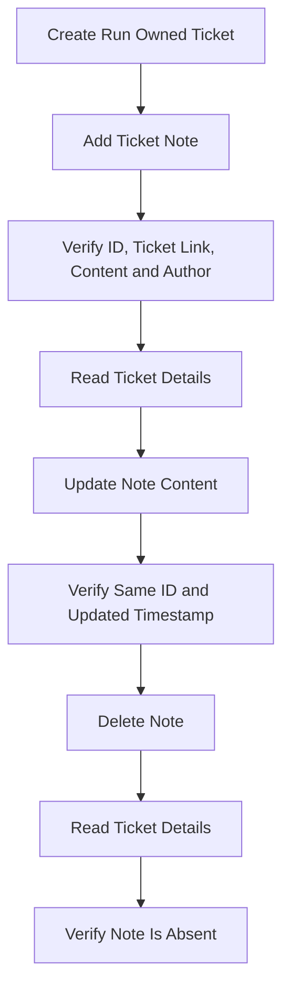
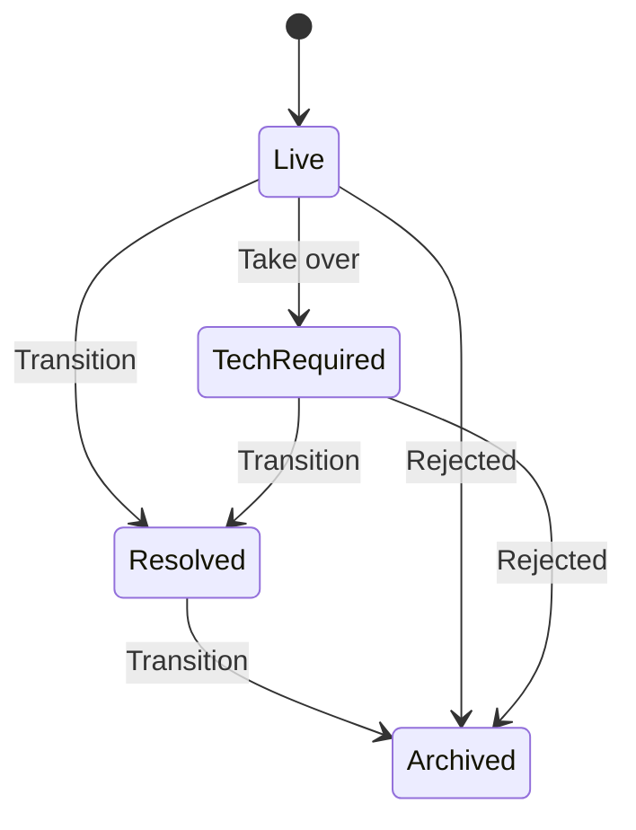
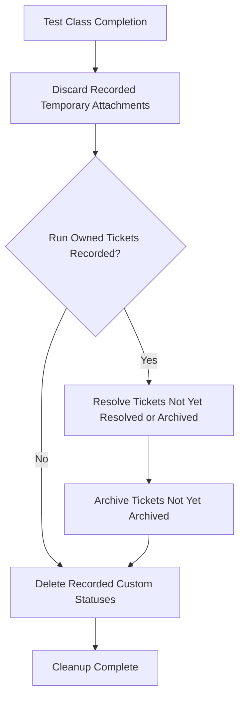

# Ticket Collaboration And Attachments

Ticket Collaboration And Attachments is the collaboration-focused portion of the end-to-end ticket test suite. It is implemented by the `TicketsTest` JUnit class in the OpenFrame OSS Library artifact `com.openframe.oss:openframe-test-service-core`, which this repository runs through its OpenFrame test service. The suite verifies ticket notes and attachment handling alongside the ticket operations that establish a usable collaboration context: creation, assignment, lifecycle transitions, device and organization links, filtering, status administration, and bulk archival.

The authoritative implementation is [`TicketsTest.java`](https://github.com/flamingo-stack/openframe-oss-lib/blob/16e7c1cbd9664e7d10ec5ebca7d53c9bd314decf/openframe-test-service-core/src/main/java/com/openframe/test/tests/TicketsTest.java). This module documents what that test proves; it does not define the production ticket API or persistent ticket schema.

## Purpose And Scope

The module protects collaboration workflows that depend on an authenticated caller and a ticket owned by the current test run:

- Notes can be added, read from ticket details, edited, and deleted.
- Files can be staged through a temporary attachment upload URL, uploaded, associated with a ticket, downloaded byte-for-byte, and deleted.
- A staged file can be discarded before it is linked to a ticket.
- Ticket assignment, device and organization links, lifecycle state, and tags are exercised because they provide the context in which collaboration operations run.
- Teardown removes staged files, archives run-owned tickets left in nonterminal states, and deletes temporary custom statuses.

The class carries the `saas` suite tag and uses `feature` tags for workflow tests. Read-only checks additionally use `read`. Ordered tests seed required state such as a ticket tag before ticket creation and resolve tickets before the bulk archive case.

## Runtime Architecture

The test class is a consumer-side integration test. It drives test API helpers rather than reaching directly into ticket persistence. `TicketApi` performs ticket-oriented API actions, `AttachmentApi` transfers the upload and download bytes, and helper APIs locate devices, users, and tags. The assertions inspect the objects returned by those calls and then re-read ticket details to verify persisted effects.

The diagram intentionally labels the remote ticket API and storage generically. The supplied test code verifies their externally observable behavior but does not identify a controller, storage provider, or internal persistence implementation.

## Core Component

### Tickets Test

`TicketsTest` extends the test suite base class and coordinates the complete workflow. It maintains run-local state in static collections:

| State | Role |
| --- | --- |
| `RUN_ID` | Distinguishes generated note and ticket-edit text for the current run. |
| `createdTickets` | Tracks test-owned tickets so teardown can transition them to the archived lifecycle state. |
| `createdStatusIds` | Tracks custom ticket statuses created by the status-definition workflow. |
| `stagedAttachmentIds` | Tracks temporary files as soon as they are staged, allowing cleanup even if a later assertion fails. |

The helper `newOwnTicket` obtains a pipeline-scoped online device when available, otherwise an offline device, uses the device's organization, and applies an existing ticket tag. This avoids cross-organization ticket creation and limits records created by the suite to its fixture organization. `me` returns the current authenticated user identifier.

### Collaboration Contract

The primary collaboration test, named **Add, edit and delete a ticket note; stage, attach, download and delete a file**, validates two independent resources attached to a run-owned ticket:

| Resource | Verified operations | Persistence check |
| --- | --- | --- |
| Ticket note | Create, edit, delete | The note appears in ticket details after creation and is absent after deletion. |
| Ticket attachment | Stage, upload, attach, obtain download URL, download, delete | The linked attachment reports the original file name and file size; downloaded bytes exactly equal the locally staged file bytes; the attachment is absent after deletion. |
| Temporary attachment | Stage, discard | The delete payload returns the temporary attachment identifier without user errors. |

The test also normalizes Relay-style IDs with `RelayIds.raw` where the API returns a global ID but the asserted ticket or note relationship is represented as a raw ID.

## Attachment Data Flow

Attachment handling has a deliberate staging boundary. A temporary attachment exists before it belongs to a ticket, so it is recorded for cleanup immediately after creation. The ticket update receives the temporary attachment identifier and turns that staged object into a ticket attachment.

### Attachment Invariants

The assertions establish these observable invariants:

1. A staged attachment has a nonblank identifier and upload URL, and echoes the input filename.
2. Linking the staged identifier through a partial ticket update produces a nonempty attachment collection.
3. The linked attachment can be located by the original filename and has the input file size.
4. A download URL is nonblank and delivers exactly the uploaded bytes.
5. Deleting either a linked attachment or an unlinked staged attachment returns no user errors and echoes the deleted identifier in the form expected by that API.

## Note Lifecycle

Notes are ticket-scoped collaborative records. The test creates a note with a run-specific string, verifies that the returned ticket ID matches the raw ticket identifier, and confirms an author identifier was captured. It then reads ticket details to prove the note is present, updates content while preserving the note ID, requires a non-null update timestamp, deletes the note, and re-reads details to confirm removal.

## Ticket Context And Related Workflows

Although collaboration is the focus, the class validates the surrounding ticket contract so collaboration tests execute against realistic tickets.

### Ticket Setup, Search, And Editing

- Listing requires each ticket to have an ID, ticket number, title, and legacy status field. Missing fields are aggregated into a concise diagnostic rather than failing one edge at a time.
- A created ticket is checked for its requested title, description, organization, device, assignee, owner, and tag. Its status definition must be live rather than `RESOLVED` or `ARCHIVED`.
- Search by an existing title must include the existing ticket.
- Partial edits retain the device link; assignment can be cleared and restored; device and organization links can be independently removed and are verified through a later detail read.
- Filtering by device includes the linked ticket and excludes tickets for other devices. Once the ticket is unlinked, it no longer appears in that device filter.

### Status Lifecycle And Assignment

The status definition is the lifecycle source of truth; the test explicitly avoids treating the legacy `status` field as authoritative after transitions.

The suite proves that:

- Resolving moves a ticket to a status definition whose kind is `RESOLVED` and sets `resolvedAt`.
- Direct archival from a live ticket is rejected with `TICKET_INVALID_TRANSITION` and leaves the status unchanged.
- A resolved ticket can move to `ARCHIVED`.
- Takeover atomically assigns the caller and moves the ticket to the requested `TECH_REQUIRED` status. An invalid attempted takeover leaves both state and assignee unchanged.
- Custom statuses can be created, edited, reordered before and after another custom status, and deleted when unused. System statuses reject deletion with `TICKET_STATUS_SYSTEM_PROTECTED`.
- The transition rule matrix includes a `RESOLVED` to `ARCHIVED` route and excludes a direct `TECH_REQUIRED` to `ARCHIVED` route.

### Bulk Archive And Statistics

An ordered pair of tests creates two run-owned tickets in one organization, resolves both, then archives resolved tickets using a filter narrowed to the current caller and organization. The caller-assigned ticket must be archived, while the unassigned ticket must remain resolved. This verifies that the bulk operation respects the assignee restriction rather than archiving every matching organization ticket.

Ticket statistics must report a total of at least one ticket, nonempty counts by status definition, non-null status references, nonnegative counts, and a sum that does not exceed the total count.

## Cleanup And Failure Safety

The `AfterAll` cleanup uses raw, nonthrowing API helpers so it can make best-effort progress after an earlier assertion has failed:

A temporary attachment is registered before upload or ticket linking. Therefore, an exception during upload, attachment linking, or assertion does not leave that staged file untracked. Ticket cleanup attempts the required lifecycle path rather than deleting tickets directly: nonterminal tickets are resolved first and then archived.

## Maintenance Guidance

When changing this module, preserve the following properties:

- Keep test-created records scoped to the pipeline device organization. Creating a ticket with a device outside the selected organization is rejected by the exercised API.
- Do not rely on a fixed initial lifecycle status. The suite supports tenant-specific starting kinds as long as a new ticket is not terminal.
- Maintain ordering dependencies for fixture seeding, creation, resolving before archival, and the bulk archive preparation step.
- Record temporary attachment IDs immediately after staging, before later operations can fail.
- Verify outcomes through a re-read when an operation is intended to persist a change, especially for notes, assignment, link removal, and lifecycle changes.
- Use the OpenMSP Slack community for questions and support rather than GitHub Issues or Discussions.
