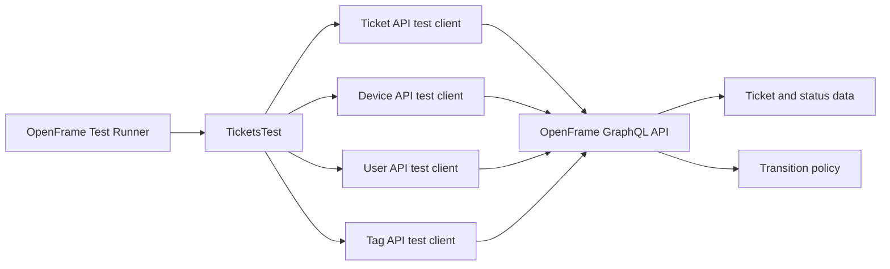
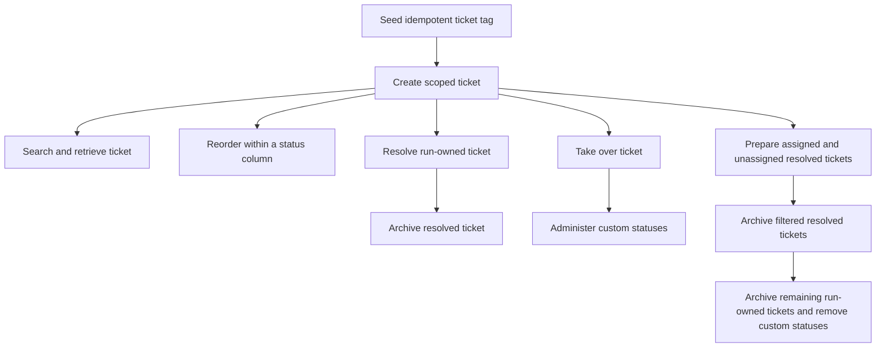
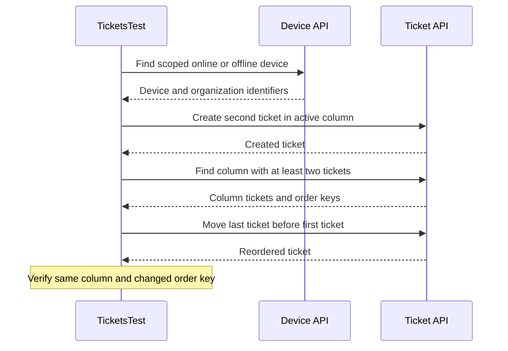
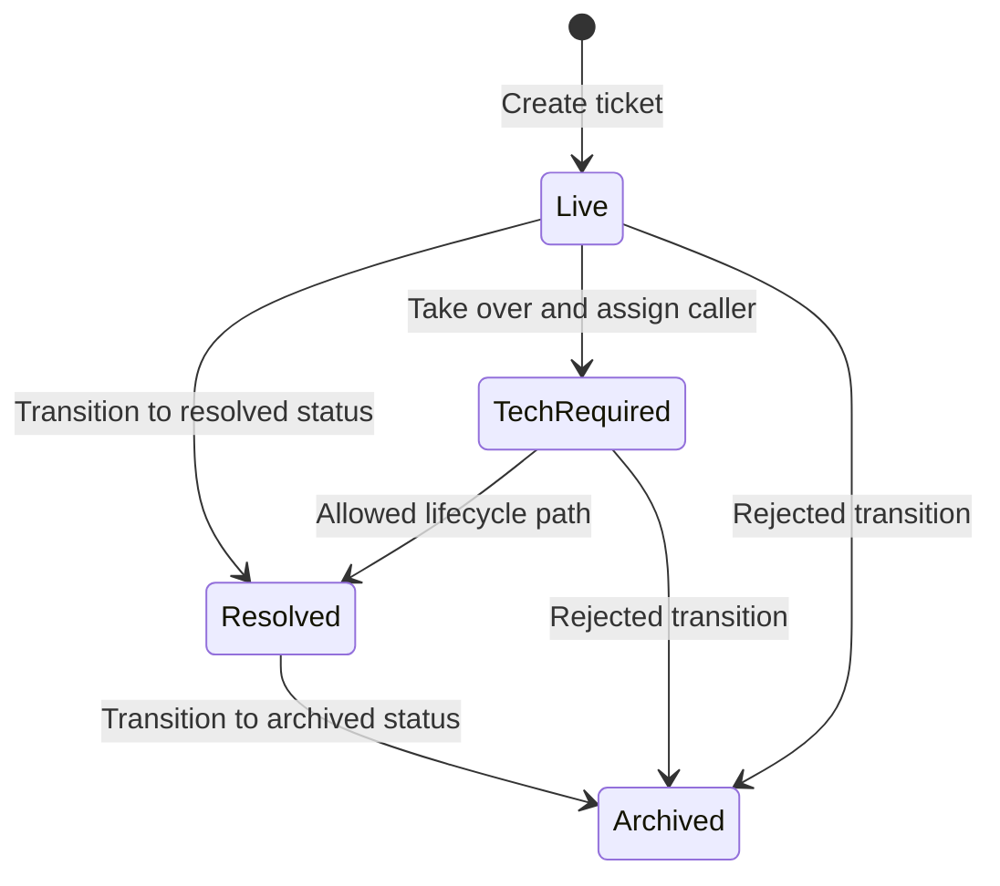
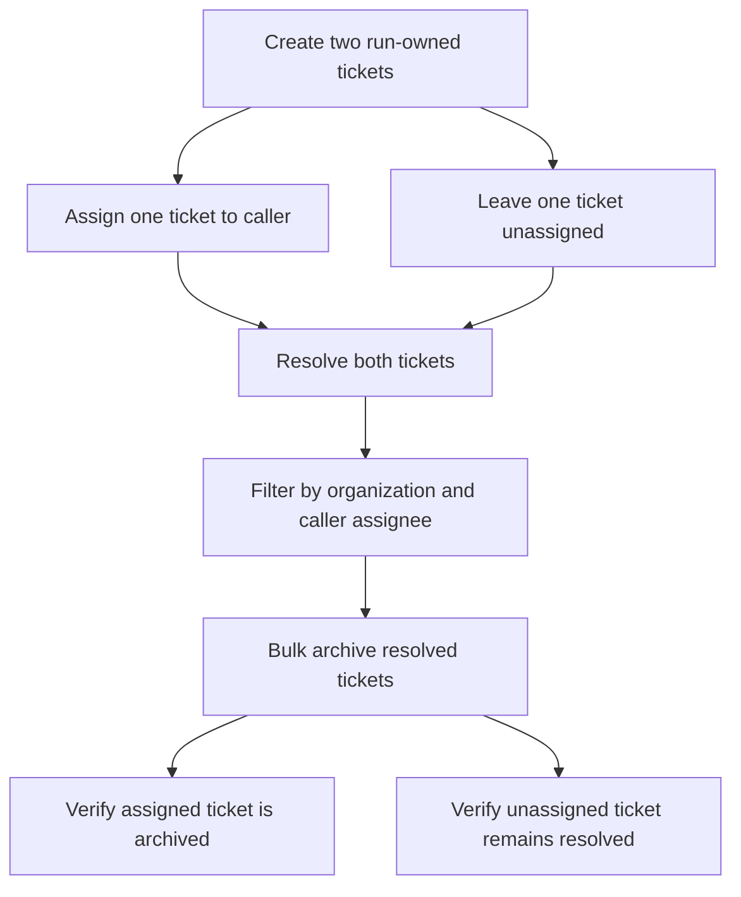

# Ticket Lifecycle And Administration

Ticket Lifecycle And Administration is the lifecycle and administration portion of the OpenFrame end-to-end ticket contract suite. It is implemented by `TicketsTest` in the OpenFrame OSS Library artifact `com.openframe.oss:openframe-test-service-core` version `7.0.11`, and is run by this repository's OpenFrame test service. It verifies observable GraphQL behavior for ticket discovery, creation, board ordering, status transitions, status-definition administration, transition policy, statistics, and filtered bulk archiving.

The implementation is supplied by the OpenFrame OSS Library rather than this repository. See the [TicketsTest source](https://github.com/flamingo-stack/openframe-oss-lib/blob/16e7c1cbd9664e7d10ec5ebca7d53c9bd314decf/openframe-test-service-core/src/main/java/com/openframe/test/tests/TicketsTest.java). For the containing suite, see [Ticket And Time Tracking Tests](ticket-and-time-tracking-tests.md).

## Scope

The module exercises a shared tenant through the test library's API clients, but creates mutable fixtures against a pipeline-scoped organization and one of its devices. This keeps created tickets associated with the current pipeline's data rather than with an arbitrary record in the shared tenant.

The lifecycle-oriented cases cover:

- listing tickets and asserting required display fields;
- finding tickets by title and retrieving a ticket by identifier;
- creating tagged, device-associated tickets with an administrator owner and assignee;
- changing board order within one status-definition column;
- resolving and archiving tickets according to the configured lifecycle;
- taking ownership while changing status atomically;
- creating, editing, ordering, listing, and deleting custom status definitions;
- reading the transition matrix and per-status ticket statistics; and
- archiving resolved tickets in bulk while honoring organization and assignee filters.

The same test class also verifies notes, attachments, ticket edits, assignment, and device or organization unlinking. Those collaboration-oriented checks share the fixture and cleanup mechanisms, but the parent module separates their documentation conceptually from this lifecycle focus.

## Architecture And Dependencies

`TicketsTest` coordinates test-facing clients rather than directly accessing persistence. `TicketApi` is the primary boundary; `DeviceApi`, `UserApi`, and `TagApi` supply compatible references needed to create a valid ticket. Assertions are made against returned ticket DTOs, status definitions, GraphQL errors, and bulk-operation payloads.

The test relies on these integration contracts:

| Dependency | Role in Ticket Lifecycle And Administration |
| --- | --- |
| `TicketApi` | Lists, searches, creates, retrieves, reorders, transitions, takes over, and bulk-archives tickets; it also administers status definitions and reads transition rules and statistics. |
| `DeviceApi` | Finds an online device when possible, falling back to an offline one, scoped to the pipeline organization. The selected device supplies both device and organization identifiers. |
| `UserApi` | Obtains administrator users for assignment and the current caller for ownership and assignee-filtered bulk archive checks. |
| `TagApi` | Seeds the idempotent `QA_TICKET_TAG` ticket tag required by ticket-creation fixtures. |
| Ticket generators and DTOs | Build request filters and mutation inputs, and expose response fields for contract assertions. |
| GraphQL error payloads | Prove invalid lifecycle and protected-system-status operations fail with stable error codes. |

## Fixture Preparation And Test Ordering

The class uses ordered JUnit methods where a later test deliberately depends on data established earlier. It first creates the fixed ticket tag, then creates tickets used for board reordering and lifecycle operations. The bulk-archive scenario explicitly prepares two resolved tickets: one assigned to the caller and another left unassigned.

Tests that need isolation call the internal run-owned fixture helper. That helper chooses a pipeline-scoped device, uses its owning organization, attaches the seeded ticket tag, and records the created ticket for final cleanup. This avoids depending on shared-tenant listing order and ensures cleanup can target records created by the current run.

## Ticket Creation, Retrieval, Search, And Board Ordering

### Creation Contract

A new ticket is created from a request containing the organization identifier, device identifier, assignee, and ticket tag. The suite asserts that the response has an identifier and ticket number; preserves title, description, organization, device, and assignment; includes an administrative owner; and retains the attached tag.

The test intentionally does not assume one literal initial status. Tenants can configure different starting lifecycle kinds. Instead, it requires a populated status definition whose kind is neither `RESOLVED` nor `ARCHIVED`. This makes the contract resilient to lifecycle configuration while still preventing newly created tickets from appearing terminal.

### Read And Search Contract

The list operation must return at least one edge. Each returned ticket is checked for an identifier, ticket number, title, and legacy status field. The test aggregates missing-field details before failing so shared-tenant failures identify the offending ticket within the test runner's log limits.

Search uses the title of an existing ticket and confirms that the result contains that ticket's identifier. A separate retrieval test confirms identifier equality and requires ticket number and owner details on the returned ticket.

### Board Ordering Contract

Ticket order is managed per lifecycle column, identified by the ticket's status-definition identifier. To ensure two ordering anchors exist, the test adds a second active ticket, locates a column containing at least two tickets, and moves the last ticket before the first one.

The response must preserve the moved ticket's identifier and status-definition identifier, return a nonempty order key, and change that key. The test therefore distinguishes valid in-column ordering from unsupported cross-column movement.

## Lifecycle State Model

Status definitions are the lifecycle source of truth. The test does not require the legacy ticket status enum to be synchronized by a transition. Instead, every transition assertion reads `statusDefinition`, checks its identifier, and checks its lifecycle kind.

The system-level contract established by the tests is:

### Resolve And Archive

A run-owned ticket transitions to the system `RESOLVED` definition. The returned ticket must retain its identifier, report the resolved definition and kind, and have `resolvedAt` populated. A resolved ticket can then transition to the system `ARCHIVED` definition.

The negative case attempts to move a newly created non-terminal ticket directly to `ARCHIVED`. It must receive one or more GraphQL errors with code `TICKET_INVALID_TRANSITION`, and a re-read must show that the original status kind was not changed.

### Take Over

Take-over combines assignment and status movement in one operation. The test moves a ticket to the `TECH_REQUIRED` system status while assigning it to the current caller, then re-reads the ticket to prove both changes persisted. Attempting to take over directly into `ARCHIVED` from `TECH_REQUIRED` must fail and leave both status and assignee unchanged.

## Status Definition Administration

Custom statuses are administration data, distinct from system lifecycle statuses. The module validates both categories:

| Operation | Expected contract |
| --- | --- |
| Create custom status | Returns an identifier, requested name and color, `CUSTOM` kind, and `system` set to false. The status appears in the status list. |
| Edit custom status | Keeps the same identifier while updating name and color; it remains non-system. |
| Reorder custom status | Supports moving the first custom status after, then before, a second custom status in the returned status list. |
| Delete unused custom status | Returns success and removes the definition from the list. |
| Delete system status | Is rejected with GraphQL error code `TICKET_STATUS_SYSTEM_PROTECTED`; the system definition remains present. |

The transition-rules query must return a nonempty matrix where every rule identifies a source status. It specifically proves that `RESOLVED` can transition to `ARCHIVED`, while `TECH_REQUIRED` cannot transition directly to `ARCHIVED`.

## Statistics And Scoped Bulk Archive

The statistics query returns a tenant total and counts grouped by status definition. The suite asserts that the total is at least one, every count names a status and is nonnegative, and the sum of per-status counts does not exceed the total.

Bulk archive is validated as a constrained write. The fixture creates and resolves two run-owned tickets in the same organization: one assigned to the caller and one unassigned. The archive request filters by both that organization and the caller's assignee identifier.

The operation must return no user errors and archive at least the caller's prepared ticket. Re-reading both fixtures verifies that the filtered ticket becomes `ARCHIVED` while the unassigned ticket remains `RESOLVED`. This demonstrates that the filter narrows the tenant-wide operation rather than archiving every resolved ticket in the organization.

## Failure Handling And Cleanup

The suite records created tickets and custom status identifiers. The cleanup method uses raw, non-throwing API calls so one cleanup failure does not prevent subsequent cleanup actions. For each run-owned ticket, it obtains the actual lifecycle kind, transitions a non-resolved and non-archived ticket to `RESOLVED`, then transitions a non-archived ticket to `ARCHIVED`. It finally deletes recorded custom statuses.

This design makes test mutations safe to repeat in a shared tenant: fixtures are localized, the ticket tag is idempotent, lifecycle cleanup uses the supported resolved-to-archived path, and custom administration data is removed after use.

## System Placement

Ticket Lifecycle And Administration is a contract-level test module, not the ticket service implementation. It validates the behavior exposed by the platform's GraphQL boundary, spanning authorization of the current caller, ticket and status storage, transition-policy enforcement, board ordering, and GraphQL error mapping. The source class is part of OpenFrame OSS Library's test artifact, while OpenFrame OSS Tenant provides the service environment in which that artifact runs.
